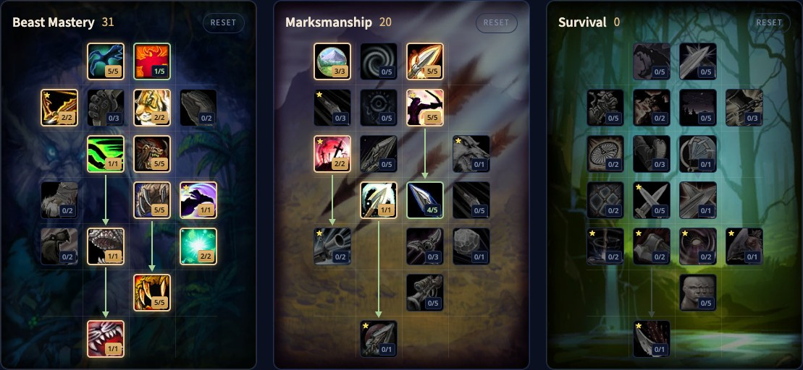

Mit dem Beast Mastery Hunter in WoW Forever erledigen deine Tiere einen großen Teil der Arbeit. Dein Begleiter hält das Monster fest, während du schießt, Summon Hawk bringt zwei Falken in den Kampf, und Bestial Wrath macht deinen Begleiter 18 Sekunden lang unaufhaltsam. Deshalb ist die Spezialisierung solo hervorragend und leicht zu lernen, mit Tiefe im Umgang mit dem Begleiter. Dieser Guide behandelt den Build für Level 60, die Rotation, Begleiter, Mana, Werte und Völker.

| | |
|---|---|
| Rolle | Fernkampfschaden mit einem Begleiter und Falken |
| Build auf Level 60 | 31/20/0: Beast Mastery mit Lethal Attacks, Careful Aim, Rapid Killing und Mortal Shots aus Marksmanship |
| Wichtigste Talente | Deadly Aspects, Focused Fire, Unleashed Fury, Ferocity, Summon Hawk, Frenzy, Bestial Discipline, Bestial Wrath |
| Stärken | Hervorragend solo, einfache Rotation, gleichmäßiger Schaden in Bewegung |
| Schwächen | Hängt vom Begleiter ab, niedrigere Spitze als Marksmanship |
| Leveln | [Leveling-Guide für den Hunter](/de/guides/hunter-leveling/), [Leveling-Build für den Hunter](/de/leveling/hunter/) |

## Stärken und Schwächen

**Hervorragend solo.** Ein starker Begleiter macht Schaden, hält Bedrohung und steckt Treffer ein, also kannst du allein harte Monster und Elites angehen.

**Leicht zu lernen.** Die Rotation ist kurz. Die Kunst liegt beim Begleiter: am Leben halten, am Ziel halten und aus schlechten Stellen holen.

**Gleichmäßiger Schaden.** Dein Begleiter greift weiter an, während du dich bewegst oder eine Mechanik bewältigst.

**Abhängig vom Begleiter.** Ein großer Teil deines Schadens kommt von deinen Tieren. Kämpfe mit viel Bewegung, Zielwechseln oder Flächenschaden kosten dich Schaden, und ein toter Begleiter am meisten.

**Niedrigere Spitze.** Marksmanship und Survival erreichen in manchen Kämpfen höhere Zahlen.

**Die tote Zone.** Zwischen Nahkampfreichweite und 8 Metern kannst du weder Nahkampf noch Fernkampf nutzen. Geh zurück, um wieder zu schießen.

## Der Build für Level 60: 31/20/0

Die Beta endete auf Level 30, aber die Talentbäume für Level 60 stecken in den Spieldateien. Wir haben diesen Build Punkt für Punkt in [unserem Talentrechner](/de/talents/hunter/?t=5120201505101251-30500520014) geprüft: 31 Punkte in Beast Mastery und 20 in Marksmanship, 51 insgesamt.

| Talent | Punkte |
|---|---|
| **Deadly Aspects** | 5/5 |
| **Endurance Training** | 1/5 |
| **Focused Fire** | 2/2 |
| **Pathfinding** | 2/2 |
| **Bestial Swiftness** | 1/1 |
| **Unleashed Fury** | 5/5 |
| **Ferocity** | 5/5 |
| **Summon Hawk** | 1/1 |
| **Intimidation** | 1/1 |
| **Bestial Discipline** | 2/2 |
| **Frenzy** | 5/5 |
| **Bestial Wrath** | 1/1 |
| **Hawk Eye** (Marksmanship) | 3/3 |
| **Lethal Attacks** (Marksmanship) | 5/5 |
| **Careful Aim** (Marksmanship) | 5/5 |
| **Rapid Killing** (Marksmanship) | 2/2 |
| **Trueshot Aura** (Marksmanship) | 1/1 |
| **Mortal Shots** (Marksmanship) | 4/5 |

Ein paar Punkte lassen sich verschieben:

- **Endurance Training** zu **Improved Revive Pet**, wenn du deinen Begleiter oft wiederbelebst.
- **Hawk Eye** zu **Efficiency**, wenn du die zusätzliche Reichweite nicht brauchst und günstigere Schüsse willst.
- **Trueshot Aura** zum letzten Punkt von **Mortal Shots**, wenn ein Marksmanship-Hunter in deinem Schlachtzug die Aura schon mitbringt.
- **Summon Hawk** zu **Endurance Training** oder **Improved Revive Pet**, wenn deine Falken ständig sterben, bevor ihre Zeit um ist.

## Was die wichtigsten Talente tun

| Talent | Was es in Forever tut |
|---|---|
| **Deadly Aspects** | Mit Aspect of the Hawk hat Auto Shot 10 % Chance, dein Fernkampftempo 12 Sekunden lang um 30 % zu erhöhen |
| **Focused Fire** | Du und dein Begleiter verursachen 2 % mehr Schaden, solange der Begleiter da ist |
| **Unleashed Fury** | Deine Begleiter und Falken verursachen 15 % mehr Schaden |
| **Ferocity** | Deine Begleiter und Falken erhalten 10 % mehr kritische Trefferchance |
| **Summon Hawk** | Ein Falke greift dein Ziel 18 Sekunden lang an; zwei können gleichzeitig aktiv sein; teilt sich die Abklingzeit mit Arcane Shot |
| **Intimidation** | Der nächste Treffer deines Begleiters betäubt 3 Sekunden und hat 100 % mehr kritische Trefferchance |
| **Bestial Discipline** | 50 % deiner Manaregeneration laufen beim Wirken weiter, und dein Begleiter regeneriert Fokus 20 % schneller |
| **Frenzy** | Dein Begleiter erhält nach einem kritischen Treffer 8 Sekunden lang 30 % Angriffstempo |
| **Bestial Wrath** | Dein Begleiter verursacht 18 Sekunden lang 50 % mehr Schaden und ist durch Kontrolle nicht aufzuhalten |
| **Lethal Attacks** | 5 % mehr kritische Trefferchance mit allen Angriffen |
| **Careful Aim** | Angriffskraft in Höhe von 100 % deiner Intelligenz |
| **Rapid Killing** | Rapid Fire ist 2 Minuten früher bereit, und ein Kill gibt deinem nächsten Schuss mehr Schaden |
| **Mortal Shots** | Kritische Treffer von Fernkampffähigkeiten verursachen mehr Zusatzschaden |

## Rotation

### Ein Ziel

1. Leg eine Immolation Trap dorthin, wo der Tank stehen wird, wenn möglich.
2. Wirk Aimed Shot zum Start des Pulls und erneut, sobald er bereit ist.
3. Wirk Serpent Sting und erneuere ihn, wenn er ausläuft.
4. Wirk Summon Hawk, sobald er bereit ist.
5. Wirk Arcane Shot erst, wenn zwei Falken mit mindestens 6 Sekunden Restzeit da sind, und geh dann zurück zu Summon Hawk, um zwei zu halten.
6. Wirk Rapid Fire und Bestial Wrath bei Abklingzeit.

### Mehrere Ziele

1. Leg eine Explosive Trap dorthin, wo der Tank stehen wird, wenn möglich.
2. Wirk Multi-Shot, sobald er bereit ist.
3. Setz Serpent Sting auf jedes Ziel, das lange genug lebt.
4. Halte zwei Falken mit Summon Hawk, und wirk Arcane Shot nur, wenn beide noch 6 Sekunden haben.
5. Leg Explosive Trap bei Abklingzeit unter die Gruppe.
6. Wirk Rapid Fire und Bestial Wrath bei Abklingzeit.

## Abklingzeiten und Nutzen

- **Rapid Fire** und **Bestial Wrath** sind deine Schadensabklingzeiten. Bestial Wrath lässt deinen Begleiter auch durch Kontrolle weiterkämpfen.
- **Frost Trap**, **Freezing Trap**, **Wing Clip** und **Concussive Shot** verlangsamen, fesseln oder nehmen Monster aus dem Kampf. **Explosive Trap** und **Immolation Trap** verursachen Schaden und teilen sich eine Abklingzeit von 30 Sekunden.
- **Intimidation** betäubt und gibt deinem Begleiter einen sicheren kritischen Treffer.
- **Feign Death** bringt dich aus dem Kampf, rettet dein Leben und hilft, Monster zu deiner Gruppe zu ziehen.
- **Scorpid Sting** senkt jetzt 20 Sekunden lang die Trefferchance des Ziels um 2 %. Er stapelt nicht mit der Trefferverringerung von Insect Swarm, zählt also weniger mit einem Balance Druid in der Gruppe.
- **Tranquilizing Shot** entfernt Enrage- und Frenzy-Effekte, was im Schlachtzug große Schadensspitzen verhindern kann.
- **Aspekte:** Hawk für Fernkampfangriffskraft, Monkey für 8 % Ausweichen, Cheetah und Pack für 30 % Tempo mit dem Risiko, bei einem Treffer benommen zu werden, Wild für Naturwiderstand. Immer nur einer aktiv. Bleib im Kampf in Aspect of the Hawk und geh zu Fuß.

## Begleiter und Mana

Dein Begleiter ist ein großer Teil deines Schadens, also halte ihn am Leben und am Ziel. Nutze **Stay** und **Move To**, um ihn aus Flächenschaden zu holen. Jede Familie bringt andere Fähigkeiten, wie Demoralizing Screech oder Dust Cloud, also halte ein paar Begleiter im Stall und wähl einen pro Kampf.

**Mana.** Bestial Discipline hält die Hälfte deiner Manaregeneration beim Wirken aufrecht. Leerlaufen hindert dich nicht daran, einen Kampf zu beenden, weil dein Begleiter weiterkämpft, kostet aber Schaden.

## Werte und Ausrüstung

Wertprioritäten für Level 60 folgen nach dem Start. Bis dahin:

- **Beweglichkeit**: 2 Fernkampfangriffskraft pro Punkt und kritische Trefferchance, etwa 1 % pro 53 Beweglichkeit auf Level 60. Dein Begleiter erhält 100 % deiner kritischen Trefferchance und 10 % deiner Angriffskraft.
- **Trefferwertung**: Gegen einen Boss der Stufe 63 brauchst du 9 % mit 300 Waffenfertigkeit oder 6 % mit 305.
- **Kritische Trefferchance**, die auch für deinen Begleiter zählt.
- **Angriffskraft**, die Beweglichkeit Punkt für Punkt meist schlägt.
- **Tempo**, damit deine Fähigkeiten früher bereit sind.
- **Intelligenz**, für Mana und über Careful Aim auch für Angriffskraft.
- **Willenskraft**, für Manaregeneration zusammen mit Bestial Discipline.

**Rüstung.** Leder und Kette funktionieren beide, wie in Classic. Leatherworking hat gute Muster beim Leveln, und Dungeons bieten Verbesserungen.

**Köcher oder Munitionsbeutel.** Pfeile kommen in einen Köcher, Kugeln in einen Munitionsbeutel, und beide erhöhen dein Fernkampftempo. Halte ihn aktuell.

**Waffen.** Deine Fernkampfwaffe ist deine wichtigste Quelle für eigenen Schaden. Die Nahkampfwaffe trägst du vor allem für die Werte. Hunter können fast jeden Waffentyp nutzen, außer Streitkolben.

## Völker und Berufe

| Fraktion | Volk | Warum |
|---|---|---|
| Alliance | Skyborne | Ein Tempobonus, selten auf Ausrüstung, die stärkste Wahl |
| Alliance | Human | 2 % mehr kritische Trefferchance, die auch dein Begleiter erhält |
| Alliance | Dwarf | 2 % mehr kritischer Schaden |
| Alliance | Night Elf | Eine Abklingzeit für kritische Trefferchance |
| Horde | Skyborne | Ein Tempobonus und eine Abklingzeit für Bewegungstempo |
| Horde | Orc | Eine Abklingzeit für Angriffskraft und 1 % mehr kritische Trefferchance |
| Horde | Troll | Mehr Schaden gegen Wildtiere und eine Abklingzeit für Angriffstempo |
| Horde | Tauren | Eine Flächenbetäubung, mehr kritischer Schaden und Plainsrunning für Tempo ohne Benommenheit |

Die Unterschiede sind klein, also spiel das Volk, das dir gefällt.

**Leatherworking** stellt gute Lederausrüstung her, teils nur für Lederer. **Engineering** bringt Gadgets und Zielfernrohre für deine Fernkampfwaffe. **Alchemy** mit Herbalism versorgt dich mit Tränken und Elixieren, und **Enchanting** hält deine Ausrüstung verzaubert.
