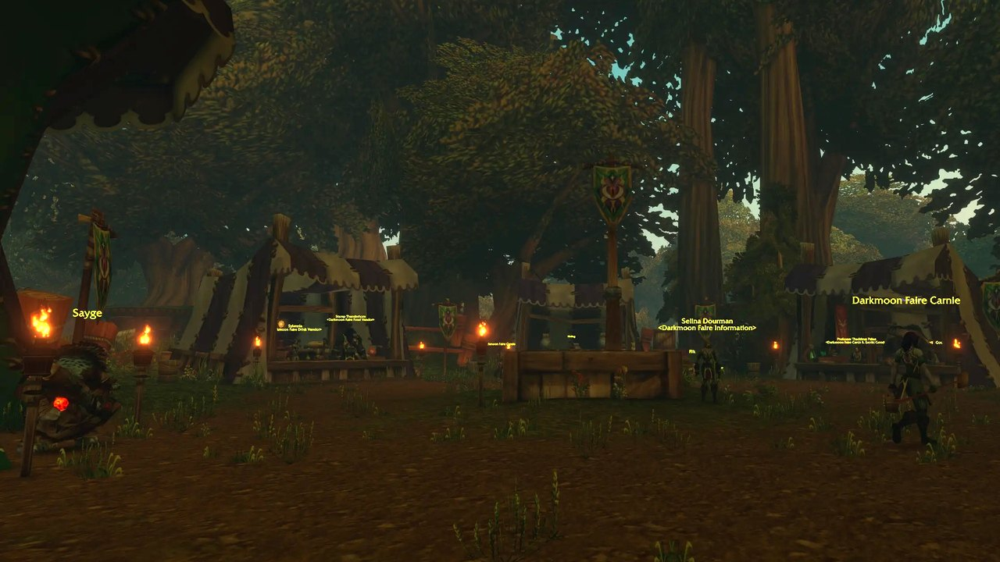

Die Darkmoon Faire ist ein reisender Jahrmarkt, der eine Woche im Monat nach Azeroth kommt. In WoW Forever funktioniert sie weitgehend wie in Classic: ein starker Buff von Sayge, Lose für Abgaben, eine Tasche mit 14 Plätzen, drei Frösche als Haustier und vier Decks, die zu epischen Schmuckstücken werden.

| | |
|---|---|
| **Wann** | einmal im Monat, eine Woche lang |
| **Wo** | Elwynn Forest oder Mulgore, im Wechsel |
| **Buff** | Sayge, 2 Stunden, alle 4 Stunden |
| **Beste Belohnung** | <a class="wf-wh wf-q1" href="https://www.wowhead.com/forever/item=19291">Darkmoon Storage Box</a>, 14 Plätze, 50 Lose |

## Wann und wo

Die Faire öffnet am Montag nach dem ersten Samstag des Monats und bleibt eine Woche. Der Kalender im Spiel zeigt Beginn und Ende um 4.00 Uhr Realmzeit, auf europäischen Realms also 4.00 Uhr belgischer Zeit. Die Schausteller bauen die Zelte schon ein paar Tage vorher auf.

| Monat | Wo | Termine |
|---|---|---|
| November 2026 | Elwynn Forest | 9. bis 15. November |
| Dezember 2026 | Mulgore | 7. bis 13. Dezember |
| Januar 2027 | Elwynn Forest | 4. bis 10. Januar |
| Februar 2027 | Mulgore | 8. bis 14. Februar |
| März 2027 | Elwynn Forest | 8. bis 14. März |
| April 2027 | Mulgore | 5. bis 11. April |

Der DMF-Knopf in der Leiste oben auf der Seite zählt bis zur nächsten Faire herunter.

- **Elwynn Forest:** knapp südlich von Goldshire, bei `/way 42 69`. Spieler der Alliance folgen der Straße von Stormwind. Die Horde nimmt den Zeppelin nach Stranglethorn Vale und reitet durch Duskwood nach Norden.
- **Mulgore:** am Fuß des Aufzugs nach Thunder Bluff, bei `/way 37 38`. Die Horde fährt mit dem Aufzug hinunter. Die Alliance nimmt das Schiff von Booty Bay nach Ratchet und läuft durch The Barrens nach Westen.

Auf der Faire gibt es keine Wachen, aber die Zone gehört einer Fraktion. Auf dem PvP-Ruleset wirst du beim Betreten für PvP markiert, rechne also mit Kämpfen am Eingang.

## Sayges Weissagungen

<a class="wf-wh wf-plain" href="https://www.wowhead.com/forever/npc=14822">Sayge</a> stellt dir neben seinem kleinen Zelt zwei Fragen. Deine Antworten bestimmen den Buff. Er hält 2 Stunden, endet beim Tod, und einen neuen gibt es erst nach 4 Stunden. Die meisten Spieler nehmen 10 % Schaden: zweimal die erste Antwort.

| Antworten | Buff | Geht auch |
|---|---|---|
| **1 und 1** | <a class="wf-wh wf-spell" href="https://www.wowhead.com/forever/spell=23768">Sayge's Dark Fortune of Damage</a>, 10 % Schaden | |
| **1 und 2** | <a class="wf-wh wf-spell" href="https://www.wowhead.com/forever/spell=23769">Sayge's Dark Fortune of Resistance</a>, 25 auf alle Widerstände | 2 und 3 |
| **1 und 3** | <a class="wf-wh wf-spell" href="https://www.wowhead.com/forever/spell=23767">Sayge's Dark Fortune of Armor</a>, 10 % Rüstung | 4 und 3 |
| **2 und 1** | <a class="wf-wh wf-spell" href="https://www.wowhead.com/forever/spell=23738">Sayge's Dark Fortune of Spirit</a>, 10 % Spirit | 4 und 2 |
| **2 und 2** | <a class="wf-wh wf-spell" href="https://www.wowhead.com/forever/spell=23766">Sayge's Dark Fortune of Intelligence</a>, 10 % Intellect | 4 und 1 |
| **3 und 1** | <a class="wf-wh wf-spell" href="https://www.wowhead.com/forever/spell=23737">Sayge's Dark Fortune of Stamina</a>, 10 % Stamina | |
| **3 und 2** | <a class="wf-wh wf-spell" href="https://www.wowhead.com/forever/spell=23735">Sayge's Dark Fortune of Strength</a>, 10 % Strength | |
| **3 und 3** | <a class="wf-wh wf-spell" href="https://www.wowhead.com/forever/spell=23736">Sayge's Dark Fortune of Agility</a>, 10 % Agility | |

Weltbuffs wirken in WoW Forever nicht in Raids, nur in der offenen Welt und in Dungeons. Die englischen Texte jeder Antwort stehen in [unserem Beitrag zur ersten Faire](/de/news/a-14-slot-bag-waits-at-the-darkmoon-faire/).

Mit dem Buff bekommst du auch eine Darkmoon Faire Fortune. Öffne sie für eine nummerierte Weissagung. Einige starten die Quest Your Fortune Awaits You..., die zu einer Truhe mit einer Mysterious Lockbox führt: Essen, Material oder Tränke für deine Stufe, dazu etwas Erfahrung und Ruf.

## Lose und Abgaben

Halte auf dem Festplatz nach blauen Fragezeichen Ausschau. Das sind wiederholbare Quests, die Gegenstände in Darkmoon Prize Tickets verwandeln. Jede Stufe gibt 250 Ruf bei der Darkmoon Faire und endet bei einer Rufgrenze, du arbeitest dich also von der ersten zur letzten Stufe hoch. Die letzte bleibt bis zum Ende von Exalted offen.

**<a class="wf-wh wf-plain" href="https://www.wowhead.com/forever/npc=14832">Kerri Hicks</a>, Blacksmithing.** Bringt die meisten Lose pro Goldstück.

| Abgabe | Lose | Bis |
|---|---|---|
| **10 <a class="wf-wh wf-q1" href="https://www.wowhead.com/forever/item=3240">Coarse Weightstone</a>** | 1 | 500 |
| **7 <a class="wf-wh wf-q1" href="https://www.wowhead.com/forever/item=3486">Heavy Grinding Stone</a>** | 4 | 1100 |
| **3 <a class="wf-wh wf-q2" href="https://www.wowhead.com/forever/item=3835">Green Iron Bracers</a>** | 8 | 1700 |
| **1 <a class="wf-wh wf-q2" href="https://www.wowhead.com/forever/item=7945">Big Black Mace</a>** | 12 | 2500 |
| **8 <a class="wf-wh wf-q1" href="https://www.wowhead.com/forever/item=12644">Dense Grinding Stone</a>** | 20 | Exalted |

**<a class="wf-wh wf-plain" href="https://www.wowhead.com/forever/npc=14841">Rinling</a>, Engineering.**

| Abgabe | Lose | Bis |
|---|---|---|
| **5 <a class="wf-wh wf-q1" href="https://www.wowhead.com/forever/item=4363">Copper Modulator</a>** | 1 | 500 |
| **7 <a class="wf-wh wf-q1" href="https://www.wowhead.com/forever/item=4375">Whirring Bronze Gizmo</a>** | 4 | 1100 |
| **36 <a class="wf-wh wf-q1" href="https://www.wowhead.com/forever/item=9313">Green Firework</a>** | 8 | 1700 |
| **6 <a class="wf-wh wf-q1" href="https://www.wowhead.com/forever/item=11590">Mechanical Repair Kit</a>** | 12 | 2500 |
| **6 <a class="wf-wh wf-q1" href="https://www.wowhead.com/forever/item=15994">Thorium Widget</a>** | 20 | Exalted |

**<a class="wf-wh wf-plain" href="https://www.wowhead.com/forever/npc=14833">Chronos</a>, Leatherworking.**

| Abgabe | Lose | Bis |
|---|---|---|
| **3 <a class="wf-wh wf-q2" href="https://www.wowhead.com/forever/item=2309">Embossed Leather Boots</a>** | 1 | 500 |
| **3 <a class="wf-wh wf-q2" href="https://www.wowhead.com/forever/item=2314">Toughened Leather Armor</a>** | 4 | 1100 |
| **3 <a class="wf-wh wf-q2" href="https://www.wowhead.com/forever/item=5739">Barbaric Harness</a>** | 8 | 1700 |
| **1 <a class="wf-wh wf-q2" href="https://www.wowhead.com/forever/item=8185">Turtle Scale Leggings</a>** | 12 | 2500 |
| **8 <a class="wf-wh wf-q1" href="https://www.wowhead.com/forever/item=15564">Rugged Armor Kit</a>** | 20 | Exalted |

**<a class="wf-wh wf-plain" href="https://www.wowhead.com/forever/npc=14829">Yebb Neblegear</a>, Tierteile.** Gut für Spieler ohne Herstellungsberuf.

| Abgabe | Lose | Bis |
|---|---|---|
| **5 <a class="wf-wh wf-q1" href="https://www.wowhead.com/forever/item=5134">Small Furry Paw</a>** | 1 | 500 |
| **5 <a class="wf-wh wf-q1" href="https://www.wowhead.com/forever/item=11407">Torn Bear Pelt</a>** | 4 | 1100 |
| **5 <a class="wf-wh wf-q1" href="https://www.wowhead.com/forever/item=4582">Soft Bushy Tail</a>** | 8 | 1700 |
| **5 <a class="wf-wh wf-q1" href="https://www.wowhead.com/forever/item=5117">Vibrant Plume</a>** | 12 | 2500 |
| **10 <a class="wf-wh wf-q1" href="https://www.wowhead.com/forever/item=11404">Evil Bat Eye</a>** | 20 | Exalted |
| **10 <a class="wf-wh wf-q1" href="https://www.wowhead.com/forever/item=19933">Glowing Scorpid Blood</a>** | 20 | Exalted |

## Belohnungen

<a class="wf-wh wf-plain" href="https://www.wowhead.com/forever/npc=14828">Gelvas Grimegate</a> verkauft die Belohnungen gegen Lose.

| Belohnung | Lose |
|---|---|
| **<a class="wf-wh wf-q1" href="https://www.wowhead.com/forever/item=19295">Darkmoon Flower</a>**, Nebenhand | 5 |
| **<a class="wf-wh wf-q2" href="https://www.wowhead.com/forever/item=19298">Minor Darkmoon Prize</a>** | 5 |
| **<a class="wf-wh wf-q1" href="https://www.wowhead.com/forever/item=19292">Last Month's Mutton</a>**, Einhandstreitkolben | 10 |
| **<a class="wf-wh wf-q2" href="https://www.wowhead.com/forever/item=19297">Lesser Darkmoon Prize</a>** | 12 |
| **<a class="wf-wh wf-q2" href="https://www.wowhead.com/forever/item=19296">Greater Darkmoon Prize</a>** | 40 |
| **<a class="wf-wh wf-q1" href="https://www.wowhead.com/forever/item=22729">Schematic: Steam Tonk Controller</a>** | 40 |
| **<a class="wf-wh wf-q1" href="https://www.wowhead.com/forever/item=19291">Darkmoon Storage Box</a>**, 14 Plätze | 50 |
| **<a class="wf-wh wf-q1" href="https://www.wowhead.com/forever/item=19293">Last Year's Mutton</a>**, Einhandstreitkolben | 50 |
| **<a class="wf-wh wf-q4" href="https://www.wowhead.com/forever/item=19491">Amulet of the Darkmoon</a>**, Hals | 1.200 |
| **<a class="wf-wh wf-q4" href="https://www.wowhead.com/forever/item=19426">Orb of the Darkmoon</a>**, Hals | 1.200 |

Die drei Preispakete enthalten zufällige Gegenstände. Der Minor-Preis enthält Ausrüstung der Stufe 21 bis 25 oder eine Tasche mit 10 Plätzen. Der Lesser-Preis enthält Ausrüstung der Stufe 31 bis 35, Edelsteine oder eine Tasche mit 12 Plätzen. Der Greater-Preis enthält Ausrüstung der Stufe 46 bis 50, Edelsteine oder Rezepte.

Ruf bei der Darkmoon Faire senkt nur die Preise ihrer Händler. Das Talent Diplomat aus dem [Legacy-System](/de/news/you-can-spend-16-legacy-points-and-earn-more-for-a-bear/) erhöht, was du verdienst.

## Frösche

| Haustier | Wie |
|---|---|
| **<a class="wf-wh wf-q1" href="https://www.wowhead.com/forever/item=11027">Wood Frog Box</a>** | bei <a class="wf-wh wf-plain" href="https://www.wowhead.com/forever/npc=14860">Flik</a> zu kaufen, begrenzter Vorrat |
| **<a class="wf-wh wf-q1" href="https://www.wowhead.com/forever/item=11026">Tree Frog Box</a>** | bei <a class="wf-wh wf-plain" href="https://www.wowhead.com/forever/npc=14860">Flik</a> zu kaufen |
| **Jubling** | Quest von <a class="wf-wh wf-plain" href="https://www.wowhead.com/forever/npc=14871">Morja</a> |

Flik ist der Orkjunge, der auf dem Festplatz einem Frosch hinterherjagt. Beide Froschkisten sind handelbar. Er verkauft auch den <a class="wf-wh wf-q1" href="https://www.wowhead.com/forever/item=18662">Heavy Leather Ball</a>.

Für den Jubling kaufst du zwei <a class="wf-wh wf-q1" href="https://www.wowhead.com/forever/item=11325">Dark Iron Ale Mug</a> bei Plugger Spazzring im Grim Guzzler von [Blackrock Depths](/de/guides/dungeons/blackrock-depths/). Bring sie zu Morja bei den Wagen und stell einen Krug neben ihr auf den Boden. Ihr Frosch Jubjub hüpft hin, und sie bietet Spawn of Jubjub an. Gib den zweiten Krug ab für ein <a class="wf-wh wf-q1" href="https://www.wowhead.com/forever/item=19462">Unhatched Jubling Egg</a>, das nach sieben Tagen zu <a class="wf-wh wf-q1" href="https://www.wowhead.com/forever/item=19450">A Jubling's Tiny Home</a> schlüpft. Kurz nachdem der erste Krug steht, können alle Spieler in der Nähe die Quest annehmen.

## Darkmoon-Decks und Schmuckstücke

Darkmoon-Karten fallen bei Gegnern der Stufe 45 bis 60 überall in Azeroth. Ein Deck braucht das Ass und die Karten 2 bis 8. Die nummerierten Karten fallen bei Humanoiden und Untoten, das Ass bei ein paar festen Gegnern. Karten und Decks sind handelbar, das Schmuckstück nicht. Gib das Deck bei <a class="wf-wh wf-plain" href="https://www.wowhead.com/forever/npc=14847">Professor Thaddeus Paleo</a> ab.

| Deck | Ass fällt bei | Schmuckstück |
|---|---|---|
| **<a class="wf-wh wf-q4" href="https://www.wowhead.com/forever/item=19228">Beasts Deck</a>** | The Beast in Upper Blackrock Spire | <a class="wf-wh wf-q4" href="https://www.wowhead.com/forever/item=19288">Darkmoon Card: Blue Dragon</a> |
| **<a class="wf-wh wf-q4" href="https://www.wowhead.com/forever/item=19267">Elementals Deck</a>** | Avalanchion in Azshara, Hydrospawn in Dire Maul, Lord Incendius in Blackrock Depths, The Windreaver in Silithus | <a class="wf-wh wf-q4" href="https://www.wowhead.com/forever/item=19289">Darkmoon Card: Maelstrom</a> |
| **<a class="wf-wh wf-q4" href="https://www.wowhead.com/forever/item=19277">Portals Deck</a>** | Darkmaster Gandling in Scholomance | <a class="wf-wh wf-q4" href="https://www.wowhead.com/forever/item=19290">Darkmoon Card: Twisting Nether</a> |
| **<a class="wf-wh wf-q4" href="https://www.wowhead.com/forever/item=19257">Warlords Deck</a>** | King Gordok in Dire Maul | <a class="wf-wh wf-q4" href="https://www.wowhead.com/forever/item=19287">Darkmoon Card: Heroism</a> |

## Minispiele

Zwei Spiele gibt es nur zum Spaß, ohne Belohnung.

- **Tonk Control Console:** Stell dich an eine Konsole am Boden und steuere 5 Minuten lang einen Steam Tonk. Kämpfe mit der Kanone gegen andere Tonks, plus eine Zusatzfähigkeit je Konsole, etwa einen Flammenwerfer, eine Mine oder einen Schild.
- **Blastenheimer 5000 Ultra Cannon:** schießt dich mit Magic Wings über die Zone. Brich den Buff ab, um zu fallen, und versuch, im schwebenden Ring im Teich zu landen. Die Kanone steht neben dem Festplatz in Elwynn Forest oder am Rand der Lower Rise in Thunder Bluff.

## Händler

| Händler | Verkauft |
|---|---|
| **<a class="wf-wh wf-plain" href="https://www.wowhead.com/forever/npc=14844">Sylannia</a>** | Getränke |
| **<a class="wf-wh wf-plain" href="https://www.wowhead.com/forever/npc=14845">Stamp Thunderhorn</a>** | Essen |
| **<a class="wf-wh wf-plain" href="https://www.wowhead.com/forever/npc=14847">Professor Thaddeus Paleo</a>** | Fläschchen für Alchemy, ein paar Tränke und Schriftrollen |
| **<a class="wf-wh wf-plain" href="https://www.wowhead.com/forever/npc=14846">Lhara</a>** | Salz, dazu etwas Leder, Kräuter und Ausrüstung |
| **<a class="wf-wh wf-plain" href="https://www.wowhead.com/forever/npc=14828">Gelvas Grimegate</a>** | Belohnungen gegen Lose |
| **<a class="wf-wh wf-plain" href="https://www.wowhead.com/forever/npc=14860">Flik</a>** | Frösche und einen Ball |
