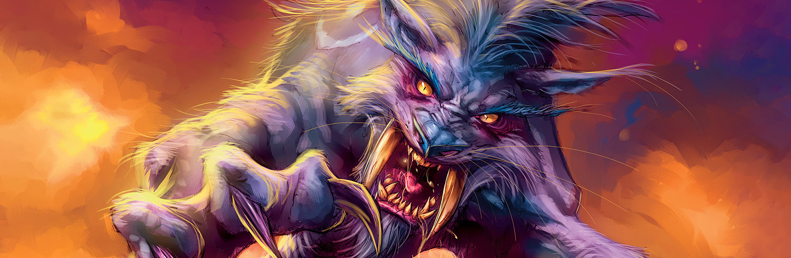

Der Druid kann in WoW Forever fast alles: als Bär tanken, als Katze oder aus der Ferne Schaden machen, und heilen. Er bewegt sich auch schneller durch die Welt als jede andere Klasse. Auf Level 30 wählst du zwischen Feral, zwei Arten Balance und Restoration. Dieser Guide behandelt die vier Builds, die Rotation, wichtige Level, die Klassenquests, Waffen und Berufe.

| | |
|---|---|
| Einfachste Spezialisierung zum Leveln | Feral, in Cat Form |
| Wichtige Talente | Ferocity, Feral Charge, Predatory Strikes, Leader of the Pack, Overgrowth |
| Stärken | Mobilität, Stealth, Selbstheilung, kann tanken und heilen |
| Schwächen | Langsamer Start vor Cat Form, Mana für jeden Gestaltwechsel |
| Talent pro Level | [Levelbuild für den Druid](/de/leveling/druid/) |
| Builds bis Level 60 | Nach dem Launch am 4. November |

## Mit welcher Spezialisierung leveln

Die ersten 20 Level ändern viel. Du beginnst mit Wrath, bekommst Bear Form auf 10 und Cat Form auf 20. Der Start ist etwas langsam, aber ab Cat Form geht es schnell.

**Feral** ist der flüssigste Weg. Eine Katze muss kaum für Mana oder Heilung anhalten, und Prowl, Dash und Feral Swiftness bringen dich von einer Quest zur nächsten. Derselbe Build tankt auch in Bear Form. **Balance mit Overgrowth** wurzelt bis zu drei Monster fest und lässt Schaden über Zeit die Arbeit machen: effizient, aber anspruchsvoller. **Balance mit Eclipse** bleibt bei Wrath und Starfire auf einem Ziel, langsamer, aber sicherer. **Restoration** tötet langsam; nimm es nur, wenn du vor allem Dungeons heilen willst.

Die Builds unten sind für die Beta gemacht, die auf Level 30 endet. Jeder Build hat eine Version mit fünf zusätzlichen Punkten für Talented aus dem Legacy-System. Der Talentrechner zeigt diese Versionen als Level 35, weil er jeden Punkt als Level zählt. Builds für Level 60 folgen nach dem Launch. Skyborne-Druids haben außerdem eine Route Schritt für Schritt durch ihr Startgebiet, von [Level 1 bis 6](/de/guides/leveling/skyborne-druid-1-6/).

## Level 1 bis 10

Du hast noch keine Talente und keine Gestalten, nur <a class="wf-wh wf-spell" href="https://www.wowhead.com/forever/spell=5176">Wrath</a> und <a class="wf-wh wf-spell" href="https://www.wowhead.com/forever/spell=5185">Healing Touch</a>. <a class="wf-wh wf-spell" href="https://www.wowhead.com/forever/spell=8921">Moonfire</a> folgt auf 4, <a class="wf-wh wf-spell" href="https://www.wowhead.com/forever/spell=467">Thorns</a> auf 6 und Entangling Roots auf 8.

1. Halte Thorns auf dir.
2. Pulle mit Wrath.
3. Setze Moonfire auf das Monster.
4. Wirke Wrath, bis das Monster fast tot ist oder dein Mana knapp wird.
5. Erledige es mit deiner Waffe.

Zum Entkommen nutzt du <a class="wf-wh wf-spell" href="https://www.wowhead.com/forever/spell=16689">Nature's Grasp</a>, das jeder Druid in Forever auf Level 10 lernt. Heile dich bei Bedarf mit Healing Touch.

Werte auf diesen Leveln: Intellect und Zauberschaden, dann Stamina und Spirit, dann Rüstung.

## Feral-Build für Level 30

Funktioniert für Katze und Bär zugleich. Er erhöht deinen Schaden, gibt deiner Gruppe Leader of the Pack und macht dich mit Feral Swiftness und Feral Charge schneller. [Den Build im Talentrechner öffnen](/de/talents/druid/?t=-5320000212003201).

| Talent | Punkte |
|---|---|
| **Ferocity** | 5/5 |
| **Heart of the Wild** | 3/5 |
| **Feral Swiftness** | 2/2 |
| **Savage Fury** | 2/2 |
| **Feral Charge** | 1/1 |
| **Sharpened Claws** | 2/2 |
| **Predatory Strikes** | 3/3 |
| **Blood Frenzy** | 2/2 |
| **Leader of the Pack** | 1/1 |

Mit Talented: Heart of the Wild 5/5 und Furor 3/5 in Restoration. [Die Version mit Talented öffnen](/de/talents/druid/?t=-5520000212003201-03).

Der Build überspringt Shredding Attacks, weil du allein selten hinter ein Monster kommst, um Shred zu nutzen. Willst du Shifting Power ausprobieren? Setze dort Punkte. Feral Instinct macht Prowl schwerer zu entdecken, und Primal Bite hilft einem Bären, die Bedrohung zu halten.

**Als Katze:**

1. Halte Thorns auf dir.
2. Nutze Faerie Fire, um die Rüstung zu senken oder aus der Ferne zu pullen.
3. Baue Combo Points mit Claw auf, oder mit Shred, wenn du hinter dem Monster stehst.
4. Nutze Shifting Power unter 50 Energy, wenn du es genommen hast.
5. Nutze Rip bei 4 oder 5 Combo Points.
6. Setze Rake auf das Monster. Lass die Blutungen weg, wenn es gleich stirbt.
7. Erledige es mit Shred oder Claw.

**Als Bär:**

1. Halte Thorns auf dir.
2. Nutze Faerie Fire für den Schwächungseffekt oder um aus der Ferne zu pullen. In Bear Form erzeugt es jetzt Bedrohung.
3. Nutze Demoralizing Roar.
4. Nutze Primal Bite, sobald es bereit ist, wenn du es genommen hast.
5. Nutze Swipe gegen mehrere Monster und Maul gegen eines.

Werte ab hier: Strength, Agility und Attack Power, dann Stamina, Intellect und Spirit, dann Rüstung.

## Balance-Build mit Overgrowth für Level 30

Stärkt deinen Schaden über Zeit und Entangling Roots, sodass du mehrere Monster zugleich zermürbst. Sehr effizient, aber hektischer und riskanter. [Den Build im Talentrechner öffnen](/de/talents/druid/?t=513222311001).

| Talent | Punkte |
|---|---|
| **Improved Wrath** | 5/5 |
| **Genesis** | 1/5 |
| **Moonglow** | 3/3 |
| **Improved Moonfire** | 2/2 |
| **Nature's Majesty** | 2/2 |
| **Nature's Reach** | 2/2 |
| **Improved Entangling Roots** | 3/3 |
| **Nature's Splendor** | 1/1 |
| **Insect Swarm** | 1/1 |
| **Overgrowth** | 1/2 |

Mit Talented: Genesis 5/5 und Overgrowth 2/2. [Die Version mit Talented öffnen](/de/talents/druid/?t=553222311002).

1. Halte Thorns auf dir.
2. Pulle mit Wrath.
3. Setze Moonfire auf das Monster.
4. Setze Insect Swarm dazu, sobald du es hast.
5. Wurzle es mit Entangling Roots fest.
6. Wiederhole das beim nächsten Monster.
7. Zermürbe sie eins nach dem anderen mit Wrath, während dein Schaden über Zeit tickt.

Mit 2 Punkten in Overgrowth wurzelst du bis zu drei Monster zugleich fest. Mit 1 Punkt sind es zwei.

## Balance-Build mit Eclipse für Level 30

Nimmt stattdessen Improved Starfire und Eclipse, für die Rotation auf ein Ziel, die du auch auf Level 60 nutzt. Etwas langsamer als Overgrowth, aber sicherer. [Den Build im Talentrechner öffnen](/de/talents/druid/?t=50322201104001).

| Talent | Punkte |
|---|---|
| **Improved Wrath** | 5/5 |
| **Moonglow** | 3/3 |
| **Improved Moonfire** | 2/2 |
| **Nature's Majesty** | 2/2 |
| **Nature's Reach** | 2/2 |
| **Nature's Splendor** | 1/1 |
| **Insect Swarm** | 1/1 |
| **Improved Starfire** | 4/5 |
| **Eclipse** | 1/3 |

Mit Talented: Improved Starfire 5/5, Eclipse 3/3, Nature's Grace 1/1 und Moonfury 1/5. [Die Version mit Talented öffnen](/de/talents/druid/?t=503222011050131).

1. Halte Thorns auf dir.
2. Pulle mit Wrath.
3. Setze Moonfire und Insect Swarm auf das Monster.
4. Vor Level 30: Wirke Wrath, bis das Monster fast tot ist oder dein Mana knapp wird.
5. Ab Level 30: Wechsle zwei Starfire mit einem Wrath ab. Nach jedem Wrath macht Eclipse die nächsten zwei Starfire schneller.
6. Erledige es mit deiner Waffe, oder lass deinen Schaden über Zeit das machen.

Wurzle ein zweites Monster mit Entangling Roots fest, während du das erste erledigst.

Werte für beide Balance-Builds: Intellect und Zauberschaden, dann Stamina und Spirit, dann Rüstung.

## Restoration-Build für Level 30

Als Heiler zu leveln ist langsam, weil du langsam tötest. Jeder Druid kann ohnehin heilen, und ab Level 40 gibt dir Dual Specialization eine zweite Spezialisierung für Dungeons. Dieser Build ist für alle, die von Anfang an heilen wollen. [Den Build im Talentrechner öffnen](/de/talents/druid/?t=--50500350021).

| Talent | Punkte |
|---|---|
| **Nature's Focus** | 5/5 |
| **Naturalist** | 5/5 |
| **Reflection** | 3/3 |
| **Gift of Nature** | 5/5 |
| **Swiftmend** | 1/1 |
| **Improved Rejuvenation** | 2/3 |

Mit Talented: Improved Rejuvenation 3/3, Nature's Swiftness 1/1 und Living Spirit 3/3. [Die Version mit Talented öffnen](/de/talents/druid/?t=--5050035003113).

**Heilen:**

1. Nutze Swiftmend auf einem Ziel mit Rejuvenation, das schnell Heilung braucht.
2. Nutze Regrowth für eine schnellere Heilung als Healing Touch, oder für eine zusätzliche Heilung über Zeit vor schwerem Schaden.
3. Nutze Healing Touch auf einem Ziel, dem viel Leben fehlt. Lerne, wie viel jeder Rang heilt, damit du einen niedrigeren Rang wählen und Mana sparen kannst.
4. Halte Rejuvenation auf allen, die gleich Schaden nehmen, oder fülle jemanden zwischen den Heilungen auf dem Tank auf.

**Allein:** dieselbe Rotation wie auf Level 1 bis 10, mit Thorns, Wrath und Moonfire.

Werte: Intellect und Heilung, dann Stamina und Spirit, dann Rüstung.

Mehr über den Restoration-Druid auf Level 60, mit Makros und dem vollen Build, steht im [Guide zum Restoration-Druid](/de/guides/restoration-druid/).

Mit Punkten in Talented aus dem Legacy-System erreichst du jedes Talent bis zu fünf Level früher.

## Wichtige Level

| Level | Was du bekommst | Von |
|---|---|---|
| 4 | Moonfire, Rejuvenation | Klassenlehrer |
| 6 | Thorns | Klassenlehrer |
| 8 | Entangling Roots | Klassenlehrer |
| 10 | Bear Form, Growl, <a class="wf-wh wf-spell" href="https://www.wowhead.com/forever/spell=6807">Maul</a>, Teleport: Moonglade | Klassenquest |
| 10 | Nature's Grasp, Demoralizing Roar | Klassenlehrer |
| 10 | Improved Wrath, Genesis, Ferocity, Heart of the Wild, Nature's Focus, Furor | Talentbaum |
| 12 | Regrowth, Revive, Enrage | Klassenlehrer |
| 14 | Cure Poison | Klassenquest |
| 14 | <a class="wf-wh wf-spell" href="https://www.wowhead.com/forever/spell=5211">Bash</a> | Klassenlehrer |
| 15 | Moonglow, Nature's Majesty, Feral Swiftness, Naturalist | Talentbaum |
| 16 | Aquatic Form | Klassenquest |
| 16 | <a class="wf-wh wf-spell" href="https://www.wowhead.com/forever/spell=779">Swipe</a> | Klassenlehrer |
| 18 | Faerie Fire, Hibernate | Klassenlehrer |
| 20 | Cat Form, <a class="wf-wh wf-spell" href="https://www.wowhead.com/forever/spell=1082">Claw</a>, Prowl, Rip | Klassenquest |
| 20 | Shred, Starfire, Rebirth, Omen of Clarity | Klassenlehrer |
| 20 | Stangenwaffen | Waffenlehrer |
| 20 | Feral Charge, Nature's Splendor, Gift of the Earthmother | Talentbaum |
| 22 | Soothe Animal | Klassenlehrer |
| 24 | Rake, Remove Curse | Klassenlehrer |
| 25 | Insect Swarm, Shifting Power, Primal Bite, Swiftmend | Talentbaum |
| 26 | <a class="wf-wh wf-spell" href="https://www.wowhead.com/forever/spell=1850">Dash</a>, Abolish Poison | Klassenlehrer |
| 28 | Cower, Challenging Roar | Klassenlehrer |
| 30 | Travel Form, <a class="wf-wh wf-spell" href="https://www.wowhead.com/forever/spell=740">Tranquility</a> | Klassenlehrer |
| 30 | Leader of the Pack, Overgrowth, <a class="wf-wh wf-spell" href="https://www.wowhead.com/forever/spell=408248">Eclipse</a>, Nature's Swiftness | Talentbaum |
| 32 | Ferocious Bite, Ravage, Track Humanoids | Klassenlehrer |
| 36 | Pounce, Frenzied Regeneration | Klassenlehrer |
| 40 | Dire Bear Form, Hurricane, Innervate, Feline Grace | Klassenlehrer |
| 40 | Reiten, Dual Specialization | Lehrer |
| 40 | Moonkin Form, Berserk, Wild Growth | Talentbaum |
| 42 | Lacerate | Klassenlehrer |
| 44 | Barkskin | Klassenlehrer |

Mark of the Wild, Wrath und Healing Touch hast du ab Level 1. Shred kommt in Forever auf 20 (vorher 22), und Nature's Grasp und Omen of Clarity sind keine Talente mehr. Tiger's Fury ist weg.

## Die Klassenquests

Ein Druid lernt die meisten Gestalten über Klassenquests. Die Quest für Bear Form lehrt auch Teleport: Moonglade; die für Cat Form auch Claw, Prowl und Rip.

| Level | Lehrt | Alliance | Horde |
|---|---|---|---|
| 10 | Bear Form, Growl, <a class="wf-wh wf-spell" href="https://www.wowhead.com/forever/spell=6807">Maul</a> | Heeding the Call, Darnassus | Heeding the Call, Thunder Bluff |
| 10 | Teleport: Moonglade | Heeding the Call, Darnassus | Heeding the Call, Thunder Bluff |
| 14 | Cure Poison | <a href="https://www.wowhead.com/forever/quest=6121">Lessons Anew</a>, Darnassus | <a href="https://www.wowhead.com/forever/quest=6126">Lessons Anew</a>, Thunder Bluff |
| 16 | Aquatic Form | <a href="https://www.wowhead.com/forever/quest=26">A Lesson to Learn</a>, Darnassus | <a href="https://www.wowhead.com/forever/quest=27">A Lesson to Learn</a>, Thunder Bluff |
| 20 | Cat Form, <a class="wf-wh wf-spell" href="https://www.wowhead.com/forever/spell=1082">Claw</a>, Prowl, Rip | The Great Cat Spirit, Darnassus | The Great Cat Spirit, Thunder Bluff |

**Skyborne** gehen auf Level 10 einen eigenen Weg. Bear Form kommt von <a href="https://www.wowhead.com/forever/quest=94006">The Great Ursera Spirit</a> auf Zephras Isle, und Teleport: Moonglade von der Quest Moonglade, die für den High Order in Stormwind beginnt und für die Windshaper in Thunder Bluff. Auf 20 bekommen sie The Great Windborne Cat Spirit: dieselbe Reihe, mit dem Avatar of Saeyleenan statt des Great Cat Spirit.

Die Quests für Cat Form sind neu in Forever. Du sprichst mit Dendrite Starblaze in Moonglade, suchst den Great Cat Spirit im Süden von Moonglade auf, holst drei Relikte aus dem Stormrage Barrow Den und kehrst zu Dendrite zurück. Ein Bug hinderte Druiden daran, diese Relikte zu looten; ein Hotfix am 16. Oktober hat ihn behoben ([mehr](/de/news/a-hotfix-lets-druids-loot-the-cat-form-relics/)).

## Waffen

In Tiergestalt machen deine automatischen Angriffe in Forever den Schaden pro Sekunde deiner Waffe. Eine bessere Waffe hebt also deinen ganzen Nahkampfschaden, auch als Katze oder Bär. Stangenwaffen sind für den Druid neu und ab Level 20 erlernbar. Eine neue Waffenart beginnt mit niedriger Fertigkeit, also trainiere sie, bevor du dich darauf verlässt.

| Waffe | Alliance | Horde |
|---|---|---|
| **Stäbe** | Von Anfang an bekannt | Von Anfang an bekannt |
| **Dolche** | Von Anfang an bekannt | Sayoc (Orgrimmar), Archibald (Undercity) |
| **Einhandstreitkolben** | Buliwyf Stonehand (Ironforge) | Von Anfang an bekannt |
| **Zweihandstreitkolben** | Buliwyf Stonehand (Ironforge) | Ansekhwa (Thunder Bluff) |
| **Faustwaffen** | Ilyenia Moonfire (Darnassus), Buliwyf Stonehand (Ironforge) | Sayoc (Orgrimmar) |
| **Stangenwaffen**, ab Level 20 | Woo Ping (Stormwind) | Archibald (Undercity) |

## Götzen und Ausrüstung

**Götzen** kommen in den Reliktplatz und geben dem Druid einen eigenen Bonus. Die Quest für Aquatic Form belohnt mit <a class="wf-wh wf-q2" href="https://www.wowhead.com/forever/item=263411">Idol of Shifting Tides</a>, das die Manakosten jedes Gestaltwechsels um 40 senkt. Behalte ihn, bis du einen Götzen findest, der deinen Schaden erhöht. Druids der Horde können auf Level 5 auf Zephras Isle einen ähnlichen Götzen bekommen, über die Quest Meddlesome Mages; mehr dazu in [diesem Post](/de/news/horde-druids-and-shamans-get-a-relic-at-level-5/).

Das Set **Embrace of the Viper** aus [Wailing Caverns](/de/guides/dungeons/wailing-caverns/) ist stark für einen Feral-Druid und hält eine Weile. Mit allen fünf Teilen wird deine Cat Form zur [Schlange](/de/news/a-hidden-set-bonus-turns-druids-into-a-snake/).

Zwei berühmte Gegenstände sind für Feral-Druids zurück. <a class="wf-wh wf-q3" href="https://www.wowhead.com/forever/item=9449">Manual Crowd Pummeler</a> droppt in [Gnomeregan](/de/guides/dungeons/gnomeregan/) und verlangt Level 29. <a class="wf-wh wf-q3" href="https://www.wowhead.com/forever/item=8345">Wolfshead Helm</a> kommt aus Leatherworking auf Level 40 und gibt jetzt 5 zusätzliche Energy aus Shifting Power. Keiner von beiden bleibt wahrscheinlich bis 60 die beste Wahl.

## Berufe

Level deine Berufe zusammen mit deinem Druid, damit du auf dem richtigen Level sammelst und herstellst. Lager geben jedem Beruf Buffs.

- **Cooking** ist Pflicht: Buff-Essen gibt zusätzliche Erfahrung, und du brauchst es für ein Lagerfeuer.
- **Herbalism** ist die klassische Wahl: Du sammelst Kräuter, ohne Travel Form zu verlassen. Sein Lager gibt Intellect.
- **Alchemy** passt zu Herbalism und gibt Tränke und ein Lager für Manaregeneration.
- **Leatherworking** hat starke seelengebundene Levelausrüstung, die du nirgends sonst bekommst, und das Camp Tent für erholte Erfahrung.
- **Skinning** liefert das Leder und geht leicht in Travel Form. Sein Camp Chair gibt dieselbe Art Kritbonus wie Leader of the Pack und Moonkin Aura, also haben Feral- und Balance-Druids wenig davon.

## Verbrauchsgüter

In Forever nutzt du Tränke und fast alle ähnlichen Verbrauchsgüter, ohne deine Gestalt zu verlassen. Für einen Druid sind sie damit viel nützlicher als früher.

- **Essen und Trinken.** Bleib Well Fed für die zusätzliche Erfahrung; jedes Buff-Essen ist besser als keins. Auch ein Feral-Druid braucht manchmal Mana, also nimm Wasser deines Levels mit.
- **Tränke.** Heiltränke für Notfälle, jetzt auch aus First Aid. Die Mittel aus First Aid gegen Krankheiten und Blutungen helfen, weil ein Druid sie sonst nicht entfernen kann. Mana-, Energy- oder Rage-Tränke je nach Build.
- **Elixiere** mit den richtigen Werten für deinen Build helfen gegen ein hartes Monster oder eine schwere Quest.
- **Rebirth** braucht für jeden Zauber ein Reagenz; welches, hängt vom Rang ab. Schau in den Tooltip.

## Gestaltwandeln

Deine Gestalten sind der Kern der Klasse. Bear Form tankt, Cat Form macht Nahkampfschaden und gibt Prowl, Aquatic Form schwimmt schneller und atmet unter Wasser, Travel Form läuft schnell ohne Reittier, und Moonkin Form auf Level 40 ist die Gestalt von Balance.

Forever nimmt viel Reibung weg. Tränke, Waffenverzauberungen und Procs funktionieren in Gestalt, die meisten Türen und Objekte öffnen sich in Gestalt, und Volksfähigkeiten wie Shadowmeld und War Stomp funktionieren auch. Weniger Effekte werfen dich aus einer Gestalt, und Cat Form senkt dein maximales Leben nicht mehr. Jede Gestalt hat ihre eigene Aktionsleiste, also richte sie ein, während du neue Fähigkeiten lernst.

Der Gestaltwechsel selbst befreit weiterhin von Wurzeln und Verlangsamungen. Mach das, statt zu warten, bis ein Root ausläuft. Verlass deine Gestalt, um dich zu heilen oder für einen Zauber, der nur außerhalb einer Gestalt geht.

**Powershifting ist weg.** Mit fünf Punkten gibt Furor die Energy zurück, die du beim letzten Verlassen der Cat Form hattest, plus 10 Energy pro Sekunde außerhalb der Bear Form, bis 100. Schnelles Raus und Rein bringt also nichts. Das Talent Shifting Power wandelt stattdessen Mana in 40 Energy um, mit 16 Sekunden Abklingzeit, oder 8 mit Improved Shifting Power. Mehr dazu in [diesem Post](/de/news/shifting-power-replaces-powershifting-for-ferals/).

## Stealth und Bewegung

Keine Klasse kommt so leicht durch die Welt wie ein Druid.

- **Prowl** macht dich zu einer von zwei Klassen mit Stealth. Du bestimmst, wann und wie ein Kampf beginnt.
- **Dash** und **Feral Swiftness** machen Cat Form schneller; **Feral Charge** bringt dich zu einem Monster. Pounce eröffnet ab Level 36 aus Prowl.
- **Aquatic Form** überquert Wasser und lässt dich Gegenstände vom Grund eines Sees holen, ohne Atemleiste.
- **Travel Form** auf Level 30 läuft fast so schnell wie ein Reittier und muss nicht beschworen werden. Du kannst darin Questgegenstände aufheben und Kräuter sammeln. Andere Klassen warten bis Level 40 auf ihr Reittier.
- **Teleport: Moonglade** ist ein zweiter Hearthstone. Moonglade hat pro Fraktion einen Flugmeister nach Darnassus oder Thunder Bluff, und einen normalen im Süden der Zone, den du zuerst einmal besuchen musst.

## Mana, Energy und Rage

Jeder Druid braucht Mana, auch als Katze oder Bär: Gestaltwechsel und Hilfszauber kosten Mana. Eine Katze nutzt Energy und ein Bär Rage, die aus ausgeteiltem und erlittenem Schaden kommt. Halte etwas zurück: genug Mana für einen Gestaltwechsel, oder etwas Rage für einen sofortigen Bash, wenn ein Monster zu zaubern beginnt.

## Heilen

Auch ohne Restoration heilst du dich und deine Gruppe.

- **Healing Touch** ist die einfache Heilung, die du am meisten nutzt.
- **Rejuvenation** füllt dich in Bewegung auf, oder vor erwartetem Schaden.
- **Regrowth** gibt eine Heilung plus eine kleine Heilung über Zeit.
- **Tranquility** heilt die Gruppe, aber nur bei voller Kanalisierung und mit langer Abklingzeit. Allein kaum nützlich.
- **Cure Poison**, **Abolish Poison** und **Remove Curse** nehmen die Ursache weg, bevor sie schadet.

Restoration bringt über die Talente Swiftmend und Wild Growth dazu.

## Crowd Control

**Entangling Roots** hält ein Monster an seinem Platz, und Nature's Grasp wurzelt fest, wer dich trifft. Balance wurzelt mit Overgrowth bis zu drei Monster zugleich fest. Druids sind gut im Kiten: Wurzle ein Monster fest, geh weg, während dein Schaden über Zeit tickt, zaubere erneut, und wechsle in Cat Form, wenn du mehr Abstand brauchst. Auch als Feral kannst du ein Monster festhalten, während du das andere wegziehst.

**Hibernate** schickt ein Wildtier oder einen Drachkin schlafen und bricht bei Schaden. **Soothe Animal** hilft anderen, an Wildtieren vorbeizuschleichen. **Faerie Fire** senkt die Rüstung eines Monsters und pullt es aus der Ferne, ohne deine Gestalt zu verlassen, auch um es aus einer Gruppe zu lösen.

## Buffs und Cooldowns

**Mark of the Wild** erhöht Werte und Rüstung jeder Klasse; halte es aufrecht. **Thorns** schadet jedem, der dich angreift, und beschleunigt deine Kills, hält aber nur 10 Minuten. Leader of the Pack und Moonkin Aura erreichen jetzt [den ganzen Raid](/de/news/battle-shout-and-totems-now-buff-the-whole-raid/).

Nutze deine Cooldowns auch in der offenen Welt, nicht nur bei Bossen. **Innervate** gibt viel Mana zurück, damit du weiter pullen kannst. **Barkskin** senkt körperlichen Schaden, und solange es hält, verzögern Angriffe deine Zauber nicht mehr. **Rebirth** holt ein Gruppenmitglied im Kampf zurück.

Mehr über Essen, Lager und erholte XP steht im [Erfahrungsguide](/de/guides/experience/).
