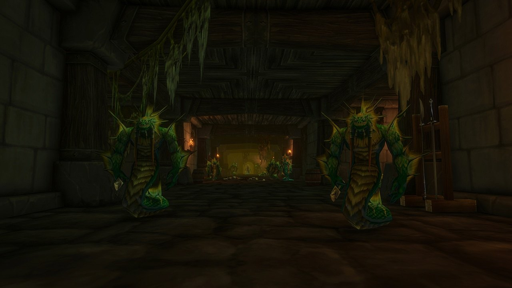

## Der Weg dorthin

Alcaz Prison ist ein neuer Dungeon in World of Warcraft: Forever, für Level 48 bis 53, auf Alcaz Island vor der Küste von Dustwallow Marsh. Nimm vom Steg aus den Pfad links den Hügel hinauf zum großen Gebäude. Das Portal ist in dessen Keller, etwa bei /way 75 15.

## Die Geschichte

Das Gefängnis auf Alcaz Island soll lange wichtige Gefangene festgehalten haben, darunter King Varian Wrynn, doch niemand kam hinein. In Forever öffnen sich die Türen. Drinnen kämpfen die Defias Brotherhood und Naga gegeneinander, und neue Teile eines bekannten Rätsels warten, so [Blizzard](/de/news/blizzard-describes-all-nine-new-dungeons/).

## Die Bosse

### The Questioner

Der erste Boss. Lass ihn am Leben, wenn du die geheime Verkleidung willst: Die Quest <a href="https://www.wowhead.com/forever/quest=96335">The Man in the Iron Chains</a> am Ende des Dungeons schickt dich zu ihm zurück.

### Blazeroar

Der bisher einzige bekannte Boss, genannt in der Legacy-Herausforderung des Dungeons.

## Die geheime Verkleidung

Hier beginnt eine versteckte Reihe, die mit der <a class="wf-wh wf-q3" href="https://www.wowhead.com/forever/item=279471">Alcaz Operative Insignia</a> endet, einem Spielzeug, das dich 10 Minuten als Defias-Agent verkleidet. Räume den Dungeon leer, ohne The Questioner zu töten, nimm am Ende <a href="https://www.wowhead.com/forever/quest=96335">The Man in the Iron Chains</a> an und folge dann der Spur nach Moonbrook in Westfall und weiter nach Stormwind (Alliance) oder Booty Bay (Horde) für eine <a class="wf-wh wf-q2" href="https://www.wowhead.com/forever/item=279450">Fractured Insignia</a>. Sechs davon ergeben das Spielzeug. Die Schritte stehen im [Beitrag zum Spielzeug](/de/news/alcaz-prison-hides-a-defias-disguise-toy/).

## Was noch nicht bekannt ist

- **Die anderen Bosse** und wie die Kämpfe ablaufen.
- **Die Karte** des Inneren.
- **Die Beute** und **die übrigen Quests**.
