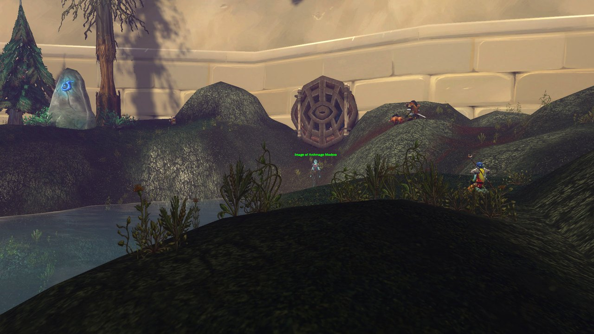
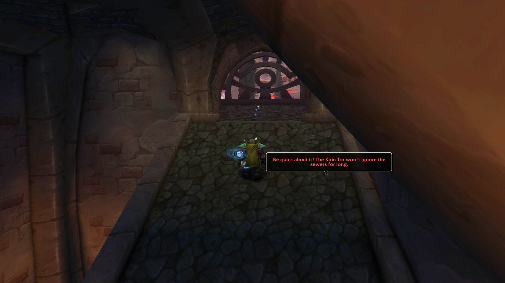
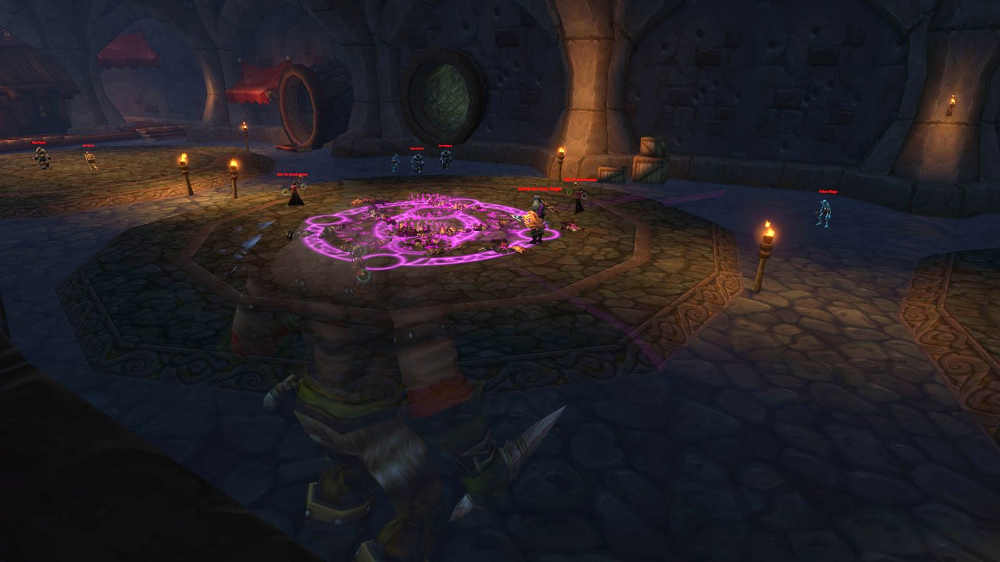
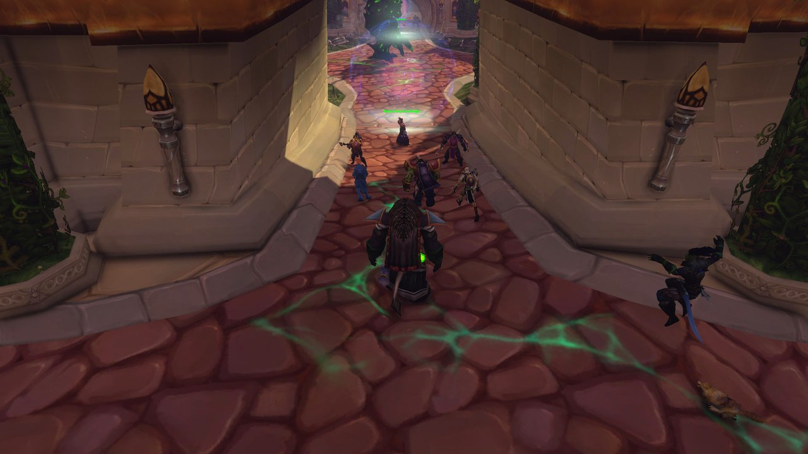
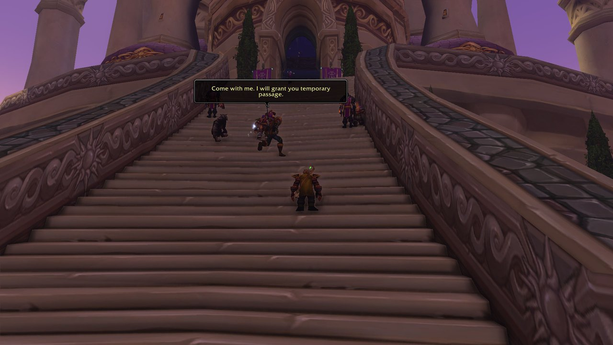

## Der Weg dorthin

**Alliance.** Beim ersten Mal ist es ein langer Ritt von Hillsbrad Foothills in die Stadt. Geh in Dalaran zu Cantrips & Crows in den Dalaran Sewers, öffne das Tor und folge dem Rohr zum Portal. Mehr über die Stadt im [Beitrag über Dalaran in der Beta](/de/news/dalaran-opens-on-the-beta-for-the-alliance-only/).

**Horde.** Die Horde ist in der Stadt nicht willkommen und kommt durch einen Tunnel außerhalb, bei /way 8.8 59.6, wo das <a class="wf-wh wf-plain" href="https://www.wowhead.com/forever/npc=269127">Image of Archmage Modera</a> Zugang gewährt. Mindestens ein Spieler braucht den <a class="wf-wh wf-q2" href="https://www.wowhead.com/forever/item=277507">Dalaran Sewer Key</a>, um das Tor zu öffnen. Von The Sepulcher in Silverpine Forest sind es ein paar Minuten zu Fuß.

Die Stadt greift Hordespieler jetzt sofort an, und die Questreihe für den Dalaran Sewer Key gibt keinen freien Zugang mehr zur Stadt in der offenen Welt. Der Weg in den Dungeon bleibt gleich ([mehr](/de/news/horde-players-are-attacked-on-sight-in-dalaran/)).

Auf der Karte von Silverpine Forest liegt der Eingang außerhalb der Stadt bei /way 69.3 45.6, neben dem Image of Archmage Modera bei /way 68.5 45.3. Emissary Jacques, der die Allianz dorthin schickt, steht in Southshore bei /way 48.3 60.1.

## Der Dalaran Sewer Key

Die Alliance bekommt den Schlüssel mit einer einzigen Quest: An Alarming Request, ab Stufe 30, von Emissary Jacques im Rathaus von Southshore, schickt dich zu <a class="wf-wh wf-plain" href="https://www.wowhead.com/forever/npc=269127">Image of Archmage Modera</a> vor der Stadt, und ihr Heart of Disruption gibt den Schlüssel. Die Horde verdient sich den <a class="wf-wh wf-q2" href="https://www.wowhead.com/forever/item=277507">Dalaran Sewer Key</a> mit einer Reihe aus Tarren Mill in den Hillsbrad Foothills, ab Stufe 30: fünf Quests, dazu zwei freiwillige. Beide Questgeber stehen im Dorf. Content Creator Farmerfarms zeigt die ganze Reihe in einem Video.

<figure class="wf-embed" data-wf-video="fEruSWVwJjM">
  <button type="button" class="wf-embed__play">
    
    
      Dalaran Attunement Guide &amp; ALL Quests, WoW Forever
      Das Video abspielen. Farmerfarms auf YouTube, 10 Minuten.
    
  </button>
</figure>

Nimm zuerst drei Quests an.

| Quest | Von | Aufgabe |
|---|---|---|
| <a href="https://www.wowhead.com/forever/quest=544">Prison Break In</a> | <a class="wf-wh wf-plain" href="https://www.wowhead.com/forever/npc=2410">Magus Wordeen Voidglare</a> | Finde die Verräter und hol ihre Artefakte zurück |
| <a href="https://www.wowhead.com/forever/quest=93680">Key to the City</a> | <a class="wf-wh wf-plain" href="https://www.wowhead.com/forever/npc=2410">Magus Wordeen Voidglare</a> | Besorge den Grimy Key |
| <a href="https://www.wowhead.com/forever/quest=556">Stone Tokens</a> | <a class="wf-wh wf-plain" href="https://www.wowhead.com/forever/npc=2437">Keeper Bel'varil</a> | Bring 10 Worn Stone Tokens |

Gib sie ab und nimm dann die nächsten zwei an.

| Quest | Von | Aufgabe |
|---|---|---|
| <a href="https://www.wowhead.com/forever/quest=545">Dalaran Patrols</a> | <a class="wf-wh wf-plain" href="https://www.wowhead.com/forever/npc=2410">Magus Wordeen Voidglare</a> | Töte 6 Dalaran Summoners und 8 Elemental Slaves |
| <a href="https://www.wowhead.com/forever/quest=557">Bracers of Binding</a> | <a class="wf-wh wf-plain" href="https://www.wowhead.com/forever/npc=2437">Keeper Bel'varil</a> | Bring 4 Bracers of Earth Binding |

Gib auch diese ab, und die Reihe zieht in die Stadt.

| Quest | Von | Aufgabe |
|---|---|---|
| <a href="https://www.wowhead.com/forever/quest=92434">Blood in the Streets</a> | <a class="wf-wh wf-plain" href="https://www.wowhead.com/forever/npc=2410">Magus Wordeen Voidglare</a> | Gib sie bei Image of Archmage Modera vor Dalaran ab |
| <a href="https://www.wowhead.com/forever/quest=96984">Heart of Disruption</a> | <a class="wf-wh wf-plain" href="https://www.wowhead.com/forever/npc=269127">Image of Archmage Modera</a> | Hol das Arcane Mote in der City of Dalaran |

Die vier Verräter aus Prison Break In stehen im und um das Lordamere Internment Camp: Dermot und Alina im Haus ohne Dach bei /way 18.4 91.4, Ricter im Hof davor bei /way 19.5 91.2 und Kegan Darkmar im Obergeschoss des Hauses außerhalb der Palisade bei /way 16.7 89.3. Der Grimy Key für Key to the City liegt im Warden's Footlocker im Erdgeschoss desselben Hauses, bewacht von Warden Belamoore. Die Verräter lassen ihr Stück immer fallen, erscheinen aber langsam neu.

Stone Tokens und Bracers of Binding sind freiwillig: Für den Schlüssel brauchst du sie nicht. Die Marken fallen selten von Dalaran Theurgists und Dalaran Shield Guards, die selbst selten sind, und die Shield Guards werfen Nahkampfschaden mit Violent Shield zurück. Nach Heart of Disruption schickt Shrewd Negotiations das Arcane Mote zurück zu Modera; die Horde bekommt keinen Zugang zur Stadt selbst, nur ein Versprechen für später.

Heart of Disruption gibt den Schlüssel. Vier der Quests stammen aus Classic: Prison Break In, Stone Tokens, Dalaran Patrols und Bracers of Binding. Key to the City, Blood in the Streets und Heart of Disruption sind neu in Forever. Mehr im [Beitrag über den Schlüssel](/de/news/horde-earns-the-dalaran-sewer-key-in-tarren-mill/).

## Der Weg durch die Stadt

Nach der Kanalisation gehen die Bosse in beliebiger Reihenfolge, solange der Shade of the Archmage zuletzt kommt. Diese Reihenfolge erspart Rückwege:

1. **The Underbelly.** Überquere die Brücke am Start und biege rechts ab, durch die drei großen Rohre, zu Atrexis the Grave Knight.
2. **Der Seitenraum.** Verlasse die Rohre auf der anderen Seite. Ein Seitengang führt zum Beschwörungskreis von Lyn the Ignored; die Rampe führt aus der Kanalisation.
3. **The Violet Hold.** Aus der Kanalisation heraus links zum Mana Devourer.
4. **Krasus' Landing.** Wieder draußen und rechts wartet die Arcane Anomaly.
5. **Runeweaver Square.** Nähere dich dem Stadtzentrum von Osten für den Fel Ancient.
6. **The Path of Renewal.** Weiter gegen den Uhrzeigersinn zum Arcanic Enigma.
7. **The Magus Commerce Exchange.** Nach Westen zum Unstable Sentinel.
8. **The Violet Citadel.** Archmage Modera auf den Stufen öffnet ein Portal zum letzten Boss.

**Eine Abkürzung.** Gleich nach der Brücke führt links ein Weg hinauf zu einer verschlossenen Tür. Dahinter kommst du vor der Violet Citadel heraus, an fast dem ganzen Dungeon vorbei. Wie sich die Tür öffnen lässt, ist nicht bekannt.

## Wichtiger Trash

**Arkaner Schaden.** Sobald du aus der Kanalisation kommst, ist viel Schaden Arcane, auch die Nahkampfschläge. Tanks als Warrior oder Paladin blocken viel weniger Treffer. Nimm reichlich Wasser mit, wenn die Gruppe wenig Unterbrechungen hat, denn mehrere Monster verbrennen Mana.

**Immun gegen Arcane.** Fast jedes Monster ignoriert Arcane-Schaden, also bringen Arcane Explosion und Arcane Shot wenig, und Counterspell unterbricht nicht.

**Mana Phantoms** zaubern ein fieses <a class="wf-wh wf-spell" href="https://www.wowhead.com/forever/spell=20817">Mana Burn</a> auf ihr Ziel. Sie sind keine Elite: Unterbrich oder betäube sie und töte sie zuerst.

**Fallen Mages und Fallen Warriors.** Die Mages zaubern Frostbolt auf ihr Ziel, also zieh sie um eine Ecke. Die Warriors setzen Hamstring ein.

**Kirin Tor Necromancers** erwecken Skelette, bis sie tot sind, und Unholy Frenzy gibt ihnen und ihren Skeletten 20 Sekunden lang 75 % Angriffstempo.

**Seeking Remnants und Saturated Remnants.** Seeking Remnants sehen durch Verstohlenheit. Saturated Remnants schlagen mit Arcane-Schaden zu, der sich nicht blocken lässt, und hinterlassen beim Tod ein Feld, das jedem darin Mana zurückgibt.

**Phantasms** legen Reflection Field auf sich oder einen Verbündeten, einen Schild, der jeden Zauber auf den Zaubernden zurückwirft.

**Fragmented Sentries** treffen alle vor sich mit Arcing Smash.

**Mindless Horrors** wirken eine Furcht, die Spieler in die nächste Gruppe treiben kann. Ein Tremor Totem hilft.

**Mana Fiends** explodieren beim Tod und treffen alle in der Nähe: verteilt euch.

## Die Bosse

### Atrexis the Grave Knight

Der erste Boss, am Ritual Circle mitten in der Underbelly, mit drei Kirin Tor Necromancers in der Nähe; töte ein paar davon, bevor du ihn ziehst. Er entwaffnet den Tank, erweckt ständig Skelette und gibt sich und seinen Verbündeten Unholy Frenzy. Er schlägt den Tank hart: Töte die ersten Skelette und konzentriere dich dann auf den Boss.

### Lyn the Ignored, ein Rare

Lyn the Ignored erscheint nur, wenn man sie beschwört. Nehmt den <a class="wf-wh wf-q1" href="https://www.wowhead.com/forever/item=276561">Black Tome</a> aus dem Raum von <a class="wf-wh wf-plain" href="https://www.wowhead.com/forever/npc=4275">Archmage Arugal</a> in Shadowfang Keep mit und benutzt ihn am Ambermill Leyline Focus, dem blauen Kristall neben <a class="wf-wh wf-plain" href="https://www.wowhead.com/forever/npc=2120">Archmage Ataeric</a> in Ambermill (/way 63.4 64.3): Er wird zum <a class="wf-wh wf-q2" href="https://www.wowhead.com/forever/item=275989">Tome of Dalaran</a>. Geht im Dungeon durch die Underbelly an Atrexis the Grave Knight vorbei. Vor der Rampe zur Arcane Anomaly geht geradeaus in den kleinen Raum und benutzt das Buch am Beschwörungskreis. Jeder Schritt, mit Screenshots, steht im [Beitrag über den Tome of Dalaran](/de/news/the-tome-of-dalaran-summons-lyn-the-ignored/).

Das Buch wird nicht verbraucht. Nach 3 Minuten wirkt es wieder, also kann eine Gruppe nach einem Wipe Lyn the Ignored sofort noch einmal beschwören. Sie erscheint nach einer kurzen Szene mit einem Augenzwinkern zu <a class="wf-wh wf-plain" href="https://www.wowhead.com/forever/npc=11502">Ragnaros</a>, mehr im [Beitrag über den neuen Versuch](/de/news/the-tome-of-dalaran-stays-for-another-try-at-lyn-the-ignored/).

Im Kampf erweckt der Boss ständig Skelette, wie Atrexis, und zaubert Shadow Bolt Volley auf die ganze Gruppe. Curse of Thorns verletzt den Tank jedes Mal, wenn der Tank Schaden macht: Entferne den Fluch, wenn du kannst.

### Arcane Anomaly

Du ziehst ihn aus einer Blase auf einer Terrasse nach der Kanalisation. Er schlägt hart zu, und Arcane Bolt trifft den Tank für etwa 500 Arcane-Schaden. <a class="wf-wh wf-spell" href="https://www.wowhead.com/forever/spell=1241501">Focal Blast</a> ist ein arkaner Strahl, der nach einem Zauber von 3 Sekunden durch den Raum fegt: Geh aus seiner Bahn, sobald der Zauber beginnt. Bleibt dicht hinter ihm: nah am Boss weicht ihr dem Strahl viel leichter aus.

### Fel Ancient

Auf dem Runeweaver Square, mitten in der Stadt, zwischen Suffused Treants. Eine Manabarriere schützt ihn; Magus Fansy Goodbringer auf der Ostseite nimmt sie weg, wenn du mit ihm sprichst. Entangle hält einen Spieler 10 Sekunden fest und verletzt ihn, solange es wirkt. Fel Timbers läuft zu einem Spieler, trifft alle im Umkreis von 5 Metern und hinterlässt eine grüne Giftpfütze. Zusammen ist das tödlich: Geh sofort aus den Pfützen, und Blessing of Freedom entfernt die Wurzeln.

### Arcanic Enigma

Zwei Mana Phantoms beginnen den Kampf mit ihm: Töte sie zuerst und stopp ihr Mana Burn mit einer Unterbrechung oder Betäubung. <a class="wf-wh wf-spell" href="https://www.wowhead.com/forever/spell=1240869">Manamorph</a> verwandelt einen Spieler 8 Sekunden lang in ein Tier; es ist Magie, also bann es. Druids in Cat Form sind immun. Sein Silence trifft alle um ihn herum, also stehen der Heiler und die Fernkämpfer weit weg. Ständig erscheinen Arcane Manalings: Mäh sie nieder, aber mach auch weiter Schaden am Boss. Er ist das Ziel der Alliance-Quest Power Overwhelming.

### Unstable Sentinel

Im Handelsviertel der Stadt. Töte die Angry Tomes, die aus den Gebäuden kommen, bevor du ihn ziehst. Arcing Smash trifft alle vor ihm, also dreht der Tank ihn von der Gruppe weg. <a class="wf-wh wf-spell" href="https://www.wowhead.com/forever/spell=1241329">Malfunction</a> lädt 2 Sekunden auf und trifft dann 6 Sekunden lang alle 2 Sekunden jeden im Umkreis von 25 Metern. Fernkämpfer bleiben außerhalb von 25 Metern, Nahkämpfer laufen während des Zaubers raus; eine Betäubung vor dem Zauber stoppt ihn.

### Shade of the Archmage

Der Endboss, im Purple Parlor oben in der Violet Citadel. Sprich mit Archmage Modera auf den Stufen vor der Violet Citadel im Nordwesten der Stadt, um nach oben teleportiert zu werden; der Shade erscheint, wenn du eintrittst. Arcane Bolt trifft den Tank hart. <a class="wf-wh wf-spell" href="https://www.wowhead.com/forever/spell=1241515">Bounding Mana</a> schickt eine Manakugel zu einem Spieler und zurück, die jeden auf ihrer Bahn verletzt und 6 Sekunden zum Schweigen bringt: Stell dich nicht zwischen ihn und diesen Spieler. Danach folgt Arcane Explosion auf alle im Umkreis von 20 Metern. Ist sein Mana leer, zaubert er Mass Polymorph auf die ganze Gruppe, 8 Sekunden lang, und füllt es mit Evocation wieder auf, dann beginnt der Kampf von vorn. Verteilt euch, haltet die Zauberer auf Abstand und versteckt euch während Mass Polymorph hinter der Wand. Verlässt jemand den Raum, setzt er auf volle Gesundheit zurück.

### Mana Devourer

Er wartet in der Violet Hold. Räum vor dem Pull den ganzen Raum, denn jedes Monster, das noch lebt, kommt in den Kampf dazu. Drain Vitality macht dem Tank Arcane-Schaden über Zeit, und Debilitate macht allen Arcane-Schaden und zieht jedem Spieler 200 Mana ab. Töte ihn schnell, bevor der Gruppe das Mana ausgeht.

## Was noch nicht bekannt ist

- **Sunreaver's Sanctuary**: Auf der Beta kommt man noch nicht hinein.
- **Die Dropchancen** der Beute der Bosse.
