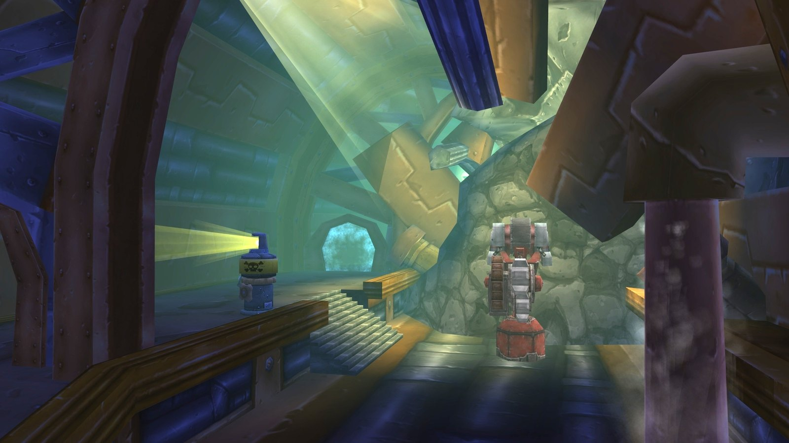

## Anreise

**Alliance.** Reite von Ironforge nach Westen zum Train Depot, dem Haupttor von Gnomeregan im Westen von Dun Morogh, bei /way 17.7 39.2.

**Horde.** Nimm Rig Wars bei Nogg in Orgrimmar an, dann Chief Engineer Scooty bei Sovik neben ihm. Nimm das Schiff von Ratchet nach Booty Bay, wo Scooty am Kai beim Gasthaus steht. Sein Gnomer-gooooone! gibt den <a class="wf-wh wf-q1" href="https://www.wowhead.com/forever/item=9173">Goblin Transponder</a>, der dich nach Gnomeregan beamt. Behalte ihn für spätere Besuche.

**Zwei Türen.** Der Haupteingang auf der Westseite des Train Depot führt zum Clockwork Run. Die Hintertür auf der Nordseite führt zu den Engineering Labs und Crowd Pummeler 9-60; dafür brauchst du den <a class="wf-wh wf-q1" href="https://www.wowhead.com/forever/item=6893">Workshop Key</a> oder einen Rogue mit Lockpicking 150.

## Die Route

Vier Ebenen, jede mit ihrer eigenen Karte oben. Die Zahlen gehören zu den Bossen.

1. **The Hall of Gears.** Sprich mit <a class="wf-wh wf-plain" href="https://www.wowhead.com/forever/npc=7998">Blastmaster Emi Shortfuse</a>, um das Event zu starten. Troggs strömen aus den Höhlen, bevor Emi sie sprengt, und <a class="wf-wh wf-plain" href="https://www.wowhead.com/forever/npc=7361">Grubbis</a> (1) kommt aus der zweiten. Halte Emi am Leben.
2. **Die verstrahlte Ebene.** <a class="wf-wh wf-plain" href="https://www.wowhead.com/forever/npc=7079">Viscous Fallout</a> (2) wartet im Erdgeschoss zwischen den verstrahlten Monstern. Kernobee für A Fine Mess und The Sparklematic 5200 sind ganz in der Nähe, in der Clean Zone und im Dormitory.
3. **The Launch Bay.** <a class="wf-wh wf-plain" href="https://www.wowhead.com/forever/npc=6235">Electrocutioner 6000</a> (3) steht auf der erhöhten Startrampe. Er lässt den Workshop Key fallen.
4. **The Engineering Labs.** <a class="wf-wh wf-plain" href="https://www.wowhead.com/forever/npc=6229">Crowd Pummeler 9-60</a> (4) wartet auf dem oberen Vorsprung im Süden. Der Rare Dark Iron Ambassador kann im Tunnel dahinter patrouillieren.
5. **The Tinkers' Court.** <a class="wf-wh wf-plain" href="https://www.wowhead.com/forever/npc=7800">Mekgineer Thermaplugg</a> (5), mit Thermaplugg's Safe für Rig Wars in seinem Raum.

## Wichtiger Trash

**Verstrahlte Monster.** Die Slimes, Lurkers und Horrors um Viscous Fallout hinterlassen eine Strahlung, die wehtut. Sie sind auch die Quelle des Fallouts für The Only Cure is More Green Glow.

**Dark Iron Agents.** Sie tauchen an vielen Stellen auf und legen Land Mines. Sie lassen auch den Grime-Encrusted Ring fallen.

**Mechanische Gruppen.** Mechano-Tanks, Mechano-Flamewalkers und Mechano-Frostwalkers kommen in Gruppen. Flächenschaden hilft, und die meisten droppen Robo-mechanical Guts für Gyrodrillmatic Excavationators.

## Die Bosse

### Grubbis

Das Ende des Events von Blastmaster Emi Shortfuse. Zuerst kommen Wellen von Troggs; dann erscheint Grubbis mit seinem Begleiter Chomper. Emi muss überleben, also nimm jeden Trogg auf, der zu ihr rennt. Töte Chomper zuerst; beide lassen sich betäuben und in Furcht versetzen.

### Viscous Fallout

Ein großer Ooze im verstrahlten Erdgeschoss und ein einfacher Kampf auf dem Tank. Räum zuerst den Trash um ihn herum. Er ist immun gegen Frost-Schaden.

### Electrocutioner 6000

Er zaubert Chain Bolt, Megavolt und Shock; die ersten beiden lassen sich nicht unterbrechen. Verteilt euch, damit Chain Bolt nicht durch die ganze Gruppe springt.

### Crowd Pummeler 9-60

Arcing Smash, Crowd Pummel und Trample treffen alle vor und um ihn. Nahkämpfer stehen an seinen Seiten und hinter ihm, Fernkämpfer weit weg.

### Mekgineer Thermaplugg

Der Endboss, im Tinkers' Court. Tank ihn in der Mitte des Raums. Knock Away schleudert den Tank zurück und setzt seine Bedrohung auf null, also halten die Schadensverursacher nach jedem Schlag kurz zurück. Walking Bombs kommen aus sechs Maschinen, unter 50 % und 20 % Gesundheit öfter: Töte sie, bevor sie die Gruppe erreichen, oder schick einen Spieler, der den Knopf rechts an jeder Maschine drückt.

## Was noch nicht bekannt ist

- **Die Dropchancen** der Beute der Bosse.
- **Die Belohnungen der Quests** können sich vor dem Launch noch ändern.
