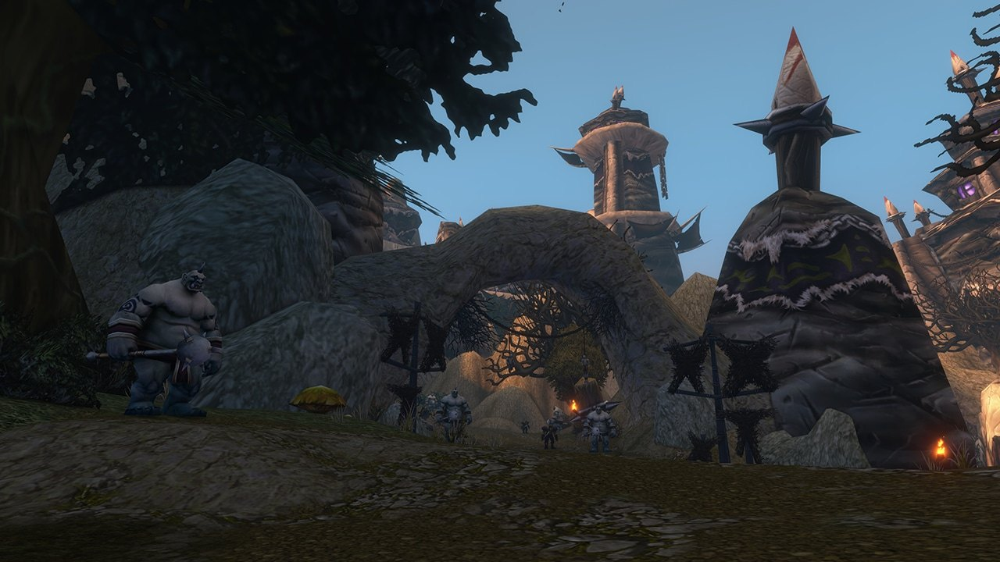

## Der Weg dorthin

Krol'dok Stronghold ist ein neuer Dungeon in World of Warcraft: Forever, für Stufe 40 bis 45, im neuen Gebiet der Riverglades. Die Ogerfestung steht auf einem Hügel über Sunnyglade im Norden des Gebiets. Der Eingang ist eine versteckte Höhle gleich westlich der großen Tore, bei /way 37.5 37.5.

Oger-Späher entführen Reisende und plündern Dörfer in den ganzen Riverglades, und ihre Spur führt hierher. Nach Einbruch der Dunkelheit dringt seltsamer Gesang aus der Festung.

## Der Aufbau

Ein gewundener Pfad führt bergauf zwischen groben Gebäuden, Werkstätten und Lagern, an bewachten Durchgängen vorbei. Eine große Holzbrücke führt zur Spitze, wo die größten Gebäude stehen. <a class="wf-wh wf-plain" href="https://www.wowhead.com/forever/npc=278310">Krol'dok Centurion</a> ist einer der Elite-Oger, denen ihr begegnet.

## Die Schlüssel

Die Spieldaten haben zwei Schlüssel für die Festung, <a class="wf-wh wf-q1" href="https://www.wowhead.com/forever/item=267089">Krol'dok Compound Key</a> und <a class="wf-wh wf-q1" href="https://www.wowhead.com/forever/item=271721">Krol'dok Ogre Key</a>. <a class="wf-wh wf-q1" href="https://www.wowhead.com/forever/item=271721">Krol'dok Ogre Key</a> kann bei Overlord Mugg droppen. Eine Questreihe, die mit der Krol'dok Moulding von Tunk beginnt, gibt einen Schlüssel zu einer Abkürzung, siehe die [Quests](/de/guides/dungeons/kroldok-stronghold/quests/).

## Trash, auf den du achten solltest

- **<a class="wf-wh wf-plain" href="https://www.wowhead.com/forever/npc=258042">Twilight Grunts</a>** sind hier die gefährlichsten Monster. Einer ist kein Problem, aber zwei oder mehr tun den Nahkämpfern weh: <a class="wf-wh wf-spell" href="https://www.wowhead.com/forever/spell=1307066">Bladestorm</a> trifft alle in 8 Metern, und sie nutzen <a class="wf-wh wf-spell" href="https://www.wowhead.com/forever/spell=15572">Sunder Armor</a> auf den Tank. Betäube sie, und halte einen mit <a class="wf-wh wf-spell" href="https://www.wowhead.com/forever/spell=12825">Polymorph</a> fern, wenn eine Gruppe mehr als zwei hat.
- **<a class="wf-wh wf-plain" href="https://www.wowhead.com/forever/npc=258102">Twilight Outriders</a>** reiten in Dreiergruppen auf Kriegshunden über die langen Wege. Sie schießen wie Jäger und halten den Tank mit <a class="wf-wh wf-spell" href="https://www.wowhead.com/forever/spell=14030">Hooked Net</a> 10 Sekunden fest. Zieh sie um eine Ecke, weg von anderen Gruppen, und ein Paladin befreit den Tank mit <a class="wf-wh wf-spell" href="https://www.wowhead.com/forever/spell=1044">Blessing of Freedom</a>.
- **<a class="wf-wh wf-plain" href="https://www.wowhead.com/forever/npc=277611">Twilight Peons</a>** rennen sehr schnell los, um andere Monster zu warnen. Betäube oder verlangsame sie, bevor sie entkommen.
- **<a class="wf-wh wf-plain" href="https://www.wowhead.com/forever/npc=257888">Krol'dok Shamans</a>** heilen und schützen ihre Freunde, und **<a class="wf-wh wf-plain" href="https://www.wowhead.com/forever/npc=257885">Krol'dok Centurions</a>** nutzen Mortal Strike auf den Tank und Thunder Clap und Demoralizing Shout auf die Nahkämpfer. Töte zuerst die Shamans, dann die Centurions.

## Die Bosse

Die Karte oben zeigt die Route und die sechs Bosse der Reihe nach. Q markiert eine Queststelle unterwegs.

### 1. Slavecrusher Grox

<a class="wf-wh wf-plain" href="https://www.wowhead.com/forever/npc=258966">Slavecrusher Grox</a> patrouilliert durch die Minen in der ersten Kurve hinter dem Eingang. Er nutzt Bloodlust (30 % schnellere Angriffe für 30 Sekunden), schlägt den Tank 2 Sekunden nieder und ruft die Gefangenen in der Nähe zu Hilfe. Räum zuerst die Gnolle in seinem Bereich; die Gefangenen, die er ruft, sind keine Elite und sterben schnell.

### 2. Twilight Commander Zarmok

<a class="wf-wh wf-plain" href="https://www.wowhead.com/forever/npc=258972">Twilight Commander Zarmok</a> wartet am Fuß des ersten Anstiegs, mit Wachen des Twilight's Hammer um sich. Töte zuerst die Wachen, damit du ihn allein ziehen kannst. Sein Rending Whirl trifft alle in 8 Metern sehr hart, also bleiben nur der Tank und Nahkämpfer, die es aushalten, in der Nähe.

### 3. War Handler Ashka

<a class="wf-wh wf-plain" href="https://www.wowhead.com/forever/npc=259281">War Handler Ashka</a> steht auf der Ostseite am Fluss, mit ihren zwei Wölfen. Betäube die Wölfe und töte sie zuerst: Mit Command: Kill hetzt sie sie 10 Sekunden auf einen zufälligen Spieler. Ohne die Wölfe ist der Kampf leicht.

### 4. Nar'gurk

<a class="wf-wh wf-plain" href="https://www.wowhead.com/forever/npc=258964">Nar'gurk</a> wartet zwischen den Lagern auf der Westseite mit drei Wachen. Halte sie mit <a class="wf-wh wf-spell" href="https://www.wowhead.com/forever/spell=12825">Polymorph</a>, <a class="wf-wh wf-spell" href="https://www.wowhead.com/forever/spell=2070">Sap</a> oder <a class="wf-wh wf-spell" href="https://www.wowhead.com/forever/spell=6213">Fear</a> fern, oder töte sie zuerst. Nar'gurk wirkt Shadow Bolt Volley auf die Gruppe und übernimmt mit Convert einen Spieler: Bring diesen Spieler auf 50 % Leben, um es zu brechen. Er droppt Helm und Brustteil der Krol'dok Battlegear.

### 5. Bossman Toof

<a class="wf-wh wf-plain" href="https://www.wowhead.com/forever/npc=264773">Bossman Toof</a> wartet auf dem Weg nach oben. Sobald du die Centurions am Anfang der Brücke angreifst, schickt er Wellen von zwei Brutes los. Das <a class="wf-wh wf-spell" href="https://www.wowhead.com/forever/spell=1725">Distract</a> eines Schurken verschafft Zeit für die erste Gruppe. Bei ihm stehen zwei Shamans: Halte sie mit Kontrolle fern, und lass noch eine Welle Brutes kommen, bevor du ihn ziehst. Er nutzt nur Mortal Strike, Thunder Clap und Demoralizing Shout, allein ist er also leicht.

### 6. Overlord Mugg

<a class="wf-wh wf-plain" href="https://www.wowhead.com/forever/npc=258968">Overlord Mugg</a> wartet oben in der Festung mit zwei Centurions: Halte sie fern oder töte sie zuerst, der Schaden hier ist hoch. Mit Crushing Slam springt er zu einem zufälligen Spieler und stößt alle in der Nähe zurück. Durch Mugg's Fury greift er immer schneller an, bis er zu zwei Streitkolben und am Ende zu zwei Hämmern mit 50 % mehr Schaden wechselt. Drück ihn also nicht runter, solange die Centurions noch leben. Er wird in der Legacy-Herausforderung des Dungeons genannt und droppt <a class="wf-wh wf-q1" href="https://www.wowhead.com/forever/item=267086">Eye of Mugg</a>, ein Questitem.

## Die Krol'dok Battlegear

Der Dungeon hat ein Plattenset aus fünf Teilen für Tanks. Nar'gurk droppt Helm und Brustteil, die anderen drei Teile werden beim Anlegen gebunden. Mit allen fünf kann dich das Set in einen Oger verwandeln, siehe [den Beitrag zum Set](/de/news/the-kroldok-set-turns-your-tank-into-an-ogre/).

## Was noch nicht bekannt ist

- **Die Dropchancen** der Bossbeute und der drei Setteile von den Monstern.
