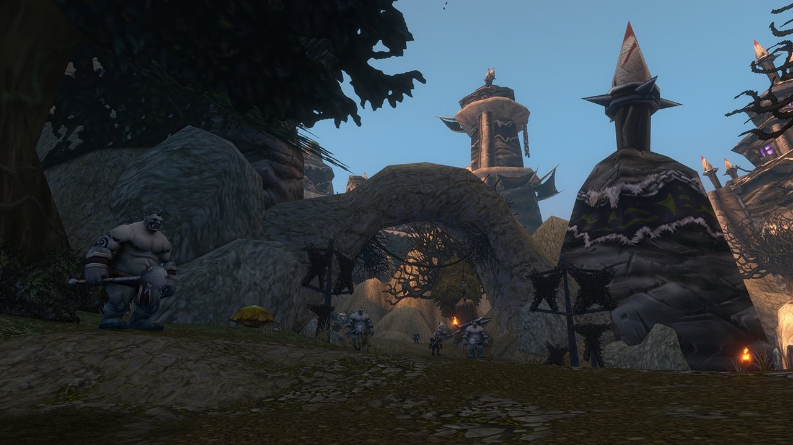

## Der Weg dorthin

Krol'dok Stronghold ist ein neuer Dungeon in World of Warcraft: Forever, für Stufe 40 bis 45, im neuen Gebiet der Riverglades. Die Ogerfestung steht auf einem Hügel über Sunnyglade im Norden des Gebiets. Der Eingang ist eine versteckte Höhle gleich westlich der großen Tore, bei /way 37.5 37.5.

Oger-Späher entführen Reisende und plündern Dörfer in den ganzen Riverglades, und ihre Spur führt hierher. Nach Einbruch der Dunkelheit dringt seltsamer Gesang aus der Festung.

## Der Aufbau

Ein gewundener Pfad führt bergauf zwischen groben Gebäuden, Werkstätten und Lagern, an bewachten Durchgängen vorbei. Eine große Holzbrücke führt zur Spitze, wo die größten Gebäude stehen. <a class="wf-wh wf-plain" href="https://www.wowhead.com/forever/npc=278310">Krol'dok Centurion</a> ist einer der Elite-Oger, denen ihr begegnet.

## Die Schlüssel

Die Spieldaten haben zwei Schlüssel für die Festung, <a class="wf-wh wf-q1" href="https://www.wowhead.com/forever/item=267089">Krol'dok Compound Key</a> und <a class="wf-wh wf-q1" href="https://www.wowhead.com/forever/item=271721">Krol'dok Ogre Key</a>. <a class="wf-wh wf-q1" href="https://www.wowhead.com/forever/item=271721">Krol'dok Ogre Key</a> kann bei Overlord Mugg droppen. Eine Questreihe, die mit der Krol'dok Moulding von Tunk beginnt, gibt einen Schlüssel zu einer Abkürzung, siehe die [Quests](/de/guides/dungeons/kroldok-stronghold/quests/).

## Die Bosse

Die Karte oben zeigt den Weg und die sechs Bosse in Reihenfolge. Q markiert einen Questort unterwegs.

1. **Slavecrusher Grox**, in der ersten Kurve nach dem Eingang.
2. **Twilight Commander Zarmok**, am Fuß des ersten Anstiegs.
3. **War Handler Ashka**, auf der Ostseite, nahe am Fluss.
4. **Nar'gurk**, zwischen den Lagern auf der Westseite.
5. **Bossman Toof**, auf dem Weg zur Spitze.
6. **Overlord Mugg**, oben in der Festung. Er wird in der Legacy-Herausforderung des Dungeons genannt und droppt <a class="wf-wh wf-q1" href="https://www.wowhead.com/forever/item=267086">Eye of Mugg</a>, ein Questitem.

## Was noch nicht bekannt ist

- **Wie die Kämpfe ablaufen** und welcher Boss was droppt.
- **Die Beute**, auch die Teile des Sets Krol'dok Battlegear.
- **Die Quests**, auch die der zwei Items <a class="wf-wh wf-q1" href="https://www.wowhead.com/forever/item=267137">Krol'dok Moulding</a>.
