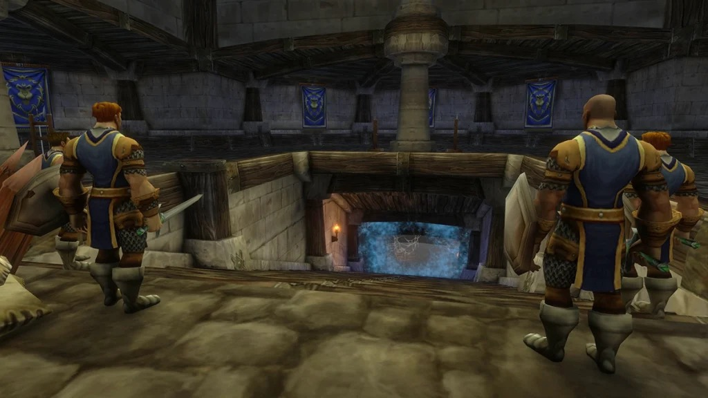

## Anreise

Der Eingang liegt in den Kanälen von Stormwind City, beim Mage Quarter, bei /way 50.4 66.2. Warden Thelwater steht direkt davor und vergibt zwei der Quests. Für die Horde ist ein Gefängnis mitten in Stormwind auf dieser Stufe kaum erreichbar.

## Die Route

Der Zellenblock ist ein T. Ein Gang führt vom Portal geradeaus, und an seinem Ende gehen zwei Flügel nach links und rechts ab. Die Flügel kannst du in beliebiger Reihenfolge machen. Die Zahlen gehören zur Karte oben.

1. **Der Gang.** <a class="wf-wh wf-plain" href="https://www.wowhead.com/forever/npc=1696">Targorr the Dread</a> (1) wartet in einer von mehreren Zellen entlang des Gangs. Elite-Gefangene in der Nähe mischen oft mit.
2. **Der Ostflügel.** <a class="wf-wh wf-plain" href="https://www.wowhead.com/forever/npc=1666">Kam Deepfury</a> (2) sitzt in einer Zelle, <a class="wf-wh wf-plain" href="https://www.wowhead.com/forever/npc=1717">Hamhock</a> (3) weiter hinten im Gang und <a class="wf-wh wf-plain" href="https://www.wowhead.com/forever/npc=1716">Bazil Thredd</a> (5) im runden Raum am Ende.
3. **Der Westflügel.** <a class="wf-wh wf-plain" href="https://www.wowhead.com/forever/npc=1663">Dextren Ward</a> (4) wartet im runden Raum am Ende. Der Rare Bruegal Ironknuckle taucht meist auf dieser Seite auf.

## Wichtiger Trash

Die Gefangenen stehen zusammen in ihren Zellen. Zieh sie Zelle für Zelle in den Gang.

**Defias Captives.** Infected Wound lässt das Ziel 5 Minuten lang mehr Physical-Schaden erleiden.

**Defias Convicts.** Backhand betäubt einen Spieler kurz.

**Defias Inmates.** Rend lässt das Ziel 15 Sekunden lang bluten.

**Defias Insurgents.** Battle Shout lässt alle Defias in der Nähe härter zuschlagen, und Demoralizing Shout senkt die Angriffskraft der Gruppe. Töte sie zuerst.

## Die Bosse

### Targorr the Dread

Ein Orc der Blackrock der Stufe 24 mit ein bis drei Gefangenen in seiner Zelle. Er setzt Thrash ein und gerät bei 20 % Gesundheit in Raserei. Er kann in mehreren Zellen des ersten Gangs stehen, also schau, bevor du ziehst.

### Kam Deepfury

Ein Dark-Iron-Zwerg der Stufe 27 in Defensive Stance. Shield Slam betäubt den Tank 2 Sekunden, und Improved Blocking erhöht 6 Sekunden lang seine Blockchance. Eine frühe Betäubung erschwert es dem Tank, die Bedrohung zu halten.

### Hamhock

Ein Oger-Magier der Stufe 28 mit zwei Defias. Töte zuerst die Defias. Seine Chain Lightning lässt sich unterbrechen, und sein Bloodlust beschleunigt ihn und seine Adds; ein Shaman oder Priest kann es entfernen. Betäubungen und Thunder Clap helfen.

### Dextren Ward

Ein Mensch der Stufe 26 am Ende des Westflügels. Intimidating Shout lässt die Gruppe fliehen, also kämpf dort, wo niemand in eine andere Zelle läuft. Ein Tremor Totem verhindert die Furcht. Der Heiler muss in Reichweite des Tanks bleiben, wenn sie endet.

### Bazil Thredd

Ein Elite der Stufe 29 und der letzte Boss, umgeben von Adds. Räum zuerst den Raum. Er kämpft mit zwei Schwertern, und Smoke Bomb betäubt alle in seiner Nähe 4 Sekunden lang: Fernkämpfer halten Abstand. Ist der Tank betäubt, greift er den Nächsten auf der Bedrohungsliste an.

## Was noch nicht bekannt ist

- **Die Dropchancen** der Beute der Bosse.
- **Wie oft Bruegal Ironknuckle erscheint.**
