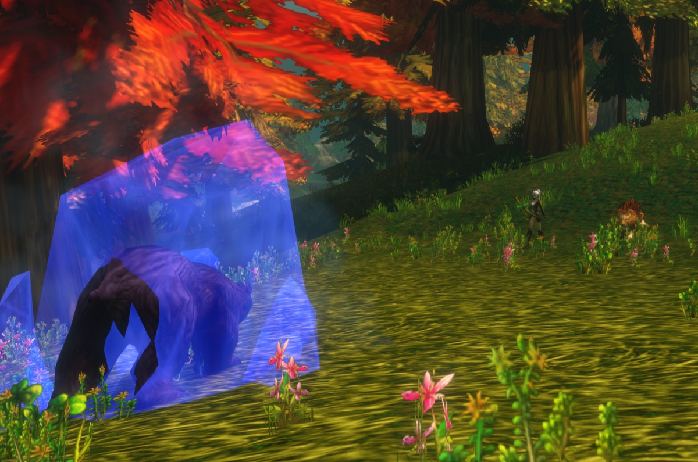
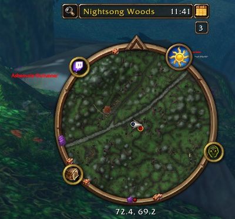

Der Hunter ist eine der stärksten Klassen zum Leveln. Du machst Schaden aus der Ferne, kontrollierst Monster mit Fallen und Verlangsamungen, und dein Begleiter fängt die Schläge ab. Die ersten 10 Level sind langsam, bis du einen Begleiter zähmst und deinen ersten Talentpunkt bekommst. In WoW Forever geben neue Begleiterfähigkeiten und neue Talente der Klasse mehr Tiefe. Dieser Guide behandelt Builds, Rotation, wichtige Level, Ausrüstung, Begleiter, Fallen und Aufspüren.

| | |
|---|---|
| Einfachste Spezialisierung zum Leveln | Beast Mastery |
| Wichtige Talente | <a class="wf-wh wf-spell" href="https://www.wowhead.com/forever/spell=19552">Deadly Aspects</a>, Unleashed Fury, <a class="wf-wh wf-spell" href="https://www.wowhead.com/forever/spell=19598">Ferocity</a>, Summon Hawk, <a class="wf-wh wf-spell" href="https://www.wowhead.com/forever/spell=1223755">Focused Fire</a> |
| Stärke | Fernkampfschaden, ein Begleiter, der tankt, Kontrolle, schnelles Reisen |
| Schwäche | Ein langsamer Start bis Level 10, Mana und Munition |
| Talentreihenfolge pro Level | [Leveling-Build für den Hunter](/de/leveling/hunter/) |
| Guides pro Spezialisierung | [Beast Mastery Hunter](/de/guides/beast-mastery-hunter/), [Marksmanship Hunter](/de/guides/marksmanship-hunter/), [Survival Hunter](/de/guides/survival-hunter/) |
| Builds bis Level 60 | Ja, der [Levelbuild](/de/leveling/hunter/) geht bis 60 |

## Mit welcher Spezialisierung leveln

Alle drei Bäume leveln. **Beast Mastery** ist am flüssigsten: Dein Begleiter macht mehr Schaden und hält mehr aus, und mit <a class="wf-wh wf-spell" href="https://www.wowhead.com/forever/spell=2649">Growl</a> hält er das Monster bei sich, während du schießt. **Marksmanship** macht mehr Schaden mit deinen eigenen Schüssen, also ziehst du öfter Bedrohung und musst kiten. **Survival** mischt Nahkampf, Fallen und Schüsse und verlangt am meisten.
## Level 1 bis 10

Du startest ohne Talente und ohne Begleiter, mit <a class="wf-wh wf-spell" href="https://www.wowhead.com/forever/spell=75">Auto Shot</a> und Raptor Strike. Monster erreichen dich schnell, also erledigst du sie oft im Nahkampf.

1. Halte <a class="wf-wh wf-spell" href="https://www.wowhead.com/forever/spell=13163">Aspect of the Monkey</a> aktiv, sobald du es hast, auf Level 4.
2. Pulle mit Auto Shot.
3. Wirke <a class="wf-wh wf-spell" href="https://www.wowhead.com/forever/spell=1978">Serpent Sting</a>.
4. Wirke Arcane Shot, sobald es bereit ist.
5. Wirke <a class="wf-wh wf-spell" href="https://www.wowhead.com/forever/spell=5116">Concussive Shot</a>, um das Monster zu verlangsamen und Abstand zu halten.
6. Geh zwischen den Schüssen zurück.
7. Nutze Raptor Strike, wenn das Monster bei dir ist, und erledige es im Nahkampf.

Beginne jeden Pull so weit weg wie möglich: Jeder Meter mehr ist ein Schuss mehr. Werte auf diesen Leveln: Agility, dann Angriffskraft, dann Intellect, dann Stamina und Spirit, dann Rüstung.

## Talent-Builds

Der [Level-Build für den Hunter](/de/leveling/hunter/) gibt das Talent für jedes Level von 10 bis 60. [Endergebnis im Talentrechner öffnen](/de/talents/hunter/?t=5120221405101241-00503520005).

Für Level 60 hat jeder Spec-Guide eigene Builds für Raids, Leveln und PvP: [Beast Mastery](/de/guides/beast-mastery-hunter/), [Survival](/de/guides/survival-hunter/) und [Marksmanship](/de/guides/marksmanship-hunter/).

## Wichtige Level

| Level | Was du bekommst | Von |
|---|---|---|
| 1 | Auto Shot, Raptor Strike, <a class="wf-wh wf-spell" href="https://www.wowhead.com/forever/spell=1494">Track Beasts</a> | Standard, Klassenlehrer |
| 4 | Aspect of the Monkey, Serpent Sting | Klassenlehrer |
| 6 | Arcane Shot, <a class="wf-wh wf-spell" href="https://www.wowhead.com/forever/spell=1130">Hunter's Mark</a> | Klassenlehrer |
| 8 | Concussive Shot | Klassenlehrer |
| 10 | <a class="wf-wh wf-spell" href="https://www.wowhead.com/forever/spell=1515">Tame Beast</a>, <a class="wf-wh wf-spell" href="https://www.wowhead.com/forever/spell=5149">Beast Training</a> | Klassenquest |
| 10 | <a class="wf-wh wf-spell" href="https://www.wowhead.com/forever/spell=6991">Feed Pet</a>, <a class="wf-wh wf-spell" href="https://www.wowhead.com/forever/spell=982">Revive Pet</a>, <a class="wf-wh wf-spell" href="https://www.wowhead.com/forever/spell=883">Call Pet</a>, <a class="wf-wh wf-spell" href="https://www.wowhead.com/forever/spell=2641">Dismiss Pet</a>, Aspect of the Hawk, <a class="wf-wh wf-spell" href="https://www.wowhead.com/forever/spell=19883">Track Humanoids</a> | Klassenlehrer |
| 10 | Erster Talentpunkt | Talentbaum |
| 12 | <a class="wf-wh wf-spell" href="https://www.wowhead.com/forever/spell=136">Mend Pet</a>, Wing Clip | Klassenlehrer |
| 14 | <a class="wf-wh wf-spell" href="https://www.wowhead.com/forever/spell=1513">Scare Beast</a>, <a class="wf-wh wf-spell" href="https://www.wowhead.com/forever/spell=6197">Eagle Eye</a>, <a class="wf-wh wf-spell" href="https://www.wowhead.com/forever/spell=1002">Eyes of the Beast</a> | Klassenlehrer |
| 16 | Mongoose Bite, Immolation Trap | Klassenlehrer |
| 18 | <a class="wf-wh wf-spell" href="https://www.wowhead.com/forever/spell=2643">Multi-Shot</a> | Klassenlehrer |
| 20 | Aimed Shot, <a class="wf-wh wf-spell" href="https://www.wowhead.com/forever/spell=5118">Aspect of the Cheetah</a>, <a class="wf-wh wf-spell" href="https://www.wowhead.com/forever/spell=1499">Freezing Trap</a> | Klassenlehrer |
| 20 | Polearms | Waffenlehrer |
| 22 | Scorpid Sting | Klassenlehrer |
| 24 | <a class="wf-wh wf-spell" href="https://www.wowhead.com/forever/spell=19885">Track Hidden</a> | Klassenlehrer |
| 25 | Summon Hawk, Trueshot Aura | Talentbaum |
| 26 | Rapid Fire, <a class="wf-wh wf-spell" href="https://www.wowhead.com/forever/spell=19880">Track Elementals</a> | Klassenlehrer |
| 28 | Frost Trap | Klassenlehrer |
| 30 | Feign Death, Aspect of the Beast | Klassenlehrer |
| 30 | Intimidation, Strider Kick, Expose Prey, Scatter Shot | Talentbaum |
| 32 | <a class="wf-wh wf-spell" href="https://www.wowhead.com/forever/spell=1543">Flare</a>, <a class="wf-wh wf-spell" href="https://www.wowhead.com/forever/spell=19878">Track Demons</a> | Klassenlehrer |
| 34 | <a class="wf-wh wf-spell" href="https://www.wowhead.com/forever/spell=13813">Explosive Trap</a> | Klassenlehrer |
| 36 | <a class="wf-wh wf-spell" href="https://www.wowhead.com/forever/spell=3034">Viper Sting</a> | Klassenlehrer |
| 40 | <a class="wf-wh wf-spell" href="https://www.wowhead.com/forever/spell=13159">Aspect of the Pack</a>, <a class="wf-wh wf-spell" href="https://www.wowhead.com/forever/spell=19882">Track Giants</a> | Klassenlehrer |
| 40 | <a class="wf-wh wf-spell" href="https://www.wowhead.com/forever/spell=19574">Bestial Wrath</a>, Sniper Shot, Lacerating Strikes | Talentbaum |
| 40 | Reiten, Dual Specialization | Lehrer |
| 46 | <a class="wf-wh wf-spell" href="https://www.wowhead.com/forever/spell=20043">Aspect of the Wild</a> | Klassenlehrer |
| 50 | <a class="wf-wh wf-spell" href="https://www.wowhead.com/forever/spell=19879">Track Dragonkin</a> | Klassenlehrer |
| 60 | <a class="wf-wh wf-spell" href="https://www.wowhead.com/forever/spell=19801">Tranquilizing Shot</a> | Klassenlehrer |

Aimed Shot ist kein Talent mehr: Jeder Hunter lernt es auf Level 20. Die Talentlevel sind die frühesten ohne Talented; mit Talented erreichst du sie bis zu fünf Level früher.

## Die Klassenquest

Auf Level 10 macht jeder Hunter Taming the Beast. Die Reihe lehrt Tame Beast und Beast Training, damit du deinen ersten Begleiter zähmen und ausbilden kannst. Sie beginnt in deinem Startgebiet: Teldrassil für Night Elves, Dun Morogh für Dwarves, [Zephras Isle](/de/guides/zephras-isle/) für die High Order Skyborne, Mulgore für Tauren und Durotar für Orcs und Trolls.

## Wo leveln

Das niedrigste empfohlene Level pro Gebiet. Die Level der Dungeons stehen im [Dungeon-Guide](/de/guides/dungeons/).

| Level | Gebiete |
|---|---|
| **1** | Elwynn Forest, Dun Morogh, Teldrassil, [Zephras Isle](/de/guides/zephras-isle/), Durotar, Mulgore, Tirisfal Glades |
| **10** | Westfall, Loch Modan, Darkshore, The Barrens, Silverpine Forest |
| **15** | Redridge Mountains, Stonetalon Mountains |
| **18** | Ashenvale |
| **20** | Wetlands, Hillsbrad Foothills, Duskwood |
| **25** | Thousand Needles |
| **30** | Alterac Mountains, Arathi Highlands, Desolace, Riverglades, Stranglethorn Vale |
| **35** | Badlands, Dustwallow Marsh, Feralas, Swamp of Sorrows |
| **40** | Shen'dralas, Tanaris, The Hinterlands |
| **43** | Searing Gorge |
| **45** | Azshara, Felwood, Blasted Lands |
| **48** | Un'Goro Crater |
| **50** | Burning Steppes, Western Plaguelands |
| **53** | Winterspring, Eastern Plaguelands |
| **55** | Silithus, Deadwind Pass |
| **60** | Mount Hyjal |

## Waffen

Ein Hunter kann mehr Waffenarten nutzen als jede andere Klasse. Die meisten lernst du bei einem Waffenlehrer.

| Waffe | Allianz | Horde |
|---|---|---|
| **Daggers** | Von Anfang an bekannt | Von Anfang an bekannt |
| **Ein- und zweihändige Axes** | Buliwyf Stonehand (Ironforge) | Hanashi, Sayoc (Orgrimmar) |
| **Ein- und zweihändige Swords** | Woo Ping (Stormwind) | Archibald (Undercity) |
| **Fist weapons** | Ilyenia Moonfire (Darnassus), Buliwyf Stonehand (Ironforge) | Sayoc (Orgrimmar) |
| **Staves** | Ilyenia Moonfire (Darnassus), Woo Ping (Stormwind) | Hanashi, Sayoc (Orgrimmar), Ansekhwa (Thunder Bluff) |
| **Polearms**, ab Level 20 | Woo Ping (Stormwind) | Archibald (Undercity) |
| **Bows** | Ilyenia Moonfire (Darnassus) | Hanashi, Sayoc (Orgrimmar) |
| **Crossbows** | Bixi Wobblebonk (Ironforge), Woo Ping (Stormwind) | Archibald (Undercity) |
| **Guns** | Buliwyf Stonehand (Ironforge) | Ansekhwa (Thunder Bluff) |
| **Thrown** | Bixi Wobblebonk (Ironforge), Ilyenia Moonfire (Darnassus) | Hanashi, Sayoc (Orgrimmar) |

Lernst du eine neue Waffenart, musst du zuerst ihre Fertigkeit trainieren, bevor du zuverlässig triffst.

## Ausrüstung

**Fernkampfwaffen** sind deine wichtigste Schadensquelle. Das sind starke Optionen von Level 13 bis 30:

| Level | Gegenstand | Quelle |
|---|---|---|
| 13 bis 16 | <a class="wf-wh wf-q3" href="https://www.wowhead.com/forever/item=272999">Barbaric Crossbow</a> | Ragefire Chasm |
| 13 bis 16 | <a class="wf-wh wf-q3" href="https://www.wowhead.com/forever/item=279894">Calibrated Blunderbuss</a> | Quest in der Hall of Thanes, nur Allianz |
| 19 bis 22 | <a class="wf-wh wf-q3" href="https://www.wowhead.com/forever/item=6469">Venomstrike</a> | Wailing Caverns |
| 22 bis 29 | <a class="wf-wh wf-q3" href="https://www.wowhead.com/forever/item=3078">Naga Heartpiercer</a> | Blackfathom Deeps |
| 23 bis 29 | <a class="wf-wh wf-q3" href="https://www.wowhead.com/forever/item=273843">Fallenroot Longbow</a> | Blackfathom Deeps |
| 29 bis 30 | <a class="wf-wh wf-q3" href="https://www.wowhead.com/forever/item=274084">Quilboar Blaster</a> | Quest in Razorfen Kraul |

**Nahkampfwaffen** zählen vor allem für Survival, das auf Waffenschaden setzt. Für die anderen Spezialisierungen ist eine Nahkampfwaffe vor allem ein Werteträger.

**Hergestellte Ausrüstung und Dungeonbeute.** Leatherworking hat früh starke neue Rezepte bekommen, etwa <a class="wf-wh wf-q3" href="https://www.wowhead.com/forever/item=252425">Dark Leather Boots</a>, <a class="wf-wh wf-q3" href="https://www.wowhead.com/forever/item=252504">Brawler's Leather Hood</a> und <a class="wf-wh wf-q3" href="https://www.wowhead.com/forever/item=252521">Stalker's Leather Belt</a>. Dungeons geben Verbesserungen wie <a class="wf-wh wf-q3" href="https://www.wowhead.com/forever/item=271212">Bloodied Chestwraps</a> und <a class="wf-wh wf-q3" href="https://www.wowhead.com/forever/item=9624">Triprunner Dungarees</a>.

## Berufe

Level deine Berufe zusammen mit deinem Hunter, damit du auf dem richtigen Level sammelst und herstellst. Lager geben Buffs für jeden Beruf, und in Forever bekommt dein Begleiter sie auch.

- **Cooking** ist Pflicht: Buff-Essen gibt zusätzliche Erfahrung, und du brauchst es für ein Lagerfeuer.
- **Leatherworking** stellt starke seelengebundene Levelausrüstung her und gibt am Lager einen Buff für erholte Erfahrung.
- **Skinning** gehört zu Leatherworking, und Aspect of the Cheetah bringt dich schnell von Monster zu Monster. Der Lagerbuff gibt 2 % kritische Trefferchance.
- **Herbalism** passt zu einem Hunter, der viel unterwegs ist. Der Lagerbuff gibt Intellect.
- **Alchemy** gehört zu Herbalism, für Tränke. Der Lagerbuff gibt Manaregeneration.
- **Engineering** baut Spielereien, Sprengstoff und Zielfernrohre für deine Fernkampfwaffe. Der Reagent Bot am Lager verkauft Essen, Wasser und Materialien.
- **Mining** gehört zu Engineering. Der Lagerbuff gibt Nahkampf-Angriffskraft, gut für Survival und deinen Begleiter.
- **Fishing** gehört zu Cooking. Der Lagerbuff erhöht alle Werte um 8 %.
- **First Aid** gibt Verbände und Tränke. Der Lagerbuff gibt dir und deinem Begleiter Stamina.

## Verbrauchsgüter

- **Essen und Wasser.** Bleib Well Fed für die zusätzliche Erfahrung; jedes Buff-Essen ist besser als keins. Nimm Wasser deines Levels mit, denn du wirst trinken müssen.
- **Tränke.** Heiltränke für Notfälle, jetzt auch aus First Aid. First Aid stellt auch Mittel gegen Poisons, Diseases und Bleeds her, die ein Hunter sonst nicht entfernen kann. Manatränke helfen auch.
- **Elixiere** mit den passenden Werten sind teuer im Unterhalt, lohnen sich aber für eine schwere Quest oder ein schweres Monster.
- **Munition.** Halte deinen Köcher oder Munitionsbeutel voll. Ohne Pfeile oder Kugeln kannst du nicht schießen.

## Begleiter

Dein Begleiter ist das Herz der Klasse. Achte darauf, wo er steht, welche Fähigkeiten er nutzt und auf seine Abklingzeiten: So kannst du auf das reagieren, was ein Monster tut, oder Gefahr ganz vermeiden. In Forever bekommt dein Begleiter auch die Buffs vom Camping, solange er beschworen ist, während du am Lagerfeuer sitzt. Seit dem 10. November hat dein Begleiter 115 % seiner normalen Gesundheit statt 150 %, die von einem Bug kamen, [mehr in unserem Beitrag](/de/news/hunter-pets-lose-health-and-warlock-pets-gain-it/).

Begleiterfähigkeiten bringen zusätzlichen Nutzen, etwa <a class="wf-wh wf-spell" href="https://www.wowhead.com/forever/spell=24423">Demoralizing Screech</a> und <a class="wf-wh wf-spell" href="https://www.wowhead.com/forever/spell=7272">Dust Cloud</a>.

## Kontrolle und Pulls

Hunter glänzen bei der Kontrolle: Frost Trap, Freezing Trap, Wing Clip und Concussive Shot, verstärkt durch Entrapment, Clever Traps, Improved Concussive Shot und <a class="wf-wh wf-spell" href="https://www.wowhead.com/forever/spell=19228">Improved Wing Clip</a>. Scatter Shot und Intimidation kommen noch dazu. Dein bestes Werkzeug bleibt dein Begleiter, der das Monster festhält, während du Abstand hältst.

Scare Beast lässt eine Beast auf Rang 1 bis zu 10 Sekunden in Angst fliehen. Sie kann in eine andere Gruppe laufen, also setz es vorsichtig ein. In PvP wirkt es gegen Begleiter von Huntern und Druids in Tiergestalt.

Fast alles kannst du mit einem Schuss aus der Ferne pullen. Hunter können auch gut Monster aneinanderreihen: Serpent Sting und deine Feuerfallen wirken weiter, während du zum nächsten Monster gehst. Achte aber auf Monster, die noch leben, denn sie können in eine andere Gruppe laufen.

## Fortbewegung

- **Aspect of the Cheetah** gibt 30 % Tempo, aber du bist 4 Sekunden Dazed, wenn du Schaden nimmst. Pathfinding legt bis zu 6 % drauf.
- **Aspect of the Pack** ab Level 40 tut dasselbe für deine Gruppe, mit demselben Risiko für alle. Gut zum Reisen, nicht im Kampf.
- **<a class="wf-wh wf-spell" href="https://www.wowhead.com/forever/spell=5384">Feign Death</a>** bringt dich aus dem Kampf. Nutze es, um durch ein gefährliches Gebiet zu kommen oder etwas zu plündern, während Monster dich angreifen.
- **Dein Begleiter** kann Monster von dir weglocken, damit du durch ein volles Gebiet kommst, ohne gegen alles zu kämpfen.

## Mana

Hunter brauchen Mana für alles, und Zauber wie Aimed Shot kosten viel. Nimm Wasser und ein paar Manatränke mit. Jeder Baum hat ein Talent für Mana im Kampf: <a class="wf-wh wf-spell" href="https://www.wowhead.com/forever/spell=19590">Bestial Discipline</a>, Rapid Recuperation und Resourcefulness. Darum ist Spirit beim Leveln wertvoll. Verbrauch nie dein ganzes Mana: Behalte genug für eine Falle oder Feign Death, wenn ein Pull schiefgeht.

## Aufspüren

Aufspüren zeigt Monster eines Typs auf deiner Minikarte. Es hilft jedem Hunter, am meisten Survival dank Improved Tracking. In PvE siehst du Patrouillen kommen, in PvP gegnerische Spieler. Track Hidden zeigt Spieler in Verstohlenheit.

| Farbe | Bedeutung |
|---|---|
| **Grün mit silbernem Rand** | Freundlicher Spieler |
| **Grün mit goldenem Rand** | Freundlicher NPC |
| **Rot mit silbernem Rand** | Feindlicher Spieler |
| **Rot mit goldenem Rand** | Feindlicher NPC |
| **Gold mit goldenem Rand** | Neutraler NPC, feindlich, sobald du angreifst |

## Aspects und Abklingzeiten

Es kann immer nur ein Aspect aktiv sein.

| Aspect | Was er tut |
|---|---|
| **Aspect of the Hawk** | Mehr Fernkampf-Angriffskraft |
| **Aspect of the Beast** | Mehr Nahkampf-Angriffskraft, und du kannst nicht aufgespürt werden |
| **Aspect of the Monkey** | 8 % mehr Ausweichen |
| **Aspect of the Cheetah** | 30 % Tempo, Dazed bei einem Treffer |
| **Aspect of the Pack** | 30 % Tempo für deine Gruppe, Dazed bei einem Treffer |
| **Aspect of the Wild** | Naturwiderstand für deine Gruppe |

- **Scorpid Sting** wurde geändert: Es senkt die Trefferchance des Ziels 20 Sekunden lang um 2 %. Es stapelt nicht mit <a class="wf-wh wf-spell" href="https://www.wowhead.com/forever/spell=5570">Insect Swarm</a> eines Balance Druids, hilft deinem Tank aber gegen Bosse, wenn kein Druid dabei ist.
- **Tranquilizing Shot** auf Level 60 entfernt einen Frenzy-Effekt von einem Monster. Wichtig in Raids.
- **Rapid Fire** erhöht dein Fern- und Nahkampf-Angriffstempo 15 Sekunden lang um 40 %, mit 5 Minuten Abklingzeit. Rapid Killing in Marksmanship zieht 2 Minuten ab.
- **Große Talente:** Bestial Wrath für Beast Mastery, Sniper Shot für Marksmanship und Strider Kick für Survival.
- **Flare** deckt verborgene und unsichtbare Gegner im Umkreis von 10 Metern 30 Sekunden lang auf.
- **Eagle Eye** lässt dich weit vorausschauen, mit unbegrenzter Reichweite, nur im Freien.
- **Eyes of the Beast** lässt dich deinen Begleiter direkt steuern, etwa zum Erkunden oder um aus der Ferne zu pullen.

Mehr über Essen, Lager und erholte Erfahrung steht im [Erfahrungsguide](/de/guides/experience/).
