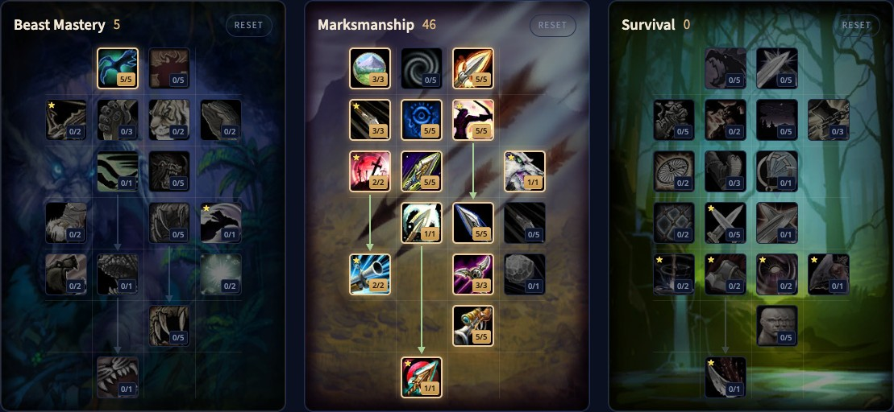

Der Marksmanship Hunter in WoW Forever ist der Scharfschütze. Du kannst mit Begleiter spielen oder ihn wegschicken: Lone Wolf gibt dir ohne Begleiter 20 % mehr Schaden, und Sniper Shot ist ein neuer Schuss auf große Distanz unten im Baum. Du behältst jedes Werkzeug des Hunter für Pulls, Kontrolle und Feign Death, aber der Fokus liegt auf deinem eigenen Fernkampfschaden. Dieser Guide behandelt den Build für Level 60, die Rotation, Mana, Werte und Völker.

| | |
|---|---|
| Rolle | Fernkampfschaden, mit oder ohne Begleiter |
| Build auf Level 60 | 5/46/0: Deadly Aspects aus Beast Mastery und der ganze Marksmanship-Baum |
| Wichtigste Talente | Deadly Aspects, Lethal Attacks, Careful Aim, Rapid Killing, Mortal Shots, Rapid Recuperation, Barrage, Lone Wolf, Sniper Shot |
| Stärken | Sehr hoher Schaden, einfache Rotation, flexibel mit oder ohne Begleiter |
| Schwächen | Kein Begleiter, der dich schützt, abhängig vom Stillstehen |
| Leveln | [Leveling-Guide für den Hunter](/de/guides/hunter-leveling/), [Leveling-Build für den Hunter](/de/leveling/hunter/) |

## Stärken und Schwächen

**Sehr hoher Schaden.** Marksmanship ist eine der stärksten Spezialisierungen in WoW Forever, und ohne Begleiter vor allem in Gruppeninhalten und Schlachtzügen.

**Leicht zu lernen.** Die Rotation ist kurz. Position, Abklingzeiten und durchgehende Schüsse machen den Unterschied.

**Flexibel.** Behalte einen Begleiter fürs Solospiel, schick ihn weg für den meisten Schaden in Gruppen.

**Kein Begleiter.** Mit Lone Wolf hält nichts ein Monster von dir fern. Ein schlechter Pull in der offenen Welt ist schwerer zu retten.

**Stillstehen.** Du machst den meisten Schaden, wenn du stehen und schießen kannst. Kämpfe mit viel Bewegung kosten dich Schaden.

**Die tote Zone.** Zwischen Nahkampfreichweite und 8 Metern kannst du weder Nahkampf noch Fernkampf nutzen.

## Der Build für Level 60: 5/46/0

Die Beta endete auf Level 30, aber die Talentbäume für Level 60 stecken in den Spieldateien. Wir haben diesen Build Punkt für Punkt in [unserem Talentrechner](/de/talents/hunter/?t=5-30535525115023051) geprüft: 5 Punkte in Beast Mastery und 46 in Marksmanship, 51 insgesamt.

| Talent | Punkte |
|---|---|
| **Deadly Aspects** (Beast Mastery) | 5/5 |
| **Hawk Eye** | 3/3 |
| **Lethal Attacks** | 5/5 |
| **Improved Stings** | 3/3 |
| **Efficiency** | 5/5 |
| **Careful Aim** | 5/5 |
| **Rapid Killing** | 2/2 |
| **Improved Arcane Shot** | 5/5 |
| **Lone Wolf** | 1/1 |
| **Trueshot Aura** | 1/1 |
| **Mortal Shots** | 5/5 |
| **Rapid Recuperation** | 2/2 |
| **Barrage** | 3/3 |
| **Ranged Weapon Specialization** | 5/5 |
| **Sniper Shot** | 1/1 |

Zwei Punkte lassen sich verschieben:

- **Lone Wolf** zu 1 Punkt in **Improved Tracking** (Survival), wenn du deinen Begleiter behalten willst, etwa beim Questen.
- **Hawk Eye** zu 3 Punkten in **Improved Tracking**, wenn du die zusätzliche Reichweite nicht brauchst und mehr Schaden willst.

## Was die wichtigsten Talente tun

| Talent | Was es in Forever tut |
|---|---|
| **Deadly Aspects** | Mit Aspect of the Hawk hat Auto Shot 10 % Chance, dein Fernkampftempo 12 Sekunden lang um 30 % zu erhöhen |
| **Lethal Attacks** | 5 % mehr kritische Trefferchance mit allen Angriffen |
| **Improved Stings** | Serpent Sting verursacht 20 % mehr Schaden, Viper Sting ist 6 Sekunden früher bereit, Scorpid Sting hält 45 Sekunden länger |
| **Efficiency** | Schüsse, Stiche und Nahkampffähigkeiten kosten 15 % weniger Mana |
| **Careful Aim** | Angriffskraft in Höhe von 100 % deiner Intelligenz |
| **Rapid Killing** | Rapid Fire ist 2 Minuten früher bereit, und ein Kill oder ein Tod unter deinem Serpent Sting gibt deinem nächsten Schuss mehr Schaden |
| **Improved Arcane Shot** | Arcane Shot ist 1,5 Sekunden früher bereit |
| **Lone Wolf** | 20 % mehr Schaden mit allen Angriffen ohne aktiven Begleiter |
| **Trueshot Aura** | 30 Fernkampfangriffskraft für deine Gruppe oder deinen Schlachtzug |
| **Mortal Shots** | Kritische Treffer von Fernkampffähigkeiten verursachen 30 % mehr Zusatzschaden |
| **Rapid Recuperation** | Serpent Sting lässt 15 Sekunden lang 50 % deiner Manaregeneration beim Wirken weiterlaufen, 100 % nach Rapid Killing |
| **Barrage** | Multi-Shot, Aimed Shot und Volley verursachen 10 % mehr Schaden |
| **Ranged Weapon Specialization** | 5 % mehr Schaden mit Fernkampfwaffen |
| **Sniper Shot** | Ein Schuss auf große Distanz, 4 Sekunden Zauberzeit, 15 Sekunden Abklingzeit, bis 45 Meter; deine nächsten 3 Schüsse erhalten 10 Meter mehr Reichweite |

## Rotation

### Ein Ziel

1. Leg eine Immolation Trap dorthin, wo der Tank stehen wird, wenn möglich.
2. Wirk Sniper Shot zum Start des Pulls und erneut, sobald er bereit ist.
3. Wirk Serpent Sting und erneuere ihn, wenn er ausläuft.
4. Wirk Aimed Shot, sobald er bereit ist.
5. Wirk Arcane Shot, sobald er bereit ist.
6. Wirk Rapid Fire bei Abklingzeit.

### Mehrere Ziele

1. Leg eine Explosive Trap dorthin, wo der Tank stehen wird, wenn möglich.
2. Wirk Multi-Shot, sobald er bereit ist.
3. Setz Serpent Sting auf jedes Ziel, das lange genug lebt.
4. Wirk Sniper Shot und Arcane Shot, sobald sie bereit sind.
5. Leg Explosive Trap bei Abklingzeit unter die Gruppe.
6. Wirk Rapid Fire bei Abklingzeit.

## Abklingzeiten und Nutzen

- **Rapid Fire** ist deine Schadensabklingzeit: 40 % mehr Angriffstempo.
- **Trueshot Aura** gibt deinem Schlachtzug Fernkampfangriffskraft, auch anderen Huntern.
- **Frost Trap**, **Freezing Trap**, **Wing Clip** und **Concussive Shot** verlangsamen, fesseln oder nehmen Monster aus dem Kampf. **Explosive Trap** und **Immolation Trap** verursachen Schaden und teilen sich eine Abklingzeit von 30 Sekunden.
- **Feign Death** bringt dich aus dem Kampf. Ohne Begleiter ist es dein wichtigster Ausweg.
- **Scorpid Sting** senkt jetzt 20 Sekunden lang die Trefferchance des Ziels um 2 %. Er stapelt nicht mit Insect Swarm.
- **Tranquilizing Shot** entfernt Enrage- und Frenzy-Effekte.
- **Aufspüren** zeigt Monster und Spieler in der Nähe. Mit Improved Tracking machst du außerdem mehr Schaden gegen den aufgespürten Typ.
- **Aspekte:** Bleib im Kampf in Aspect of the Hawk und geh zu Fuß. Cheetah und Pack sind schneller, aber du wirst bei einem Treffer benommen.

## Mana

Marksmanship verbraucht viel Mana: Sniper Shot und Aimed Shot sind teuer und beide in deiner Rotation. Rapid Recuperation hält die Hälfte deiner Manaregeneration beim Wirken aufrecht, solange Serpent Sting auf dem Ziel ist, und Efficiency macht jeden Schuss günstiger. Behalte in langen Kämpfen deine Manaleiste im Blick.

## Mit oder ohne Begleiter

Lone Wolf verlangt, ohne Begleiter zu spielen. In Schlachtzügen und Dungeons ist das der meiste Schaden. In der offenen Welt ist ein Begleiter, der Monster von dir fernhält, oft mehr wert: Tausch Lone Wolf gegen einen Punkt in Improved Tracking und behalte deinen Begleiter. Nutze **Stay** und **Move To**, um ihn aus Flächenschaden herauszuhalten.

## Werte und Ausrüstung

Wertprioritäten für Level 60 folgen nach dem Start. Bis dahin:

- **Beweglichkeit**: 2 Fernkampfangriffskraft pro Punkt und kritische Trefferchance, etwa 1 % pro 53 Beweglichkeit auf Level 60.
- **Trefferwertung**: Gegen einen Boss der Stufe 63 brauchst du 9 % mit 300 Waffenfertigkeit oder 6 % mit 305.
- **Kritische Trefferchance**, die mit Mortal Shots zusammenwirkt.
- **Angriffskraft**, die Beweglichkeit Punkt für Punkt meist schlägt.
- **Tempo**, damit deine Fähigkeiten früher bereit sind.
- **Intelligenz**, für Mana und über Careful Aim auch für Angriffskraft.
- **Willenskraft**, für Manaregeneration zusammen mit Rapid Recuperation.

**Rüstung.** Leder und Kette funktionieren beide. Leatherworking hat gute Muster beim Leveln.

**Köcher oder Munitionsbeutel.** Beide erhöhen dein Fernkampftempo. Halte deinen aktuell.

**Waffen.** Deine Fernkampfwaffe ist mit Abstand dein wichtigstes Teil. Die Nahkampfwaffe trägst du vor allem für die Werte.

## Völker und Berufe

| Fraktion | Volk | Warum |
|---|---|---|
| Alliance | Skyborne | Ein Tempobonus, selten auf Ausrüstung, die stärkste Wahl |
| Alliance | Human | 2 % mehr kritische Trefferchance |
| Alliance | Dwarf | 2 % mehr kritischer Schaden |
| Alliance | Night Elf | Eine Abklingzeit für kritische Trefferchance |
| Horde | Skyborne | Ein Tempobonus und eine Abklingzeit für Bewegungstempo |
| Horde | Orc | Eine Abklingzeit für Angriffskraft und 1 % mehr kritische Trefferchance |
| Horde | Troll | Mehr Schaden gegen Wildtiere und eine Abklingzeit für Angriffstempo |
| Horde | Tauren | Eine Flächenbetäubung, mehr kritischer Schaden und Plainsrunning |

Die Unterschiede sind klein, also spiel das Volk, das dir gefällt. Für einen Build mit Begleiter siehe den [Guide für den Beast Mastery Hunter](/de/guides/beast-mastery-hunter/).

**Leatherworking** stellt gute Lederausrüstung her, **Engineering** bringt Gadgets und Zielfernrohre, **Alchemy** mit Herbalism versorgt dich mit Tränken, und **Enchanting** hält deine Ausrüstung verzaubert.
