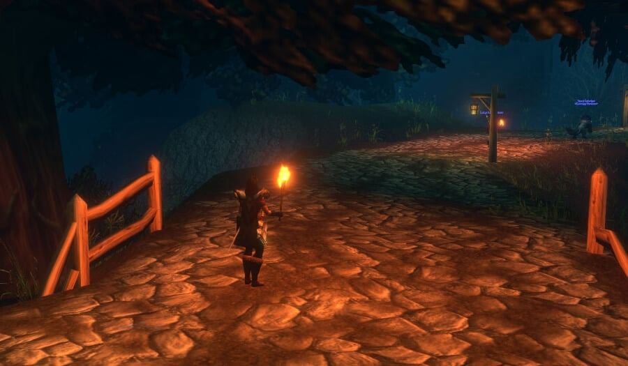
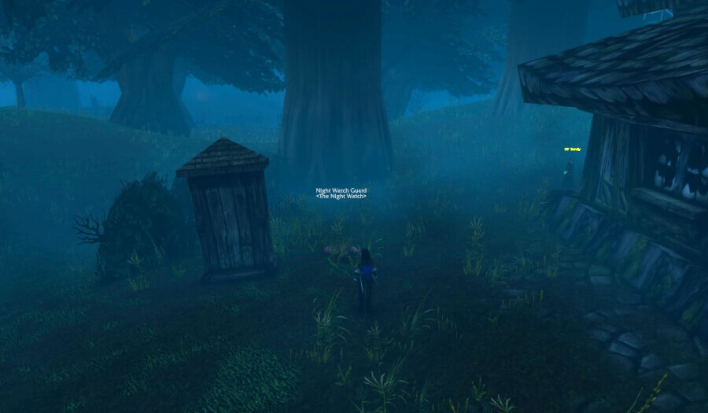
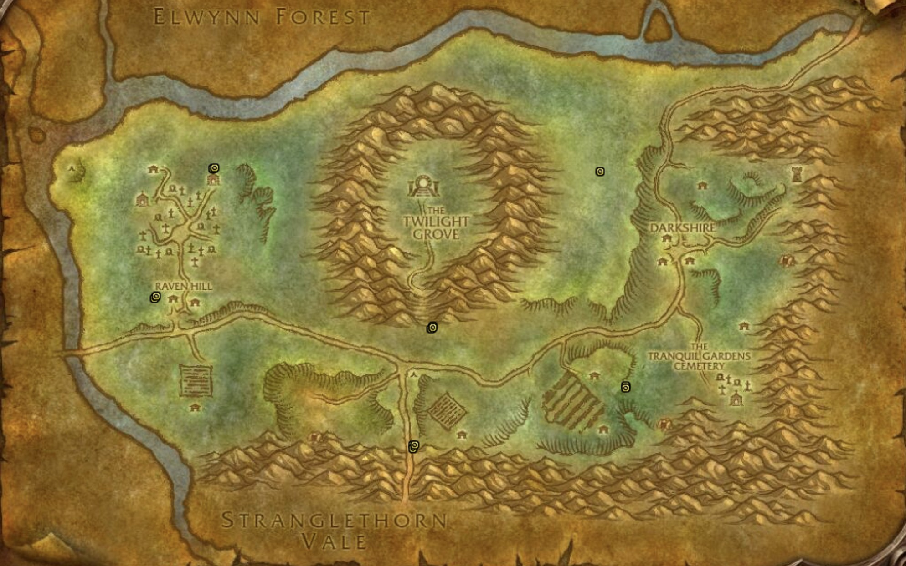

Die [Night Watchman's Torch](https://www.wowhead.com/forever/item=280612/night-watchmans-torch) ist eine Fackel, die dein Charakter hält, um die Dunkelheit zu erhellen. Durch die neue Beleuchtung von WoW Forever werden manche Zonen nachts richtig dunkel, und dort hilft dieser Gegenstand. Sie stammt von einem toten Wächter in Duskwood, der nur nachts erscheint. Spieler fanden sie in der Beta.

| | |
|---|---|
| Gegenstand | Night Watchman's Torch, einzigartig, beim Aufheben gebunden |
| Wo | Duskwood, ein toter Night Watch Guard |
| Wann | Nachts, am besten ab 20 Uhr Spielzeit |
| Fraktion | Allianz und Horde |
| Licht | 5 Minuten, Abklingzeit 30 Sekunden |

## Was die Fackel tut

Benutze sie, und dein Charakter hält 5 Minuten lang eine brennende Fackel. Das Licht geht aus, sobald du eine Kampfaktion ausführst, wenn du ins Wasser gehst und in den großen Städten. Danach hat der Gegenstand eine Abklingzeit von 30 Sekunden.

Wo sie hilft: in Duskwood selbst, in Tirisfal Glades und Silverpine Forest bei Nacht und in Stranglethorn Vale in den frühen Stunden, wenn der Waldboden schwarz wird.

Druids können die Fackel auch in ihren Tiergestalten benutzen. Seit einem Beta-Update im Oktober halten Cat Form und Travel Form sie im Maul ([News](/de/news/druid-forms-carry-the-torch-in-their-mouth/)).

Die Fackel macht auch Verstecktes sichtbar. Ein Hidden Stash in der Höhle von Ringo in Un'Goro Crater erscheint nur mit brennender Fackel, als Teil einer [Jagd nach Geheimnissen](/de/news/secret-hunters-chase-hidden-pages-across-azeroth/) in der Beta.

## So bekommst du sie

1. **Geh nachts nach Duskwood.** Der Night Watch Guard erscheint nur nachts; ab 20 Uhr Spielzeit stehen die Chancen am besten.
2. **Such den Wächter.** Fang bei Raven Hill an, /way Duskwood 17.2 54.4, wo er am häufigsten auftaucht. Prüf danach die anderen fünf Orte. Das Makro `/target Night Watch Guard` hilft, ihn im Dunkeln zu finden.
3. **Nimm die Quest an.** Über der Leiche schwebt ein gelbes Ausrufezeichen. Nimm die Quest an und schließ sie sofort ab; die Fackel landet in deinen Taschen.

Mehrere Spieler können die Quest am selben Wächter machen. Hast du die Fackel, verschwindet die Quest für dich, der Wächter bleibt aber in der Welt.

## Wo der Wächter liegt

Er hat keinen festen Platz. Er taucht an einem von sechs Orten auf, die auf der Karte von Duskwood markiert sind.

| Ort | Wo |
|---|---|
| **Raven Hill, Nord** | Nördlich des Friedhofs, /way 23.6 33.2 |
| **Raven Hill, West** | Westlich der Häuser, /way 17.2 54.4, der häufigste Ort |
| **Twilight Grove** | Südlich des Twilight Grove, an der Straße, /way 47.6 59.6 |
| **Südstraße** | Auf der Straße nach Süden Richtung Stranglethorn Vale, /way 45.6 79.0 |
| **Höfe** | Östlich der Felder, westlich des Tranquil Gardens Cemetery, /way 68.8 69.6 |
| **Nordosten** | Zwischen dem Twilight Grove und Darkshire, /way 66.0 33.8 |

## Für die Horde

Auch die Horde kann die Fackel holen. Nimm den Zeppelin von Orgrimmar nach Grom'gol in Stranglethorn Vale und reise nach Norden bis Duskwood.

## Wenn du sie verlierst

Die Fackel ist einzigartig, du trägst also nur eine. Wer sie löscht, kann nach Duskwood zurückkehren und den Wächter erneut suchen, um eine neue zu bekommen.

Der nächtliche Spawn und die Orte stammen von Spielern in der Beta. Ob sie bis zum Launch gleich bleiben, ist nicht bekannt.
