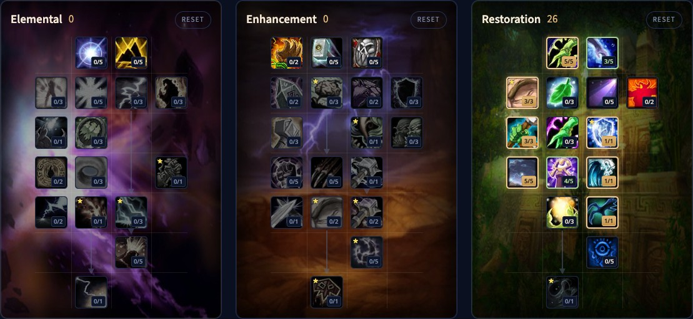

Der Restoration Shaman in WoW Forever heilt mit wenigen einfachen Zaubern und füllt den Rest mit Nutzen. Chain Heal ist die große Gruppenheilung, Lesser Healing Wave rettet ein Ziel in Not, und deine Totems stärken den ganzen Raid. Neu in Forever sind Riptide, Water Shield und Mindfulness, die das älteste Problem der Spec angehen: Mana. Dieser Guide behandelt den Build für Level 30, die wichtigsten Talente, die Heilpriorität, Totems, Mana, Werte und Völker.

| | |
|---|---|
| Rolle | Heiler, für ein Ziel und für Gruppen |
| Build auf Level 30 | 21 Punkte in Restoration, Talented fügt Tidal Mastery 5/5 und Restorative Totems 4/5 hinzu |
| Wichtigste Talente | Mindfulness, Water Shield, Ancestral Healing, Tidal Mastery, Mana Tide Totem, Nature's Swiftness |
| Stärken | Einfache und starke Heilungen, Totems für den ganzen Raid, viel Nutzen |
| Schwächen | Mana, keine harte Kontrolle, die Platzierung der Totems |
| Weitere Guides zum Shaman | [Shaman leveln](/de/guides/shaman-leveling/), [Levelbuild für den Shaman](/de/leveling/shaman/) |

## Stärken und Schwächen

**Einfaches Heilen.** Eine Handvoll Heilungen, die wenig Planung brauchen, und Chain Heal ist eine der stärksten Heilungen im Spiel. In ruhigen Momenten hilfst du der Gruppe auf andere Weise.

**Gruppenbuffs.** Totems geben Werte, Windfury auf Waffen, Manaregeneration und Widerstände. In Forever wirken sie für den ganzen Raid, nicht nur für deine Gruppe.

**Nutzen.** Purge entfernt einen Buff vom Gegner, Earth Shock unterbricht, und du heilst Gift und Krankheit. Mit Improved Ghost Wolf bist du im Kampf schnell unterwegs, auch drinnen.

**Mana.** Shamans verbrennen Mana. Water Shield und Mindfulness helfen, aber Manaverwaltung bleibt Teil der Arbeit.

**Wenig Kontrolle.** Keine harte Kontrolle. Earthbind Totem verlangsamt, und hält mit Earthbound aus dem Elemental-Baum fest, aber es fällt zu deinen Füßen.

**Platzierung.** Totems haben eine Reichweite. Windfury Totem muss die Nahkämpfer erreichen, Mana Tide Totem die anderen Heiler, und Chain Heal springt nur zwischen Spielern, die nah beieinander stehen.

## Der Build für Level 30

Die Beta endete bei Level 30, der Build nutzt also 21 Punkte. Talented aus dem Legacy-System fügt 5 hinzu. [Öffne den Build im Talentrechner](/de/talents/shaman/?t=--53300030140101).

| Talent | Punkte |
|---|---|
| **Improved Healing Wave** | 5/5 |
| **Tidal Focus** | 3/5 |
| **Mindfulness** | 3/3 |
| **Ancestral Healing** | 3/3 |
| **Water Shield** | 1/1 |
| **Tidal Mastery** | 4/5 |
| **Mana Tide Totem** | 1/1 |
| **Nature's Swiftness** | 1/1 |

[Öffne die Talented-Version](/de/talents/shaman/?t=--53300030154101) mit Tidal Mastery 5/5 und Restorative Totems 4/5.

Nature's Swiftness sitzt in der fünften Reihe und braucht 20 Punkte darüber, es ist also der 21. Punkt. Derselbe Build steht in unserem [Levelguide für den Shaman](/de/guides/shaman-leveling/).

## Was die wichtigsten Talente tun

| Talent | Was es in Forever tut |
|---|---|
| **Improved Healing Wave** | Healing Wave wirkt 0,5 Sekunden schneller |
| **Tidal Focus** | Bei 3/5: Heilzauber kosten 3 % weniger Mana, und 3 % mehr Trefferchance |
| **Mindfulness** | 50 % deiner Manaregeneration laufen beim Zaubern weiter |
| **Ancestral Healing** | Eine kritische Heilung erhöht die Rüstung des Ziels 15 Sekunden lang um 25 % |
| **Water Shield** | Drei Wasserkugeln; ein Treffer auf dich oder ein kritischer Zauber gibt pro Kugel 2 % deines maximalen Manas zurück |
| **Tidal Mastery** | Bis zu 5 % mehr kritische Trefferchance für Heilzauber |
| **Restorative Totems** | Bei 4/5: Mana Spring Totem 20 % stärker, Healing Stream Totem 40 % stärker |
| **Mana Tide Totem** | Ein Totem, das 12 Sekunden lang alle 3 Sekunden 88 Mana an die Gruppe im Umkreis von 30 Metern zurückgibt |
| **Nature's Swiftness** | Dein nächster Naturzauber mit Zauberzeit wird sofort gewirkt |
| **Riptide** | Eine Sofortheilung plus Heilung über Zeit, und 25 % mehr Heilung von Chain Heal auf dieses Ziel |

Water Shield gibt in Forever kein passives Mana, aber mit vielen kritischen Heilungen summiert es sich. Riptide ist das letzte Talent des Baums, in der siebten Reihe, auf Level 30 außer Reichweite.

## Heilpriorität

Ein Heiler hat keine feste Reihenfolge: Reagiere auf das, was passiert. Als Richtlinie:

1. Riptide auf dein Hauptziel, sobald du es hast.
2. Chain Heal, wenn das Ziel bei anderen verletzten Spielern steht, am besten auf ein Ziel mit Riptide.
3. Lesser Healing Wave, wenn jemand sofort eine Heilung braucht.
4. Healing Wave für gleichmäßigen Schaden.
5. Healing Stream Totem für dauernde Heilung, wenn dein Platz für Wassertotems frei ist.

Beim Tankheilen lohnt Chain Heal nur, wenn der Tank bei anderen Verletzten steht. Riptide ist sofort, du kannst es also direkt nach einer Heilung mit Zauberzeit wirken, für einen zusätzlichen Schub. Ein Makro mit Nature's Swiftness und Healing Wave, oder mit Chain Heal, gibt dir einen Notfallknopf.

## Mana

1. **Spirit** auf der Ausrüstung ist deine wichtigste Manaregeneration. Nimm mehr davon, wenn du leer läufst.
2. **Mindfulness** lässt 50 % davon beim Zaubern weiterlaufen, für nur 3 Punkte.
3. **Mana Spring Totem** immer, **Mana Tide Totem**, wenn die Gruppe trocken läuft. Stell es so, dass andere Heiler auch etwas davon haben.
4. **Water Shield** bei kritischen Heilungen.

## Totems und Bewegung

- **Windfury Totem** ist der beste Nahkampfbuff im Spiel und bringt dir Einladungen. Ohne die Beschränkung auf die Gruppe wirkt es für den ganzen Raid.
- **Tremor Totem** entfernt Furcht, Schlaf und Bezauberung bei Verbündeten in Reichweite. Gutes Timing rettet Runs.
- **Poison Cleansing Totem** und **Disease Cleansing Totem** entfernen pro Puls einen Effekt, ohne dass du jeden Spieler einzeln heilen musst.
- **Totemic Recall** holt deine Totems gegen etwas Mana zurück. **Totemic Projection** versetzt deine aktiven Totems bis zu 30 Meter, kostet aber viel Mana.
- **Ghost Wolf** mit Improved Ghost Wolf ist sofort und wirkt drinnen. Rein und raus aus der Form kostet eine globale Abklingzeit.

In Bewegung hast du vor allem Riptide und Nature's Swiftness zum Heilen. Überleg, wohin der Kampf geht, bevor du deine Totems stellst.

## Heilen per Mouseover

Zaubern per Mouseover ist in Forever eingebaut. Schalte es unter Options, Combat ein: Deine Heilungen gehen dann an die Einheit unter der Maus, Rahmen eingeschlossen, während du dein eigenes Ziel behältst. Click Casting im Menü Keybindings gibt jeder Maustaste einen eigenen Zauber.

## Werte und Ausrüstung

Wertprioritäten für Level 60 folgen nach dem Start. Bis dahin:

- **Heilkraft**: größere Heilungen, also weniger Zauber und weniger Mana.
- **Spirit**: deine wichtigste Manaregeneration in Forever.
- **Intellect**: ein größerer Manapool und mehr kritische Trefferchance mit Zaubern.
- **Crit**: größere Heilungen, mehr Mana aus Water Shield, und Heilungen über Zeit können jetzt kritisch treffen.
- **Haste**: schnellere Zauber und globale Abklingzeit, aber Heilungen über Zeit werden nicht schneller, und dein Mana geht schneller aus.

**Rüstung.** Stoff, Leder oder Kette, was die richtigen Werte hat: ein leichterer Typ hat in Forever keinen Nachteil. Dungeons und Leatherworking geben gute Levelausrüstung.

**Waffe.** Heilkraft und Zaubermacht, dann Intellect. Eine Einhandwaffe mit Schild ist meist am besten, aber ein besserer Stab geht auch.

**Totems.** Der Reliktplatz des Shaman. Noch selten; such eines, das deinem Mana hilft.

## Völker und Berufe

| Fraktion | Volk | Warum |
|---|---|---|
| Alliance | Dwarf | Der einzige Shaman der Alliance, mit einem Bonus auf kritische Treffer |
| Horde | Orc | Mehr kritische Trefferchance und Blood Fury, die stärkste Wahl |
| Horde | Troll | Überlebensfähigkeiten und Berserking |
| Horde | Tauren | Ein Bonus auf kritische Treffer |
| Horde | Windshaper Skyborne | 3 % mehr Haste für Zauber und Nahkampf |

**Leatherworking** stellt beim Leveln gute Ausrüstung her, mit Zaubermacht, die früh selten ist. **Engineering** stellt starke Schmuckstücke und Gadgets her. **Enchanting** stellt früh ein starkes Totem her, <a class="wf-wh wf-q3" href="https://www.wowhead.com/forever/item=249398">Polished Driftwood Icon</a>. Mehr über Heilen in Gruppen in unseren [Dungeon-Guides](/de/guides/dungeons/).
