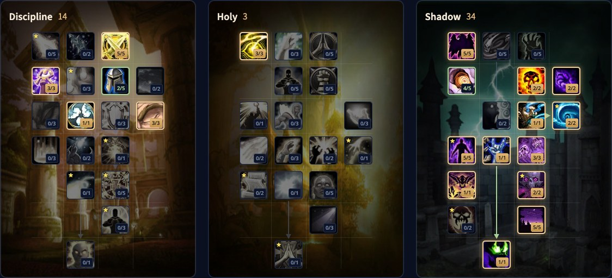

Der Shadow Priest in WoW Forever macht Schattenschaden mit zwei Zaubern, die Schaden über Zeit verursachen, Mind Blast und Mind Flay, und heilt gleichzeitig die Gruppe mit Vampiric Embrace. Mana ist selten ein Problem. Mobilität schon: Der Priest hat dafür kaum Mittel. Dieser Guide behandelt den Build, die Rotation, Shadowform, Mana, Werte und Ausrüstung.

| | |
|---|---|
| Rolle | Fernkampfschaden über Zeit, mit Gruppenheilung durch Vampiric Embrace |
| Build für Level 60 | 14/3/34, mit den Talenten des Beta-Builds vom 15. Oktober |
| Wichtige Talente | Mind Flay, Improved Mind Flay, Vampiric Embrace, Shadow Weaving, Silence, Shadowform |
| Stärke | Sehr gutes Mana, Gruppenheilung, die nie aufhört |
| Schwäche | Kaum Mobilität, langsamer Start, schwach gegen mehr als vier Ziele |
| Leveln | [Leveling-Guide für den Priest](/de/guides/priest-leveling/), [Level-Build für den Priest](/de/leveling/priest/) |
| Andere Spezialisierungen | [Holy Priest](/de/guides/holy-priest/), [Discipline Priest](/de/guides/discipline-priest/) |

## Was sich für Shadow ändert

- **Improved Mind Flay ist neu.** Bei 2/2 macht jeder Tick von Mind Flay 20 % mehr als der vorige, der letzte Tick ist also der stärkste.
- **Vampiric Embrace hält 30 Sekunden.** Es heilt alle Gruppenmitglieder um 20 % des Schattenschadens, den du machst, und kann den ganzen Kampf aktiv bleiben.
- **Shadowform kann mehr.** 10 % mehr Schattenschaden, 50 % weniger Manakosten für Schattenzauber, 100 % mehr Bonus auf kritischen Schaden von Schattenzaubern und 15 % weniger erlittener körperlicher Schaden.
- **Silence unterbricht jetzt auch.** 5 Sekunden Stille und 3 Sekunden Unterbrechung auf einer Taste.
- **Devouring Contagion ist neu.** Devouring Plague kostet halb so viel Mana, und stirbt ein Ziel damit, springt die Seuche auf 2 Gegner in der Nähe über.
- **Dark Inspiration ist neu.** Mind Blast und ein voll kanalisiertes Mind Flay geben dir und deiner Gruppe 10 Sekunden lang 15 % mehr Willenskraft.
- **Early Demise ist neu.** Bei 2/2 30 % mehr kritische Trefferchance für Shadow Word: Death auf Ziele unter 20 % Gesundheit.

## Stärken und Schwächen

| Stärken | Schwächen |
|---|---|
| Sehr gutes Mana dank Shadowform, Meditation und Mental Strength | Kaum Möglichkeiten, sich schnell zu bewegen oder zu fliehen |
| Vampiric Embrace heilt die Gruppe den ganzen Kampf lang | Der Schaden braucht Zeit, um mit DoTs und Shadow Weaving aufzubauen |
| DoTs und Burst-Zauber passen zusammen, ohne komplizierte Rotation | Wenig Direktschaden gegen mehr als vier Ziele |
| Silence, Psychic Scream und Dispel Magic als Nutzen | Keine Heilzauber in Shadowform |

## Der Build für Level 60 (14/3/34)

Dieser Build nutzt alle 51 Punkte von Level 60. Vierzehn gehen in Discipline für Twin Disciplines, Inner Focus und Meditation, drei in Holy für Twilight Focus und der Rest in Shadow bis Shadowform. [Öffne den Build im Talentrechner](/de/talents/priest/?t=00530200103-3-50042201251312051).

| Talent | Punkte |
|---|---|
| **Twin Disciplines** | 5/5 |
| **Silent Resolve** | 3/3 |
| **Mental Strength** | 2/5 |
| **Inner Focus** | 1/1 |
| **Meditation** | 3/3 |
| **Twilight Focus** | 3/3 |
| **Shadow Focus** | 5/5 |
| **Improved Mind Blast** | 4/5 |
| **Improved Shadow Word: Pain** | 2/2 |
| **Shadow Reach** | 2/2 |
| **Mind Flay** | 1/1 |
| **Improved Mind Flay** | 2/2 |
| **Dark Inspiration** | 5/5 |
| **Vampiric Embrace** | 1/1 |
| **Shadow Weaving** | 3/3 |
| **Silence** | 1/1 |
| **Devouring Contagion** | 2/2 |
| **Darkness** | 5/5 |
| **Shadowform** | 1/1 |

**Freie Punkte.** Ein paar Punkte lassen sich ohne großen Verlust verschieben:

- Inner Focus bringt Shadow wenig. Der Punkt kann woanders hin.
- Devouring Contagion hilft nur, wenn Ziele mit Devouring Plague sterben. Im Schlachtzug fehlt selten Mana, also können ein oder zwei Punkte weg.
- Mehr Punkte in Early Demise oder Mental Strength sind kleine Gewinne.
- Spirit Tap hilft viel in Dungeons, wo ständig Gegner sterben, und wenig im Schlachtzug.
- Musst du im Schlachtzug Gegner bannen, lässt ein Punkt in Holy Precision Dispel Magic seltener verfehlen.

## Was die wichtigsten Talente tun

| Talent | Was es in Forever tut |
|---|---|
| **Mind Flay** | Dein Füller: Schattenschaden über 3 Sekunden und 50 % Verlangsamung |
| **Improved Mind Flay** | Jeder Tick von Mind Flay 20 % stärker als der vorige. Brich Mind Flay nie ab |
| **Vampiric Embrace** | 20 % deines Schattenschadens heilen 30 Sekunden lang die ganze Gruppe. Der Hauptgrund, dich mitzunehmen |
| **Shadow Weaving** | Jeder Schattenzauber lässt das Ziel 2 % mehr Schattenschaden von dir erleiden, bis 10 % bei 5 Stapeln |
| **Silence** | 5 Sekunden Stille und 3 Sekunden Unterbrechung. Ob Schlachtzüge es brauchen, ist noch offen |
| **Darkness** | 10 % mehr Schattenschaden bei 5/5 |
| **Dark Inspiration** | 15 % mehr Willenskraft für dich und deine Gruppe nach Mind Blast oder einem vollen Mind Flay |
| **Shadowform** | Mehr Schaden, halbe Manakosten, größere kritische Treffer und weniger körperlicher Schaden. Das Herz der Spezialisierung |

## Rotation

**Ein Gegner**
1. Wirke Fade vor dem Pull, um deine Bedrohung zu senken.
2. Wirke Mind Blast vorab, damit er zu Kampfbeginn trifft.
3. Devouring Plague, dann Shadow Word: Pain.
4. Shadow Word: Death und Mind Blast.
5. Vampiric Embrace.
6. Mind Flay, und lass es auslaufen.

Nach dem Opener folgst du einer Priorität: Halte Devouring Plague und Shadow Word: Pain aufrecht, wirke Mind Blast und Shadow Word: Death, sobald sie bereit sind, halte Vampiric Embrace so nah wie möglich an 100 % und fülle jede Lücke mit Mind Flay.

**Mehrere Gegner**
1. Derselbe Opener auf das Hauptziel, mit Devouring Plague nur dort.
2. Shadow Word: Pain auf jedes Ziel. Das ist der größte Teil deines Schadens gegen eine Gruppe.
3. Unter vier Zielen nutzt du weiter Shadow Word: Death und Mind Blast.
4. Vampiric Embrace auf das Ziel, das den meisten Schattenschaden von dir bekommt.
5. Fülle mit Mind Flay auf.

Shadow hat keine eigenen Schadens-Abklingzeiten. Vampiric Embrace ist der einzige Buff, den du verwaltest, und der darf einfach nie wegfallen.

## Shadowform, DoTs und Mind Flay

**Shadowform** macht die Spezialisierung aus, sperrt aber jede Heilung. Willst du jemanden direkt heilen, verlässt du die Form, wirkst die Heilung und gehst zurück, was eine globale Abklingzeit und Mana kostet. Überlass das Heilen den Heilern und Vampiric Embrace.

**DoTs.** Dein Schaden steht und fällt mit der Laufzeit von Shadow Word: Pain und Devouring Plague. Erneuere sie, wenn sie auslaufen, nicht lange vorher.

**Mind Flay.** Mit Improved Mind Flay macht der dritte Tick den meisten Schaden. Wer sich bewegt oder etwas anderes wirkt, bevor die Kanalisierung endet, verschenkt diesen Tick.

**Devouring Contagion.** Steht ein Ziel kurz vor dem Tod, springt eine Devouring Plague darauf auf zwei andere Gegner über. Halte Devouring Plague nicht dafür zurück, aber denk in Dungeon-Gruppen daran.

## Mana

Mana ist eine Stärke von Shadow. Shadowform halbiert die Kosten von Schattenzaubern, Meditation lässt 50 % deiner Manaregeneration beim Zaubern weiterlaufen, und Mental Strength gibt bei 5/5 10 % Intelligenz. Devouring Contagion halbiert die Kosten von Devouring Plague. In Dungeons gibt Spirit Tap nach jedem Kill viel Regeneration.

## Mobilität

Zauberer leben nach einer Regel: immer zaubern. Der Priest hat kaum Mittel, sich schnell zu bewegen, also wähle deinen Platz vor dem Kampf und bewege dich so wenig wie möglich. Wirke deine Spontanzauber wie Shadow Word: Pain und Shadow Word: Death, wenn du laufen musst.

## Werte und Ausrüstung

Die Reihenfolge für einen Shadow Priest:

1. **Trefferchance** bis zur Obergrenze. Ein Zauber, der verfehlt, macht nichts und lässt die Stapel von Shadow Weaving auslaufen.
2. **Zaubermacht und Schattenzauberschaden.** Der größte Gewinn, sobald du die Trefferobergrenze erreicht hast. Schattenzauberschaden zählt für dich genauso.
3. **Kritische Trefferchance.** Shadowform verdoppelt den Bonus auf kritischen Schaden deiner Schattenzauber, kritische Treffer sind also mehr wert, als ihr Platz in dieser Liste vermuten lässt.
4. **Intelligenz** für einen größeren Manavorrat und mehr kritische Treffer mit Zaubern.
5. **Willenskraft** kommt mit der Ausrüstung. Such nicht danach.

**Rüstung.** Stoff mit Zaubermacht oder Schattenzauberschaden passt zu dir. Stoff mit Stärke oder Beweglichkeit nicht.

**Zauberstab.** <a class="wf-wh wf-q3" href="https://www.wowhead.com/forever/item=7001">Gravestone Scepter</a> aus einer Quest in Blackfathom Deeps geht ab Level 18, realistischer um 24. Du behältst ihn bis Level 37 oder länger, also lohnt sich die Mühe.

**Ring.** <a class="wf-wh wf-q3" href="https://www.wowhead.com/forever/item=281635">Philanthropist's Ring</a> gibt 10 Zaubermacht für 20 Bücher. Der [Guide zu den Bibliotheksbüchern](/de/guides/library-books/) zeigt, wo sie liegen.

**Schmuckstück.** <a class="wf-wh wf-q3" href="https://www.wowhead.com/forever/item=273840">Cursed Murloc Eye</a> fällt von Gelihast in Blackfathom Deeps. Farme es nicht, aber nimm es mit, wenn es bei deinem Questlauf fällt.

## Völker und Berufe

| Fraktion | Volk | Warum |
|---|---|---|
| Allianz | Dwarf | Big Game Hunter: 5 % mehr Schaden gegen Wildtiere. Die beste Wahl gegen Wildtier-Bosse, knapp hinter Human gegen den Rest |
| Allianz | Human | <a class="wf-wh wf-spell" href="https://www.wowhead.com/forever/spell=20597">Ruthless</a>: 1 % mehr kritische Trefferchance. Eine echte Option in Forever |
| Horde | Troll | Beast Slaying: 5 % mehr Schaden gegen Wildtiere. Die beste Wahl gegen Wildtier-Bosse |
| Horde | Undead | Touch of the Grave wurde stärker. Gegen andere Bosse so gut wie Troll, oder besser, wenn Shadowguard nicht oft auslöst |

Die Unterschiede zwischen den Völkern sind sehr klein. Wähle das Volk, das dir gefällt, nicht das, das einen Bruchteil eines Prozents gewinnt.

**Berufe.** Tailoring passt zu jedem Priest: Stoffausrüstung mit Zaubermacht, und Forever bringt neue Muster, von Ausrüstung für eine einzige Magieschule bis zu neuen Gürteln auf Level 10 mit Zaubermacht. Enchanting gibt dir eigene Zauberstäbe und Verzauberungen und macht dich zum Verzauberer deiner Gilde. Engineering bekommt in Forever neue Pläne und neue Schmuckstücke und ist immer ein starker Hauptberuf.
