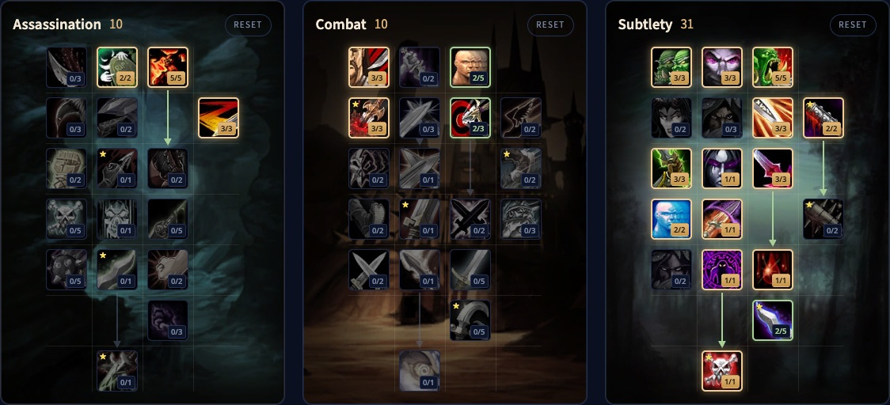

> **Update vom 4. November:** Builds und Talente unten folgen den neuen Bäumen aus den Entwicklungsnotizen vom 2. November, mehr in [unserem Beitrag](/de/news/rogues-get-shank-and-death-mark-in-a-big-rework/).

Der Subtlety Rogue in WoW Forever hat zwei echte PvE-Builds. Der eine teilt riesige kritische Ambushes aus, und Ghostly Strike lässt dich Ambush im Kampf nutzen. Der andere setzt auf Blutungen, mit Hemorrhage und einem stärkeren Rupture. Beide enden in Death Mark, einem Finishing Move, der deinen Schaden speichert und später freisetzt. Gifte treffen jetzt kritisch und skalieren mit Angriffskraft. Dieser Guide behandelt beide Builds für Level 30 und 60, die Rotationen, Energie, Gifte, Überleben, Werte und Völker.

| | |
|---|---|
| Rolle | Nahkampfschaden, mit Dolchen oder Blutungen |
| Builds | Ambush (10/10/31) und Blutung (12/8/31), beide mit Death Mark, auf Level 60 |
| Wichtigste Talente | Malice, Opportunity, Initiative, Ghostly Strike, Serrated Blades, Preparation, Hemorrhage, Boot Knife, Death Mark |
| Stärken | Zwei Spielstile, Blutungen ignorieren Rüstung, viel Kontrolle |
| Schwächen | Braucht Ausrüstung, beste Talente erst auf hoher Stufe |
| Leveln | [Leveling-Guide für den Rogue](/de/guides/rogue-leveling/), [Leveling-Build für den Rogue](/de/leveling/rogue/) |

## Stärken und Schwächen

**Zwei Spielstile.** Ambush mit Ghostly Strike oder Blutungen mit Hemorrhage, beide mit Death Mark am Ende. Beide halten in langen Kämpfen gut mit.

**Blutungen ignorieren Rüstung.** Rupture und Garrote ignorieren Rüstung vollständig, und das zahlt sich gegen schwer gepanzerte Monster und Bosse aus.

**Kontrolle.** Kick, Gouge, Sap, Cheap Shot, Kidney Shot und Blind, dazu Gifte, die verlangsamen, Zauberzeiten verlängern oder Heilung senken.

**Hängt vom Kampf ab.** Der Ambush-Build muss hinter dem Ziel stehen, was besser zu Dungeons und Schlachtzügen passt als zur offenen Welt. Manche Monster sind immun gegen Blutungen.

**Braucht Ausrüstung.** Rupture, Garrote und Gifte skalieren mit Angriffskraft und können kritisch treffen, du brauchst also beides.

**Braucht Stufen.** Die besten Talente liegen unten im Baum. Viele Spieler leveln mit einer anderen Spezialisierung und wechseln später zu Subtlety.

## Builds für Level 30

Auf Level 30 hast du 21 Punkte, und Talented gibt 5 dazu. Beide Builds stehen erklärt in unserem [Leveling-Guide für den Rogue](/de/guides/rogue-leveling/).

- **Ambush:** tötet Monster so schnell wie möglich mit kritischen Ambushes aus Stealth. [Öffne den Build](/de/talents/rogue/?t=02--333003031021), [Talented-Version](/de/talents/rogue/?t=025--333003031021).
- **Blutung:** Garrote, Hemorrhage und Rupture, mit Serrated Blades für ein stärkeres Rupture und Preparation für ein zusätzliches Slice and Dice. [Öffne den Build](/de/talents/rogue/?t=--3320002313210001), [Talented-Version](/de/talents/rogue/?t=002--3322002313210011).

## Ambush-Build mit Death Mark für Level 60: 10/10/31

Die Beta endete auf Level 30, aber die Talentbäume für Level 60 stecken in den Spieldateien. Wir haben diesen Build Punkt für Punkt in [unserem Talentrechner](/de/talents/rogue/?t=025003-302302-335003231321001121) geprüft. Backstab ist dein wichtigster Generator, und Ghostly Strike lässt dein nächstes Ambush ohne Stealth zu. Serrated Blades bringt 9 % Rüstungsdurchschlag, Hemorrhage deckt Kämpfe ab, in denen du nicht hinter dem Monster stehen kannst, und Death Mark unten im Baum speichert deinen Schaden und setzt ihn nach 6 Sekunden frei.

| Talent | Punkte |
|---|---|
| **Remorseless Attacks** (Assassination) | 2/2 |
| **Malice** (Assassination) | 5/5 |
| **Improved Slice and Dice** (Assassination) | 3/3 |
| **Coup de Grace** (Combat) | 3/3 |
| **Lightning Reflexes** (Combat) | 2/5 |
| **Puncturing Wounds** (Combat) | 3/3 |
| **Precision** (Combat) | 2/3 |
| **Setup** | 3/3 |
| **Master of Deception** | 3/3 |
| **Opportunity** | 5/5 |
| **Improved Ambush** | 3/3 |
| **Dirty Tricks** | 2/2 |
| **Initiative** | 3/3 |
| **Premeditation** | 1/1 |
| **Serrated Blades** | 3/3 |
| **Elusiveness** | 2/2 |
| **Ghostly Strike** | 1/1 |
| **Preparation** | 1/1 |
| **Hemorrhage** | 1/1 |
| **Boot Knife** | 2/5 |
| **Death Mark** | 1/1 |

Murder gibt es seit dem 2. November nicht mehr, daher gehen die letzten 2 Punkte in Assassination an Remorseless Attacks. Ruthlessness 2/3 ist eine Alternative.

## Blutungsbuild mit Death Mark für Level 60: 12/8/31

Ganz nach unten im Subtlety-Baum. [Öffne den Build im Talentrechner](/de/talents/rogue/?t=015303-302003-332210231321001151). Hemorrhage lässt Rupture und Garrote 15 % härter treffen, Boot Knife 5/5 macht aus jedem Shank 2 Combopunkte, und Death Mark speichert den Schaden von Garrote und Rupture doppelt so schnell.

| Talent | Punkte |
|---|---|
| **Remorseless Attacks** (Assassination) | 1/2 |
| **Malice** (Assassination) | 5/5 |
| **Ruthlessness** (Assassination) | 3/3 |
| **Improved Slice and Dice** (Assassination) | 3/3 |
| **Coup de Grace** (Combat) | 3/3 |
| **Lightning Reflexes** (Combat) | 2/5 |
| **Precision** (Combat) | 3/3 |
| **Setup** | 3/3 |
| **Master of Deception** | 3/3 |
| **Opportunity** | 2/5 |
| **Dirty Deeds** | 2/2 |
| **Camouflage** | 1/3 |
| **Dirty Tricks** | 2/2 |
| **Initiative** | 3/3 |
| **Premeditation** | 1/1 |
| **Serrated Blades** | 3/3 |
| **Elusiveness** | 2/2 |
| **Ghostly Strike** | 1/1 |
| **Preparation** | 1/1 |
| **Hemorrhage** | 1/1 |
| **Boot Knife** | 5/5 |
| **Death Mark** | 1/1 |

## Was die wichtigsten Talente tun

| Talent | Was es in Forever tut |
|---|---|
| **Malice** | 5 % mehr kritische Trefferchance mit Angriffen und Giften |
| **Remorseless Attacks** | Nach einem Kill 40 % mehr kritische Trefferchance für dein nächstes Sinister Strike, Backstab, Ambush, Mutilate oder Ghostly Strike |
| **Ruthlessness** | Finishing Moves haben 60 % Chance, einen Combopunkt hinzuzufügen |
| **Improved Slice and Dice** | Slice and Dice hält 45 % länger |
| **Precision** | 3 % mehr Trefferchance |
| **Opportunity** | Backstab, Garrote, Ambush und Mutilate verursachen auf 5/5 bis zu 20 % mehr Schaden |
| **Master of Deception** | Monster entdecken dich in Stealth, als wärst du 3 Stufen höher |
| **Setup** | Auf 3/3: 45 % Chance auf einen Combopunkt, wenn du einem Angriff ausweichst oder einem Zauber widerstehst |
| **Initiative** | Ambush, Garrote und Cheap Shot geben einen zusätzlichen Combopunkt |
| **Ghostly Strike** | 180 % Waffenschaden mit einem Dolch, 15 % mehr Ausweichen für 7 Sekunden, und dein nächstes Ambush oder Garrote innerhalb von 7 Sekunden braucht kein Stealth |
| **Serrated Blades** | Deine Angriffe ignorieren 9 % Rüstung, und Rupture verursacht 30 % mehr Schaden |
| **Premeditation** | Fügt deinem Ziel 2 Combopunkte hinzu |
| **Preparation** | Beendet die Abklingzeit deiner anderen Rogue-Fähigkeiten |
| **Hemorrhage** | 145 % Waffenschaden mit einem Dolch, und 15 % mehr Rupture-Schaden auf dem Ziel für 15 Sekunden |
| **Dirty Deeds** | Cheap Shot und Garrote kosten 20 Energie weniger, und Garrote muss nicht mehr von hinten kommen |
| **Boot Knife** | Auf 5/5 gibt jeder Shank 2 Combopunkte |
| **Death Mark** | Ein Finishing Move, der pro Combopunkt einen Teil deines Schadens speichert, Garrote und Rupture doppelt so schnell, und ihn nach 6 Sekunden austeilt. 25 Energie, 10 Sekunden Abklingzeit |

## Rotation

### Ambush-Build

1. Geh in Stealth und wirk Premeditation.
2. Eröffne mit Ambush.
3. Bleib hinter dem Ziel und nutze Backstab als Generator. Wo du nicht hinter ihm stehen kannst, nutze Hemorrhage.
4. Nutze Ghostly Strike bei Abklingzeit.
5. Nutze Ambush direkt nach Ghostly Strike, das es 7 Sekunden lang ohne Stealth erlaubt. Bei 5 Combopunkten zuerst ein Finishing Move.
6. Bei 5 Combopunkten wirkst du Slice and Dice und erneuerst es, wenn es ausläuft.
7. In langen Kämpfen wirkst du Expose Armor bei den nächsten 5 Combopunkten.
8. Wirk Death Mark bei 5 Combopunkten, sobald es bereit ist, der Rest geht in Eviscerate.
9. Vanish und Ambush für eine Schadensspitze, und Preparation, um deine Abklingzeiten zurückzusetzen oder zu fliehen.

### Blutungsbuild

1. Geh in Stealth und wirk Premeditation.
2. Eröffne mit Garrote.
3. Nutze Hemorrhage als Generator und Ghostly Strike bei Abklingzeit.
4. Bei 5 Combopunkten wirkst du Slice and Dice, bei den nächsten 5 Rupture.
5. Nutze Shank, sobald er bereit ist: Mit Boot Knife gibt er 2 Combopunkte.
6. Wirk Death Mark bei 5 Combopunkten, während Garrote und Rupture ticken, der Rest geht in Eviscerate, und Expose Armor auf Bossen, wenn deine Gruppe es braucht.
7. Vanish und Garrote für eine Schadensspitze, und Preparation, um deine Abklingzeiten zurückzusetzen oder zu fliehen.

### Mehrere Monster

Rogues haben keinen Flächenschaden: Töte ein Monster nach dem anderen. Wechsle nie das Ziel, während du Combopunkte aufbaust, sonst verlierst du sie.

## Stealth, Combopunkte und Finishing Moves

Stealth verlangsamt dich, bis zu 50 % auf niedrigen Stufen und 30 % auf Level 60, du reist also nicht damit, nutzt es aber gegen die meisten Monster. In Stealth bekommst du Eröffner: Ambush für einen großen Treffer, Garrote für eine Blutung, Sap und Cheap Shot zum Ausschalten.

Deine Generatoren sind zuerst Sinister Strike, später Backstab, Ghostly Strike und Hemorrhage, dazu Shank ab Level 24. Deine Finishing Moves sind Eviscerate, Slice and Dice, Expose Armor, Rupture und, ganz unten im Baum, Death Mark. Slice and Dice aktiv zu halten ist dein größter Schadensbonus. Kidney Shot betäubt ein gefährliches Monster.

## Energie

Energie kommt jetzt gleichmäßig zurück, 1 Punkt alle 0,1 Sekunden, also 10 pro Sekunde. Shank, ab Level 24, kostet 5 Energie und gibt alle 10 Sekunden 15 zurück, und Thistle Tea gibt mit langer Abklingzeit eine große Menge zurück. Ansonsten: Bau nie einen Combopunkt über 5 auf, und gib keine Energie ohne Grund für Kick, Feint, Gouge oder Blind aus.

## Gifte

Ab Level 20 lehrt dich eine Questreihe, Gifte herzustellen. Nutze Instant Poison und Deadly Poison in den meisten Kämpfen: Instant Poison auf langsamen Waffen, Deadly Poison auf schnellen. Wechsle zu Crippling, Mind-numbing oder Wound Poison, wenn ein Monster verlangsamt werden, langsamer wirken oder weniger Heilung bekommen soll.

## Überleben

Rogues schlagen hart zu, fallen aber schnell. Schätz jeden Pull ein: Nimm mit Sap ein Monster aus einer Gruppe, am besten einen Zauberer. Eröffne mit Cheap Shot, folge mit Kidney Shot und streck es mit Gouge oder Blind, wenn du Energie oder Abklingzeiten brauchst. Nutze Evasion, wenn du Treffer einstecken musst, unterbrich jeden Zauberer mit Kick, und Vanish, wenn nichts anderes mehr hilft.

## Werte und Ausrüstung

Wertprioritäten für Level 60 folgen, sobald wir Level 60 im Live-Spiel testen können. Bis dahin:

- **Beweglichkeit**: 1 Angriffskraft pro Punkt, 1 % kritische Trefferchance pro 29 Beweglichkeit, 1 % Ausweichen pro 14,5 Beweglichkeit.
- **Angriffskraft**, die jetzt auch den Schaden deiner Gifte erhöht.
- **Kritische Trefferchance**, auch für Gifte und Rupture.
- **Stärke**: 1 Angriffskraft pro Punkt, sonst nichts.
- **Ausdauer** für Gesundheit, auf den meisten Teilen zu finden.
- **Willenskraft** nur für Regeneration zwischen den Kämpfen.

**Rüstung.** Leder mit den Werten oben. Sets wie Defias Leather und Embrace of the Viper sind beim Leveln gut.

**Waffen.** Waffen sind jetzt auf jeder Stufe viel stärker. Jeder Typ funktioniert, aber deine Fähigkeiten skalieren am besten mit Dolchen, und der Ambush-Build braucht sie. Gute Beispiele sind Meteor Shard, Toxic Revenger, Assassin's Blade und Torturing Poker.

## Völker und Berufe

| Fraktion | Volk | Warum |
|---|---|---|
| Alliance | Human | 1 % kritische Trefferchance durch Ruthless |
| Alliance | Night Elf | Elune's Light, 10 % kritische Trefferchance für 15 Sekunden; Shadowmeld und besseres Stealth |
| Alliance | Gnome | Eureka! für eine Schadensspitze, Engineering Specialization mit Engineering |
| Alliance | Dwarf | Stoneform entfernt Blutungen, Gifte und Krankheiten; Artisan's Precision gibt 1 % Hit |
| Alliance | Skyborne | 2 % Tempo durch Wind Blessed |
| Horde | Orc | 10 % Angriffskraft durch Blood Fury, die beste Wahl |
| Horde | Troll | 10 % Tempo durch Berserking und ein Werkzeug zum Überleben |
| Horde | Undead | Besser im PvP; Cannibalize spart Zeit in der offenen Welt |
| Horde | Skyborne | 2 % Tempo durch Wind Blessed |

**Leatherworking** mit Skinning ist das beste Paar: starke Lederausrüstung auf jeder Stufe, Rüstungssets und das Camp Tent aus dem Camping, das das Leveln beschleunigt. **Engineering** bringt Gadgets und Sprengstoff für mehr Schaden und ist der beste Partner für Leatherworking, wenn du Skinning auslässt. **Herbalism** mit **Alchemy** gibt dir Elixiere, Tränke und Fläschchen.
