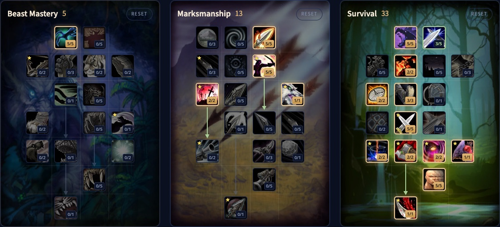

Der Survival Hunter in WoW Forever kämpft auf Distanz und im Nahkampf. Du webst Raptor Strike, Mongoose Bite und den neuen Strider Kick zwischen deine Schüsse, oder du bleibst den ganzen Kampf im Nahkampf. Neue Talente machen Nahkampfangriffe und Fallen deutlich stärker, und Lone Wolf bringt Schaden ohne Begleiter. Dieser Guide behandelt den Build für Level 60, die Rotation, Melee Weaving, Mana, Werte und Völker.

| | |
|---|---|
| Rolle | Fernkampf- und Nahkampfschaden, meist ohne Begleiter |
| Build auf Level 60 | 5/13/33: Deadly Aspects, Marksmanship bis Lone Wolf, und Survival bis Lacerating Strikes |
| Wichtigste Talente | Improved Tracking, Savage Strikes, Clever Traps, Predator's Edge, Resourcefulness, Expose Prey, Strider Kick, <a class="wf-wh wf-spell" href="https://www.wowhead.com/forever/spell=19168">Lightning Reflexes</a>, Lethal Attacks, Careful Aim, Lone Wolf |
| Stärken | Sehr hoher Schaden, wenn gut gespielt, stark auf Distanz und im Nahkampf |
| Schwächen | Eine anspruchsvolle Rotation, die von der Positionierung abhängt |
| Leveln | [Leveling-Guide für den Hunter](/de/guides/hunter-leveling/), [Leveling-Build für den Hunter](/de/leveling/hunter/) |

## Stärken und Schwächen

**Sehr hoher Schaden.** Mit gutem Melee Weaving ist Survival eine starke Schadensspezialisierung für Dungeons und Raids.

**Zwei Spielweisen.** Web Nahkampfangriffe zwischen deine Schüsse, oder bleib den ganzen Kampf im Nahkampf. Beide nutzen denselben Build.

**Stark auf Distanz und im Nahkampf.** Die anderen Hunter-Spezialisierungen schießen vor allem. Survival macht an beiden Stellen echten Schaden.

**Eine anspruchsvolle Rotation.** Melee Weaving verlangt genaues Timing und genaue Positionierung. Ein Fehler kostet mehr Schaden als bei den anderen Hunter-Spezialisierungen.

**Positionierung.** Kämpfe mit viel Bewegung oder Mechaniken, die dich aus dem Nahkampf halten, brechen deine Rotation.

**Die tote Zone.** Zwischen Nahkampfreichweite und 8 Metern kannst du weder Nahkampf noch Fernkampf einsetzen. Auch Survival hat dieses Problem.

## Der Build für Level 60: 5/13/33

Die Beta endete auf Level 30, aber die Talentbäume für Level 60 stehen in den Spieldateien. Wir haben diesen Build Punkt für Punkt in [unserem Talentrechner](/de/talents/hunter/?t=5-005005201-530200230050222151) geprüft: 5 Punkte in Beast Mastery, 13 in Marksmanship und 33 in Survival, zusammen 51.

| Talent | Punkte |
|---|---|
| **Deadly Aspects** (Beast Mastery) | 5/5 |
| **Lethal Attacks** (Marksmanship) | 5/5 |
| **Careful Aim** (Marksmanship) | 5/5 |
| **Rapid Killing** (Marksmanship) | 2/2 |
| **Lone Wolf** (Marksmanship) | 1/1 |
| **Improved Tracking** | 5/5 |
| **<a class="wf-wh wf-spell" href="https://www.wowhead.com/forever/spell=19295">Deflection</a>** | 3/5 |
| **Savage Strikes** | 2/2 |
| **Clever Traps** | 2/2 |
| **Surefooted** | 3/3 |
| **Predator's Edge** | 5/5 |
| **Resourcefulness** | 2/2 |
| **Expose Prey** | 2/2 |
| **<a class="wf-wh wf-spell" href="https://www.wowhead.com/forever/spell=1310496">Survivalist's Discipline</a>** | 2/2 |
| **Strider Kick** | 1/1 |
| **<a class="wf-wh wf-spell" href="https://www.wowhead.com/forever/spell=19168">Lightning Reflexes</a>** | 5/5 |
| **Lacerating Strikes** | 1/1 |

Drei Entscheidungen lassen sich verschieben:

- **Lone Wolf** zu 1 Punkt in **Efficiency** oder **Improved Stings**, wenn du deinen Begleiter behalten willst, zum Beispiel beim Questen.
- **Rapid Killing** zu 2 Punkten in **Efficiency** oder **Improved Stings**, wenn du Rapid Fire nicht öfter brauchst und günstigere oder stärkere Stings willst.
- **Deadly Aspects** zu 2 Punkten in **Efficiency** oder **Improved Stings** plus 3 Punkten in **Mortal Shots**.

## Was die wichtigsten Talente tun

| Talent | Was es in Forever tut |
|---|---|
| **Improved Tracking** | 5 % mehr Schaden gegen den Kreaturentyp, den du aufspürst |
| **Savage Strikes** | 4 % mehr kritische Trefferchance mit Nahkampffähigkeiten |
| **Clever Traps** | Freezing Trap und Frost Trap halten 30 % länger, Immolation Trap und Explosive Trap verursachen 30 % mehr Schaden |
| **Surefooted** | 3 % mehr Trefferchance, und verlangsamende Effekte halten 30 % kürzer |
| **Predator's Edge** | Kritische Treffer mit Nahkampffähigkeiten verursachen 30 % mehr Zusatzschaden, und deine Nebenhandwaffe verursacht 50 % mehr Schaden |
| **Resourcefulness** | Fallen und Nahkampffähigkeiten kosten 60 % weniger Mana, und deine kritischen Treffer lassen 30 Sekunden lang 50 % deiner Manaregeneration beim Zaubern weiterlaufen |
| **Expose Prey** | Angriffe gegen ein Ziel mit Hunter's Mark haben 10 % Chance, Mongoose Bite für 10 Sekunden freizuschalten |
| **<a class="wf-wh wf-spell" href="https://www.wowhead.com/forever/spell=1310496">Survivalist's Discipline</a>** | Fallen und <a class="wf-wh wf-spell" href="https://www.wowhead.com/forever/spell=19263">Deterrence</a> sind 40 % früher wieder bereit |
| **Strider Kick** | Ein Tritt für 100 % deines Nahkampfwaffenschadens, plus 3 Sekunden lang 30 % Bewegungstempo |
| **<a class="wf-wh wf-spell" href="https://www.wowhead.com/forever/spell=19168">Lightning Reflexes</a>** | 10 % mehr Agility |
| **Lacerating Strikes** | Mongoose Bite lässt das Ziel außerdem 21 Sekunden lang für 40 % seines Schadens bluten |
| **Lethal Attacks** | 5 % mehr kritische Trefferchance mit allen Angriffen |
| **Careful Aim** | Angriffskraft in Höhe von 100 % deines Intellect |
| **Lone Wolf** | 20 % mehr Schaden mit allen Angriffen, solange du keinen aktiven Begleiter hast |

## Rotation

Halte Hunter's Mark auf dem Ziel: Expose Prey schaltet Mongoose Bite nur gegen ein markiertes Ziel frei.

### Ein Ziel

1. Leg eine Immolation Trap dorthin, wo der Tank stehen wird, wenn es geht.
2. Wirk Aimed Shot zu Beginn des Pulls.
3. Wirk Serpent Sting.
4. Wirk Arcane Shot.
5. Lauf in den Nahkampf.
6. Wirk Raptor Strike.
7. Wirk Mongoose Bite, wenn es verfügbar ist.
8. Leg Immolation Trap, wenn sie bereit ist.
9. Wirk Strider Kick und lauf wieder aus dem Nahkampf.
10. Schieß wieder auf Distanz und wiederhole.
11. Wirk Rapid Fire, sobald es bereit ist.

### Mehrere Ziele

1. Leg eine Explosive Trap dorthin, wo der Tank stehen wird, wenn es geht.
2. Wirk Multi-Shot.
3. Wirk Serpent Sting.
4. Wirk Arcane Shot.
5. Lauf in den Nahkampf.
6. Wirk Raptor Strike.
7. Wirk Mongoose Bite, wenn es verfügbar ist.
8. Leg Explosive Trap, wenn sie bereit ist.
9. Wirk Strider Kick und lauf wieder aus dem Nahkampf.
10. Schieß wieder auf Distanz und wiederhole.
11. Wirk Rapid Fire, sobald es bereit ist.

## Abklingzeiten und Nutzen

- **Rapid Fire** ist deine Schadensabklingzeit: 40 % mehr Angriffstempo.
- **Explosive Trap** und **Immolation Trap** bringen jedes Mal Schaden, wenn du in den Nahkampf läufst. Survivalist's Discipline macht sie 40 % früher wieder bereit.
- **Frost Trap**, **Freezing Trap**, **Wing Clip** und **Concussive Shot** verlangsamen, fesseln oder nehmen Monster aus dem Kampf.
- **Feign Death** bringt dich aus dem Kampf. Ohne Begleiter ist es dein wichtigster Ausweg.
- **Scorpid Sting** senkt jetzt 20 Sekunden lang die Trefferchance des Ziels um 2 %. Es ist nicht mit Insect Swarm stapelbar.
- **Tranquilizing Shot** entfernt Enrage- und Frenzy-Effekte.
- **Aufspüren** zeigt Monster und Spieler in der Nähe. Mit Improved Tracking verursachst du auch 5 % mehr Schaden gegen den aufgespürten Typ.
- **Aspekte:** Aspect of the Hawk gibt Fernkampfangriffskraft, Aspect of the Beast Nahkampfangriffskraft. Cheetah und Pack sind schneller, aber du wirst bei einem Treffer benommen.

## Melee Weaving und Bewegung

Melee Weaving heißt, zwischen Distanz und Nahkampf zu wechseln, ohne Schaden zu verlieren. Serpent Sting, Arcane Shot und deine Nahkampffähigkeiten sind sofort, du greifst also in der Bewegung weiter an. Bewegung unterbricht aber Auto Shot, also setz deine Schritte zwischen die Schüsse.

Strider Kick ist der Schlüssel: Er trifft und gibt dir 3 Sekunden lang 30 % Bewegungstempo, um wieder auf Distanz zu kommen. Bleib im Kampf in Aspect of the Hawk oder Aspect of the Beast und geh zu Fuß. Mit Cheetah und Pack wirst du benommen, wenn dich ein Monster trifft.

## Mana

Survival verbraucht viel Mana, weil die Rotation viele Fähigkeiten hat. Resourcefulness macht Fallen und Nahkampffähigkeiten 60 % billiger. Nach einem kritischen Treffer laufen 30 Sekunden lang 50 % deiner Manaregeneration beim Zaubern weiter. Lethal Attacks und Savage Strikes geben dir die kritischen Treffer, um diesen Effekt zu halten. Efficiency ist das optionale Talent für günstigere Schüsse.

## Mit oder ohne Begleiter

Der Build nimmt Lone Wolf und spielt ohne Begleiter. In Dungeons und Raids ist das der meiste Schaden. In der offenen Welt ist ein Begleiter, der dir Monster vom Leib hält, oft mehr wert: Tausch Lone Wolf gegen einen Punkt in Efficiency oder Improved Stings und behalte deinen Begleiter. Nutze **Stay** und **Move To**, um ihn aus Flächenschaden zu halten. Mehr über Begleiter steht im [Guide für den Beast Mastery Hunter](/de/guides/beast-mastery-hunter/).

## Werte und Ausrüstung

Wertprioritäten für Level 60 folgen nach dem Start. Bis dahin:

- **Agility**: 2 Fernkampf- und 1 Nahkampfangriffskraft pro Punkt und kritische Trefferchance, etwa 1 % pro 53 Agility auf Level 60. <a class="wf-wh wf-spell" href="https://www.wowhead.com/forever/spell=19168">Lightning Reflexes</a> gibt 10 % dazu.
- **Hit**: Gegen einen Boss auf Level 63 brauchst du 9 % mit 300 Waffenfertigkeit oder 6 % mit 305. Das gilt für Fernkampfangriffe und Zweihand-Nahkampfwaffen. Surefooted gibt schon 3 %.
- **Kritische Trefferchance**, die Resourcefulness am Laufen hält.
- **Angriffskraft**, die Agility Punkt für Punkt meist schlägt.
- **Tempo**, das das Timing des Melee Weaving verändert. Was es wirklich wert ist, zeigt sich auf Level 60.
- **Intellect**, für Mana und über Careful Aim auch für Angriffskraft.
- **Spirit**, für Manaregeneration zusammen mit Resourcefulness.

**Rüstung.** Leder und Kette funktionieren beide. Leatherworking hat gute Muster beim Leveln.

**Köcher oder Munitionsbeutel.** Beide erhöhen dein Fernkampftempo. Halte deinen aktuell.

**Waffen.** Survival braucht eine gute Fernkampfwaffe und eine gute Nahkampfwaffe. Achte auf Schaden pro Sekunde und auf Tempo, denn beides verändert das Timing deiner Rotation.

## Völker und Berufe

| Fraktion | Volk | Warum |
|---|---|---|
| Alliance | Skyborne | Ein Tempobonus, selten auf Ausrüstung, die stärkste Wahl |
| Alliance | Human | 2 % mehr kritische Trefferchance, gut für Resourcefulness |
| Alliance | Dwarf | 2 % mehr kritischer Schaden |
| Alliance | Night Elf | Eine Abklingzeit für kritische Treffer |
| Horde | Skyborne | Ein Tempobonus und eine Abklingzeit für Bewegungstempo beim Weaving |
| Horde | Orc | Eine Abklingzeit für Angriffskraft und 1 % mehr kritische Trefferchance |
| Horde | Troll | Mehr Schaden gegen Beasts und eine Abklingzeit für Angriffstempo |
| Horde | Tauren | Eine Flächenbetäubung, mehr kritischer Schaden, und Plainsrunning |

Die Unterschiede sind klein, also spiel das Volk, das dir gefällt. Für einen Build, der nur schießt, siehe den [Guide für den Marksmanship Hunter](/de/guides/marksmanship-hunter/).

**Leatherworking** stellt gute Lederausrüstung her, **Engineering** bringt Gadgets und Zielfernrohre, **Alchemy** mit Herbalism versorgt dich mit Tränken, und **Enchanting** hält deine Ausrüstung verzaubert.
