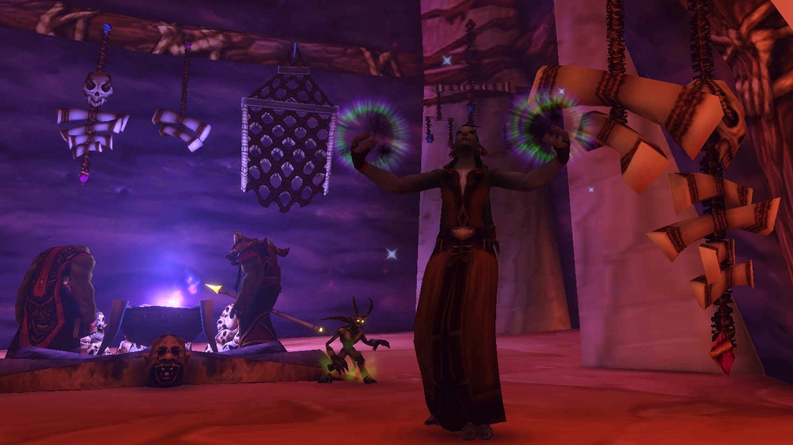

Der Warlock ist eine der selbstständigsten Klassen in WoW Forever. Dein Schaden tickt weiter, während du dich bewegst, dein Dämon tankt oder kämpft mit, und du wandelst deine eigene Gesundheit in Mana um. Auf Level 30 wählst du zwischen Affliction, Demonology und Destruction. Dieser Guide behandelt die Builds, die Rotation, wichtige Level, die Klassenquests, Zauberstäbe und Berufe.

| | |
|---|---|
| Einfachste Spezialisierung zum Leveln | Affliction, bis 30 mit Zauberstab und danach Drain Tanking |
| Wichtige Talente | Improved Corruption, Improved Drains, Soul Siphon, Demonic Brand, Conflagrate |
| Stärken | Trinkt selten, ein Dämon für jede Lage, Fear |
| Schwächen | Langsamer Start, Soul Shards sammeln, wenig gegen viele Monster auf einmal |
| Talent pro Level | [Levelbuild für den Warlock](/de/leveling/warlock/) |
| Guides pro Spezialisierung | [Affliction Warlock](/de/guides/affliction-warlock/), [Demonology Warlock](/de/guides/demonology-warlock/), [Destruction Warlock](/de/guides/destruction-warlock/) |
| Builds bis Level 60 | Nach dem Launch am 4. November |

## Mit welcher Spezialisierung leveln

Du kannst mit allen dreien leveln, aber **Affliction** ist der flüssigste Weg. Fast der ganze Schaden kommt von sofortigem Schaden über Zeit, der weitertickt, während du weiterläufst, und du nimmst es mit zwei Monstern gleichzeitig auf, mit wenigen Pausen. Bis Level 30 erledigst du Monster mit dem Zauberstab. Auf 30 machen Rang 3 von Drain Life und die Drain-Talente das Drain Tanking stärker als den Zauberstab.

**Demonology** wird mit Demonic Brand bei 25 Punkten bequem: Dann hält dein Dämon die Monster. **Destruction** ist allein am schwersten, weil es still steht und zaubert, und seine Zauber mehr Mana kosten. In Dungeons ist es stark.

Die Builds unten sind für die Beta gemacht, die auf Level 30 endet. Der Affliction-Build hat eine Version mit fünf Extrapunkten für Talented aus dem Legacy-System. Der Talentrechner zeigt diese Version als Level 35, weil er jeden Punkt als Level zählt. Builds für Level 60 folgen nach dem Launch.

Mehr zur Spezialisierung auf Level 60 steht im [Guide für den Affliction Warlock](/de/guides/affliction-warlock/).

## Level 1 bis 10

Du startest mit <a class="wf-wh wf-spell" href="https://www.wowhead.com/forever/spell=686">Shadow Bolt</a>, <a class="wf-wh wf-spell" href="https://www.wowhead.com/forever/spell=687">Demon Skin</a> und dem Imp. Verkauf deine Startausrüstung sofort an einen Händler, damit du dir <a class="wf-wh wf-spell" href="https://www.wowhead.com/forever/spell=348">Immolate</a> auf Level 1 leisten kannst, und mach die Klassenquest für den Imp so früh wie möglich. <a class="wf-wh wf-spell" href="https://www.wowhead.com/forever/spell=172">Corruption</a> und <a class="wf-wh wf-spell" href="https://www.wowhead.com/forever/spell=702">Curse of Weakness</a> folgen auf 4, <a class="wf-wh wf-spell" href="https://www.wowhead.com/forever/spell=1454">Life Tap</a> auf 6, <a class="wf-wh wf-spell" href="https://www.wowhead.com/forever/spell=980">Bane of Agony</a> und <a class="wf-wh wf-spell" href="https://www.wowhead.com/forever/spell=5782">Fear</a> auf 8.

1. Schick deinen Imp oder Voidwalker vor.
2. Pull mit Bane of Agony, sobald du es hast. Es fängt langsam an, also kann dein Dämon die Bedrohung übernehmen.
3. Wirk Corruption, sobald du es hast.
4. Wirk Immolate auf Monster, die lange genug leben.
5. Schieß mit dem Zauberstab, bis das Monster stirbt. Ohne Zauberstab nimm Shadow Bolt oder deine Waffe.

Nutze Life Tap zwischen den Pulls, um überschüssige Gesundheit in Mana umzuwandeln. Kommt ein zweites Monster dazu, belege es mit Fear, setz deinen Schaden über Zeit darauf und erledige das erste.

Werte auf diesen Leveln: zuerst Schaden pro Sekunde des Zauberstabs, dann Intellect und Zauberschaden, dann Stamina und Spirit.

## Affliction-Build für Level 30

Der empfohlene Build zum Leveln. Bis Level 29 setzt du deinen Schaden über Zeit auf ein Monster und erledigst es mit dem Zauberstab. Auf Level 30 lernst du Rang 3 von Drain Life und skillst auf Drain Tanking um: Drain Life ist dann dein Füller und heilt zurück, was Life Tap kostet.

**Level 10 bis 29: Schaden über Zeit und Zauberstab.** [Öffne den Build im Talentrechner](/de/talents/warlock/?t=245200201032).

| Talent | Punkte |
|---|---|
| **Improved Life Tap** | 2/2 |
| **Suppression** | 4/5 |
| **Improved Corruption** | 5/5 |
| **Grim Reach** | 2/2 |
| **Improved Bane of Agony** | 2/2 |
| **Amplify Curse** | 1/1 |
| **Malevolence** | 3/5 |
| **Nightfall** | 2/2 |

Improved Corruption ist das wichtigste Talent: eine sofortige Corruption, die du in Bewegung wirkst. Mit 4 Punkten in Suppression verfehlst du Monster deines Levels nicht mehr. Dein Zauberstab macht auf diesen Leveln mehr als Drain Life, also können die Drain-Talente warten.

**Level 30: Drain Tanking.** [Öffne den Build im Talentrechner](/de/talents/warlock/?t=245203031000001).

| Talent | Punkte |
|---|---|
| **Improved Life Tap** | 2/2 |
| **Suppression** | 4/5 |
| **Improved Corruption** | 5/5 |
| **Grim Reach** | 2/2 |
| **Improved Drains** | 3/3 |
| **Fel Concentration** | 3/3 |
| **Amplify Curse** | 1/1 |
| **Soul Siphon** | 1/3 |

Mit Talented: Soul Siphon 3/3, Siphon Life 1/1 und Nightfall 2/2. [Öffne die Version mit Talented](/de/talents/warlock/?t=245203031002013).

Improved Drains macht Drain Life stärker, und Fel Concentration verhindert, dass Schaden deine Kanalisierung zurückwirft. Mit Improved Life Tap ist jeder Punkt entzogener Gesundheit 1,2 Mana wert. Soul Siphon erhöht Drain Life um bis zu 36 %, wenn deine anderen Effekte auf dem Monster liegen. Kein guter Zauberstab, oder keine Lust umzuskillen? Dann nimm die Drain-Talente von Anfang an.

Malediction ist aus dem Baum verschwunden. Seine Punkte gehen in Grim Reach, für mehr Reichweite, und in Malevolence oder Nightfall. Pandemic erhöht nur den kritischen Schaden und bringt auf diesen Leveln wenig. Siphon Life macht wenig Schaden, zählt aber als zusätzlicher Effekt für Soul Siphon.

1. Schick deinen Dämon vor.
2. Pull mit Bane of Agony.
3. Wirk Corruption.
4. Wirk Immolate auf Monster, die lange genug leben.
5. Wirk Siphon Life auf Monster, die lange genug leben, sobald du es hast.
6. Vor Level 30: Schieß mit dem Zauberstab, bis das Monster stirbt.
7. Ab Level 30: Kanalisiere Drain Life, bis das Monster stirbt. Wechsel zum Zauberstab, wenn deine Gesundheit voll oder das Monster fast tot ist.
8. Wirk Life Tap, wann immer du mehr Gesundheit als Mana hast.

Vor Level 30 ist der Dämon Geschmackssache: Der Voidwalker hält dir Monster vom Leib, während du schießt, die Succubus oder der Incubus tötet schneller, lässt die Schläge aber bei dir. Ab Level 30 tankst du mit der Succubus oder dem Incubus per Drain.

Noch schneller geht es mit zwei Monstern gleichzeitig. Setz deinen Schaden über Zeit auf das erste und belege es mit Fear, dann kämpf mit deinem Dämon gegen das zweite. Belege das erste wieder mit Fear, sobald es zurückkommt.

Werte: Zauberschaden und Schattenschaden, dann Zauberstabschaden bis 30, dann Intellect und Spirit, dann Stamina.

## Demonology-Build für Level 30

Stellt deinen Dämon nach vorn. Am Anfang langsamer als Affliction, aber mit Demonic Brand hält deine Succubus oder dein Felhunter zwei oder drei Monster und erledigt einen großen Teil der Arbeit. Du bekommst selten einen Treffer ab. [Öffne den Build im Talentrechner](/de/talents/warlock/?t=-0005003231201301).

| Talent | Punkte |
|---|---|
| **Unholy Power** | 5/5 |
| **Fel Vitality** | 3/3 |
| **Demonic Energies** | 2/2 |
| **Improved Sayaad** | 3/3 |
| **Demonic Sacrifice** | 1/1 |
| **Master Summoner** | 2/2 |
| **Fel Domination** | 1/1 |
| **Demonic Brand** | 3/3 |
| **Soul Link** | 1/1 |

Unholy Power und Demonic Brand sind der Kern. Mit Demonic Brand brandmarkt dein Searing Pain das Monster, was deinem Dämon mehr Schaden und Bedrohung dagegen gibt. Auf einem PvP-Realm beschwörst du mit Master Summoner und Fel Domination im Notfall einen frischen Voidwalker, für den Schild seines <a class="wf-wh wf-spell" href="https://www.wowhead.com/forever/spell=7812">Sacrifice</a>.

1. Schick deinen Dämon vor.
2. Wirk Searing Pain, um das Monster zu brandmarken.
3. Wirk Bane of Agony auf Monster, die lange genug leben.
4. Wirk Corruption und Immolate.
5. Schieß mit dem Zauberstab oder wirk Shadow Bolt, bis das Monster stirbt.
6. Wirk Searing Pain erneut, bevor das Brandmal ausläuft.

Ohne Demonic Brand wirkst du kein Searing Pain: Es erzeugt viel Bedrohung und zieht Monster von deinem Dämon weg.

Werte: Zauberschaden und Schattenschaden, dann Zauberstabschaden, dann Intellect und Spirit, dann Stamina.

## Destruction-Build für Level 30

Allein die schwerste Spezialisierung. Fast der ganze Schaden kommt von Shadow Bolt und Immolate mit Zauberzeit, und während du zauberst, kannst du nicht weiterlaufen. In Dungeons glänzt sie, mit Conflagrate und Shadowburn für Burst auf wichtige Ziele. [Öffne den Build im Talentrechner](/de/talents/warlock/?t=--0550050103101).

| Talent | Punkte |
|---|---|
| **Improved Shadow Bolt** | 5/5 |
| **<a class="wf-wh wf-spell" href="https://www.wowhead.com/forever/spell=17788">Bane</a>** | 5/5 |
| **Aftermath** | 5/5 |
| **Shadowburn** | 1/1 |
| **Agonizing Flames** | 3/3 |
| **Conflagrate** | 1/1 |
| **Bane of Havoc** | 1/1 |

Bane verkürzt die Zauberzeit von Shadow Bolt und Immolate, und Aftermath erhöht den Schaden von Immolate. Shadowburn ist ein sofortiger Finisher, der seinen Soul Shard zurückgibt, wenn das Monster stirbt. Conflagrate verbraucht dein Immolate für sofortigen Burst. Agonizing Flames gibt all deinen Destruction-Zaubern mehr Schaden.

1. Schick deinen Dämon vor.
2. Wirk Bane of Agony, Corruption und Immolate.
3. Wirk Shadow Bolt, bis sich das Monster dir zuwendet, dann schieß mit dem Zauberstab.
4. Wirk Conflagrate kurz bevor Immolate ausläuft.
5. Erledige es mit Shadowburn, sobald das Monster weniger Gesundheit hat als ein Treffer davon.

Allein bleibst du als Destruction beim Voidwalker: Dir fehlen die Demonology-Talente, mit denen die Succubus Bedrohung hält, und die Heilung, die Affliction aus seinen Drains holt. In Dungeons nimm den Imp für <a class="wf-wh wf-spell" href="https://www.wowhead.com/forever/spell=6307">Blood Pact</a> oder die Succubus oder den Incubus für Schaden.

Werte: Zauberschaden und Feuerschaden, dann Zauberstabschaden, dann Intellect und Spirit, dann Stamina.

Die Builds für Demonology und Destruction nutzen 21 Punkte. Mit Talented hast du auf Level 30 26, und die fünf Extrapunkte setzt du im Rechner, wo du willst.

## Wichtige Level

| Level | Was du bekommst | Von |
|---|---|---|
| 1 | Shadow Bolt, Demon Skin, Immolate | Von Anfang an, Klassenlehrer |
| 1 | <a class="wf-wh wf-spell" href="https://www.wowhead.com/forever/spell=688">Summon Imp</a> | Klassenquest |
| 4 | Corruption, Curse of Weakness | Klassenlehrer |
| 6 | Life Tap | Klassenlehrer |
| 8 | Bane of Agony, <a class="wf-wh wf-spell" href="https://www.wowhead.com/forever/spell=5782">Fear</a> | Klassenlehrer |
| 10 | <a class="wf-wh wf-spell" href="https://www.wowhead.com/forever/spell=697">Summon Voidwalker</a> | Klassenquest |
| 10 | <a class="wf-wh wf-spell" href="https://www.wowhead.com/forever/spell=1120">Drain Soul</a>, <a class="wf-wh wf-spell" href="https://www.wowhead.com/forever/spell=6201">Create Healthstone</a> | Klassenlehrer |
| 10 | Improved Corruption, Suppression, Unholy Power, <a class="wf-wh wf-spell" href="https://www.wowhead.com/forever/spell=17788">Bane</a> | Talentbaum |
| 12 | <a class="wf-wh wf-spell" href="https://www.wowhead.com/forever/spell=755">Health Funnel</a> | Klassenlehrer |
| 14 | <a class="wf-wh wf-spell" href="https://www.wowhead.com/forever/spell=689">Drain Life</a>, <a class="wf-wh wf-spell" href="https://www.wowhead.com/forever/spell=704">Curse of Recklessness</a> | Klassenlehrer |
| 15 | Improved Drains | Talentbaum |
| 16 | <a class="wf-wh wf-spell" href="https://www.wowhead.com/forever/spell=5697">Unending Breath</a> | Klassenlehrer |
| 18 | <a class="wf-wh wf-spell" href="https://www.wowhead.com/forever/spell=693">Create Soulstone</a>, <a class="wf-wh wf-spell" href="https://www.wowhead.com/forever/spell=5676">Searing Pain</a> | Klassenlehrer |
| 20 | <a class="wf-wh wf-spell" href="https://www.wowhead.com/forever/spell=712">Summon Succubus</a> oder <a class="wf-wh wf-spell" href="https://www.wowhead.com/forever/spell=713">Summon Incubus</a> | Klassenquest |
| 20 | <a class="wf-wh wf-spell" href="https://www.wowhead.com/forever/spell=706">Demon Armor</a>, <a class="wf-wh wf-spell" href="https://www.wowhead.com/forever/spell=698">Ritual of Summoning</a>, <a class="wf-wh wf-spell" href="https://www.wowhead.com/forever/spell=440892">Curse of the Elements</a>, <a class="wf-wh wf-spell" href="https://www.wowhead.com/forever/spell=5740">Rain of Fire</a> | Klassenlehrer |
| 20 | Amplify Curse, Fel Concentration, Shadowburn | Talentbaum |
| 22 | <a class="wf-wh wf-spell" href="https://www.wowhead.com/forever/spell=126">Eye of Kilrogg</a> | Klassenlehrer |
| 24 | <a class="wf-wh wf-spell" href="https://www.wowhead.com/forever/spell=5138">Drain Mana</a>, <a class="wf-wh wf-spell" href="https://www.wowhead.com/forever/spell=5500">Sense Demons</a> | Klassenlehrer |
| 25 | Curse of Exhaustion, Nightfall, Demonic Brand, Decimation, Conflagrate, Agonizing Flames | Talentbaum |
| 26 | <a class="wf-wh wf-spell" href="https://www.wowhead.com/forever/spell=1714">Curse of Tongues</a>, <a class="wf-wh wf-spell" href="https://www.wowhead.com/forever/spell=132">Detect Invisibility</a> | Klassenlehrer |
| 28 | <a class="wf-wh wf-spell" href="https://www.wowhead.com/forever/spell=710">Banish</a>, <a class="wf-wh wf-spell" href="https://www.wowhead.com/forever/spell=6366">Create Firestone</a> | Klassenlehrer |
| 30 | <a class="wf-wh wf-spell" href="https://www.wowhead.com/forever/spell=691">Summon Felhunter</a> | Klassenquest |
| 30 | <a class="wf-wh wf-spell" href="https://www.wowhead.com/forever/spell=1098">Subjugate Demon</a>, <a class="wf-wh wf-spell" href="https://www.wowhead.com/forever/spell=1949">Hellfire</a> | Klassenlehrer |
| 30 | Siphon Life, Soul Siphon, Bane of Havoc | Talentbaum |
| 32 | <a class="wf-wh wf-spell" href="https://www.wowhead.com/forever/spell=6229">Shadow Ward</a> | Klassenlehrer |
| 36 | <a class="wf-wh wf-spell" href="https://www.wowhead.com/forever/spell=2362">Create Spellstone</a> | Klassenlehrer |
| 40 | <a class="wf-wh wf-spell" href="https://www.wowhead.com/forever/spell=5484">Howl of Terror</a> | Klassenlehrer |
| 40 | Reiten, Dual Specialization | Lehrer |
| 40 | Wrack, Demonic Pact, Incinerate | Talentbaum |
| 42 | <a class="wf-wh wf-spell" href="https://www.wowhead.com/forever/spell=6789">Death Coil</a> | Klassenlehrer |

Curse of the Elements kommt in Forever auf 20 (vorher 32). Mit Punkten in Talented aus dem Legacy-System erreichst du jedes Talent bis zu fünf Level früher.

## Die Klassenquests

Ein Warlock lernt jeden Dämon über eine Klassenquest zu beschwören. Eine Quest um Level 20 gibt außerdem einen starken Stab oder eine Schildhand.

| Level | Dämon | Alliance | Horde |
|---|---|---|---|
| 1 | Imp | Quest im Startgebiet | Quest im Startgebiet |
| 10 | Voidwalker | Human: <a href="https://www.wowhead.com/forever/quest=1685">Gakin's Summons</a> in Goldshire. Gnome: <a href="https://www.wowhead.com/forever/quest=1715">The Slaughtered Lamb</a> in Ironforge. Beide führen zu Gakin the Darkbinder in Stormwind | Orc und Troll: <a href="https://www.wowhead.com/forever/quest=1506">Gan'rul's Summons</a> in Razor Hill, nach Orgrimmar. Undead: <a href="https://www.wowhead.com/forever/quest=1478">Halgar's Summons</a> in Brill, in die Undercity |
| 20 | Succubus | Devourer of Souls, Stormwind | Devourer of Souls, Orgrimmar oder die Undercity |
| 20 | Incubus | <a href="https://www.wowhead.com/forever/quest=65602">What Is Love?</a>, Stormwind | <a href="https://www.wowhead.com/forever/quest=65601">Love Hurts</a>, Orgrimmar. <a href="https://www.wowhead.com/forever/quest=65593">Hearts of the Lovers</a>, die Undercity |
| 30 | Felhunter | Seeking Strahad, Stormwind | Seeking Strahad, Orgrimmar oder die Undercity |

Horde-Warlocks wählen zwischen der Voidwalker-Quest von Orgrimmar und der der Undercity. Die der Undercity ist viel leichter: Die Version aus Orgrimmar schickt dich in die gefährliche Höhle Skull Rock. Die Succubus-Reihe der Horde hat acht Quests durch die Barrens und Stonetalon Mountains, also hol dir diese Flugpunkte zuerst. Seeking Strahad schickt dich zu Strahad Farsan in Ratchet.

**<a href="https://www.wowhead.com/forever/quest=1740">The Orb of Soran'ruk</a>** kommt von Doan Karhan in den Barrens. Du wählst zwischen <a class="wf-wh wf-q3" href="https://www.wowhead.com/forever/item=15109">Staff of Soran'ruk</a> und <a class="wf-wh wf-q3" href="https://www.wowhead.com/forever/item=6898">Orb of Soran'ruk</a>. Die Fragmente dafür kommen aus [Blackfathom Deeps](/de/guides/dungeons/blackfathom-deeps/) und [Shadowfang Keep](/de/guides/dungeons/shadowfang-keep/).

## Waffen

Deine Waffe ist vor allem ein Werteträger. Der Zauberschaden, den sie bringt, zählt viel mehr als ihr eigener Schaden, also rüste auf, wann immer du mehr findest.

| Waffe | Alliance | Horde |
|---|---|---|
| **Dolche** | Von Anfang an bekannt | Von Anfang an bekannt |
| **Zauberstäbe** | Von Anfang an bekannt | Von Anfang an bekannt |
| **Einhandschwerter** | Woo Ping (Stormwind) | Archibald (Undercity) |
| **Stäbe** | Ilyenia Moonfire (Darnassus), Woo Ping (Stormwind) | Hanashi, Sayoc (Orgrimmar), Ansekhwa (Thunder Bluff) |

Humans brauchen kein Schwert mehr: Ihr Volksbonus Ruthless gibt jetzt 2 % kritische Trefferchance mit jeder Waffe. Mehr dazu in [diesem Beitrag](/de/news/humans-dwarves-and-orcs-lose-their-weapon-racials/).

## Zauberstäbe und Ausrüstung

**Zauberstäbe** sind auf den ersten Leveln deine wichtigste Waffe. Sie kosten kein Mana, und dein Schaden über Zeit und dein Dämon arbeiten weiter, während du schießt.

- <a class="wf-wh wf-q2" href="https://www.wowhead.com/forever/item=11287">Lesser Magic Wand</a> auf Level 5 und <a class="wf-wh wf-q2" href="https://www.wowhead.com/forever/item=11288">Greater Magic Wand</a> auf Level 13 kommen aus Enchanting, mit 11,3 und 17,5 Schaden pro Sekunde. Das ist mehr als die meisten Zauberstäbe vor Level 18. Hol dir so früh wie möglich einen von einem Verzauberer oder aus dem Auktionshaus.
- <a class="wf-wh wf-q3" href="https://www.wowhead.com/forever/item=7001">Gravestone Scepter</a> macht 29 Schaden pro Sekunde, am meisten von allen Zauberstäben vor Level 30. Er ist eine Belohnung der Quest Blackfathom Villainy in [Blackfathom Deeps](/de/guides/dungeons/blackfathom-deeps/). Du kannst sie ab 18 annehmen, aber der Dungeon verlangt meist ein paar Level mehr.

**Stäbe und Schildhände.** Die Warlock-Quest für den Orb of Soran'ruk lässt dich zwischen <a class="wf-wh wf-q3" href="https://www.wowhead.com/forever/item=15109">Staff of Soran'ruk</a> wählen, einer Zweihandwaffe mit 34 Schatten- und Feuerschaden und 14 Stamina, und <a class="wf-wh wf-q3" href="https://www.wowhead.com/forever/item=6898">Orb of Soran'ruk</a>, einer Schildhand mit 9 Schatten- und Feuerschaden, die dich außerdem 30 Sekunden lang heilt. <a class="wf-wh wf-q3" href="https://www.wowhead.com/forever/item=2549">Staff of the Shade</a> aus [Razorfen Kraul](/de/guides/dungeons/razorfen-kraul/) hat 37 Schattenschaden und 15 Stamina ab Level 22. Er droppt selten, ist aber eine hervorragende Waffe für Affliction.

**Tailoring** hat neue seelengebundene Shadow-Teile wie <a class="wf-wh wf-q3" href="https://www.wowhead.com/forever/item=253967">Shadow Gown</a> und <a class="wf-wh wf-q3" href="https://www.wowhead.com/forever/item=253919">Shadow Gloves</a>. Nur der Schneider, der sie hergestellt hat, kann sie tragen.

## Berufe

Level deine Berufe mit deinem Warlock mit, damit du auf dem richtigen Level sammelst und herstellst. Lager geben Buffs für jeden Beruf.

- **Cooking** ist Pflicht: Buff-Essen gibt zusätzliche Erfahrung, und du brauchst es für ein Lagerfeuer.
- **First Aid** passt gut zu einem Warlock. Verbinde dich zwischen den Pulls oder während ein Monster unter Fear steht, und wandle diese Gesundheit mit Life Tap in Mana um. First Aid stellt jetzt auch Heiltränke und Mittel gegen Gift, Krankheit und Blutungen her, die ein Warlock sonst nicht entfernen kann.
- **Tailoring** ist der klassische Beruf für Zauberwirker. Er stellt auf fast jedem Level Shadow-Ausrüstung her, und sein Lager gibt Spirit, was das Mana aus Life Tap erhöht.
- **Enchanting** passt perfekt zu Tailoring: Du entzauberst die Ausrüstung, die du beim Leveln herstellst. Verzauberer stellen die ersten guten Zauberstäbe, Stäbe und Waffenöle her.
- **Herbalism** bringt leichtes Gold für deine Zauber, und sein Lager gibt Intellect.
- **Alchemy** passt gut zu Herbalism und gibt Tränke und ein Lager für Manaregeneration.
- **Skinning** bezahlt jeden neuen Rang deiner Zauber, weil du beim Questen viele Wildtiere tötest. Sein Lager gibt 2 % kritische Trefferchance.

## Verbrauchsgüter

Ein Warlock wandelt Gesundheit in Mana um und stiehlt Gesundheit zurück, also brauchst du weniger Verbrauchsgüter als die meisten Klassen.

- **Essen und Trinken.** Bleib Well Fed für die zusätzliche Erfahrung; jedes Buff-Essen ist besser als keins. Dank Life Tap trinkst du selten, aber nimm etwas Wasser mit für den Fall, dass Gesundheit und Mana beide niedrig sind.
- **Healthstones.** Stell so früh wie möglich einen mit Create Healthstone her und hab ihn immer in den Taschen. Es ist eine kostenlose Heilung mit eigener Abklingzeit, getrennt von Tränken. Verteil sie vor einem Dungeon an deine Gruppe.
- **Tränke und Verbände.** Heiltränke für Notfälle, jetzt auch aus First Aid. Manatränke brauchst du selten: Life Tap macht dasselbe kostenlos.
- **Elixiere** für Zauberschaden oder Manaregeneration, wie <a class="wf-wh wf-q1" href="https://www.wowhead.com/forever/item=250342">Lesser Arcane Elixir</a> und <a class="wf-wh wf-q1" href="https://www.wowhead.com/forever/item=250340">Lesser Mageblood Elixir</a>, sind nett, aber nicht nötig.

## Soul Shards

<a class="wf-wh wf-q1" href="https://www.wowhead.com/forever/item=6265">Soul Shard</a> ist das Reagenz des Warlocks. Du brauchst ihn, um den Voidwalker, die Succubus oder den Incubus und den Felhunter zu beschwören, und für Healthstones und Soulstones. Shadowburn und Ritual of Summoning verbrauchen auch einen.

In Forever hat Drain Soul eine Chance auf einen Soul Shard, während es einem Monster Schaden zufügt, nicht nur wenn es stirbt. Ein Monster, das durch Drain Soul stirbt, gibt immer einen. Zum Sammeln lässt du deinen Dämon tanken und kanalisierst Rang 1 von Drain Soul, bis du genug hast. Behalte ein paar für Ritual of Summoning: Forever bekommt keine [Versammlungssteine](/de/news/blizzard-rules-out-summoning-stones-and-new-races/), also zählt deine Gruppe auf dich.

## Dämonen

Der Warlock ist die einzige Klasse mit Dämonen, und jeder hat seine eigene Aufgabe.

- **Imp**: dein erster Dämon. Er greift aus der Ferne an und gibt deiner Gruppe Stamina mit Blood Pact. Nach Level 10 fällt er hinter die anderen zurück, also nimm ihn vor allem in der Gruppe.
- **Voidwalker**: dein Tank, mit <a class="wf-wh wf-spell" href="https://www.wowhead.com/forever/spell=3716">Torment</a>, um Bedrohung zu ziehen, und Sacrifice für einen großen Schild im Notfall. Die sicherste Wahl gegen mehrere Monster oder Monster, die hart zuschlagen.
- **Succubus oder Incubus**: der meiste Schaden aller Dämonen. Ohne Demonology-Talente hält er keine Bedrohung, aber das zählt beim Drain Tanking wenig. <a class="wf-wh wf-spell" href="https://www.wowhead.com/forever/spell=6358">Seduction</a> hält einen Humanoiden bis zu 15 Sekunden aus dem Kampf.
- **Felhunter**: unterbricht und bringt Zauberwirker mit <a class="wf-wh wf-spell" href="https://www.wowhead.com/forever/spell=19244">Spell Lock</a> zum Schweigen und entfernt Magie mit <a class="wf-wh wf-spell" href="https://www.wowhead.com/forever/spell=19505">Devour Magic</a>. Ideal für PvP, und mit Demonology-Talenten macht er fast so viel Schaden wie die Succubus.

Gute Kontrolle über deinen Dämon macht das Leveln viel flüssiger. Leg Attack und Follow deines Dämons auf Tasten, die du ohne Nachdenken drückst, etwa das Mausrad oder die Seitentasten. Der neue Befehl Move stellt deinen Dämon an jeden Ort.

## Gesundheit und Mana

Für einen Warlock sind Gesundheit und Mana eine gemeinsame Ressource. Life Tap wandelt Gesundheit in Mana um und skaliert jetzt mit Spirit. Drain Life holt sich Gesundheit vom Monster zurück. Zwei Regeln ersparen dir das Trinken:

- **Viel mehr Gesundheit als Mana?** Wirk Life Tap. Bleib nicht auf voller Gesundheit, während Drain Life dich heilt, sonst ist die Heilung verschwendet.
- **Viel mehr Mana als Gesundheit?** Wirk Drain Life. Schieß nicht mit dem Zauberstab, während dein Mana voll ist.

Deshalb ist Stamina für einen Warlock etwas mehr wert als für andere Zauberwirker: mehr Gesundheit heißt mehr Mana über Life Tap.

## Schaden über Zeit

Schaden über Zeit macht viel für sein Mana und seine Zauberzeit, und das meiste ist sofort. Läuft er einmal, kannst du dich bewegen, Life Tap nutzen oder ein anderes Monster angreifen, während er tickt. In Forever kann er auch kritisch treffen. Verschwende ihn nicht an Monster, die gleich sterben: Er lohnt sich nur, wenn er tickt.

Setz dein zweites Monster als Fokusziel und wirk deinen Schaden über Zeit mit einer Zusatztaste wie Shift darauf. Setz ihn auf beide Monster, schick deinen Dämon auf eins und belege das andere mit Fear.

## Pullen und Bedrohung

Pull mit Bane of Agony. Die ersten Ticks sind schwach, also zieht dein Dämon die Aufmerksamkeit auf sich. Es markiert das Monster auch sofort, sodass es dir niemand wegnehmen kann. Immolate macht viel Schaden auf einmal und macht es deinem Dämon viel schwerer, dir das Monster abzunehmen.

Der Voidwalker bekommt auf 10, 20 und 30 einen neuen Rang von Torment. Zwischen zwei Rängen wächst dein Schaden, Torment aber nicht, also verliert der Voidwalker ab etwa Level 25 öfter Monster an dich, bis Rang 3 auf Level 30.

## Gruppenkontrolle

**Fear** ist dein bestes Mittel gegen mehrere Monster. Halte ein gefährliches Monster unter Fear, während dein Schaden über Zeit tickt, oder belege eins mit Fear, während du das andere tötest. Fear hat in Forever eine Reichweite von 20 Metern. Achte darauf, wohin ein verängstigtes Monster läuft, und beende Fear früher mit Curse of Recklessness, wenn es auf eine andere Gruppe zuläuft.

**Banish** nimmt einen Dämon oder Elementar aus dem Kampf und bricht nicht durch Schaden. **Seduction** der Succubus oder des Incubus hält einen Humanoiden fest, nützlich in Dungeons. Später verängstigt Howl of Terror mehrere Monster auf einmal, und Death Coil ist eine sofortige Flucht, die dich heilt.

Fernkampfmonster, die nicht zu dir kommen: Zieh sie um eine Ecke, damit sie zu dir laufen müssen, weg von ihrer Gruppe.

## Banes und Curses

In Forever sind Flüche in **Banes** und **Curses** aufgeteilt. Banes machen Schaden über Zeit, Curses sind Hilfsmittel. Du kannst von jedem einen auf demselben Monster haben, also läuft Bane of Agony zusammen mit einem Curse.

- **Curse of Weakness** senkt die Angriffskraft. Für Monster, die im Nahkampf hart zuschlagen.
- **Curse of Recklessness** senkt die Rüstung und hält Monster davon ab, bei wenig Gesundheit zu fliehen.
- **Curse of Tongues** verlangsamt das Zaubern. Für Zauberwirker.
- **Curse of the Elements** erhöht den magischen Schaden, den das Monster erleidet. Für lange Kämpfe und Dungeons.
- **Curse of Exhaustion** ist ein Affliction-Talent, das um 30 % verlangsamt, deine einzige Verlangsamung. Zum Kiten oder um ein fliehendes Monster zu erwischen.
- **Bane of Havoc** ist ein Destruction-Talent auf Level 30. Solange es läuft, trifft 15 % des Schadens, den du anderen Monstern zufügst, auch dieses Ziel.

## Nützliches

- **Create Soulstone** lässt ein Gruppenmitglied nach dem Tod wiederauferstehen.
- **Ritual of Summoning** beschwört Gruppenmitglieder mit der Hilfe von zwei anderen. Es ist der einzige Weg, in Forever Spieler zu beschwören.
- **Unending Breath** lässt dich oder einen Verbündeten 10 Minuten unter Wasser atmen, für Quests unter Wasser. **Detect Invisibility** zeigt unsichtbare Gegner.

Mehr über Essen, Lager und erholte Erfahrung steht im [Guide zur Erfahrung](/de/guides/experience/).
