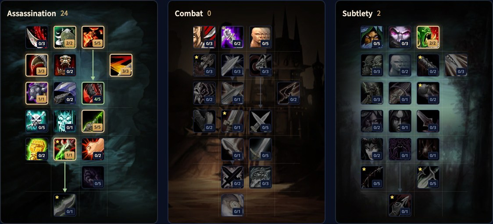

The Assassination Rogue in WoW Forever is the poisoner. Mutilate gives the spec its own Combo Point generator with daggers, Venom is a new finishing move that makes poisons stronger, and poisons can now land critical strikes. You do not need Stealth tricks or pure auto attacks to deal damage. This guide covers two level 30 builds, the rotation, Energy, poisons, survival, stats and races.

| | |
|---|---|
| Role | Melee damage with daggers and poisons |
| Build at level 30 | 21 points in Assassination, Talented adds Lethality and Opportunity |
| Key talents | Malice, Ruthlessness, Relentless Strikes, Improved Slice and Dice, Improved Poisons, Mutilate |
| Strength | Very high damage that scales with every level, lots of crowd control |
| Weakness | A busy rotation, needs gear |
| Leveling | [Rogue leveling guide](/guides/rogue-leveling/), [Rogue level build](/leveling/rogue/) |

## What changes for Assassination

- **Mutilate is new.** Attacks with both daggers for 2 Combo Points, 20% stronger against poisoned targets.
- **Venom is new.** A finishing move for 30% more poison damage and 10% more poison applications.
- **Poisons land critical strikes** and get stronger with attack power. Malice now also counts for poisons.
- **Improved Poisons does more.** 10% more chance to apply poisons and a 50% chance to keep the charge at 5/5.
- **Improved Expose Armor is reworked.** 10 Energy less, and 2 Combo Points back when you use Expose Armor with 5.
- **Remorseless Attacks** gives 40% more critical strike chance to your next Mutilate or Ambush after a kill that gives experience.
- **Energy regenerates smoothly**, 10 per second, instead of in chunks.

## Strengths and weaknesses

| Strengths | Weaknesses |
|---|---|
| Very high damage that grows with every level | A busy rotation with several finishing moves to keep up |
| Poisons ignore Armor and now land critical strikes | Random Combo Points from Ruthlessness and Relentless Strikes can feel hard |
| Kick, Gouge, Sap, Cheap Shot, Kidney Shot and Blind | Needs a lot of attack power before it truly takes off |
| Poisons for every situation, and the easiest route to Improved Expose Armor | No area damage |

## Two builds for level 30

Both builds use the 21 points you have at level 30. Talented from the Legacy system adds 5 points to each.

### Solo build

Built for as much damage as possible: 5% critical strike chance from Malice, extra Combo Points from Ruthlessness and Relentless Strikes, more poison procs from Improved Poisons and Mutilate as your generator. [Open the build in the talent calculator](/talents/rogue/?t=02530310100501).

| Talent | Points |
|---|---|
| **Remorseless Attacks** | 2/2 |
| **Malice** | 5/5 |
| **Ruthlessness** | 3/3 |
| **Improved Slice and Dice** | 3/3 |
| **Relentless Strikes** | 1/1 |
| **Lethality** | 1/5 |
| **Improved Poisons** | 5/5 |
| **Mutilate** | 1/1 |

[Open the Talented version](/talents/rogue/?t=02530310400501--002) with Lethality 4/5 and Opportunity 2/2 in Subtlety, for more Mutilate damage.

### Improved Expose Armor build

Almost the same, but with Improved Expose Armor, which makes Expose Armor much easier to use in dungeon groups, on bosses and on trash. [Open the build in the talent calculator](/talents/rogue/?t=02530312100301).

| Talent | Points |
|---|---|
| **Remorseless Attacks** | 2/2 |
| **Malice** | 5/5 |
| **Ruthlessness** | 3/3 |
| **Improved Slice and Dice** | 3/3 |
| **Relentless Strikes** | 1/1 |
| **Improved Expose Armor** | 2/2 |
| **Lethality** | 1/5 |
| **Improved Poisons** | 3/5 |
| **Mutilate** | 1/1 |

[Open the Talented version](/talents/rogue/?t=02530312400501) with Lethality 4/5 and Improved Poisons 5/5.

## What the key talents do

| Talent | What it does in Forever |
|---|---|
| **Malice** | 5% more critical strike chance for attacks and poisons. A must |
| **Remorseless Attacks** | 40% more critical strike chance for your next Mutilate or Ambush after a kill. Great for farming and dungeon packs |
| **Ruthlessness** | A 60% chance for a Combo Point after a finishing move |
| **Improved Slice and Dice** | 45% longer Slice and Dice. The build does not work without it |
| **Relentless Strikes** | 25 Energy back after a finishing move, 20% chance per Combo Point |
| **Improved Expose Armor** | Cheaper Expose Armor and 2 Combo Points back at 5 points. Optional, but your group will thank you |
| **Lethality** | A 20% bigger critical strike damage bonus for Mutilate at 5/5, even better with Remorseless Attacks |
| **Cold Blood** | 100% critical strike chance for your next Ambush or Mutilate |
| **Improved Poisons** | More poison applications and fewer used charges |
| **Mutilate** | Your Combo Point generator with two daggers. Hits very hard with the right gear |
| **Opportunity** | 10% more damage for Mutilate and Ambush |

## Rotation

**Normal enemies**
1. Open from Stealth with Ambush.
2. Mutilate for Combo Points. At 4 Combo Points, Sinister Strike for the last point saves Energy.
3. Slice and Dice, and refresh it every time it runs out.
4. Eviscerate at 5 Combo Points, or with what you have when the target is almost dead.
5. Kick every cast, Evasion when you take the hits, Vanish when you need to get away.

**Bosses**
1. Open from Stealth with Ambush.
2. Mutilate as your generator, Sinister Strike at 4 Combo Points.
3. Expose Armor as soon as you can.
4. Then Slice and Dice as soon as you can.
5. Refresh Expose Armor and Slice and Dice before they run out. Expose Armor comes first, because it is shorter.
6. Spare Combo Points go into Eviscerate, or Kidney Shot if the boss can be stunned.
7. Vanish and Ambush for burst, Kick on every cast, Feint when your threat gets too high.

**Packs.** The Rogue has no area attacks. Kill one target at a time and never switch targets while you build Combo Points: they stay on the old target.

At high levels, with Venom, the order for long fights becomes Slice and Dice, then Venom, then Expose Armor.

## Cooldowns and utility

- **Cheap Shot** stuns from Stealth. Strong for locking down dangerous targets.
- **Kidney Shot** stuns longer with more Combo Points.
- **Sap** incapacitates a target from Stealth for a long time. Use it to pull one enemy from a pack.
- **Kick** interrupts almost every cast in the game.
- **Expose Armor** lowers the Armor of the target for you and your group.
- **Cold Blood** for a sure critical strike with Ambush or Mutilate.
- **Gouge** incapacitates and stops your auto attack, to buy time for Energy or cooldowns.
- **Blind** later on, to take a dangerous enemy out of the fight.
- **Crippling Poison** slows, **Mind-numbing Poison** makes casts slower and **Wound Poison** lowers healing.

## Stealth, Combo Points and finishing moves

**Stealth** makes you slow, so you do not travel in it, but use it against most enemies while questing and as much as you can in dungeons. In Stealth you get a separate action bar with openers: Ambush for heavy damage, Garrote for a bleed, Sap and Cheap Shot to disable. Pick Pocket and Distract also only work in Stealth.

**Generators and finishing moves.** You start with Sinister Strike and switch to Mutilate. Sinister Strike only stays for the last point at 4 Combo Points. Eviscerate is your first finishing move; later you mainly use it to finish targets off. Slice and Dice is your strongest finishing move and should be up in almost every fight. Expose Armor joins against bosses, and Venom at high levels. Rupture is not worth the Energy and time for Assassination.

## Energy

Every Rogue ability costs Energy. In Forever it comes back smoothly: 1 every 0.1 seconds, 10 per second. Assassination cannot make it regenerate faster, but Vigor raises your maximum Energy. <a class="wf-wh wf-q1" href="https://www.wowhead.com/forever/item=7676">Thistle Tea</a> gives a big chunk of Energy with a long cooldown.

So spend with care. At 5 Combo Points, never use another generator. At 4 Combo Points, Mutilate wastes a point. Kick, Feint, Gouge and Blind cost Energy too, so only use them with a good reason.

## Poisons

From level 20 a Rogue makes poisons after a class quest chain; the [Rogue leveling guide](/guides/rogue-leveling/) has the steps. Instant Poison deals damage at once, Deadly Poison stacks damage over time. Use these two in most fights: Instant Poison on slow weapons, Deadly Poison on fast ones. Crippling, Mind-numbing and Wound Poison are for enemies that must be slowed, cast slower or healed less.

## Survival

The Rogue is fragile but hits hard, so how you start a fight decides whether you survive it. Easy enemies: Ambush, a few Mutilates and Eviscerate. Dangerous enemies: Sap one out of the pack, casters first, open with Cheap Shot, follow with Kidney Shot, then Gouge to wait for Energy or Blind to wait for cooldowns. Then your normal rotation with Evasion, and Kick on every caster. If even a health potion is not enough, Vanish drops you out of combat and back into Stealth.

## Stats and gear

The exact order at level 60 follows after the launch. These stats help an Assassination Rogue:

- **Agility.** Your core stat: 1 attack power per point, 1% critical strike chance per 29 points and 1% dodge per 14.5 points. Stack as much as you can.
- **Attack power.** More weapon and ability damage, and in Forever more poison damage too.
- **Critical strike chance.** Critical strikes deal 100% more damage, and poisons can now crit as well.
- **Strength.** 1 attack power per point and nothing else.
- **Stamina.** Comes on most gear. Take a bit more for solo play against dangerous enemies.
- **Spirit.** Health regeneration out of combat. Not useful in a fight, but some players build a Spirit set to rest less between pulls.

**Armor.** Leather with the stats above. Sets along the way, such as the Defias Leather and the Embrace of the Viper, help a lot, and higher sets add stronger bonuses.

**Weapons.** Weapons got much stronger in Forever. You use daggers, and there are good ones from low levels: <a class="wf-wh wf-q3" href="https://www.wowhead.com/forever/item=6220">Meteor Shard</a>, <a class="wf-wh wf-q3" href="https://www.wowhead.com/forever/item=9453">Toxic Revenger</a>, <a class="wf-wh wf-q3" href="https://www.wowhead.com/forever/item=1935">Assassin's Blade</a> and <a class="wf-wh wf-q3" href="https://www.wowhead.com/forever/item=7682">Torturing Poker</a>.

## Races and professions

| Faction | Race | Why |
|---|---|---|
| Alliance | Human | <a class="wf-wh wf-spell" href="https://www.wowhead.com/forever/spell=20597">Ruthless</a>: 2% more critical strike chance, which now also counts for poisons. The best pick |
| Alliance | Night Elf | Elune's Light: 10% more critical strike chance for 15 seconds, plus Quickness, Shadowmeld and better Stealth. The second best |
| Alliance | Gnome | Eureka for burst, Expansive Mind with Vigor and Engineering Specialization for Engineers |
| Alliance | High Order Skyborne | <a class="wf-wh wf-spell" href="https://www.wowhead.com/forever/spell=1259710">Wind Blessed</a>: 3% Haste, which overlaps with Slice and Dice. Decent, not the best |
| Alliance | Dwarf | Stoneform is a good defensive cooldown, but the rest is weak for PvE |
| Horde | Orc | <a class="wf-wh wf-spell" href="https://www.wowhead.com/forever/spell=20572">Blood Fury</a>: 10% more attack power, plus 5% less magic damage taken. The best pick |
| Horde | Troll | Berserking for 10% Haste and Rapid Regeneration as a heal you otherwise lack. The second best |
| Horde | Windshaper Skyborne | 3% Haste, and Skysight to spot mechanics such as fire on the ground |
| Horde | Undead | Touch of the Grave is the only damage racial, and Cannibalize cuts downtime. Better in PvP |

**Professions.** Leatherworking makes valuable leather gear at every level, the new camp tent and armor kits. Skinning pairs with it and makes gold at high levels. Engineering adds gadgets and explosives for more damage. Herbalism and Alchemy give elixirs, potions and flasks, and can make good money.
