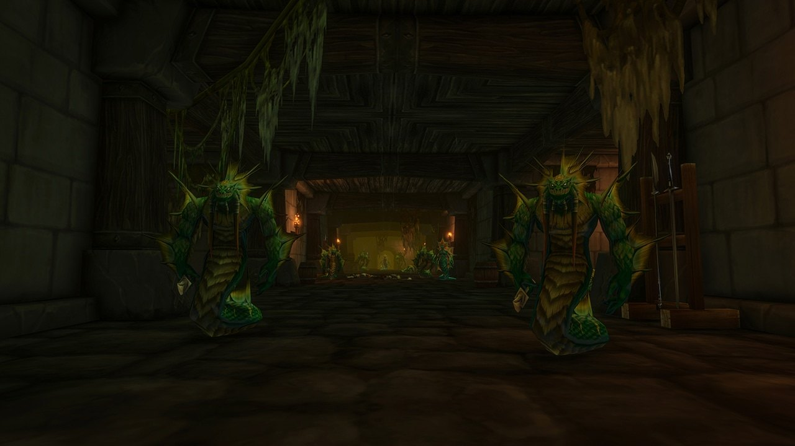

## Getting there

Alcaz Prison is a new dungeon for World of Warcraft: Forever, for levels 48 to 53, on Alcaz Island off the coast of Dustwallow Marsh. From the dock, take the path up the hill to the left to the large building. The portal is in its basement, around /way 75 15.

## The story

The prison on Alcaz Island was long said to hold important prisoners, King Varian Wrynn among them, but nobody could get in. In Forever its doors open. Inside, the Defias Brotherhood and naga fight each other, and new pieces of a familiar mystery wait, according to [Blizzard](/news/blizzard-describes-all-nine-new-dungeons/).

## The bosses

### The Questioner

The first boss. Leave him alive if you want the secret disguise toy: the quest <a href="https://www.wowhead.com/forever/quest=96335">The Man in the Iron Chains</a> at the end of the dungeon sends you back to him.

### Blazeroar

The only boss known so far, named in the Legacy challenge of the dungeon.

## The secret disguise toy

A hidden chain starts here and ends with the <a class="wf-wh wf-q3" href="https://www.wowhead.com/forever/item=279471">Alcaz Operative Insignia</a>, a toy that disguises you as a Defias operative for 10 minutes. Clear the dungeon without killing The Questioner, take <a href="https://www.wowhead.com/forever/quest=96335">The Man in the Iron Chains</a> at the end, then follow the trail to Moonbrook in Westfall and on to Stormwind (Alliance) or Booty Bay (Horde) for a <a class="wf-wh wf-q2" href="https://www.wowhead.com/forever/item=279450">Fractured Insignia</a>. Six of them make the toy. The steps are in [the post about the toy](/news/alcaz-prison-hides-a-defias-disguise-toy/).

## What is not known yet

- **The other bosses** and how the fights work.
- **The map** of the inside.
- **The loot** and **the other quests**.
