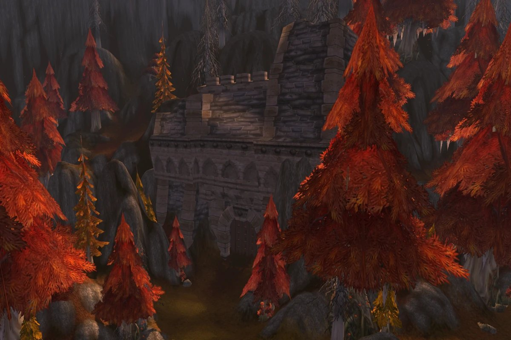

## Getting there

Blackmaw Hold is a new dungeon for World of Warcraft: Forever, for levels 55 to 60, in Azshara. A furbolg tunnel opens behind the old stone gate at /way 38.7 33.4. The tunnel runs so deep that the portal itself lies on the map of Winterspring, at /way 66.6 84.4.

## The gate that said Timbermaw Hold

In Classic, step close to that gate and the game says you enter Timbermaw Hold, yet it never led anywhere. In Forever it is the way into Blackmaw Hold: a different tribe from the Timbermaw of Felwood. More in the [post about the gate](/news/blackmaw-hold-sits-behind-the-old-gate-in-azshara/).

## A furbolg city

The Blackmaw clan fights a corruption that spreads through its groves and mountain tunnels. Blizzard calls it a substantial max-level dungeon with several routes and bosses, and the deepest part may lead even further below Azeroth.

The developers put it a little above Blackrock Depths in size, the largest dungeon until now. They do not call it a mega dungeon though: a group should get through it from start to end in one long session.

## The bosses

### Varrox Bleakhoof

The only boss known so far, named in the Legacy challenge of the dungeon. The game data has a quest item <a class="wf-wh wf-q1" href="https://www.wowhead.com/forever/item=249692">Head of Varrox Bleakhoof</a>, so a quest to kill him is likely.

## What is not known yet

- **The other bosses** and the routes through the city.
- **The map** of the inside.
- **The loot** and **the quests**, see the [quests tab](/guides/dungeons/blackmaw-hold/quests/) for the items in the game data.
