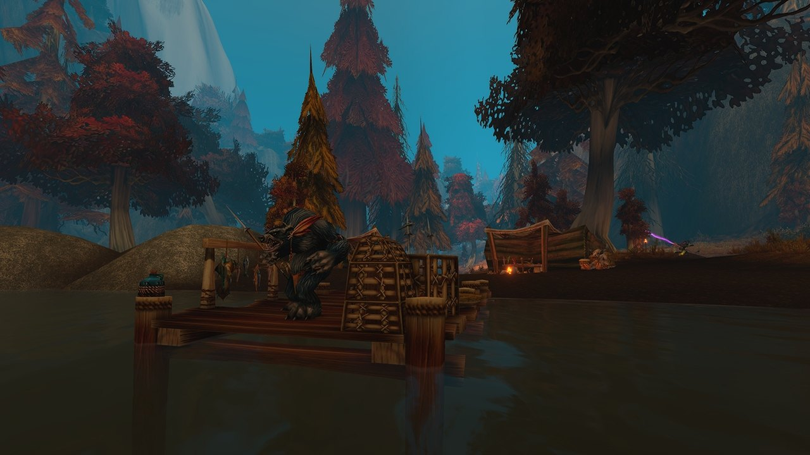

## Getting there

Blackmaw Hold is a new dungeon for World of Warcraft: Forever, for levels 55 to 60, in Azshara, just west of Timbermaw Hold. A furbolg tunnel opens behind the old stone gate at /way 38.7 33.4. The tunnel runs so deep that the portal itself lies on the map of Winterspring, at /way 66.6 84.4. The spirit healer stands right outside, so a wipe costs only a short run.

- **Horde:** fly to Valormok in Azshara. Without that flight path, fly to Splintertree Post in Ashenvale and ride east, or leave Orgrimmar by the west gate and ride north.
- **Alliance:** fly to Talrendis Point in the south-west of Azshara. Without that flight path, Astranaar in Ashenvale or Ratchet are the closest.

## The gate that said Timbermaw Hold

In Classic, step close to that gate and the game says you enter Timbermaw Hold, yet it never led anywhere. In Forever it is the way into Blackmaw Hold. The Blackmaw are a rival tribe of the Timbermaw who joined the Legashi satyrs, and their fel magic corrupts Azshara. More in the [post about the gate](/news/blackmaw-hold-sits-behind-the-old-gate-in-azshara/).

## A furbolg city

Blackmaw Hold is about as big as Maraudon or Blackrock Depths, with several routes through groves and mountain tunnels. The developers still do not call it a mega dungeon: a group should get through it from start to end in one long session.

## Trash to watch out for

- **<a class="wf-wh wf-plain" href="https://www.wowhead.com/forever/npc=250027">Blackmaw Headhunters</a> and <a class="wf-wh wf-plain" href="https://www.wowhead.com/forever/npc=247237">Blackmaw Berserkers</a>** wait at the start. The Headhunters put a strong poison on you with <a class="wf-wh wf-spell" href="https://www.wowhead.com/forever/spell=1323656">Poisoned Shot</a>: remove it right away. Stun the Berserkers when they enrage.
- **<a class="wf-wh wf-plain" href="https://www.wowhead.com/forever/npc=255394">Blackmaw Champions</a>** fear everyone around them with <a class="wf-wh wf-spell" href="https://www.wowhead.com/forever/spell=1324618">Terrifying Roar</a> and stun the tank for 2 seconds with <a class="wf-wh wf-spell" href="https://www.wowhead.com/forever/spell=1323676">Slam</a>. Kill them first in every furbolg pack, because a feared player can run into the next pack. A Shaman's <a class="wf-wh wf-spell" href="https://www.wowhead.com/forever/spell=8143">Tremor Totem</a> helps; without one, pull these packs back to a spot where nobody can run into other monsters.
- **<a class="wf-wh wf-plain" href="https://www.wowhead.com/forever/npc=268864">Legashi Plaguebringers</a>** hit hard with Shadow Bolt and summon <a class="wf-wh wf-plain" href="https://www.wowhead.com/forever/npc=268865">Festering Swarmers</a>: kill the Swarmers as soon as they appear. A **<a class="wf-wh wf-plain" href="https://www.wowhead.com/forever/npc=258329">Bloated Grizzly</a>** explodes when it dies with <a class="wf-wh wf-spell" href="https://www.wowhead.com/forever/spell=1302497">Corpse Explosion</a>, which hits everyone nearby and leaves a disease. Ranged players stay away from it, and the disease gets removed fast.
- **<a class="wf-wh wf-plain" href="https://www.wowhead.com/forever/npc=247248">Legashi Summoners</a>** fear players into other packs and cast <a class="wf-wh wf-spell" href="https://www.wowhead.com/forever/spell=11639">Shadow Word: Pain</a>. Kill them first. Their <a class="wf-wh wf-plain" href="https://www.wowhead.com/forever/npc=255247">Swarming Imps</a> explode with <a class="wf-wh wf-spell" href="https://www.wowhead.com/forever/spell=1264600">Soulburst</a> when they die, so do not kill them all at once with area damage, or the melee players die with them.

The large group of <a class="wf-wh wf-plain" href="https://www.wowhead.com/forever/npc=277474">Blackmaw Devotees</a> drops nothing since a hotfix on 16 November. Groups farmed it for gold, see [our post about the farm](/news/a-gold-farm-in-blackmaw-hold-is-hotfixed/).

## The bosses

Seven bosses and four rares. Varrox Bleakhoof is the last one, at the bottom of a hole in the room of Clawbert.

### 1. Withermaw

<a class="wf-wh wf-plain" href="https://www.wowhead.com/forever/npc=247195">Withermaw</a> waits in the Festering Grotto. Flesh Maggots keep coming during the whole fight, he mauls the tank and his Intimidating Roar fears the whole group for 8 seconds. Put down <a class="wf-wh wf-spell" href="https://www.wowhead.com/forever/spell=8143">Tremor Totem</a> or have a Priest cast <a class="wf-wh wf-spell" href="https://www.wowhead.com/forever/spell=6346">Fear Ward</a> on the healer, so the tank keeps getting heals. The maggots have little health: kill them as they come. Withermaw drops the Claws of the Great Bear for the quest Claws That Rend, Tusks that Gore.

### 2. Impaan the Imprisoner

<a class="wf-wh wf-plain" href="https://www.wowhead.com/forever/npc=247206">Impaan the Imprisoner</a> patrols one of the groves and fires Shadow Bolts at the tank. His Imps! summons three imps that make him take 99% less damage, so kill the imps first, then the boss. Clear the area before you pull him.

### 3. Bonesnout the Unbroken

<a class="wf-wh wf-plain" href="https://www.wowhead.com/forever/npc=247198">Bonesnout the Unbroken</a> patrols Bonesnout's Thicket and starts with four stacks of Profane Bulwark: he takes no damage at all. Four <a class="wf-wh wf-plain" href="https://www.wowhead.com/forever/npc=258668">Legashi Ritualists</a> keep that shield up from around the thicket, and every Ritualist you kill takes 25% off. Watch his patrol while you hunt them. After that the fight is easy: Trample hits everyone near him and Stomp stuns for 2 seconds, so the healer and ranged players stay out of melee range. He drops the Tusks of the Unbroken for the same quest as Withermaw.

### 4. Unbound Spirit

<a class="wf-wh wf-plain" href="https://www.wowhead.com/forever/npc=247231">Unbound Spirit</a> starts when you talk to <a class="wf-wh wf-plain" href="https://www.wowhead.com/forever/npc=248765">Elder Bramblesnap</a>. In phase 1 three Profane Totems protect the spirit, and Elder Bramblesnap channels on them one by one so you can break them. Ethereal Beasts keep coming in the meantime and the spirit casts Fire Nova on the whole group. The tank picks up the beasts, the rest hits the totem, and after each totem the group kills the beasts. Phase 2 starts when the third totem breaks: the spirit has little health and only adds Fireball on the tank.

### 5. Clawbert and the Blackmaw Behemoth

<a class="wf-wh wf-plain" href="https://www.wowhead.com/forever/npc=247996">Clawbert</a> rides on the <a class="wf-wh wf-plain" href="https://www.wowhead.com/forever/npc=247207">Blackmaw Behemoth</a>, a huge furbolg he believes he controls. Both have their own health; kill Clawbert first. He casts Lightning Bolt, the Behemoth swings him around as an Improvised Weapon and lowers your damage with a roar. When Clawbert dies the Behemoth eats him and takes over his Lightning Bolt, plus a slow, spinning attack that follows the tank: walk out of it.

### 6. Elder Shaman Bloodmane

<a class="wf-wh wf-plain" href="https://www.wowhead.com/forever/npc=247209">Elder Shaman Bloodmane</a> is not hard. He summons two Feral Spirits at the start, purges your buffs and casts Chain Lightning. Kill the boss first, then the wolves: they stay when he dies. He drops the Blackmaw Ritual Totem for the quest Blackmaw Magic.

### 7. Varrox Bleakhoof

<a class="wf-wh wf-plain" href="https://www.wowhead.com/forever/npc=247234">Varrox Bleakhoof</a> waits down the hole in the room of Clawbert. He fears random players, casts Shadow Bolt Volley and puts Nightmare Detonation on a random player: that player gets pulled to the boss and explodes when the debuff ends, hitting everyone nearby and leaving a pool of Crimson Wrest. Move away from that player, and the tank moves Varrox when a pool lands near melee. Watch out that a Fear does not send someone into a pool. The healer heals the group during Nightmare Detonation and the tank in between. His head is for the quest Blackmaw Reclamation.

### The rares

Four rares can show up. They fight more like named trash than real bosses, and each drops two items.

- **<a class="wf-wh wf-plain" href="https://www.wowhead.com/forever/npc=269104">Moontouched Wanderer</a>**: Moonfire and Enrage. Remove the Moonfire and stun him when he enrages.
- **Tunnelweb Matriarch**: a stealthed spider that is easy to miss. She poisons players and roots them in a Web for 10 seconds.
- **<a class="wf-wh wf-plain" href="https://www.wowhead.com/forever/npc=247412">Mopes</a>**: only Shadow Bolt.
- **<a class="wf-wh wf-plain" href="https://www.wowhead.com/forever/npc=269111">Gortek the Apprentice</a>**: Lightning Bolt and Earth Shock. Interrupt the Lightning Bolt.
