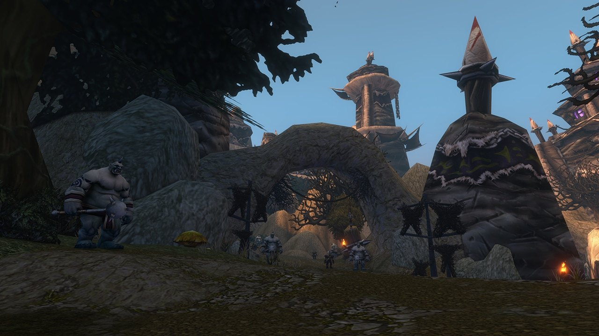

## Getting there

Krol'dok Stronghold is a new dungeon for World of Warcraft: Forever, for levels 40 to 45, in the new zone the Riverglades. The ogre fortress stands on a hill above Sunnyglade on the north side of the zone. The entrance is a cave tucked away just west of the large gates, at /way 37.5 37.5.

Ogre outrunners kidnap travelers and plunder villages all over the Riverglades, and their trail leads here. After dark, strange chanting comes from the stronghold.

## The layout

A winding path leads uphill between crude buildings, workshops and camps, past guarded passages. A large wooden bridge crosses to the top, where the largest buildings stand. <a class="wf-wh wf-plain" href="https://www.wowhead.com/forever/npc=278310">Krol'dok Centurion</a> is one of the elite ogres you will meet.

## The keys

The game data has two keys for the stronghold, <a class="wf-wh wf-q1" href="https://www.wowhead.com/forever/item=267089">Krol'dok Compound Key</a> and <a class="wf-wh wf-q1" href="https://www.wowhead.com/forever/item=271721">Krol'dok Ogre Key</a>. Which doors they open and where they drop is not known yet.

## The bosses

### Overlord Mugg

The only boss known so far, named in the Legacy challenge of the dungeon. He drops <a class="wf-wh wf-q1" href="https://www.wowhead.com/forever/item=267086">Eye of Mugg</a>, a quest item.

## What is not known yet

- **The other bosses** and how the fights work.
- **The loot**, including the pieces of the Krol'dok Battlegear set.
- **The quests**, including the two <a class="wf-wh wf-q1" href="https://www.wowhead.com/forever/item=267137">Krol'dok Moulding</a> items that start one.
