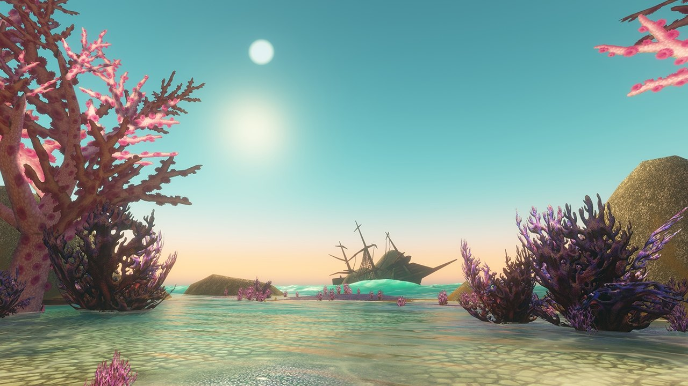

## Getting there

The Drowned City is a new dungeon for World of Warcraft: Forever, for levels 35 to 40. Old troll ruins have risen from the sea west of Grom'gol, on land that existed in the alpha of World of Warcraft as Gillijim's Isle but never made it into the game.

The entrance is under water, around /way 21.4 27.9. Swim past The Vile Reef to the Sunken Hollow, near the island with the water elementals. A cave with a large tablet beside it leads inside. Bring something to breathe under water if your class has it. The spirit healer stands right outside the entrance, so a wipe costs only a short run.

## The layout

You start in a cave and climb a hill to the main ruins. The city opens into a large central area with a pool in the middle, with smaller sections on each side where more bosses wait. The dungeon is open to the sky: during the run mist and rain build into a storm before the last fight. Trolls and naga roam the streets, and a pirate ship nearby came to a bad end.

## Trash to watch out for

Since a hotfix on 9 November, creatures here no longer do about 30% more damage than intended. Packs that felt too strong before that date are now easier.

- **Makrura Snappers and Chasm Crawlers** come first. The Crawlers walk in packs of two or three, hit hard and put Muscle Tear on the tank (21 less Strength), while the Snappers stack Sunder Armor. Pull slowly and let the tank build threat.
- **Risen Sentries** come in packs of three or four, often with a **Profane Necro**. The Sentries charge and knock players back; the Necro summons a Drowned Spirit. Stand on top of the pack so the charges do nothing, kill the Necro first and keep your back away from other packs.
- **Brinescale Sorcerers** are the dangerous naga: hard Frostbolts and a Fear. Pull them around a corner so they come to you. Interrupt the Fear first and the Frostbolts when you can. A Shaman's Tremor Totem helps a lot here, because one feared player in these crowded streets can pull the next pack.
- **Poison** is everywhere in this dungeon. A Druid, Shaman or Paladin who can remove it saves the healer a lot of mana.

## The bosses

Six bosses in the order you meet them, plus two rares that are not always there: Umbra and Gill. Deathless Marrow is by far the hardest fight.

### 1. Zul'Alai

<a class="wf-wh wf-plain" href="https://www.wowhead.com/forever/npc=270882">Zul'Alai</a> hits the tank hard. Monstrous Slam stuns everyone near him for 2 seconds, and at 30% health he enrages. Keep the healer out of melee range and save cooldowns for the last 30%. Near the end he casts Undying Oath, so watch his buffs.

### 2. Var'Taka

<a class="wf-wh wf-plain" href="https://www.wowhead.com/forever/npc=270883">Var'Taka</a> fights with two Brinescale Priestesses. They heal themselves and the boss and cast Frostbolt at the tank, so kill them first or keep them out of the fight with Polymorph or Sap. Var'Taka throws a Harpoon at a random player and pulls them to him, and Arcing Smash hits everything in front of him, so the tank turns him away from the group. Clear the packs on the left and right before you pull. Afterwards, click the Glowing Pearl to break the barrier.

### 3. Primeval Elemental

<a class="wf-wh wf-plain" href="https://www.wowhead.com/forever/npc=270887">Primeval Elemental</a> has an area spell that slows the whole group: interrupt it every time. Apart from that it is no real threat. It can drop <a class="wf-wh wf-q3" href="https://www.wowhead.com/forever/item=274615">Heart of the Primeval</a>, a trinket that adds up to 19 spell damage and healing for 30 seconds.

### 4. Captain Dreadrise

<a class="wf-wh wf-plain" href="https://www.wowhead.com/forever/npc=270884">Captain Dreadrise</a> leads the Saltseer Pirates in the city. Embrine locks a random player in an Abyssal Bubble: kill the bubble before that player drowns. Waterbolt Volley hits the whole group and can be interrupted, so do that every time. Clear the area first, so no patrol joins the fight. Click the Glowing Pearl after this fight as well.

### 5. Deathless Marrow

<a class="wf-wh wf-plain" href="https://www.wowhead.com/forever/npc=270885">Deathless Marrow</a> casts Bloodbolt again and again while Deathless trolls keep coming. Every add that dies makes the boss take 20% more damage. So do not ignore the adds: the tank gathers them, the group kills them with cleaves and area damage, and you hit the boss in between.

The same hotfix weakened this fight: the creatures have 25% less health, the Fireball of the Deathless Sorcerer does 25% less damage, the Charge of the Deathless Watcher 50% less, and the Deathless Guardian casts Shield Slam about half as often. More in [the post about the hotfix](/news/drowned-city-gets-easier-and-busy-zones-emptier/).

### 6. Min'loth the Serpent

<a class="wf-wh wf-plain" href="https://www.wowhead.com/forever/npc=270886">Min'loth the Serpent</a> fights in two phases. As a troll he uses Drench, a heavy hit on the tank, and Deluge, a channelled spell that hits the whole group. At 0% he turns into a serpent with full health. Now he poisons everyone, so cleanse it fast, and fears a random player. The fight ends when the serpent drops to 0%. The tank turns him away from the group.

### Umbra (rare)

Umbra comes with five Saltscale Murlocs whose bleeds add up fast. Umbra has no known abilities of his own: kill him quickly, then the murlocs.

### Gill (rare)

<a class="wf-wh wf-plain" href="https://www.wowhead.com/forever/npc=270888">Gill</a> is the second rare. How this fight works is not known yet.

### Zin'aka

<a class="wf-wh wf-plain" href="https://www.wowhead.com/forever/npc=263742">Zin'aka</a> is an elite shark among the trash, not a boss. It almost always wipes the group and drops nothing, so swim around it.

## What is not known yet

- **The rest of the loot**: so far <a class="wf-wh wf-q3" href="https://www.wowhead.com/forever/item=274615">Heart of the Primeval</a> from the Primeval Elemental and <a class="wf-wh wf-q3" href="https://www.wowhead.com/forever/item=271718">Linken's Boots of Iron</a> from any boss are known.
- **The rewards** of four of the eight quests.
