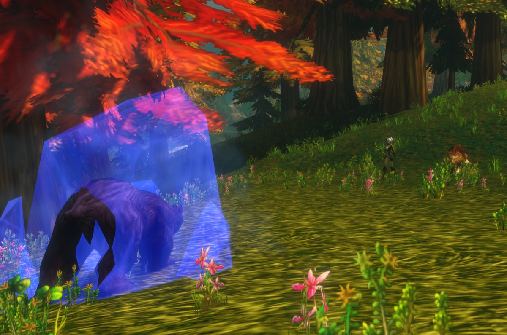
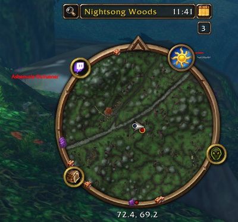

The Hunter is one of the strongest classes to level. You deal damage from a distance, you control monsters with traps and slows, and your pet takes the hits. The first 10 levels are slow, until you tame a pet and get your first talent point. In WoW Forever, new pet abilities and new talents give the class more depth. This guide covers the builds, the rotation, the key levels, gear, pets, traps and tracking.

| | |
|---|---|
| Easiest spec for leveling | Beast Mastery |
| Key talents | <a class="wf-wh wf-spell" href="https://www.wowhead.com/forever/spell=19552">Deadly Aspects</a>, Unleashed Fury, <a class="wf-wh wf-spell" href="https://www.wowhead.com/forever/spell=19598">Ferocity</a>, Summon Hawk, <a class="wf-wh wf-spell" href="https://www.wowhead.com/forever/spell=1223755">Focused Fire</a> |
| Strength | Ranged damage, a pet that tanks, crowd control, fast travel |
| Weakness | A slow start until level 10, mana and ammunition |
| Talent order per level | [Hunter level build](/leveling/hunter/) |
| Spec guides | [Beast Mastery Hunter](/guides/beast-mastery-hunter/), [Marksmanship Hunter](/guides/marksmanship-hunter/), [Survival Hunter](/guides/survival-hunter/) |
| Builds to level 60 | Yes, the [level build](/leveling/hunter/) goes to 60 |

## Which spec to level with

All three trees level. **Beast Mastery** is the smoothest: your pet deals more damage and survives more, and with <a class="wf-wh wf-spell" href="https://www.wowhead.com/forever/spell=2649">Growl</a> it keeps the monster on itself while you shoot. **Marksmanship** deals more damage from your own shots, so you pull threat more often and have to kite. **Survival** mixes melee, traps and shots, and asks the most of you.
## Levels 1 to 10

You start without talents and without a pet, with <a class="wf-wh wf-spell" href="https://www.wowhead.com/forever/spell=75">Auto Shot</a> and Raptor Strike. Monsters reach you quickly, so you often finish them in melee.

1. Keep <a class="wf-wh wf-spell" href="https://www.wowhead.com/forever/spell=13163">Aspect of the Monkey</a> up as soon as you have it, at level 4.
2. Pull with Auto Shot.
3. Cast <a class="wf-wh wf-spell" href="https://www.wowhead.com/forever/spell=1978">Serpent Sting</a>.
4. Cast Arcane Shot on cooldown.
5. Cast <a class="wf-wh wf-spell" href="https://www.wowhead.com/forever/spell=5116">Concussive Shot</a> to slow the monster and keep your distance.
6. Step back between shots.
7. Use Raptor Strike once the monster reaches you, and finish it in melee.

Start every pull from as far away as you can: every extra yard is an extra shot. Stats at these levels: Agility, then attack power, then Intellect, then Stamina and Spirit, then armor.

## Talent builds

The [Hunter level build](/leveling/hunter/) gives the talent for every level from 10 to 60. [Open the end result in the talent calculator](/talents/hunter/?t=5120221405101241-00503520005).

For level 60, every spec guide has its own builds for raids, leveling and PvP: [Beast Mastery](/guides/beast-mastery-hunter/), [Survival](/guides/survival-hunter/) and [Marksmanship](/guides/marksmanship-hunter/).

## Key levels

| Level | What you get | From |
|---|---|---|
| 1 | Auto Shot, Raptor Strike, <a class="wf-wh wf-spell" href="https://www.wowhead.com/forever/spell=1494">Track Beasts</a> | Default, class trainer |
| 4 | Aspect of the Monkey, Serpent Sting | Class trainer |
| 6 | Arcane Shot, <a class="wf-wh wf-spell" href="https://www.wowhead.com/forever/spell=1130">Hunter's Mark</a> | Class trainer |
| 8 | Concussive Shot | Class trainer |
| 10 | <a class="wf-wh wf-spell" href="https://www.wowhead.com/forever/spell=1515">Tame Beast</a>, <a class="wf-wh wf-spell" href="https://www.wowhead.com/forever/spell=5149">Beast Training</a> | Class quest |
| 10 | <a class="wf-wh wf-spell" href="https://www.wowhead.com/forever/spell=6991">Feed Pet</a>, <a class="wf-wh wf-spell" href="https://www.wowhead.com/forever/spell=982">Revive Pet</a>, <a class="wf-wh wf-spell" href="https://www.wowhead.com/forever/spell=883">Call Pet</a>, <a class="wf-wh wf-spell" href="https://www.wowhead.com/forever/spell=2641">Dismiss Pet</a>, Aspect of the Hawk, <a class="wf-wh wf-spell" href="https://www.wowhead.com/forever/spell=19883">Track Humanoids</a> | Class trainer |
| 10 | First talent point | Talent tree |
| 12 | <a class="wf-wh wf-spell" href="https://www.wowhead.com/forever/spell=136">Mend Pet</a>, Wing Clip | Class trainer |
| 14 | <a class="wf-wh wf-spell" href="https://www.wowhead.com/forever/spell=1513">Scare Beast</a>, <a class="wf-wh wf-spell" href="https://www.wowhead.com/forever/spell=6197">Eagle Eye</a>, <a class="wf-wh wf-spell" href="https://www.wowhead.com/forever/spell=1002">Eyes of the Beast</a> | Class trainer |
| 16 | Mongoose Bite, Immolation Trap | Class trainer |
| 18 | <a class="wf-wh wf-spell" href="https://www.wowhead.com/forever/spell=2643">Multi-Shot</a> | Class trainer |
| 20 | Aimed Shot, <a class="wf-wh wf-spell" href="https://www.wowhead.com/forever/spell=5118">Aspect of the Cheetah</a>, <a class="wf-wh wf-spell" href="https://www.wowhead.com/forever/spell=1499">Freezing Trap</a> | Class trainer |
| 20 | Polearms | Weapon trainer |
| 22 | Scorpid Sting | Class trainer |
| 24 | <a class="wf-wh wf-spell" href="https://www.wowhead.com/forever/spell=19885">Track Hidden</a> | Class trainer |
| 25 | Summon Hawk, Trueshot Aura | Talent tree |
| 26 | Rapid Fire, <a class="wf-wh wf-spell" href="https://www.wowhead.com/forever/spell=19880">Track Elementals</a> | Class trainer |
| 28 | Frost Trap | Class trainer |
| 30 | Feign Death, Aspect of the Beast | Class trainer |
| 30 | Intimidation, Strider Kick, Expose Prey, Scatter Shot | Talent tree |
| 32 | <a class="wf-wh wf-spell" href="https://www.wowhead.com/forever/spell=1543">Flare</a>, <a class="wf-wh wf-spell" href="https://www.wowhead.com/forever/spell=19878">Track Demons</a> | Class trainer |
| 34 | <a class="wf-wh wf-spell" href="https://www.wowhead.com/forever/spell=13813">Explosive Trap</a> | Class trainer |
| 36 | <a class="wf-wh wf-spell" href="https://www.wowhead.com/forever/spell=3034">Viper Sting</a> | Class trainer |
| 40 | <a class="wf-wh wf-spell" href="https://www.wowhead.com/forever/spell=13159">Aspect of the Pack</a>, <a class="wf-wh wf-spell" href="https://www.wowhead.com/forever/spell=19882">Track Giants</a> | Class trainer |
| 40 | <a class="wf-wh wf-spell" href="https://www.wowhead.com/forever/spell=19574">Bestial Wrath</a>, Sniper Shot, Lacerating Strikes | Talent tree |
| 40 | Riding, Dual Specialization (50 gold) | Trainers |
| 46 | <a class="wf-wh wf-spell" href="https://www.wowhead.com/forever/spell=20043">Aspect of the Wild</a> | Class trainer |
| 50 | <a class="wf-wh wf-spell" href="https://www.wowhead.com/forever/spell=19879">Track Dragonkin</a> | Class trainer |
| 60 | <a class="wf-wh wf-spell" href="https://www.wowhead.com/forever/spell=19801">Tranquilizing Shot</a> | Class trainer |

Aimed Shot is no longer a talent: every Hunter learns it at level 20. The talent levels are the earliest without Talented; with Talented you reach them up to five levels sooner.

## The class quest

At level 10, every Hunter does Taming the Beast. The chain teaches Tame Beast and Beast Training, so you can tame and train your first pet. It starts in your starting zone: Teldrassil for Night Elves, Dun Morogh for Dwarves, [Zephras Isle](/guides/zephras-isle/) for the High Order Skyborne, Mulgore for Tauren and Durotar for Orcs and Trolls.

## Where to level

The lowest recommended level for each zone. The levels of the dungeons are in the [dungeon guide](/guides/dungeons/).

| Level | Zones |
|---|---|
| **1** | Elwynn Forest, Dun Morogh, Teldrassil, [Zephras Isle](/guides/zephras-isle/), Durotar, Mulgore, Tirisfal Glades |
| **10** | Westfall, Loch Modan, Darkshore, The Barrens, Silverpine Forest |
| **15** | Redridge Mountains, Stonetalon Mountains |
| **18** | Ashenvale |
| **20** | Wetlands, Hillsbrad Foothills, Duskwood |
| **25** | Thousand Needles |
| **30** | Alterac Mountains, Arathi Highlands, Desolace, Riverglades, Stranglethorn Vale |
| **35** | Badlands, Dustwallow Marsh, Feralas, Swamp of Sorrows |
| **40** | Shen'dralas, Tanaris, The Hinterlands |
| **43** | Searing Gorge |
| **45** | Azshara, Felwood, Blasted Lands |
| **48** | Un'Goro Crater |
| **50** | Burning Steppes, Western Plaguelands |
| **53** | Winterspring, Eastern Plaguelands |
| **55** | Silithus, Deadwind Pass |
| **60** | Mount Hyjal |

## Weapons

A Hunter can use more weapon types than any other class. You learn most of them from a weapon trainer.

| Weapon | Alliance | Horde |
|---|---|---|
| **Daggers** | Known from the start | Known from the start |
| **One- and two-handed axes** | Buliwyf Stonehand (Ironforge) | Hanashi, Sayoc (Orgrimmar) |
| **One- and two-handed swords** | Woo Ping (Stormwind) | Archibald (Undercity) |
| **Fist weapons** | Ilyenia Moonfire (Darnassus), Buliwyf Stonehand (Ironforge) | Sayoc (Orgrimmar) |
| **Staves** | Ilyenia Moonfire (Darnassus), Woo Ping (Stormwind) | Hanashi, Sayoc (Orgrimmar), Ansekhwa (Thunder Bluff) |
| **Polearms**, from level 20 | Woo Ping (Stormwind) | Archibald (Undercity) |
| **Bows** | Ilyenia Moonfire (Darnassus) | Hanashi, Sayoc (Orgrimmar) |
| **Crossbows** | Bixi Wobblebonk (Ironforge), Woo Ping (Stormwind) | Archibald (Undercity) |
| **Guns** | Buliwyf Stonehand (Ironforge) | Ansekhwa (Thunder Bluff) |
| **Thrown** | Bixi Wobblebonk (Ironforge), Ilyenia Moonfire (Darnassus) | Hanashi, Sayoc (Orgrimmar) |

Whenever you learn a new weapon type, you first have to train its skill before you hit reliably with it.

## Gear

**Ranged weapons** are your main source of damage. These are strong picks from level 13 to 30:

| Level | Item | Source |
|---|---|---|
| 13 to 16 | <a class="wf-wh wf-q3" href="https://www.wowhead.com/forever/item=272999">Barbaric Crossbow</a> | Ragefire Chasm |
| 13 to 16 | <a class="wf-wh wf-q3" href="https://www.wowhead.com/forever/item=279894">Calibrated Blunderbuss</a> | Quest in the Hall of Thanes, Alliance only |
| 19 to 22 | <a class="wf-wh wf-q3" href="https://www.wowhead.com/forever/item=6469">Venomstrike</a> | Wailing Caverns |
| 22 to 29 | <a class="wf-wh wf-q3" href="https://www.wowhead.com/forever/item=3078">Naga Heartpiercer</a> | Blackfathom Deeps |
| 23 to 29 | <a class="wf-wh wf-q3" href="https://www.wowhead.com/forever/item=273843">Fallenroot Longbow</a> | Blackfathom Deeps |
| 29 to 30 | <a class="wf-wh wf-q3" href="https://www.wowhead.com/forever/item=274084">Quilboar Blaster</a> | Quest in Razorfen Kraul |

**Melee weapons** matter most for Survival, which leans on weapon damage. For the other specs a melee weapon is mostly a stat stick.

**Crafted gear and dungeon loot.** Leatherworking got strong new recipes early on, such as <a class="wf-wh wf-q3" href="https://www.wowhead.com/forever/item=252425">Dark Leather Boots</a>, <a class="wf-wh wf-q3" href="https://www.wowhead.com/forever/item=252504">Brawler's Leather Hood</a> and <a class="wf-wh wf-q3" href="https://www.wowhead.com/forever/item=252521">Stalker's Leather Belt</a>. Dungeons give upgrades such as <a class="wf-wh wf-q3" href="https://www.wowhead.com/forever/item=271212">Bloodied Chestwraps</a> and <a class="wf-wh wf-q3" href="https://www.wowhead.com/forever/item=9624">Triprunner Dungarees</a>.

## Professions

Level your professions alongside your Hunter, so you gather and craft at the right level. Camps give buffs to every profession, and in Forever your pet gets them too.

- **Cooking** is a must: buff food gives extra experience, and you need it for a campfire.
- **Leatherworking** makes strong soulbound leveling gear and gives a rested experience buff at your camp.
- **Skinning** goes with Leatherworking, and Aspect of the Cheetah gets you from monster to monster quickly. Its camp buff gives 2% critical strike chance.
- **Herbalism** fits a Hunter on the move. Its camp buff gives Intellect.
- **Alchemy** goes with Herbalism, for potions. Its camp buff gives mana regeneration.
- **Engineering** makes gadgets, explosives and scopes for your ranged weapon. The Reagent Bot at your camp sells food, water and materials.
- **Mining** goes with Engineering. Its camp buff gives melee attack power, good for Survival and your pet.
- **Fishing** goes with Cooking. Its camp buff raises all stats by 8%.
- **First Aid** gives bandages and potions. Its camp buff gives Stamina to you and your pet.

## Consumables

- **Food and water.** Stay Well Fed for the extra experience; any buff food is better than none. Carry water at your level, because you will need to drink.
- **Potions.** Healing potions for emergencies, now also from First Aid. First Aid also makes cures for Poisons, Diseases and Bleeds, which a Hunter cannot remove otherwise. Mana potions help too.
- **Elixirs** with the right stats are expensive to keep up, but worth it for a difficult quest or monster.
- **Ammunition.** Keep your quiver or ammo pouch full. Without arrows or bullets you cannot shoot.

## Pets

Your pet is the heart of the class. Keep an eye on where it stands, which abilities it uses and its cooldowns: that lets you respond to what a monster does, or avoid danger altogether. In Forever, your pet also gets the Camping buffs, as long as it is summoned while you sit at the campfire. Since 10 November your pet has 115% of its normal health instead of 150%, which was a bug, [more in our post](/news/hunter-pets-lose-health-and-warlock-pets-gain-it/).

Pet abilities add utility, such as <a class="wf-wh wf-spell" href="https://www.wowhead.com/forever/spell=24423">Demoralizing Screech</a> and <a class="wf-wh wf-spell" href="https://www.wowhead.com/forever/spell=7272">Dust Cloud</a>.

## Crowd control and pulls

Hunters excel at control: Frost Trap, Freezing Trap, Wing Clip and Concussive Shot, made stronger with Entrapment, Clever Traps, Improved Concussive Shot and <a class="wf-wh wf-spell" href="https://www.wowhead.com/forever/spell=19228">Improved Wing Clip</a>. Scatter Shot and Intimidation add more. Your best tool remains your pet, which holds the monster while you keep your distance.

Scare Beast makes a Beast run in fear for up to 10 seconds at rank 1. It can run into another group, so use it with care. In PvP it works against Hunter pets and Druids in animal form.

You can pull almost anything from a distance with a shot. Hunters also chain pull well: Serpent Sting and your fire traps keep ticking while you move to the next monster. Watch out for monsters that are still alive, though, as they can run into another group.

## Movement

- **Aspect of the Cheetah** gives 30% movement speed, but you are Dazed for 4 seconds when you take damage. Pathfinding adds up to 6%.
- **Aspect of the Pack** from level 40 does the same for your group, with the same risk for everyone. Good for travel, not for combat.
- **<a class="wf-wh wf-spell" href="https://www.wowhead.com/forever/spell=5384">Feign Death</a>** drops combat. Use it to get through a dangerous area or to loot something while monsters attack you.
- **Your pet** can draw monsters away from you, so you get through a busy area without fighting everything.

## Mana

Hunters use mana for everything, and spells such as Aimed Shot cost a lot. Carry water and a few mana potions. Each tree has a talent for mana in combat: <a class="wf-wh wf-spell" href="https://www.wowhead.com/forever/spell=19590">Bestial Discipline</a>, Rapid Recuperation and Resourcefulness. That makes Spirit valuable while leveling. Never spend all your mana: keep enough for a trap or Feign Death when a pull goes wrong.

## Tracking

Tracking shows monsters of one type on your minimap. It helps every Hunter, Survival most of all, thanks to Improved Tracking. In PvE you see patrols coming, in PvP you see enemy players. Track Hidden reveals stealthed players.

| Color | Meaning |
|---|---|
| **Green with a silver border** | Friendly player |
| **Green with a gold border** | Friendly NPC |
| **Red with a silver border** | Enemy player |
| **Red with a gold border** | Enemy NPC |
| **Gold with a gold border** | Neutral NPC, hostile once you attack it |

## Aspects and cooldowns

Only one Aspect can be active at a time.

| Aspect | What it does |
|---|---|
| **Aspect of the Hawk** | More ranged attack power |
| **Aspect of the Beast** | More melee attack power, and you cannot be tracked |
| **Aspect of the Monkey** | 8% more dodge |
| **Aspect of the Cheetah** | 30% movement speed, Dazed when hit |
| **Aspect of the Pack** | 30% movement speed for your group, Dazed when hit |
| **Aspect of the Wild** | Nature resistance for your group |

- **Scorpid Sting** has changed: it lowers the chance to hit of the target by 2% for 20 seconds. It does not stack with <a class="wf-wh wf-spell" href="https://www.wowhead.com/forever/spell=5570">Insect Swarm</a> of a Balance Druid, but helps your tank against bosses when there is no Druid.
- **Tranquilizing Shot** at level 60 removes a Frenzy effect from a monster. Important in raids.
- **Rapid Fire** raises your ranged and melee attack speed by 40% for 15 seconds, with a 5 minute cooldown. Rapid Killing in Marksmanship takes 2 minutes off.
- **Big talents:** Bestial Wrath for Beast Mastery, Sniper Shot for Marksmanship and Strider Kick for Survival.
- **Flare** reveals hidden and invisible enemies within 10 yards for 30 seconds.
- **Eagle Eye** lets you look far ahead, with unlimited range, outdoors only.
- **Eyes of the Beast** lets you control your pet directly, for example to scout or to pull from a distance.

More about food, camps and rested XP is in the [experience guide](/guides/experience/).
