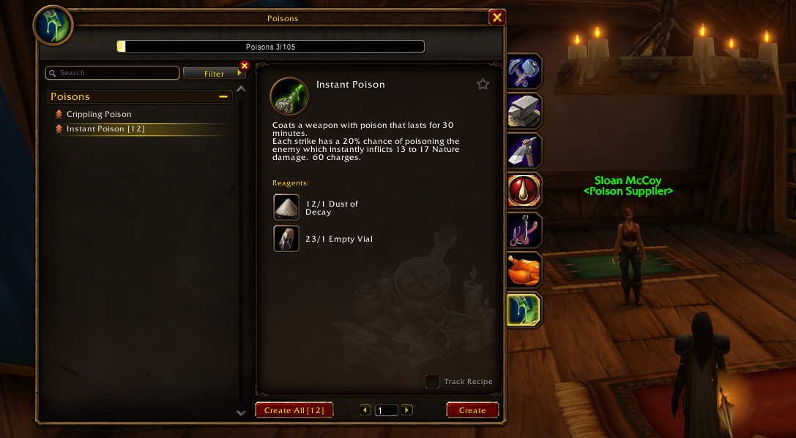
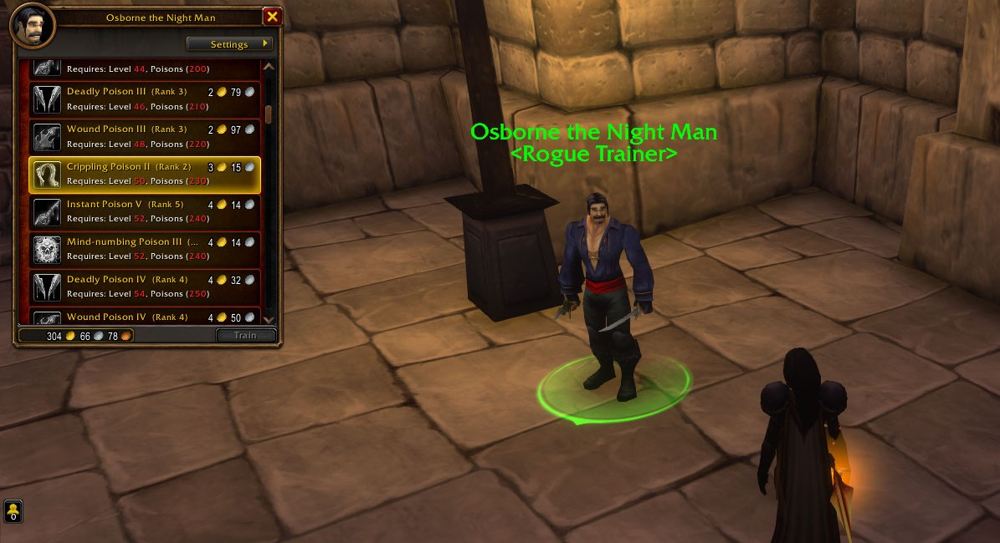
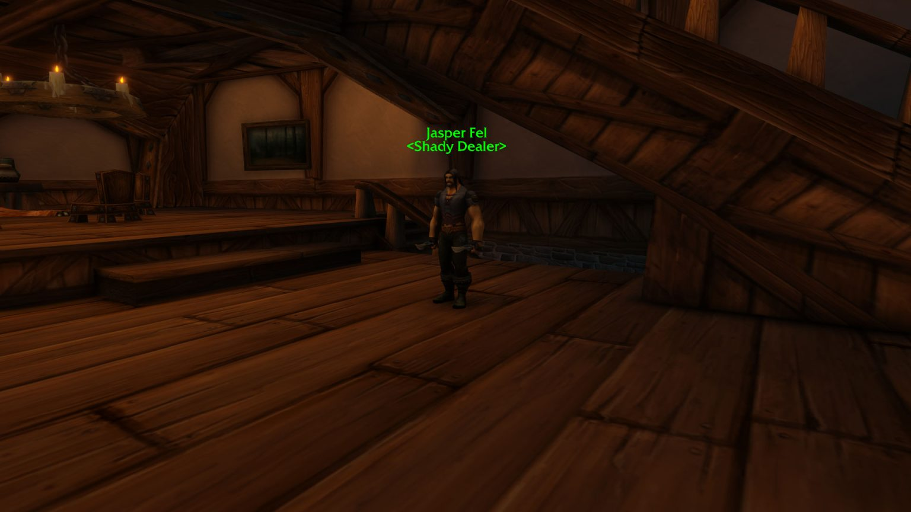

Poisons are the trademark of the Rogue, and WoW Forever keeps them as they were in Classic: you make them yourself and put them on your weapons. Forever does make them a lot stronger. This guide covers the quests that teach you Poisons, every poison and rank, the reagents and what changed.

| | |
|---|---|
| Unlock | Class quest chain from level 20, 80 Lockpicking needed |
| First poison | Instant Poison, the others from the Rogue trainer |
| Skill | 5 points per level, 300 at level 60 |
| Active at once | Two, one per weapon |
| New in Forever | Critical strikes, attack power, more charges, works with a Sharpening Stone |

## What poisons do

A poison is a coating on your weapon, on top of an enchantment. You can have two active, one on each weapon. Each hit has a fixed chance to apply it, and every application uses a charge. A coating lasts 30 minutes or until the charges run out.

A higher rank deals more damage and has more charges, but the chance to apply stays the same. Deadly Poison always has a 30% chance, at every rank, before talents.

| Poison | Ranks (level) | Effect | Chance |
|---|---|---|---|
| **<a class="wf-wh wf-q1" href="https://www.wowhead.com/forever/item=6947">Instant Poison</a>** | 20, 28, 36, 44, 52, 60 | Nature damage at once | 20% |
| **<a class="wf-wh wf-q1" href="https://www.wowhead.com/forever/item=3775">Crippling Poison</a>** | 20, 50 | Slows movement | 30% |
| **<a class="wf-wh wf-q1" href="https://www.wowhead.com/forever/item=5237">Mind-numbing Poison</a>** | 24, 38, 52 | Slows casting | 20% |
| **<a class="wf-wh wf-q1" href="https://www.wowhead.com/forever/item=2892">Deadly Poison</a>** | 30, 38, 46, 54, 60 | Nature damage over time, stacks | 30% |
| **<a class="wf-wh wf-q1" href="https://www.wowhead.com/forever/item=10918">Wound Poison</a>** | 32, 40, 48, 56 | Lowers healing taken | 30% |

<a class="wf-wh wf-q1" href="https://www.wowhead.com/forever/item=5530">Blinding Powder</a> for Blind comes at level 34 from the same trainer.

## Unlocking Poisons

At level 20 a class quest chain teaches you Poisons. Each faction has its own chain, and both send you into a guarded tower with mobs that hit very hard. The Horde chain is clearly the harder one.

You need **80 Lockpicking** for both. Level 20 is enough if you play carefully, but at level 22 you get Vanish and Distract, and the chain becomes much safer. A group or better gear helps too. Every tough mob in the chain has a weakness for a Rogue ability; notes in the quests point them out, and the steps below name them.

### Alliance

| Quest | NPC | Where |
|---|---|---|
| **<a href="https://www.wowhead.com/forever/quest=2360">Mathias and the Defias</a>** | <a class="wf-wh wf-plain" href="https://www.wowhead.com/forever/npc=332">Master Mathias Shaw</a> | Stormwind, Old Town |
| **<a href="https://www.wowhead.com/forever/quest=2359">Klaven's Tower</a>** | <a class="wf-wh wf-plain" href="https://www.wowhead.com/forever/npc=7024">Agent Kearnen</a> | Westfall |
| **<a href="https://www.wowhead.com/forever/quest=2607">The Touch of Zanzil</a>** | <a class="wf-wh wf-plain" href="https://www.wowhead.com/forever/npc=332">Master Mathias Shaw</a> | Stormwind |
| **<a href="https://www.wowhead.com/forever/quest=2608">The Touch of Zanzil</a>** | <a class="wf-wh wf-plain" href="https://www.wowhead.com/forever/npc=7207">Doc Mixilpixil</a> | Stormwind |
| **<a href="https://www.wowhead.com/forever/quest=2609">The Touch of Zanzil</a>** | <a class="wf-wh wf-plain" href="https://www.wowhead.com/forever/npc=7207">Doc Mixilpixil</a> | Stormwind |

1. **Stormwind.** Pick up <a href="https://www.wowhead.com/forever/quest=2360">Mathias and the Defias</a> from <a class="wf-wh wf-plain" href="https://www.wowhead.com/forever/npc=332">Master Mathias Shaw</a> in Old Town.
2. **Westfall.** Travel to the Defias tower east of Sentinel Hill. Turn in the quest to <a class="wf-wh wf-plain" href="https://www.wowhead.com/forever/npc=7024">Agent Kearnen</a> and pick up <a href="https://www.wowhead.com/forever/quest=2359">Klaven's Tower</a>.
3. **The key.** Walk around the tower in Stealth and use Pick Pocket on the Malformed Defias Drone for <a class="wf-wh wf-q1" href="https://www.wowhead.com/forever/item=7923">Defias Tower Key</a>. Do not fight the Drone: it hits very hard. If Pick Pocket fails, use Vanish or Sprint.
4. **The tower.** Avoid the Defias Tower Patrollers or kill them: Distract and then Ambush kills one in one hit, Gouge and then Backstab comes close.
5. **Klaven Mortwake.** The only elite, at the top. At a high enough level, Sap him and pick the lock of the chest next to him. If Sap fails, Vanish resets the fight; open with Ambush and keep Evasion ready, because he hits almost as hard as the Drone.
6. **Touch of Zanzil.** Opening the chest gives you this debuff. It lasts 7 days and hinders your Stealth, so remove it soon.
7. **Back to Stormwind.** Turn in <a href="https://www.wowhead.com/forever/quest=2359">Klaven's Tower</a>. You learn Poisons and the recipe for <a class="wf-wh wf-q1" href="https://www.wowhead.com/forever/item=7676">Thistle Tea</a>.
8. **Remove the debuff.** Use <a class="wf-wh wf-q1" href="https://www.wowhead.com/forever/item=6452">Anti-Venom</a>, ask a Shaman or Druid to remove the poison, or finish the chain: pick up <a href="https://www.wowhead.com/forever/quest=2607">The Touch of Zanzil</a> from Shaw and go down to the basement.
9. **Doc Mixilpixil.** Talk to <a class="wf-wh wf-plain" href="https://www.wowhead.com/forever/npc=7207">Doc Mixilpixil</a> and use /lay to finish the first part. For the follow-up, buy <a class="wf-wh wf-q1" href="https://www.wowhead.com/forever/item=3421">Simple Wildflowers</a>, <a class="wf-wh wf-q1" href="https://www.wowhead.com/forever/item=3372">Leaded Vial</a>, <a class="wf-wh wf-q1" href="https://www.wowhead.com/forever/item=4371">Bronze Tube</a> and <a class="wf-wh wf-q1" href="https://www.wowhead.com/forever/item=8431">Spool of Light Chartreuse Silk Thread</a> from vendors in Stormwind or the Auction House. Bring them back for <a class="wf-wh wf-q1" href="https://www.wowhead.com/forever/item=8432">Eau de Mixilpixil</a>, which removes the debuff.

### Horde

| Quest | NPC | Where |
|---|---|---|
| **<a href="https://www.wowhead.com/forever/quest=2460">The Shattered Salute</a>** | <a class="wf-wh wf-plain" href="https://www.wowhead.com/forever/npc=3401">Shenthul</a> | Orgrimmar, Cleft of Shadow |
| **<a href="https://www.wowhead.com/forever/quest=2458">Deep Cover</a>** | <a class="wf-wh wf-plain" href="https://www.wowhead.com/forever/npc=3401">Shenthul</a> | Orgrimmar |
| **<a href="https://www.wowhead.com/forever/quest=2478">Mission: Possible But Not Probable</a>** | <a class="wf-wh wf-plain" href="https://www.wowhead.com/forever/npc=7233">Taskmaster Fizzule</a> | The Barrens |
| **<a href="https://www.wowhead.com/forever/quest=2479">Hinott's Assistance</a>** | <a class="wf-wh wf-plain" href="https://www.wowhead.com/forever/npc=3401">Shenthul</a> | Orgrimmar |
| **<a href="https://www.wowhead.com/forever/quest=2480">Hinott's Assistance</a>** | <a class="wf-wh wf-plain" href="https://www.wowhead.com/forever/npc=2391">Serge Hinott</a> | Hillsbrad Foothills |

1. **Orgrimmar.** Pick up <a href="https://www.wowhead.com/forever/quest=2460">The Shattered Salute</a> from <a class="wf-wh wf-plain" href="https://www.wowhead.com/forever/npc=3401">Shenthul</a> in the Cleft of Shadow. Use /salute to finish it and pick up <a href="https://www.wowhead.com/forever/quest=2458">Deep Cover</a>.
2. **The Barrens.** Leave Orgrimmar through the western gate and go to the Sludge Fen in the north of the Barrens. <a class="wf-wh wf-plain" href="https://www.wowhead.com/forever/npc=7233">Taskmaster Fizzule</a> stands by a huge tree east of the Venture Co. tower.
3. **The signal.** Use the <a class="wf-wh wf-q1" href="https://www.wowhead.com/forever/item=8051">Flare Gun</a> twice and then /salute at Fizzule. Skip that and he turns hostile, which ends quickly. Turn in <a href="https://www.wowhead.com/forever/quest=2458">Deep Cover</a> and pick up <a href="https://www.wowhead.com/forever/quest=2478">Mission: Possible But Not Probable</a>.
4. **The key.** Use Pick Pocket on <a class="wf-wh wf-plain" href="https://www.wowhead.com/forever/npc=7287">Foreman Silixiz</a> near the tower for <a class="wf-wh wf-q1" href="https://www.wowhead.com/forever/item=8072">Silixiz's Tower Key</a>.
5. **The Drones.** Inside, Ambush kills a Mutated Venture Co. Drone in one hit. The second stands close by: Vanish and Ambush again.
6. **Patrollers and Lookouts.** Rupture almost kills each of the two Venture Co. Patrollers on its own. Weaken the two Venture Co. Lookouts with Eviscerate.
7. **Gallywix.** At the top, open on <a class="wf-wh wf-plain" href="https://www.wowhead.com/forever/npc=7288">Grand Foreman Puzik Gallywix</a> with Ambush and fight him with Evasion up. Loot <a class="wf-wh wf-q1" href="https://www.wowhead.com/forever/item=8074">Gallywix's Head</a> and pick the lock of the box next to him. That finishes the quest and gives you Touch of Zanzil.
8. **Back to Orgrimmar.** Turn in <a href="https://www.wowhead.com/forever/quest=2478">Mission: Possible But Not Probable</a> to Shenthul for the recipe for <a class="wf-wh wf-q1" href="https://www.wowhead.com/forever/item=7676">Thistle Tea</a>.
9. **Tarren Mill.** Pick up <a href="https://www.wowhead.com/forever/quest=2479">Hinott's Assistance</a>, take the zeppelin to Tirisfal Glades and travel to Tarren Mill in Hillsbrad Foothills. Turn it in to <a class="wf-wh wf-plain" href="https://www.wowhead.com/forever/npc=2391">Serge Hinott</a>, pick up <a href="https://www.wowhead.com/forever/quest=2480">Hinott's Assistance</a> and wait until his brew is done. That removes the debuff and teaches you Poisons.

## Making poisons

Poisons get their own tab among your professions. You start with Instant Poison; all other recipes come from any Rogue trainer. Every poison you make gives one skill point, with any recipe, up to 300. You do not need new recipes to raise the skill.

The maximum is five times your level: 100 at level 20, 300 at level 60. Higher ranks ask for a minimum skill, such as 200 for Instant Poison IV at level 44 and 250 for Deadly Poison IV at level 54. Make poisons as you level, or you cannot learn the next rank.

## Reagents

Every reagent comes from a vendor: the poison suppliers and Shady Dealers near the Rogue trainers, such as <a class="wf-wh wf-plain" href="https://www.wowhead.com/forever/npc=1326">Sloan McCoy</a> and <a class="wf-wh wf-plain" href="https://www.wowhead.com/forever/npc=1325">Jasper Fel</a> in Stormwind. A craft makes one poison; Blinding Powder makes three.

| Poison | Reagents |
|---|---|
| **<a class="wf-wh wf-q1" href="https://www.wowhead.com/forever/item=6947">Instant Poison</a>** | <a class="wf-wh wf-q1" href="https://www.wowhead.com/forever/item=2928">Dust of Decay</a>, <a class="wf-wh wf-q1" href="https://www.wowhead.com/forever/item=3371">Empty Vial</a> |
| **<a class="wf-wh wf-q1" href="https://www.wowhead.com/forever/item=3775">Crippling Poison</a>** | <a class="wf-wh wf-q1" href="https://www.wowhead.com/forever/item=2930">Essence of Pain</a>, <a class="wf-wh wf-q1" href="https://www.wowhead.com/forever/item=3371">Empty Vial</a> |
| **<a class="wf-wh wf-q1" href="https://www.wowhead.com/forever/item=5237">Mind-numbing Poison</a>** | <a class="wf-wh wf-q1" href="https://www.wowhead.com/forever/item=2928">Dust of Decay</a>, <a class="wf-wh wf-q1" href="https://www.wowhead.com/forever/item=2930">Essence of Pain</a>, <a class="wf-wh wf-q1" href="https://www.wowhead.com/forever/item=3371">Empty Vial</a> |
| **<a class="wf-wh wf-q1" href="https://www.wowhead.com/forever/item=2892">Deadly Poison</a>** | <a class="wf-wh wf-q1" href="https://www.wowhead.com/forever/item=5173">Deathweed</a>, <a class="wf-wh wf-q1" href="https://www.wowhead.com/forever/item=3372">Leaded Vial</a> |
| **<a class="wf-wh wf-q1" href="https://www.wowhead.com/forever/item=10918">Wound Poison</a>** | <a class="wf-wh wf-q1" href="https://www.wowhead.com/forever/item=2930">Essence of Pain</a>, <a class="wf-wh wf-q1" href="https://www.wowhead.com/forever/item=5173">Deathweed</a>, <a class="wf-wh wf-q1" href="https://www.wowhead.com/forever/item=3372">Leaded Vial</a> |
| **<a class="wf-wh wf-q1" href="https://www.wowhead.com/forever/item=5530">Blinding Powder</a>** | <a class="wf-wh wf-q1" href="https://www.wowhead.com/forever/item=3818">Fadeleaf</a> |

Higher ranks need more of the same, <a class="wf-wh wf-q1" href="https://www.wowhead.com/forever/item=8924">Dust of Deterioration</a> or <a class="wf-wh wf-q1" href="https://www.wowhead.com/forever/item=8923">Essence of Agony</a> instead of the first dust and essence, and from level 44 a <a class="wf-wh wf-q1" href="https://www.wowhead.com/forever/item=8925">Crystal Vial</a>.

## What changed in Forever

- **Attack power.** Poison damage now scales with attack power, so it grows with your gear.
- **Critical strikes.** Poisons can crit.
- **Sharpening Stones.** A poison stays on the weapon next to a Sharpening Stone. Windfury Totem should work with poisons too, but Blizzard has not confirmed that.
- **More charges.** In the Forever data every rank has about half again as many charges as in Classic: Instant Poison 60 instead of 40, Deadly Poison 90 instead of 60, Instant Poison VI 175 instead of 115. Crippling Poison has no charges and lasts 30 minutes.

| Rank | Classic | Forever |
|---|---|---|
| **Instant Poison** | 40 | 60 |
| **Instant Poison VI** | 115 | 175 |
| **Deadly Poison** | 60 | 90 |
| **Deadly Poison V** | 120 | 180 |
| **Mind-numbing Poison** | 50 | 75 |
| **Wound Poison** | 60 | 90 |

## Talents for poisons

| Talent | What it does |
|---|---|
| **Malice** | Up to 5% critical strike chance with attacks and poisons |
| **Improved Poisons** | Up to 10% more chance to apply poisons, and a 50% chance not to use a charge |
| **Vile Poisons** | Up to 20% more poison damage, and poisons resist dispels more often |
| **Venom** | New finishing move: 30% more poison damage and 10% more chance to apply poisons, 9 to 21 seconds |

Venom sits at the bottom of the Assassination tree. For a full build with these talents, see the [Assassination Rogue guide](/guides/assassination-rogue/). For the quests in the context of leveling, see the [Rogue leveling guide](/guides/rogue-leveling/).

## Which poison to use

Instant Poison and Deadly Poison in most fights. Instant Poison suits a slow weapon, Deadly Poison a fast one. Crippling Poison stops a fleeing target, Mind-numbing Poison slows a caster and Wound Poison lowers the healing on a target, which counts most in PvP.
