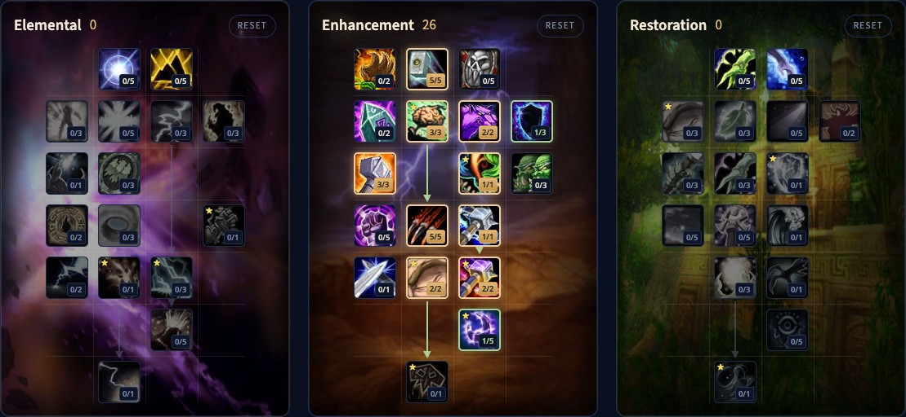
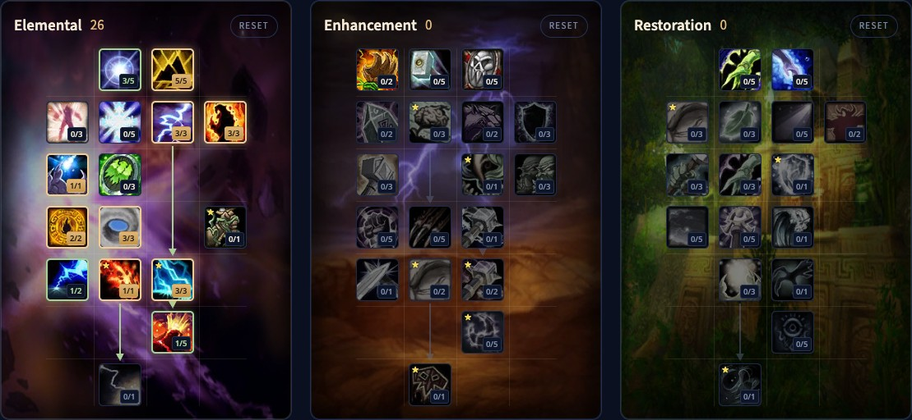

The Shaman in WoW Forever is a welcome sight in every group: strong totem buffs, an instant Ghost Wolf with Improved Ghost Wolf, and three specs that each work. You can be a melee spellblade, a caster who throws lightning and lava, or a healer. This guide covers the early rotation, a level 30 build for each spec, the key levels, the totem quests, the Call of Air weapons, zones, gear, totems and mana.

| | |
|---|---|
| Easiest spec for leveling | Enhancement, with Windfury Weapon from level 30 |
| Key talents | Thundering Strikes, Mental Dexterity, Improved Ghost Wolf, Flurry, Stormstrike, Lava Burst |
| Strength | Totem buffs, self-healing, fast travel with Ghost Wolf, can tank low dungeons as Enhancement |
| Weakness | Mana, little crowd control |
| Talent order per level | [Shaman level build](/leveling/shaman/) |
| Builds to level 60 | After the launch on 4 November |

## Which spec to level with

**Enhancement** is the cleanest way to level. You hit hard in melee, cast between swings, survive well and move fast, and at level 32 you bring Windfury Totem to every group. With a shield and some grit you can even tank the lower dungeons.

**Elemental** stays at range and throws spells. It works, but its procs are less steady and mana runs out sooner, because you have no strong melee to fall back on.

**Restoration** is slow solo. At level 40 you get Dual Spec, so most players level as Enhancement or Elemental and add a healing spec then. You do not need Restoration talents to heal low dungeons.

## Levels 1 to 10

You fight with Lightning Bolt at range and Rockbiter Weapon for your melee swings. At level 4 you get Earth Shock, an instant spell you cast right after the first Lightning Bolt.

1. Keep Rockbiter Weapon on your weapon and, from level 8, Lightning Shield on yourself.
2. Pull with Lightning Bolt.
3. Cast Earth Shock as soon as Lightning Bolt lands.
4. Cast another Lightning Bolt if the monster is not in melee yet and your mana allows it.
5. Finish it in melee.

Stoneclaw Totem and Earthbind Totem help when a pull goes wrong. Stats early on: spell damage, then Strength, then Intellect, then Stamina and Spirit, then armor.

## Level 30 Enhancement build

The strongest leveling build, and it scales into the endgame. Totem twisting is gone, which makes the rotation simpler. [Open the build in the talent calculator](/talents/shaman/?t=-0500321310051).

| Talent | Points |
|---|---|
| **Thundering Strikes** | 5/5 |
| **Mental Dexterity** | 3/3 |
| **Improved Ghost Wolf** | 2/2 |
| **Improved Lightning Shield** | 1/3 |
| **Elemental Weapons** | 3/3 |
| **Shamanistic Focus** | 1/1 |
| **Flurry** | 5/5 |
| **Stormstrike** | 1/1 |

[Open the Talented version](/talents/shaman/?t=-05003213100510221) with Mental Quickness 2/2, Improved Stormstrike 2/2 and Maelstrom Weapon 1/5.

Mental Dexterity turns your Intellect into attack power, and Mental Quickness turns it into spell damage, so Intellect is worth more than you would expect. Improved Ghost Wolf makes Ghost Wolf instant and usable indoors.

1. Keep Lightning Shield and Windfury Weapon up.
2. Keep Searing Totem and Strength of Earth Totem down in combat.
3. Pull with Lightning Bolt.
4. Keep Flame Shock on the target, and renew it only when it is about to run out.
5. Cast Stormstrike on cooldown.
6. Use Earth Shock as filler.
7. Spend Maelstrom Weapon at 5 stacks on an instant Lightning Bolt. With more points in Maelstrom Weapon, this moves up.

Stats: hit, then Strength, then Intellect, then critical strike chance, then spell damage, then Agility.

## Level 30 Elemental build

For a pure caster at range. [Open the build in the talent calculator](/talents/shaman/?t=3500331023001).

| Talent | Points |
|---|---|
| **Convection** | 3/5 |
| **Concussion** | 5/5 |
| **Elemental Alacrity** | 3/3 |
| **Call of Flame** | 3/3 |
| **Elemental Focus** | 1/1 |
| **Trial by Fire** | 2/2 |
| **Eye of the Storm** | 3/3 |
| **Lava Burst** | 1/1 |

[Open the Talented version](/talents/shaman/?t=350033102301131) with Elemental Reach 1/2, Lightning Overload 3/3 and Elemental Fury 1/5.

1. Keep Lightning Shield up.
2. Keep Searing Totem down for one target, Magma Totem for several, and Mana Spring Totem if you stay in one place long enough.
3. Pull with Lava Burst.
4. Cast Flame Shock right as Lava Burst finishes: the instant shock lands before the slower lava, and Lava Burst then deals more damage to the burning target.
5. Keep Flame Shock on the target.
6. Cast Lava Burst on cooldown.
7. Fill with Lightning Bolt.

Stats: spell damage and Intellect, then critical strike chance, then Stamina and Spirit, then armor.

## Level 30 Restoration build

Not recommended for solo leveling, but it works in a group. [Open the build in the talent calculator](/talents/shaman/?t=--53300030140101).

| Talent | Points |
|---|---|
| **Improved Healing Wave** | 5/5 |
| **Tidal Focus** | 3/5 |
| **Mindfulness** | 3/3 |
| **Ancestral Healing** | 3/3 |
| **Water Shield** | 1/1 |
| **Tidal Mastery** | 4/5 |
| **Mana Tide Totem** | 1/1 |
| **Nature's Swiftness** | 1/1 |

[Open the Talented version](/talents/shaman/?t=--53300030154101) with Tidal Mastery 5/5 and Restorative Totems 4/5.

Healing: keep Water Shield up, keep Healing Stream Totem or Mana Spring Totem down depending on whether you need healing or mana, cast Healing Wave as your normal heal and Lesser Healing Wave when it has to be fast. Dealing damage: Water Shield, Searing Totem and Flame Shock, then Lightning Bolt.

## Key levels

From the trainer unless noted. With Talented from the Legacy system, talents come up to 5 levels sooner; the levels below are without it.

| Level | What you get |
|---|---|
| 1 | Lightning Bolt, Healing Wave, Rockbiter Weapon |
| 4 | Earth Shock; Stoneskin Totem from the Earth quest |
| 6 | Earthbind Totem |
| 8 | Stoneclaw Totem, Lightning Shield |
| 10 | Flame Shock, Flametongue Weapon, Strength of Earth Totem; Searing Totem from the Fire quest |
| 12 | Fire Nova, Purge, Ancestral Spirit |
| 16 | Cure Poison |
| 18 | Tremor Totem |
| 20 | Ghost Wolf, Frost Shock, Frostbrand Weapon, Lesser Healing Wave, Call of the Elements, Totemic Recall; Healing Stream Totem from the Water quest; Water Shield (talent) |
| 22 | Totemic Projection, Cure Disease, Poison Cleansing Totem |
| 24 | Frost Resistance Totem |
| 25 | Stormstrike and Mana Tide Totem (talents) |
| 26 | Magma Totem, Mana Spring Totem |
| 28 | Fire Resistance Totem, Flametongue Totem |
| 30 | Windfury Weapon, Grounding Totem, Nature Resistance Totem, Call of the Ancestors, Reincarnation; Lava Burst and Nature's Swiftness (talents) |
| 32 | Chain Lightning, Windfury Totem |
| 40 | Chain Heal, Call of the Spirits, Dual Spec |

## The totem quests

Your totems need an item in your bags for each element. You earn them with class quests: Earth, then Fire, then Water, then Air.

| Totem | Level | Quest |
|---|---|---|
| Earth Totem | 4 (3 for Skyborne) | Call of Earth, in your starting zone: Zephras Isle, Durotar, Mulgore or Dun Morogh |
| Fire Totem | 10 | Call of Fire, in Durotar (Horde), Zephras Isle (Skyborne) or Loch Modan (Dwarf) |
| Water Totem | 20 | Call of Water, from Orgrimmar or Thunder Bluff for the Horde, Ironforge for Dwarves |
| Air Totem | 30 | Call of Air, from Orgrimmar or Thunder Bluff for the Horde, Ironforge for the Alliance |

The Call of Air chain is the biggest upgrade of the mid levels. Besides the Air Totem, it gives a weapon for your spec, each with a passive that improves a main ability:

- Enhancement: <a class="wf-wh wf-q3" href="https://www.wowhead.com/forever/item=280604">Rage of the Storm</a>
- Elemental: <a class="wf-wh wf-q3" href="https://www.wowhead.com/forever/item=280607">Lightning's Grasp</a>
- Restoration: <a class="wf-wh wf-q3" href="https://www.wowhead.com/forever/item=280605">Tidebringer's Claw</a>

Casters can pair their weapon with <a class="wf-wh wf-q3" href="https://www.wowhead.com/forever/item=280696">Elementalist's Guard</a> from the same quest.

## Weapon skills

Shamans start with one-handed maces and staves. The rest you learn from a weapon trainer.

| Weapon | Alliance | Horde |
|---|---|---|
| Fist weapons | Ilyenia Moonfire (Darnassus), Buliwyf Stonehand (Ironforge) | Sayoc (Orgrimmar) |
| One-handed axes | Buliwyf Stonehand (Ironforge) | Hanashi or Sayoc (Orgrimmar) |
| Two-handed axes | Buliwyf Stonehand (Ironforge) | Hanashi or Sayoc (Orgrimmar) |
| Two-handed maces | Buliwyf Stonehand (Ironforge) | Ansekhwa (Thunder Bluff) |
| Daggers | Ilyenia Moonfire (Darnassus), Bixi Wobblebonk (Ironforge), Woo Ping (Stormwind) | Sayoc (Orgrimmar), Archibald (Undercity) |

A new weapon type starts at a low skill. Raise it on easy monsters before you take it into a pack.

## Where to level

| From level | Zones |
|---|---|
| 1 | Elwynn Forest, Dun Morogh, Teldrassil, Zephras Isle, Durotar, Mulgore, Tirisfal Glades |
| 10 | Westfall, Loch Modan, Darkshore, The Barrens, Silverpine Forest |
| 15 | Redridge Mountains, Stonetalon Mountains |
| 18 | Ashenvale |
| 20 | Wetlands, Hillsbrad Foothills, Duskwood |
| 25 | Thousand Needles |
| 30 | Alterac Mountains, Arathi Highlands, Desolace, Stranglethorn Vale |
| 35 | Badlands, Dustwallow Marsh, Feralas, The Riverglades, Swamp of Sorrows |
| 40 | Shen'dralas, Tanaris, The Hinterlands |
| 43 | Searing Gorge |
| 45 | Azshara, Felwood, Blasted Lands |
| 48 | Un'Goro Crater |
| 50 | Burning Steppes, Western Plaguelands |
| 53 | Winterspring, Eastern Plaguelands |
| 55 | Silithus, Deadwind Pass |
| 60 | Mount Hyjal |

The levels for every dungeon are in our [dungeon guides](/guides/dungeons/).

## Gear and consumables

**Weapons** matter more than ever, also for casters: spell damage is now common on caster weapons and is your main way to scale.

**Totems** are a Shaman relic slot item with a small special effect. Your first one usually comes from Call of Fire. Skyborne Shamans can also get <a class="wf-wh wf-q2" href="https://www.wowhead.com/forever/item=263412">Totem of Charged Flames</a> from the quest Meddlesome Mages.

**Food and drink.** Cook your own food for Well Fed and its experience bonus, and always carry drinks of your level: every Shaman spec uses a lot of mana. Keep a few health potions with you, and level First Aid, which now also makes potions and removes debuffs.

**Reagents.** Reincarnation needs an Ankh, Water Breathing a Shiny Fish Scale and Water Walking Fish Oil, unless you have the Legacy talent that removes reagents.

## Professions

- **Cooking** is a must: food buffs are stronger, give experience and let you set up your own camp.
- **Leatherworking** with **Skinning** makes well-statted gear while you level, especially with spell power, which is rare early on.
- **Engineering** with **Mining** makes trinkets and explosives, strong while leveling and for a Shaman who tanks.
- **Enchanting** has no natural partner, but it is worth taking early: it makes <a class="wf-wh wf-q3" href="https://www.wowhead.com/forever/item=249398">Polished Driftwood Icon</a>, a strong item you cannot get any other way.

## Totems in play

Only drop the totems that help right now: every totem costs mana and a global cooldown. In a group, use more of them, because everyone in range benefits.

| Totem | What it does |
|---|---|
| Searing Totem | Damage to one target |
| Magma Totem | Damage to everything around it |
| Strength of Earth Totem | More Strength |
| Windfury Totem | More melee damage for the group |
| Grace of Air Totem | More Agility |
| Earthbind Totem | Slows everything around it, for kiting |
| Tremor Totem | Removes fear, charm and sleep |
| Poison Cleansing Totem | Removes poisons |
| Disease Cleansing Totem | Removes diseases |
| Healing Stream Totem | Heals a little, again and again |
| Mana Spring Totem | Restores mana to your group |

Call of the Elements places a saved set of four totems with one button. Totemic Projection moves them and Totemic Recall takes them back.

## Movement and mana

**Ghost Wolf** arrives at level 20. With Improved Ghost Wolf it is instant and works indoors, so you can use it in combat too. **Astral Recall** is a second Hearthstone to your home inn, with its own cooldown of 15 minutes instead of 60.

**Mana** is the limit for every spec. Mana Spring Totem, Mana Tide Totem and Spirit help, but keep water with you and, as a caster, a few mana potions.

## Healing and crowd control

Every Shaman can heal: Healing Wave for big heals, Lesser Healing Wave for fast ones, Healing Stream Totem, Cure Poison and Cure Disease, Poison Cleansing Totem, and from level 40 Chain Heal, which jumps between targets that stand close together. Riptide is the last talent of the Restoration tree. Bandages, food and potions save your mana.

Crowd control is a weak spot: Shamans have no Hex in Forever. Your best tool is Earthbind Totem, which roots for 5 seconds with the Elemental talent Earthbound. Frost Shock slows at range, and Stoneclaw Totem pulls monsters off you for a moment.

## Utility and cooldowns

- **Windfury Totem** is a big boost for any melee group.
- **Mana Tide Totem** (Restoration) restores mana to your whole group when everyone runs dry.
- **Earth Shock** also interrupts a spell at range, on a short cooldown. Use it on every dangerous cast.
- **Purge** removes buffs from an enemy, instantly and at range.
- **Grounding Totem** catches one enemy spell. It takes your Air slot, so put your normal Air Totem back afterwards.
- **Water Breathing** and **Water Walking** save a lot of time on some quests.
