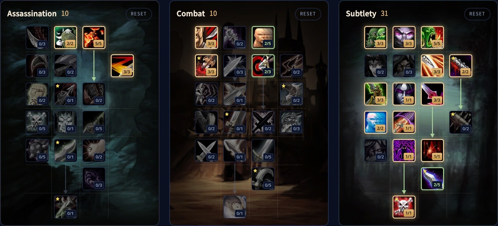

> **Update 4 November:** the builds and talents below follow the new trees from the development notes of 2 November, more in [our post](/news/rogues-get-shank-and-death-mark-in-a-big-rework/).

The Subtlety Rogue in WoW Forever has two real PvE builds. One deals huge critical Ambushes, and Ghostly Strike lets you use Ambush in combat. The other is built on bleeds, with Hemorrhage and a stronger Rupture. Both end in Death Mark, a finishing move that stores your damage and releases it later. Poisons now land critical strikes and scale with attack power. This guide covers both builds for level 30 and 60, the rotations, Energy, poisons, survival, stats and races.

| | |
|---|---|
| Role | Melee damage, with daggers or bleeds |
| Builds | Ambush (10/10/31) and bleed (12/8/31), both with Death Mark, at level 60 |
| Key talents | Malice, Opportunity, Initiative, Ghostly Strike, Serrated Blades, Preparation, Hemorrhage, Boot Knife, Death Mark |
| Strength | Two playstyles, bleeds ignore armor, lots of crowd control |
| Weakness | Needs gear, best talents only at high level |
| Leveling | [Rogue leveling guide](/guides/rogue-leveling/), [Rogue level build](/leveling/rogue/) |

## Strengths and weaknesses

**Two playstyles.** Ambush with Ghostly Strike or bleeds with Hemorrhage, both ending in Death Mark. Both hold up well in long fights.

**Bleeds ignore armor.** Rupture and Garrote ignore armor completely, which pays off against heavily armored monsters and bosses.

**Crowd control.** Kick, Gouge, Sap, Cheap Shot, Kidney Shot and Blind, plus poisons that slow, lengthen casts or lower healing.

**Depends on the fight.** The Ambush build needs to stand behind the target, which suits dungeons and raids better than the open world. Some monsters are immune to bleeds.

**Needs gear.** Rupture, Garrote and poisons scale with attack power and can land critical strikes, so you need both.

**Needs levels.** The best talents sit at the bottom of the tree. Many players level with another spec and switch to Subtlety later.

## Level 30 builds

At level 30 you have 21 points, and Talented adds 5. Both builds are explained in our [Rogue leveling guide](/guides/rogue-leveling/).

- **Ambush:** kills monsters as fast as possible with critical Ambushes from Stealth. [Open the build](/talents/rogue/?t=02--333003031021), [Talented version](/talents/rogue/?t=025--333003031021).
- **Bleed:** Garrote, Hemorrhage and Rupture, with Serrated Blades for a stronger Rupture and Preparation for an extra Slice and Dice. [Open the build](/talents/rogue/?t=--3320002313210001), [Talented version](/talents/rogue/?t=002--3322002313210011).

## Level 60 Ambush build with Death Mark: 10/10/31

The beta stopped at level 30, but the talent trees for level 60 are in the game files. We checked this build point for point in [our talent calculator](/talents/rogue/?t=025003-302302-335003231321001121). Backstab is your main generator, and Ghostly Strike lets your next Ambush skip Stealth. Serrated Blades adds 9% armor penetration, Hemorrhage covers fights where you cannot stand behind the monster, and Death Mark at the bottom stores your damage and releases it after 6 seconds.

| Talent | Points |
|---|---|
| **Remorseless Attacks** (Assassination) | 2/2 |
| **Malice** (Assassination) | 5/5 |
| **Improved Slice and Dice** (Assassination) | 3/3 |
| **Coup de Grace** (Combat) | 3/3 |
| **Lightning Reflexes** (Combat) | 2/5 |
| **Puncturing Wounds** (Combat) | 3/3 |
| **Precision** (Combat) | 2/3 |
| **Setup** | 3/3 |
| **Master of Deception** | 3/3 |
| **Opportunity** | 5/5 |
| **Improved Ambush** | 3/3 |
| **Dirty Tricks** | 2/2 |
| **Initiative** | 3/3 |
| **Premeditation** | 1/1 |
| **Serrated Blades** | 3/3 |
| **Elusiveness** | 2/2 |
| **Ghostly Strike** | 1/1 |
| **Preparation** | 1/1 |
| **Hemorrhage** | 1/1 |
| **Boot Knife** | 2/5 |
| **Death Mark** | 1/1 |

Murder is gone since 2 November, so the last 2 points in Assassination go to Remorseless Attacks. Ruthlessness 2/3 is an alternative.

## Level 60 bleed build with Death Mark: 12/8/31

All the way down the Subtlety tree. [Open the build in the talent calculator](/talents/rogue/?t=015303-302003-332210231321001151). Hemorrhage makes your Rupture and Garrote hit 15% harder, Boot Knife 5/5 turns every Shank into 2 Combo Points, and Death Mark stores Garrote and Rupture damage at twice the rate.

| Talent | Points |
|---|---|
| **Remorseless Attacks** (Assassination) | 1/2 |
| **Malice** (Assassination) | 5/5 |
| **Ruthlessness** (Assassination) | 3/3 |
| **Improved Slice and Dice** (Assassination) | 3/3 |
| **Coup de Grace** (Combat) | 3/3 |
| **Lightning Reflexes** (Combat) | 2/5 |
| **Precision** (Combat) | 3/3 |
| **Setup** | 3/3 |
| **Master of Deception** | 3/3 |
| **Opportunity** | 2/5 |
| **Dirty Deeds** | 2/2 |
| **Camouflage** | 1/3 |
| **Dirty Tricks** | 2/2 |
| **Initiative** | 3/3 |
| **Premeditation** | 1/1 |
| **Serrated Blades** | 3/3 |
| **Elusiveness** | 2/2 |
| **Ghostly Strike** | 1/1 |
| **Preparation** | 1/1 |
| **Hemorrhage** | 1/1 |
| **Boot Knife** | 5/5 |
| **Death Mark** | 1/1 |

## What the key talents do

| Talent | What it does in Forever |
|---|---|
| **Malice** | 5% more critical strike chance with attacks and poisons |
| **Remorseless Attacks** | After a kill, 40% more critical strike chance on your next Sinister Strike, Backstab, Ambush, Mutilate or Ghostly Strike |
| **Ruthlessness** | Finishing moves have a 60% chance to add a Combo Point |
| **Improved Slice and Dice** | Slice and Dice lasts 45% longer |
| **Precision** | 3% more chance to hit |
| **Opportunity** | Backstab, Garrote, Ambush and Mutilate deal up to 20% more damage, at 5/5 |
| **Master of Deception** | Monsters detect you in Stealth as if you were 3 levels higher |
| **Setup** | At 3/3: a 45% chance for a Combo Point when you dodge an attack or resist a spell |
| **Initiative** | Ambush, Garrote and Cheap Shot add an extra Combo Point |
| **Ghostly Strike** | 180% weapon damage with a dagger, 15% more dodge for 7 seconds, and your next Ambush or Garrote within 7 seconds needs no Stealth |
| **Serrated Blades** | Your attacks ignore 9% armor, and Rupture deals 30% more damage |
| **Premeditation** | Adds 2 Combo Points to your target |
| **Preparation** | Finishes the cooldown of your other Rogue abilities |
| **Hemorrhage** | 145% weapon damage with a dagger, and 15% more Rupture damage on the target for 15 seconds |
| **Dirty Deeds** | Cheap Shot and Garrote cost 20 Energy less, and Garrote no longer needs you behind the target |
| **Boot Knife** | At 5/5 every Shank adds 2 Combo Points |
| **Death Mark** | A finishing move that stores part of your damage per Combo Point, Garrote and Rupture at twice the rate, and deals it after 6 seconds. 25 Energy, 10 second cooldown |

## Rotation

### Ambush build

1. Go into Stealth and cast Premeditation.
2. Open with Ambush.
3. Stay behind the target and use Backstab as your generator. Where you cannot stand behind it, use Hemorrhage.
4. Use Ghostly Strike on cooldown.
5. Use Ambush right after Ghostly Strike, which lets it skip Stealth for 7 seconds. At 5 Combo Points, use a finishing move first.
6. At 5 Combo Points, cast Slice and Dice and renew it when it runs out.
7. In long fights, cast Expose Armor at the next 5 Combo Points.
8. Cast Death Mark at 5 Combo Points whenever it is ready, and spend the rest on Eviscerate.
9. Vanish and Ambush for burst, and Preparation to reset your cooldowns or to escape.

### Bleed build

1. Go into Stealth and cast Premeditation.
2. Open with Garrote.
3. Use Hemorrhage as your generator and Ghostly Strike on cooldown.
4. At 5 Combo Points, cast Slice and Dice, then Rupture at the next 5.
5. Use Shank whenever it is ready: with Boot Knife it adds 2 Combo Points.
6. Cast Death Mark at 5 Combo Points while Garrote and Rupture tick, the rest on Eviscerate, and Expose Armor on bosses if your group needs it.
7. Vanish and Garrote for burst, and Preparation to reset your cooldowns or to escape.

### Several monsters

Rogues have no area attacks: kill one monster at a time. Never switch targets while you build Combo Points, or you lose them.

## Stealth, Combo Points and finishing moves

Stealth slows you, up to 50% at low levels and 30% at level 60, so you do not travel in it, but you do use it against most monsters. In Stealth you get openers: Ambush for a big hit, Garrote for a bleed, Sap and Cheap Shot to disable.

Your generators are Sinister Strike at first, later Backstab, Ghostly Strike and Hemorrhage, plus Shank from level 24. Your finishing moves are Eviscerate, Slice and Dice, Expose Armor, Rupture and, at the bottom of the tree, Death Mark. Keeping Slice and Dice up is the biggest damage boost you have. Kidney Shot stuns a dangerous monster.

## Energy

Energy now regenerates smoothly, 1 point every 0.1 seconds, so 10 per second. Shank, from level 24, costs 5 Energy and gives 15 back every 10 seconds, and Thistle Tea gives a large amount back on a long cooldown. Otherwise: never build a Combo Point above 5, and do not spend Energy on Kick, Feint, Gouge or Blind without a reason.

## Poisons

From level 20, a quest chain teaches you to make poisons. Use Instant Poison and Deadly Poison in most fights: Instant Poison on slow weapons, Deadly Poison on fast ones. Switch to Crippling, Mind-numbing or Wound Poison when a monster must be slowed, cast slower or healed less.

## Survival

Rogues hit hard but fall fast. Judge every pull: Sap one monster out of a group, preferably a caster. Open with Cheap Shot, follow with Kidney Shot, and stretch it with Gouge or Blind when you need Energy or cooldowns. Use Evasion when you must take hits, Kick every caster, and Vanish when nothing else works.

## Stats and gear

Stat priorities for level 60 follow after the launch. Until then:

- **Agility**: 1 attack power per point, 1% critical strike chance per 29 Agility, 1% dodge per 14.5 Agility.
- **Attack power**, which now also raises the damage of your poisons.
- **Critical strike chance**, also for poisons and Rupture.
- **Strength**: 1 attack power per point, nothing else.
- **Stamina** for health, found on most gear.
- **Spirit** only for regeneration between fights.

**Armor.** Leather with the stats above. Sets such as Defias Leather and Embrace of the Viper are good while you level.

**Weapons.** Weapons are much stronger now at every level. Any type works, but your abilities scale best with daggers, and the Ambush build needs them. Good examples are Meteor Shard, Toxic Revenger, Assassin's Blade and Torturing Poker.

## Races and professions

| Faction | Race | Why |
|---|---|---|
| Alliance | Human | 1% critical strike chance from Ruthless |
| Alliance | Night Elf | Elune's Light, 10% critical strike chance for 15 seconds; Shadowmeld and better Stealth |
| Alliance | Gnome | Eureka! for burst, Engineering Specialization with Engineering |
| Alliance | Dwarf | Stoneform removes bleeds, poisons and diseases; Artisan's Precision gives 1% hit |
| Alliance | Skyborne | 2% haste from Wind Blessed |
| Horde | Orc | 10% attack power from Blood Fury, the best choice |
| Horde | Troll | 10% haste from Berserking and a survival tool |
| Horde | Undead | Better for PvP; Cannibalize saves time in the open world |
| Horde | Skyborne | 2% haste from Wind Blessed |

**Leatherworking** with Skinning is the best pair: strong leather gear at every level, armor kits, and the Camp Tent from camping that speeds up leveling. **Engineering** brings gadgets and explosives for more damage and is the best partner for Leatherworking if you skip Skinning. **Herbalism** with **Alchemy** gives you elixirs, potions and flasks.
