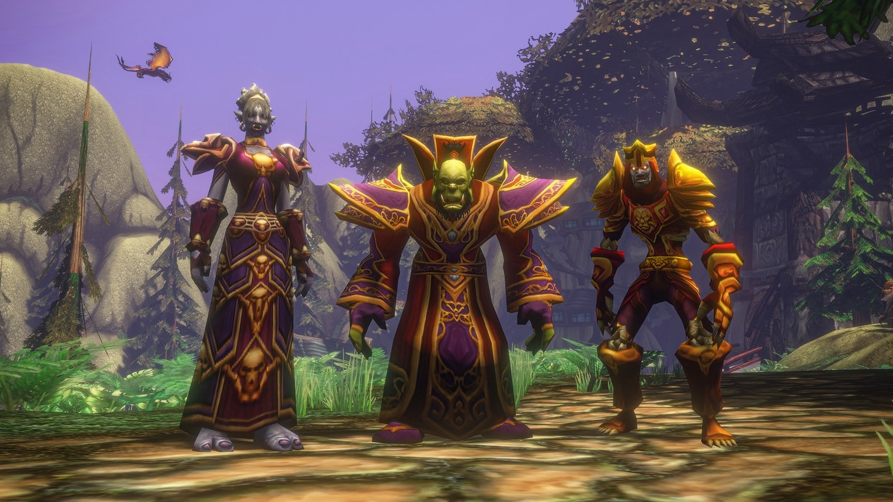

El Fire Mage de WoW Forever vive de los golpes críticos. Heating Up convierte los críticos en un Pyroblast rápido, Ignite quema al objetivo tras cada crítico, y el nuevo Fire Power premia cada efecto de Fuego sobre tu objetivo. La spec crece mucho con el equipo, pero arranca despacio al subir de nivel. Esta guía cubre las builds, la rotación, el maná, la supervivencia y el equipo.

| | |
|---|---|
| Rol | Daño a distancia, golpes críticos y quemaduras |
| Build a nivel 60 | 16/32/3 |
| Talentos clave | Heating Up, Pyroblast, Ignite, Improved Scorch, <a class="wf-wh wf-spell" href="https://www.wowhead.com/forever/spell=18459">Incineration</a> |
| Fuerte en | Mucho daño que crece con el equipo, buen maná, utilidad para el grupo |
| Débil en | Necesita probabilidad de golpe crítico, débil al subir de nivel |
| Subir de nivel | [Guía para subir un Mage](/es/classes/mage/leveling/) |
| Otras specs | [Frost Mage](/es/classes/mage/frost/), [Arcane Mage](/es/classes/mage/arcane/) |

## Qué cambia para Fire

- **Heating Up es nuevo.** Un talento de nivel 25. Cada golpe crítico no periódico con Fireball, Frostfire Bolt, Fire Blast o Scorch hace que tu siguiente Pyroblast en 20 segundos sea un 25% más rápido, hasta 3 acumulados. Fire Blast da un acumulado con cada impacto.
- **Critical Mass es más fuerte.** Un 2% de probabilidad de golpe crítico para hechizos de Fuego por punto, un 6% con 3/3.
- **Fire Power cambia por completo.** Ahora cuenta tus efectos de Fuego sobre el objetivo, hasta cuatro: un 3% más de daño de Fuego por efecto con 3/3, así que un 12% como máximo.
- **Ignite es más débil.** Quema el 40% del golpe crítico en 4 segundos. Encadenar Ignite de un crítico al siguiente ya no compensa.
- **Flamestrike ya no se acumula.** Solo queda una quemadura de Flamestrike en un objetivo.

## Fortalezas y debilidades

| Fuerte en | Débil en |
|---|---|
| Pyroblast forma parte de la rotación, gracias a Heating Up | Sin probabilidad de golpe crítico, Heating Up e Ignite hacen poco |
| Crece mucho con la probabilidad de golpe crítico, el equipo y el nivel | La spec de Mage más débil al subir de nivel |
| Gasta menos maná que Arcane, más adelante con Master of Elements | Menos supervivencia que Frost, y sin <a class="wf-wh wf-spell" href="https://www.wowhead.com/forever/spell=11958">Ice Block</a> |
| <a class="wf-wh wf-spell" href="https://www.wowhead.com/forever/spell=1459">Arcane Intellect</a>, <a class="wf-wh wf-spell" href="https://www.wowhead.com/forever/spell=604">Dampen Magic</a>, <a class="wf-wh wf-spell" href="https://www.wowhead.com/forever/spell=1008">Amplify Magic</a>, comida, agua y portales | Necesita golpe contra jefes, y eso cuesta puntos de talento |

## Builds para nivel 60

Tres builds, cada una con los 51 puntos de talento del nivel 60: una para bandas y mazmorras, una para subir de nivel y una para PvP. Cada build se abre en nuestra calculadora de talentos.

### Build de banda, 16/32/3

16 puntos en Arcane, 32 en Fire y 3 en Frost. [Abre la build de banda en la calculadora de talentos](/es/talents/mage/?t=0502052001001-55500001230133031-003).

| Talento | Puntos |
|---|---|
| **Improved Channeling** | 5/5 |
| **Arcane Subtlety** | 2/2 |
| **Arcane Concentration** | 5/5 |
| **Missile Barrage** | 2/2 |
| **Arcane Blast** | 1/1 |
| **Arcane Meditation** | 1/3 |
| **Incineration** | 5/5 |
| **Accelerant** | 5/5 |
| **Ignite** | 5/5 |
| **Pyroblast** | 1/1 |
| **Improved Fire Blast** | 2/2 |
| **Improved Scorch** | 3/3 |
| **Heating Up** | 1/1 |
| **Master of Elements** | 3/3 |
| **Critical Mass** | 3/3 |
| **Fire Power** | 3/3 |
| **Combustion** | 1/1 |
| **Precision** | 3/3 |

Frostfire se salta Arcane y combina Fire a fondo con talentos de Frost (0/29/22). [Ábrela en la calculadora de talentos](/es/talents/mage/?t=-5550000123011303-2035000311113002).

### Build para subir de nivel, 18/0/33

La build para subir de nivel toma primero los talentos que ayudan a matar en solitario. [Ábrela en la calculadora de talentos](/es/talents/mage/?t=0502052001003--053530000101331251). La [build de nivel del Mage](/es/leveling/mage/) da el talento de cada nivel.

### Build de PvP, 21/28/2

La build de PvP cambia daño por control y supervivencia. [Abre la build de PvP en la calculadora de talentos](/es/talents/mage/?t=050205220002201-35523001230103-002).

### Qué hacen los talentos clave

| Talento | Qué hace en Forever |
|---|---|
| **Accelerant** | Fireball y Frostfire Bolt se lanzan 0,5 segundos más rápido con 5/5. Imprescindible |
| **<a class="wf-wh wf-spell" href="https://www.wowhead.com/forever/spell=18459">Incineration</a>** | Un 6% más de probabilidad de golpe crítico para Fire Blast y Scorch con 3/3, también para Arcane Blast e Ice Lance. Cada punto da más Heating Up |
| **Ignite** | Cada golpe crítico de Fuego quema al objetivo por el 40% de su daño en 4 segundos |
| **Pyroblast** | Un lanzamiento largo con mucho daño y una quemadura. El corazón de la spec |
| **Burning Soul** | Un 70% de probabilidad de seguir lanzando al recibir daño, y un 30% menos de amenaza con hechizos de Fuego |
| **Improved Scorch** | Cada Scorch añade un acumulado: un 3% más de daño de Fuego tuyo por acumulado, un 15% con 5 |
| **Heating Up** | Pyroblast hasta un 75% más rápido tras golpes críticos. Sin él, la spec se desmorona |
| **Critical Mass** | Un 6% más de probabilidad de golpe crítico para hechizos de Fuego con 3/3 |
| **Fire Power** | Más daño de Fuego por cada efecto de Fuego sobre el objetivo, ver más abajo |
| **Precision** | Un 1% más de probabilidad de golpe con hechizos de Fuego y Escarcha por punto. Necesario contra jefes |

## Rotación

**Un enemigo**
1. Prelanza Pyroblast antes de un combate contra un jefe. Atrae a un monstruo normal con Fireball.
2. Lanza Scorch hasta que Improved Scorch tenga 5 acumulados.
3. Lanza Fire Blast en cuanto esté listo: siempre da un acumulado de Heating Up.
4. Lanza Fireball, y Scorch de nuevo cuando los acumulados estén por caducar.
5. Lanza Pyroblast en cuanto Heating Up tenga 3 acumulados.
6. <a class="wf-wh wf-spell" href="https://www.wowhead.com/forever/spell=1326053">Frost Blast</a> para ralentizar a un objetivo a distancia, Frost Nova rango 1 para inmovilizar a un monstruo peligroso, Cone of Cold cuando te alcance.
7. Counterspell contra un lanzamiento peligroso, Polymorph contra un enemigo extra peligroso.

**Un grupo de enemigos**
1. Lanza Flamestrike, y de nuevo cuando caduque su quemadura. Ya no se acumula.
2. Lanza Blast Wave en cuanto esté listo tras Flamestrike, si lo elegiste.
3. Encadena Arcane Explosion.

A niveles altos, la rotación se ve así: Improved Scorch con 5 acumulados, Fire Blast, Fireball, Pyroblast, Fireball, Fire Blast, Pyroblast, y así sucesivamente.

## Heating Up y Fire Power

**Heating Up** es el núcleo de la spec. Cada golpe crítico no periódico da un acumulado, y cada acumulado hace tu siguiente Pyroblast un 25% más rápido, hasta un 75% con 3 acumulados. A niveles bajos casi no salta, porque tu probabilidad de golpe crítico es baja. Incineration, Critical Mass, el equipo y los niveles lo hacen más fiable. Fire Blast da un acumulado con cada impacto y dos con un crítico, así que lo lanzas en cuanto está listo.

**Fire Power** cuenta los efectos de Fuego sobre tu objetivo, hasta cuatro: la quemadura de Fireball, Improved Scorch, Ignite y la quemadura de Pyroblast. Los efectos que mezclan escuelas, como <a class="wf-wh wf-spell" href="https://www.wowhead.com/forever/spell=401502">Frostfire Bolt</a>, no cuentan. La bonificación no aparece como buff ni como debuff en el objetivo. Oscila entre 2 y 4 efectos: Improved Scorch y Fireball casi siempre están, Ignite y Pyroblast dependen de tus críticos.

## Maná

Los hechizos de Fuego cuestan mucho, pero Fire exige menos control del maná que Arcane.

- **Master of Elements** devuelve con 3/3 el 30% del coste base de cada golpe crítico de Fuego o Escarcha. Salta casi siempre.
- **<a class="wf-wh wf-spell" href="https://www.wowhead.com/forever/spell=6117">Mage Armor</a>** desde el nivel 34 mantiene el 50% de tu regeneración de maná mientras lanzas. Una incursión en Arcane Meditation lo sube al 100%.
- **<a class="wf-wh wf-spell" href="https://www.wowhead.com/forever/spell=12051">Evocation</a>** recupera tu maná en unos segundos, con un tiempo de reutilización largo. Guárdalo para combates largos contra jefes. Un High Order Skyborne puede combinarlo con <a class="wf-wh wf-spell" href="https://www.wowhead.com/forever/spell=1259705">Read Leyline</a>.
- **Las gemas de maná** como <a class="wf-wh wf-spell" href="https://www.wowhead.com/forever/spell=759">Conjure Mana Agate</a> devuelven maná con una sola carga por gema. Prepara una nueva antes de cada combate largo.
- **Las pociones de maná** devuelven mucho, según su nivel.

## Supervivencia

Fire sobrevive peor que Frost y no tiene Ice Block. Mata al objetivo antes de que te mate, y elige tus combates. <a class="wf-wh wf-spell" href="https://www.wowhead.com/forever/spell=1953">Blink</a> y Frost Nova te sacan de la mayoría de los apuros. <a class="wf-wh wf-spell" href="https://www.wowhead.com/forever/spell=1463">Mana Shield</a> cuesta demasiado maná para usarlo siempre, pero Mana Shield con Evocation puede salvarte como último recurso.

Usa Frostbolt rango 1 para ralentizar a un objetivo a distancia, Cone of Cold como ralentización instantánea (los cuatro primeros objetivos se ralentizan más), y Polymorph para sacar a un objetivo del combate. Blast Wave también aturde todo a tu alrededor. Las vallas, colinas y edificios cortan la línea de visión, y eso te da lanzamientos.

## Tiempos de reutilización y utilidad

- **Frost Nova** sirve para atacar y defender. Úsalo tan a menudo como puedas.
- **Fire Blast** se lanza en cuanto está listo, por Heating Up.
- **Blast Wave** hace mucho daño a tu alrededor y aturde, bueno para el burst o como ralentización si Cone of Cold está en reutilización.
- **<a class="wf-wh wf-spell" href="https://www.wowhead.com/forever/spell=475">Remove Lesser Curse</a>** quita Curses y Banes. Úsalo rápido en los peligrosos.
- **Amplify Magic** hace que un miembro del grupo reciba más daño de hechizos, pero también más sanación. Bueno contra daño físico.
- **Dampen Magic** reduce el daño de hechizos, pero también la sanación recibida. Úsalo contra lanzadores de hechizos, no contra enemigos que te tumban rápido.
- **Polymorph** a un objetivo peligroso en cada pull en grupo.

## Encantamientos y consumibles

El mejor encantamiento por hueco. Ponlos en el equipo que vayas a conservar un tiempo; mientras subes de nivel, las versiones más baratas del mismo encantamiento bastan.

| Hueco | Mejor opción |
|---|---|
| **Arma** | <a class="wf-wh wf-spell" href="https://www.wowhead.com/forever/spell=1219580">Enchant 2H Weapon - Spellblasting</a> (dos manos), <a class="wf-wh wf-spell" href="https://www.wowhead.com/forever/spell=1248805">Enchant Weapon - Revelation</a> (una mano) |
| **Mano izquierda** | <a class="wf-wh wf-spell" href="https://www.wowhead.com/forever/spell=1219579">Enchant Off-Hand - Wisdom</a> |
| **Cabeza** | <a class="wf-wh wf-q2" href="https://www.wowhead.com/forever/item=18330">Arcanum of Focus</a> |
| **Cuello** | <a class="wf-wh wf-spell" href="https://www.wowhead.com/forever/spell=1249057">Enchant Necklace - Spell Power</a> |
| **Pecho** | <a class="wf-wh wf-q2" href="https://www.wowhead.com/forever/item=252487">Mystic Rugged Armor Kit</a> |
| **Muñecas** | <a class="wf-wh wf-spell" href="https://www.wowhead.com/forever/spell=1220624">Enchant Bracer - Greater Spellpower</a> |
| **Manos** | <a class="wf-wh wf-q2" href="https://www.wowhead.com/forever/item=252487">Mystic Rugged Armor Kit</a>, <a class="wf-wh wf-spell" href="https://www.wowhead.com/forever/spell=13948">Enchant Gloves - Minor Haste</a> |
| **Piernas** | <a class="wf-wh wf-q2" href="https://www.wowhead.com/forever/item=18330">Arcanum of Focus</a>, <a class="wf-wh wf-q2" href="https://www.wowhead.com/forever/item=252487">Mystic Rugged Armor Kit</a> |
| **Pies** | <a class="wf-wh wf-q2" href="https://www.wowhead.com/forever/item=252487">Mystic Rugged Armor Kit</a>, <a class="wf-wh wf-spell" href="https://www.wowhead.com/forever/spell=1328948">Enchant Boots - Speed</a> |

| Tipo | Mejor opción |
|---|---|
| **Frasco** | <a class="wf-wh wf-q1" href="https://www.wowhead.com/forever/item=13512">Flask of Supreme Power</a> |
| **Pociones** | <a class="wf-wh wf-q1" href="https://www.wowhead.com/forever/item=13444">Major Mana Potion</a>, <a class="wf-wh wf-q1" href="https://www.wowhead.com/forever/item=250937">Major Spellblasting Potion</a>, <a class="wf-wh wf-q1" href="https://www.wowhead.com/forever/item=3387">Limited Invulnerability Potion</a>, <a class="wf-wh wf-q1" href="https://www.wowhead.com/forever/item=5634">Free Action Potion</a>, <a class="wf-wh wf-q1" href="https://www.wowhead.com/forever/item=9421">Major Healthstone</a> |
| **Elixires** | <a class="wf-wh wf-q1" href="https://www.wowhead.com/forever/item=250338">Elixir of Sages</a>, <a class="wf-wh wf-q1" href="https://www.wowhead.com/forever/item=250348">Elixir of the Whale</a>, <a class="wf-wh wf-q1" href="https://www.wowhead.com/forever/item=13454">Greater Arcane Elixir</a>, <a class="wf-wh wf-q1" href="https://www.wowhead.com/forever/item=250341">Greater Mageblood Elixir</a>, <a class="wf-wh wf-q1" href="https://www.wowhead.com/forever/item=6373">Elixir of Fire Power</a>, <a class="wf-wh wf-q1" href="https://www.wowhead.com/forever/item=250351">Elixir of the Grizzly</a>, <a class="wf-wh wf-q1" href="https://www.wowhead.com/forever/item=250337">Elixir of the Owl</a>, <a class="wf-wh wf-q1" href="https://www.wowhead.com/forever/item=250335">Elixir of Greater Fortitude</a> |
| **Mejora de arma** | <a class="wf-wh wf-q1" href="https://www.wowhead.com/forever/item=20750">Wizard Oil</a> |
| **Comida** | <a class="wf-wh wf-q1" href="https://www.wowhead.com/forever/item=13935">Baked Salmon</a>, <a class="wf-wh wf-q1" href="https://www.wowhead.com/forever/item=13933">Lobster Stew</a> |
| **Pergamino de mago** | <a class="wf-wh wf-q2" href="https://www.wowhead.com/forever/item=277500">Scroll of Imbue Greater Flame</a>, <a class="wf-wh wf-q1" href="https://www.wowhead.com/forever/item=277493">Scroll of Cat Familiar</a>, <a class="wf-wh wf-q1" href="https://www.wowhead.com/forever/item=10305">Scroll of Protection IV</a> |
| **Maná** | <a class="wf-wh wf-q1" href="https://www.wowhead.com/forever/item=8008">Mana Ruby</a>, <a class="wf-wh wf-q2" href="https://www.wowhead.com/forever/item=20520">Dark Rune</a>, <a class="wf-wh wf-q2" href="https://www.wowhead.com/forever/item=12662">Demonic Rune</a>, <a class="wf-wh wf-q1" href="https://www.wowhead.com/forever/item=8007">Mana Citrine</a>, <a class="wf-wh wf-q1" href="https://www.wowhead.com/forever/item=5513">Mana Jade</a>, <a class="wf-wh wf-q1" href="https://www.wowhead.com/forever/item=5514">Mana Agate</a> |
| **Explosivos** | <a class="wf-wh wf-q1" href="https://www.wowhead.com/forever/item=10646">Goblin Sapper Charge</a>, <a class="wf-wh wf-q1" href="https://www.wowhead.com/forever/item=18641">Dense Dynamite</a>, <a class="wf-wh wf-q1" href="https://www.wowhead.com/forever/item=260814">SAF-T Clever Dynamite</a>, <a class="wf-wh wf-q1" href="https://www.wowhead.com/forever/item=277499">Scroll of Greater Cryoblast</a>, <a class="wf-wh wf-q1" href="https://www.wowhead.com/forever/item=13180">Stratholme Holy Water</a> |

## Equipo, razas y profesiones

### Stats y equipo

A nivel 60 el orden es: golpe con hechizos hasta el 17 %, daño de hechizos, probabilidad de crítico, penetración de hechizos, celeridad, Intelecto, Espíritu, Aguante. Lo que hace cada stat:

- **El poder con hechizos y el poder con hechizos de Fuego** primero. El de Fuego solo ayuda a los hechizos de Fuego, y funciona con Fire Power.
- **La probabilidad de golpe crítico** es el corazón de la spec: un crítico hace un 50% más de daño, y Heating Up, Incineration, Critical Mass, Ignite y Combustion se apoyan en ella.
- **El Intellect** para más reserva de maná y más probabilidad de golpe crítico.
- **La Haste** da lanzamientos más rápidos. A niveles bajos solo la tienen el Troll (<a class="wf-wh wf-spell" href="https://www.wowhead.com/forever/spell=20554">Berserking</a>) y el High Order Skyborne (<a class="wf-wh wf-spell" href="https://www.wowhead.com/forever/spell=1259710">Wind Blessed</a>).
- **El Spirit y el maná cada 5 segundos** ayudan en cuanto Mage Armor mantiene parte de tu regeneración mientras lanzas.
- **La Stamina** viene en casi todo el equipo. No hace falta buscar más.

**Armadura.** Tela con poder con hechizos, Intellect y Stamina. <a class="wf-wh wf-q3" href="https://www.wowhead.com/forever/item=273044">Violet Sorcerer's Robes</a> en el nivel 27 es una túnica nueva con Intellect y poder con hechizos. Más adelante encuentras probabilidad de golpe crítico y Haste en el equipo.

**Armas.** Las armas recibieron mucho más poder con hechizos en Forever. Busca Intellect, Stamina y poder con hechizos, como <a class="wf-wh wf-q3" href="https://www.wowhead.com/forever/item=274158">Death Prophet Spine</a>, pero un arma solo con poder con hechizos, como <a class="wf-wh wf-q3" href="https://www.wowhead.com/forever/item=2169">Buzzer Blade</a>, puede ser la mejor opción.

**Varitas.** Las nuevas varitas de Enchanting te llevan: <a class="wf-wh wf-q2" href="https://www.wowhead.com/forever/item=11287">Lesser Magic Wand</a> y <a class="wf-wh wf-q2" href="https://www.wowhead.com/forever/item=11288">Greater Magic Wand</a> al principio, <a class="wf-wh wf-q2" href="https://www.wowhead.com/forever/item=249232">Lesser Eternal Wand</a> y <a class="wf-wh wf-q2" href="https://www.wowhead.com/forever/item=249237">Greater Eternal Wand</a> después. <a class="wf-wh wf-q4" href="https://www.wowhead.com/forever/item=279246">Torch of Light</a> espera en el nivel 60. Busca poder con hechizos y daño por segundo de la varita.

### Razas y profesiones

| Facción | Raza | Por qué |
|---|---|---|
| Horda | Orc | <a class="wf-wh wf-spell" href="https://www.wowhead.com/forever/spell=20572">Blood Fury</a>: un 10% más de poder con hechizos. <a class="wf-wh wf-spell" href="https://www.wowhead.com/forever/spell=1299026">Shatter Curse</a>: un 5% menos de daño mágico recibido |
| Horda | Troll | <a class="wf-wh wf-spell" href="https://www.wowhead.com/forever/spell=20554">Berserking</a>: lanzamientos un 10% más rápidos. <a class="wf-wh wf-spell" href="https://www.wowhead.com/forever/spell=1260270">Rapid Regeneration</a> es una herramienta de supervivencia que Fire necesita |
| Horda | Undead | <a class="wf-wh wf-spell" href="https://www.wowhead.com/forever/spell=1260201">Touch of the Grave</a> es el único racial que ayuda en PvE. Más fuerte en PvP |
| Alianza | Human | <a class="wf-wh wf-spell" href="https://www.wowhead.com/forever/spell=20597">Ruthless</a>: un 1% más de probabilidad de golpe crítico. <a class="wf-wh wf-spell" href="https://www.wowhead.com/forever/spell=20598">The Human Spirit</a>: un 10% más de Spirit, vale más con Mage Armor |
| Alianza | High Order Skyborne | <a class="wf-wh wf-spell" href="https://www.wowhead.com/forever/spell=1259710">Wind Blessed</a>: un 2% de Haste. <a class="wf-wh wf-spell" href="https://www.wowhead.com/forever/spell=1259705">Read Leyline</a>: regeneración extra, también con Evocation. <a class="wf-wh wf-spell" href="https://www.wowhead.com/forever/spell=1259707">Elemental Insight</a>: un 5% más de daño contra Elementals |
| Alianza | Gnome | <a class="wf-wh wf-spell" href="https://www.wowhead.com/forever/spell=1259817">Eureka!</a> es un burst corto. <a class="wf-wh wf-spell" href="https://www.wowhead.com/forever/spell=20591">Expansive Mind</a>: más maná, que importa menos después |

Orc es la mejor opción en PvE, Troll la segunda. En la Alianza, Human va primero por la probabilidad de golpe crítico y el High Order Skyborne segundo. Gnome recibió nerfs en la beta y sigue interesante sobre todo con Engineering. Nada de esto es tan fuerte como para descartar una raza que te guste más.

**Profesiones.** Tailoring crea conjuntos de tela con poder con hechizos e Intellect, y encaja con Enchanting para tus propias varitas y encantamientos. Engineering es la mejor pareja para Tailoring si quieres el máximo daño. Herbalism abastece a Alchemy, que crea elixires, pociones y frascos.
