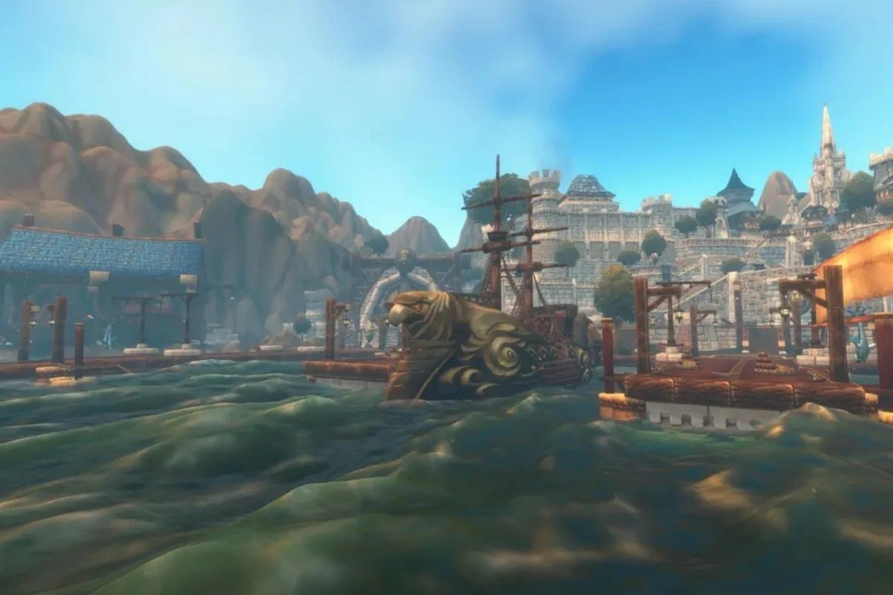

Viajar entre las capitales es más fácil en WoW Forever que en Classic. Un nuevo barco sale de Stormwind Harbor hacia Darnassus, sin el largo camino por los Wetlands. Esta guía muestra paso a paso la ruta más rápida entre las capitales de las dos facciones.

## De un vistazo

| De | A | Cómo |
|---|---|---|
| Stormwind | Ironforge | Deeprun Tram, luego un vuelo directo |
| Stormwind | Darnassus | Barco a Auberdine, barco a Rut'theran Village, portal |
| Orgrimmar | Undercity | Zepelín desde la torre fuera de Orgrimmar |
| Orgrimmar | Thunder Bluff | A pie por The Barrens, luego un vuelo directo |

Todas las rutas funcionan también al revés. Cada punto de vuelo y cada barco están en la [guía de rutas de vuelo](/es/guides/flight-paths/), y un Mage va más rápido con [portales](/es/classes/mage/portals/).

## De Stormwind a Ironforge

El Deeprun Tram sale del Dwarven District de Stormwind. Cruza el portal hacia la estación y sube a cualquiera de los dos trenes: ambos van a la misma estación de Ironforge. No saltes en el tren, puedes caerte. Entonces tendrías que recorrer el largo túnel a pie. En Ironforge, el portal de la estación te lleva a Tinker Town.

Volar es más rápido, pero solo con los dos puntos de vuelo. <a class="wf-wh wf-plain" href="https://www.wowhead.com/forever/npc=352">Dungar Longdrink</a> está en el suroeste del Trade District de Stormwind (/way 66.2 62.4) y <a class="wf-wh wf-plain" href="https://www.wowhead.com/forever/npc=1573">Gryth Thurden</a> junto a la Great Forge de Ironforge (/way 55.8 48.0). Así que coge el tranvía una vez, consigue el punto de vuelo y vuela desde entonces.

## De Stormwind a Darnassus

1. **Stormwind Harbor a Auberdine.** El puerto es nuevo en Forever. Coge el barco de la izquierda: su muelle tiene balistas y símbolos de los elfos de la noche, así que se ve enseguida.
2. **Auberdine a Rut'theran Village.** Auberdine tiene tres muelles: el de llegada, uno a la izquierda hacia Rut'theran Village y otro a la derecha hacia Menethil Harbor. El barco a Rut'theran atraca en el lado norte de Auberdine. Consigue antes el punto de vuelo de <a class="wf-wh wf-plain" href="https://www.wowhead.com/forever/npc=3841">Caylais Moonfeather</a> (/way 36.4 45.6) si aún no lo tienes.
3. **Rut'theran Village a Darnassus.** Cruza el portal brillante del árbol. <a class="wf-wh wf-plain" href="https://www.wowhead.com/forever/npc=3838">Vesprystus</a> en Rut'theran (/way 58.4 94.0) vuela a Auberdine.

Los Night Elves conocen desde el principio la ruta de vuelo entre Rut'theran Village y Auberdine, aunque nunca hayan estado en Auberdine. Así que nunca esperan el barco de camino a Stormwind.

## De Orgrimmar a Undercity

El zepelín es rápido y no ha cambiado. La torre está justo fuera de la puerta de Orgrimmar, a la derecha. Sube y coge el zepelín que atraca junto al maestro de zepelines: vuela a Tirisfal Glades, al lado de Undercity.

A la vuelta, la torre de Tirisfal está entre Brill y Undercity. Las dos torres tienen también un zepelín a Grom'gol en Stranglethorn Vale, así que fíjate en cuál subes.

## De Orgrimmar a Thunder Bluff

La primera vez sigue siendo una larga caminata. Coge cada punto de vuelo por el camino y no tendrás que repetirla nunca.

1. Coge el punto de vuelo de <a class="wf-wh wf-plain" href="https://www.wowhead.com/forever/npc=3310">Doras</a> en la torre del Valley of Strength (/way 45.2 63.8).
2. Sal de Orgrimmar hacia Razor Hill y sigue el camino hacia el este hasta Far Watch Post, en el borde de Durotar.
3. Entra en The Barrens y ve hacia el sur hasta los Crossroads. Coge el punto de vuelo de <a class="wf-wh wf-plain" href="https://www.wowhead.com/forever/npc=3615">Devrak</a> (/way 51.4 30.2).
4. Sigue la Gold Road hacia el sur hasta Camp Taurajo y coge el punto de vuelo de <a class="wf-wh wf-plain" href="https://www.wowhead.com/forever/npc=10378">Omusa Thunderhorn</a> (/way 44.4 59.0). Quédate en el camino si eres de nivel bajo.
5. Camina hacia el oeste a Mulgore, sigue el camino hasta Bloodhoof Village y luego al norte, hasta el pie de Thunder Bluff. Los ascensores te suben.
6. Coge el punto de vuelo de <a class="wf-wh wf-plain" href="https://www.wowhead.com/forever/npc=2995">Tal</a>, en el gran tótem del centro de la ciudad (/way 46.8 50.0).

Desde entonces, Orgrimmar y Thunder Bluff están a un solo vuelo.
