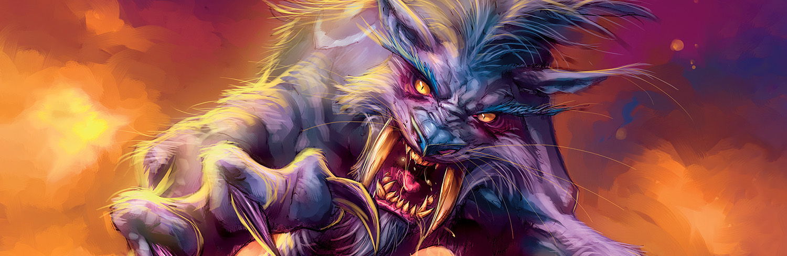

El Druid lo puede hacer casi todo en WoW Forever: tanquear como oso, hacer daño como gato o a distancia, y sanar. También se mueve por el mundo más rápido que cualquier otra clase. Subes como Feral, con una sola build del nivel 10 al 60. Esta guía cubre la build, la rotación, los niveles clave, las misiones de clase, las armas y las profesiones.

| | |
|---|---|
| Spec más fácil para subir | Feral, en Cat Form |
| Talentos clave | Ferocity, Furor, Rend and Tear, Shifting Power |
| Puntos fuertes | Movilidad, Stealth, se sana solo, puede tanquear y sanar |
| Puntos débiles | Inicio lento antes de Cat Form, maná para cada cambio de forma |
| Talento por nivel | [Build de subida del Druid](/es/leveling/druid/) |
| Guías por spec | [Balance Druid](/es/guides/balance-druid/), [Feral Druid](/es/guides/feral-druid/), [Restoration Druid](/es/guides/restoration-druid/) |
| Builds hasta el nivel 60 | Esta guía, del nivel 10 al 60 |

## Con qué spec subir

Los primeros 20 niveles cambian mucho. Empiezas con Wrath, recibes Bear Form en el 10 y Cat Form en el 20. El comienzo es algo lento, pero desde Cat Form va rápido.

**Sube como Feral.** Un gato casi nunca tiene que parar por maná o curación, y Prowl, Dash y Feral Swiftness te llevan de una misión a la siguiente. La build está hecha para Cat Form; para tanquear en mazmorras, mira la [guía del Feral Druid](/es/guides/feral-druid/). Balance y Restoration son para grupos y para el nivel 60; tienen sus propias guías de [Balance](/es/guides/balance-druid/) y [Restoration](/es/guides/restoration-druid/).

La build de abajo da un talento para cada nivel del 10 al 60. Con puntos en Talented del sistema Legacy, llegas a cada talento hasta cinco niveles antes. Los Druids Skyborne también tienen una ruta paso a paso por su zona inicial, del [nivel 1 al 6](/es/guides/leveling/skyborne-druid-1-6/).

## Niveles 1 a 10

Todavía no tienes talentos ni formas, solo <a class="wf-wh wf-spell" href="https://www.wowhead.com/forever/spell=5176">Wrath</a> y <a class="wf-wh wf-spell" href="https://www.wowhead.com/forever/spell=5185">Healing Touch</a>. <a class="wf-wh wf-spell" href="https://www.wowhead.com/forever/spell=8921">Moonfire</a> llega en el 4, <a class="wf-wh wf-spell" href="https://www.wowhead.com/forever/spell=467">Thorns</a> en el 6 y Entangling Roots en el 8.

1. Mantén Thorns sobre ti.
2. Atrae con Wrath.
3. Pon Moonfire en el monstruo.
4. Lanza Wrath hasta que el monstruo esté casi muerto o te quede poco maná.
5. Remátalo con tu arma.

Para escapar, usa <a class="wf-wh wf-spell" href="https://www.wowhead.com/forever/spell=16689">Nature's Grasp</a>, que cada Druid aprende en el nivel 10 en Forever. Sánate con Healing Touch cuando haga falta.

Estadísticas en estos niveles: Intellect y daño de hechizos, luego Stamina y Spirit, luego armadura.

## La build Feral del 10 al 60

Una build completa para Cat Form con un talento por nivel: todos los talentos de gato en Feral, luego crítico y golpe de Balance y daño de Restoration. [Abrir la build en el nivel 60 en la calculadora de talentos](/es/talents/druid/?t=050022-55200002123012125001-055), o seguirla nivel a nivel en la [build de subida del Druid](/es/leveling/druid/).

| Niveles | Talentos |
|---|---|
| **10 a 14** | 5 Ferocity |
| **15 a 19** | 4 Furor, 1 Feral Swiftness |
| **20 a 24** | 1 Feral Swiftness, 2 Savage Fury, 2 Sharpened Claws |
| **25 a 29** | 1 Predatory Discipline, 2 Blood Frenzy, 1 Feral Charge, 1 Predatory Strikes |
| **30 a 34** | 2 Natural Instinct, 1 Leader of the Pack, 2 Predatory Strikes |
| **35 a 39** | 5 Rend and Tear |
| **40 a 44** | 1 Shifting Power, 1 Furor, 3 Genesis |
| **45 a 49** | 2 Genesis, 2 Nature's Majesty, 1 Nature's Reach |
| **50 a 54** | 1 Nature's Reach, 4 Heart of the Wild |
| **55 a 59** | 1 Heart of the Wild, 4 Naturalist |
| **60** | 1 Naturalist |

En el nivel 30 la build se ve [así en la calculadora](/es/talents/druid/?t=-5420000212101201).

**Hasta el nivel 30** la build reduce el coste de tus ataques, toma Furor pronto para tener energía cada vez que vuelves a Cat Form, y añade Savage Fury, Sharpened Claws, Blood Frenzy y Feral Charge. **Desde el 30** Natural Instinct, Leader of the Pack y Predatory Strikes aumentan tus críticos y tu poder de ataque, y en el 35 Rend and Tear añade un 15% de daño contra objetivos que sangran. **En el 40** llega Shifting Power; la build se salta Primal Bite, porque juega casi solo en Cat Form. **Desde el 42** Genesis refuerza Rake y Rip, Nature's Majesty añade un 4% de crítico y Nature's Reach un 4% de golpe, y Heart of the Wild y Naturalist cierran la build en el 60. Si casi no usas Bear Form, también puedes tomar Furor antes que Ferocity.

**Como gato:**

1. Mantén Thorns sobre ti.
2. Usa Faerie Fire para bajar la armadura, o para atraer a distancia.
3. Genera Combo Points con Claw, o con Shred si estás detrás del monstruo.
4. Usa Shifting Power por debajo de 50 de Energy.
5. Usa Rip con 4 o 5 Combo Points.
6. Pon Rake en el monstruo. Olvida los sangrados si está a punto de morir.
7. Remátalo con Shred o Claw.

**Como oso:**

1. Mantén Thorns sobre ti.
2. Usa Faerie Fire para el perjuicio, o para atraer a distancia. En Bear Form ahora genera amenaza.
3. Usa Demoralizing Roar.
4. Usa Swipe contra varios monstruos y Maul contra uno.

Estadísticas desde aquí: Strength, Agility y Attack Power, luego Stamina, Intellect y Spirit, luego armadura.

## Niveles clave

| Nivel | Qué consigues | De |
|---|---|---|
| 4 | Moonfire, Rejuvenation | Instructor de clase |
| 6 | Thorns | Instructor de clase |
| 8 | Entangling Roots | Instructor de clase |
| 10 | Bear Form, Growl, <a class="wf-wh wf-spell" href="https://www.wowhead.com/forever/spell=6807">Maul</a>, Teleport: Moonglade | Misión de clase |
| 10 | Nature's Grasp, Demoralizing Roar | Instructor de clase |
| 10 | Ferocity | Árbol de talentos |
| 12 | Regrowth, Revive, <a class="wf-wh wf-spell" href="https://www.wowhead.com/forever/spell=5229">Enrage</a> | Instructor de clase |
| 14 | Cure Poison | Misión de clase |
| 14 | <a class="wf-wh wf-spell" href="https://www.wowhead.com/forever/spell=5211">Bash</a> | Instructor de clase |
| 15 | Furor, Feral Swiftness | Árbol de talentos |
| 16 | Aquatic Form | Misión de clase |
| 16 | <a class="wf-wh wf-spell" href="https://www.wowhead.com/forever/spell=779">Swipe</a> | Instructor de clase |
| 18 | Faerie Fire, Hibernate | Instructor de clase |
| 20 | Cat Form, <a class="wf-wh wf-spell" href="https://www.wowhead.com/forever/spell=1082">Claw</a>, Prowl, Rip | Misión de clase |
| 20 | Shred, Starfire, Rebirth, Omen of Clarity | Instructor de clase |
| 20 | Armas de asta | Instructor de armas |
| 20 | Savage Fury, Sharpened Claws | Árbol de talentos |
| 22 | Soothe Animal | Instructor de clase |
| 24 | Rake, Remove Curse | Instructor de clase |
| 25 | Predatory Discipline, Blood Frenzy, Feral Charge, Predatory Strikes | Árbol de talentos |
| 26 | <a class="wf-wh wf-spell" href="https://www.wowhead.com/forever/spell=1850">Dash</a>, Abolish Poison | Instructor de clase |
| 28 | Cower, Challenging Roar | Instructor de clase |
| 30 | Travel Form, <a class="wf-wh wf-spell" href="https://www.wowhead.com/forever/spell=740">Tranquility</a> | Instructor de clase |
| 30 | Natural Instinct, Leader of the Pack | Árbol de talentos |
| 32 | Ferocious Bite, Ravage, Track Humanoids | Instructor de clase |
| 35 | Rend and Tear | Árbol de talentos |
| 36 | Pounce, Frenzied Regeneration | Instructor de clase |
| 40 | Shifting Power | Árbol de talentos |
| 42 | Genesis, Nature's Majesty, Nature's Reach | Árbol de talentos |
| 44 | Barkskin | Instructor de clase |

Mark of the Wild, Wrath y Healing Touch los tienes desde el nivel 1. Shred llega en el 20 en Forever (antes en el 22), y Nature's Grasp y Omen of Clarity ya no son talentos. Tiger's Fury ha desaparecido.

## Las misiones de clase

Un Druid aprende la mayoría de sus formas con misiones de clase. La misión de Bear Form también enseña Teleport: Moonglade; la de Cat Form también Claw, Prowl y Rip.

| Nivel | Aprende | Alliance | Horde |
|---|---|---|---|
| 10 | Bear Form, Growl, <a class="wf-wh wf-spell" href="https://www.wowhead.com/forever/spell=6807">Maul</a> | Heeding the Call, Darnassus | Heeding the Call, Thunder Bluff |
| 10 | Teleport: Moonglade | Heeding the Call, Darnassus | Heeding the Call, Thunder Bluff |
| 14 | Cure Poison | <a href="https://www.wowhead.com/forever/quest=6121">Lessons Anew</a>, Darnassus | <a href="https://www.wowhead.com/forever/quest=6126">Lessons Anew</a>, Thunder Bluff |
| 16 | Aquatic Form | <a href="https://www.wowhead.com/forever/quest=26">A Lesson to Learn</a>, Darnassus | <a href="https://www.wowhead.com/forever/quest=27">A Lesson to Learn</a>, Thunder Bluff |
| 20 | Cat Form, <a class="wf-wh wf-spell" href="https://www.wowhead.com/forever/spell=1082">Claw</a>, Prowl, Rip | The Great Cat Spirit, Darnassus | The Great Cat Spirit, Thunder Bluff |

Los **Skyborne** siguen su propio camino en el nivel 10. Bear Form viene de <a href="https://www.wowhead.com/forever/quest=94006">The Great Ursera Spirit</a> en Zephras Isle, y Teleport: Moonglade de la misión Moonglade, que empieza en Stormwind para el High Order y en Thunder Bluff para los Windshapers. En el 20 reciben The Great Windborne Cat Spirit: la misma cadena, con el Avatar of Saeyleenan en lugar del Great Cat Spirit.

Las misiones de Cat Form son nuevas en Forever. Hablas con Dendrite Starblaze en Moonglade, buscas al Great Cat Spirit en el sur de Moonglade, recuperas tres reliquias del Stormrage Barrow Den y vuelves con Dendrite. Un error impedía a los druidas saquear esas reliquias; una corrección del 16 de octubre lo arregló ([más](/es/news/a-hotfix-lets-druids-loot-the-cat-form-relics/)).

### Skyborne, paso a paso

**Bear Form, nivel 10.** Las dos facciones empiezan en Zephras Isle, así que la misión es la misma para el High Order y los Windshapers.

1. Lotheluum Starbreeze, el instructor de Druidas en Valanaar (/way 64.0 75.1), da <a href="https://www.wowhead.com/forever/quest=94006">The Great Ursera Spirit</a>. Te envía al Great Windborne Bear Spirit, Urs'endris, en un islote al este de Zephras Isle (/way 69.8 61.7).
2. Urs'endris da <a href="https://www.wowhead.com/forever/quest=94638">Strength and Mercy</a>: su pareja Ur'endra ha enloquecido. Espera en una cueva en lo alto de una colina de las Shen'dar Highlands, en el sur de la isla (cerca de /way 53.9 65.4).
3. Mata a Ur'endra y vuelve con Urs'endris. Aprendes Bear Form, Growl y Maul.

**Cat Form, nivel 20.**

1. Tu instructor de Druidas da The Great Cat Spirit: Mathrengyl Bearwalker en el Cenarion Enclave de Darnassus (/way 35.2 8.3) o Turak Runetotem en el Elder Rise de Thunder Bluff (/way 76.6 27.6).
2. Usa Teleport: Moonglade y sube al piso de arriba del edificio que tienes delante. Dendrite Starblaze en Nighthaven (/way 56.2 30.5) da <a href="https://www.wowhead.com/forever/quest=98341">The Great Windborne Cat Spirit</a>.
3. El Avatar of Saeyleenan, en el sur de Moonglade (/way 44.0 73.5), da el siguiente paso, también llamado <a href="https://www.wowhead.com/forever/quest=98404">The Great Windborne Cat Spirit</a>, y te envía al Stormrage Barrow Den, al este (/way 71.8 61.9).
4. Nada más entrar, haz clic en el Great Cat Spirit Statue. Su beneficio, Feline Blessing of the Silent Shadow, te deja cruzar el túmulo sin que te vean.
5. Recoge tres reliquias, cada una delante de una estatua de gato: la Relic of the Claw al otro lado del puente en la primera sala, la Relic of the Fang en una cámara pequeña un nivel más abajo y la Relic of the Silent Shadow en el centro de la sala bajo el puente.
6. Lleva las reliquias al Avatar, acepta <a href="https://www.wowhead.com/forever/quest=98738">Blessings of the Great Windborne Cat Spirit</a> y habla con Dendrite en Nighthaven. Back to Darnassus o Back to Thunder Bluff te manda a tu instructor, que enseña Cat Form, Claw, Prowl y Rip.

## Dónde subir

El nivel mínimo recomendado de cada zona. Los niveles de las mazmorras están en la [guía de mazmorras](/es/guides/dungeons/).

| Nivel | Zonas |
|---|---|
| **1** | Elwynn Forest, Dun Morogh, Teldrassil, [Zephras Isle](/es/guides/zephras-isle/), Durotar, Mulgore, Tirisfal Glades |
| **10** | Westfall, Loch Modan, Darkshore, The Barrens, Silverpine Forest |
| **15** | Redridge Mountains, Stonetalon Mountains |
| **18** | Ashenvale |
| **20** | Wetlands, Hillsbrad Foothills, Duskwood |
| **25** | Thousand Needles |
| **30** | Alterac Mountains, Arathi Highlands, Desolace, Stranglethorn Vale |
| **35** | Badlands, Dustwallow Marsh, Feralas, Riverglades, Swamp of Sorrows |
| **40** | Shen'dralas, Tanaris, The Hinterlands |
| **43** | Searing Gorge |
| **45** | Azshara, Felwood, Blasted Lands |
| **48** | Un'Goro Crater |
| **50** | Burning Steppes, Western Plaguelands |
| **53** | Winterspring, Eastern Plaguelands |
| **55** | Silithus, Deadwind Pass |
| **60** | Mount Hyjal |

## Armas

En forma animal, tus ataques automáticos hacen en Forever el daño por segundo de tu arma. Una mejor arma sube por tanto todo tu daño cuerpo a cuerpo, también como gato u oso. Las armas de asta son nuevas para el Druid y se aprenden desde el nivel 20. Un tipo de arma nuevo empieza con poca habilidad, así que entrénalo antes de depender de él.

| Arma | Alliance | Horde |
|---|---|---|
| **Bastones** | Conocidos desde el principio | Conocidos desde el principio |
| **Dagas** | Conocidas desde el principio | Sayoc (Orgrimmar), Archibald (Undercity) |
| **Mazas de una mano** | Buliwyf Stonehand (Ironforge) | Conocidas desde el principio |
| **Mazas de dos manos** | Buliwyf Stonehand (Ironforge) | Ansekhwa (Thunder Bluff) |
| **Armas de puño** | Ilyenia Moonfire (Darnassus), Buliwyf Stonehand (Ironforge) | Sayoc (Orgrimmar) |
| **Armas de asta**, desde el nivel 20 | Woo Ping (Stormwind) | Archibald (Undercity) |

## Ídolos y equipo

Los **ídolos** van en la ranura de reliquia y dan al Druid una bonificación propia. La misión de Aquatic Form da <a class="wf-wh wf-q2" href="https://www.wowhead.com/forever/item=263411">Idol of Shifting Tides</a>, que reduce en 40 el coste de maná de cada cambio de forma. Guárdalo hasta que encuentres un ídolo que suba tu daño. Los Druids de la Horde pueden conseguir un ídolo parecido en el nivel 5 en Zephras Isle, con la misión Meddlesome Mages; más en [este post](/es/news/horde-druids-and-shamans-get-a-relic-at-level-5/).

El conjunto **Embrace of the Viper** de [Wailing Caverns](/es/guides/dungeons/wailing-caverns/) es fuerte para un Druid Feral y dura bastante. Con las cinco piezas, tu Cat Form se convierte en una [serpiente](/es/news/a-hidden-set-bonus-turns-druids-into-a-snake/).

Dos objetos famosos vuelven para los Druids Feral. <a class="wf-wh wf-q3" href="https://www.wowhead.com/forever/item=9449">Manual Crowd Pummeler</a> cae en [Gnomeregan](/es/guides/dungeons/gnomeregan/) y pide nivel 29. <a class="wf-wh wf-q3" href="https://www.wowhead.com/forever/item=8345">Wolfshead Helm</a> sale de Leatherworking en el nivel 40 y ahora da 5 de Energy extra con Shifting Power. Ninguno de los dos seguirá siendo probablemente la mejor opción hasta el 60.

## Profesiones

Sube tus profesiones a la vez que tu Druid, para recoger y fabricar al nivel adecuado. Los campamentos dan bufos a cada profesión.

- **Cooking** es imprescindible: la comida con bufo da experiencia extra, y la necesitas para una hoguera.
- **Herbalism** es la elección clásica: recoges hierbas sin salir de Travel Form. Su campamento da Intellect.
- **Alchemy** combina con Herbalism y da pociones y un campamento para regenerar maná.
- **Leatherworking** tiene buen equipo de subida ligado que no consigues en ningún otro sitio, y la Camp Tent para la experiencia de descanso.
- **Skinning** da el cuero y es fácil en Travel Form. Su Camp Chair da el mismo tipo de bonificación de crítico que Leader of the Pack y Moonkin Aura, así que los Druids Feral y Balance apenas ganan algo.

## Consumibles

En Forever usas pociones y casi todos los consumibles parecidos sin salir de tu forma. Eso los hace mucho más útiles para un Druid que antes.

- **Comida y bebida.** Mantente Well Fed por la experiencia extra; cualquier comida con bufo es mejor que ninguna. Incluso un Druid Feral necesita maná a veces, así que lleva agua de tu nivel.
- **Pociones.** Pociones de sanación para emergencias, ahora también de First Aid. Los remedios de First Aid contra enfermedades y sangrados ayudan, porque un Druid no puede quitarlos de otra forma. Pociones de maná, Energy o Rage según tu build.
- **Elixires** con las estadísticas adecuadas para tu build ayudan contra un monstruo duro o una misión difícil.
- **Rebirth** necesita un componente en cada lanzamiento; cuál depende del rango. Mira la descripción.

## Cambios de forma

Tus formas son el núcleo de la clase. Bear Form tanquea, Cat Form hace daño cuerpo a cuerpo y da Prowl, Aquatic Form nada más rápido y respira bajo el agua, Travel Form corre rápido sin montura, y Moonkin Form en el nivel 40 es la forma de Balance.

Forever quita mucha fricción. Pociones, encantamientos de arma y efectos de activación funcionan en forma, la mayoría de puertas y objetos se abren en forma, y raciales como Shadowmeld y War Stomp también funcionan. Menos efectos te sacan de una forma, y Cat Form ya no baja tu vida máxima. Cada forma tiene su propia barra de acción, así que configúralas a medida que aprendes habilidades nuevas.

Cambiar de forma sigue rompiendo inmovilizaciones y ralentizaciones. Hazlo en vez de esperar a que acabe un root. Sal de tu forma para sanarte o para un hechizo que solo funciona fuera de forma.

**El powershifting ha desaparecido.** Con cinco puntos, Furor devuelve la Energy que tenías al salir de Cat Form la última vez, más 10 de Energy por segundo fuera de Bear Form, hasta 100. Salir y volver rápido no aporta nada. Más en [este post](/es/news/shifting-power-replaces-powershifting-for-ferals/).

## Stealth y movimiento

Ninguna clase recorre el mundo con tanta facilidad como un Druid.

- **Prowl** te convierte en una de las dos clases con Stealth. Tú decides cuándo y cómo empieza un combate.
- **Dash** y **Feral Swiftness** hacen más rápida la Cat Form; **Feral Charge** te lleva hasta un monstruo. Pounce abre desde Prowl a partir del nivel 36.
- **Aquatic Form** cruza el agua y te deja recoger objetos del fondo de un lago sin barra de respiración.
- **Travel Form** en el nivel 30 corre casi tan rápido como una montura y no hay que invocarla. Puedes recoger objetos de misión y hierbas con ella. Las demás clases esperan al nivel 40 para su montura.
- **Teleport: Moonglade** es una segunda Hearthstone. Moonglade tiene un maestro de vuelo por facción hacia Darnassus o Thunder Bluff, y uno normal en el sur de la zona, que antes tienes que visitar una vez.

## Maná, Energy y Rage

Cada Druid necesita maná, también como gato u oso: los cambios de forma y los hechizos de utilidad cuestan maná. Un gato usa Energy y un oso Rage, que viene de hacer y recibir daño. Guarda algo de reserva: maná suficiente para cambiar de forma, o un poco de Rage para un Bash inmediato cuando un monstruo empieza a lanzar.

## Sanación

Incluso sin Restoration te sanas a ti y a tu grupo.

- **Healing Touch** es la cura sencilla que más usarás.
- **Rejuvenation** te rellena en movimiento, o antes de un daño previsto.
- **Regrowth** da una cura más una pequeña cura en el tiempo.
- **Tranquility** sana al grupo, pero solo si canalizas hasta el final, y con un tiempo de reutilización largo. Poco útil en solitario.
- **Cure Poison**, **Abolish Poison** y **Remove Curse** quitan la causa antes de que haga daño.

Restoration añade Swiftmend y Wild Growth con sus talentos.

## Control

**Entangling Roots** mantiene a un monstruo en su sitio, y Nature's Grasp inmoviliza a quien te golpea. Los Druids saben kitear bien: inmoviliza a un monstruo, aléjate mientras corre tu daño en el tiempo, lanza otra vez, y pasa a Cat Form si necesitas más distancia. Incluso como Feral puedes mantener a un monstruo inmovilizado mientras alejas al otro.

**Hibernate** duerme a una bestia o un dragonante, y se rompe con el daño. **Soothe Animal** ayuda a otros a pasar junto a bestias. **Faerie Fire** baja la armadura de un monstruo y lo atrae a distancia sin salir de tu forma, también para sacarlo de un grupo.

## Bufos y tiempos de reutilización

**Mark of the Wild** sube estadísticas y armadura para cada clase; mantenlo activo. **Thorns** daña a quien te ataca y acelera tus muertes, pero solo dura 10 minutos. Leader of the Pack y Moonkin Aura llegan ahora a [toda la banda](/es/news/battle-shout-and-totems-now-buff-the-whole-raid/).

Usa tus tiempos de reutilización también en el mundo abierto, no solo contra jefes. **Innervate** devuelve mucho maná, para seguir atrayendo. **Barkskin** reduce el daño físico, y mientras dura los ataques ya no retrasan tus lanzamientos. **Rebirth** devuelve a la vida a un miembro del grupo en combate.

Más sobre comida, campamentos y XP de descanso en la [guía de experiencia](/es/guides/experience/).
