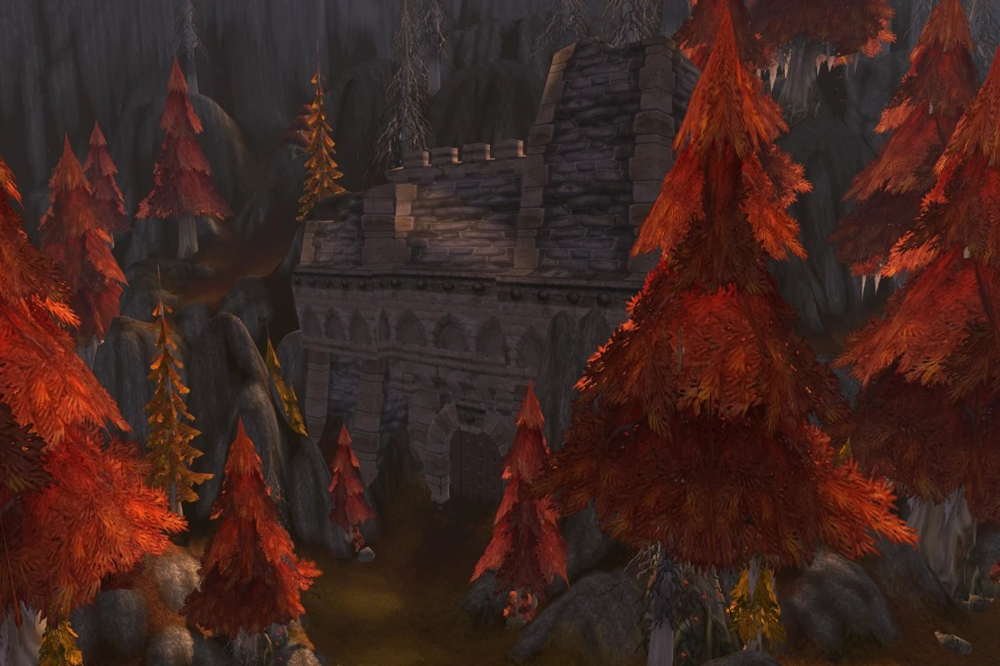

## Cómo llegar

Blackmaw Hold es una nueva mazmorra de World of Warcraft: Forever, para los niveles 55 a 60, en Azshara, justo al oeste de Timbermaw Hold. Tras la vieja puerta de piedra se abre un túnel de los furbolgs, en /way 38.7 33.4. El túnel es tan profundo que el portal está en el mapa de Winterspring, en /way 66.6 84.4. El sanador espiritual está justo fuera, así que un wipe solo cuesta una carrera corta.

- **Horda:** vuela a Valormok en Azshara. Sin esa ruta, vuela a Splintertree Post en Ashenvale y ve hacia el este, o sal de Orgrimmar por la puerta oeste y ve hacia el norte.
- **Alianza:** vuela a Talrendis Point, en el suroeste de Azshara. Sin esa ruta, Astranaar en Ashenvale y Ratchet son las más cercanas.

## La puerta que decía Timbermaw Hold

En Classic, al acercarte a esa puerta el juego decía que entrabas en Timbermaw Hold, pero no llevaba a ninguna parte. En Forever es la entrada a Blackmaw Hold. Los Blackmaw son una tribu rival de los Timbermaw, aliada con los sátiros Legashi, y su magia vil corrompe Azshara. Más en el [artículo sobre la puerta](/es/news/blackmaw-hold-sits-behind-the-old-gate-in-azshara/).

## Una ciudad furbolg

Blackmaw Hold es más o menos tan grande como Maraudon o Blackrock Depths, con varias rutas por arboledas y túneles de montaña. Aun así, los desarrolladores no la llaman megamazmorra: un grupo debería terminarla de principio a fin en una sesión larga.

## Enemigos a vigilar

- **Los <a class="wf-wh wf-plain" href="https://www.wowhead.com/forever/npc=250027">Blackmaw Headhunters</a> y los <a class="wf-wh wf-plain" href="https://www.wowhead.com/forever/npc=247237">Blackmaw Berserkers</a>** esperan al principio. Los Headhunters te ponen un veneno fuerte con <a class="wf-wh wf-spell" href="https://www.wowhead.com/forever/spell=1323656">Poisoned Shot</a>: quítalo enseguida. Aturde a los Berserkers cuando se enfurecen.
- **Los <a class="wf-wh wf-plain" href="https://www.wowhead.com/forever/npc=255394">Blackmaw Champions</a>** hacen huir a todos a su alrededor con <a class="wf-wh wf-spell" href="https://www.wowhead.com/forever/spell=1324618">Terrifying Roar</a> y aturden al tanque 2 segundos con <a class="wf-wh wf-spell" href="https://www.wowhead.com/forever/spell=1323676">Slam</a>. Mátalos primero en cada grupo de furbolgs, porque un jugador que huye puede atraer al siguiente grupo. El <a class="wf-wh wf-spell" href="https://www.wowhead.com/forever/spell=8143">Tremor Totem</a> de un chamán ayuda; sin chamán, lleva estos grupos a un sitio donde nadie pueda correr hacia otros monstruos.
- **Los <a class="wf-wh wf-plain" href="https://www.wowhead.com/forever/npc=268864">Legashi Plaguebringers</a>** pegan fuerte con Shadow Bolt e invocan <a class="wf-wh wf-plain" href="https://www.wowhead.com/forever/npc=268865">Festering Swarmers</a>: mátalos en cuanto aparezcan. Un **<a class="wf-wh wf-plain" href="https://www.wowhead.com/forever/npc=258329">Bloated Grizzly</a>** explota al morir con <a class="wf-wh wf-spell" href="https://www.wowhead.com/forever/spell=1302497">Corpse Explosion</a>, que golpea a todos cerca y deja una enfermedad. Los jugadores a distancia se alejan, y la enfermedad se quita rápido.
- **Los <a class="wf-wh wf-plain" href="https://www.wowhead.com/forever/npc=247248">Legashi Summoners</a>** hacen huir a jugadores hacia otros grupos y lanzan <a class="wf-wh wf-spell" href="https://www.wowhead.com/forever/spell=11639">Shadow Word: Pain</a>. Mátalos primero. Sus <a class="wf-wh wf-plain" href="https://www.wowhead.com/forever/npc=255247">Swarming Imps</a> explotan al morir con <a class="wf-wh wf-spell" href="https://www.wowhead.com/forever/spell=1264600">Soulburst</a>, así que no los mates todos a la vez con daño en área, o los jugadores cuerpo a cuerpo mueren con ellos.

El gran grupo de <a class="wf-wh wf-plain" href="https://www.wowhead.com/forever/npc=277474">Blackmaw Devotees</a> ya no suelta nada desde una corrección del 16 de noviembre. Los grupos farmeaban oro allí, mira [nuestro artículo sobre el farmeo](/es/news/a-gold-farm-in-blackmaw-hold-is-hotfixed/).

## Los jefes

Siete jefes y cuatro raros. Varrox Bleakhoof es el último, al fondo de un agujero en la sala de Clawbert.

### 1. Withermaw

<a class="wf-wh wf-plain" href="https://www.wowhead.com/forever/npc=247195">Withermaw</a> espera en la Festering Grotto. Durante todo el combate salen Flesh Maggots, golpea al tanque con Maul y su Intimidating Roar hace huir a todo el grupo 8 segundos. Pon <a class="wf-wh wf-spell" href="https://www.wowhead.com/forever/spell=8143">Tremor Totem</a> o pide a un sacerdote que lance <a class="wf-wh wf-spell" href="https://www.wowhead.com/forever/spell=6346">Fear Ward</a> sobre el sanador, para que el tanque siga recibiendo sanación. Las larvas tienen poca vida: mátalas según llegan. Withermaw suelta las Claws of the Great Bear para la misión Claws That Rend, Tusks that Gore.

### 2. Impaan the Imprisoner

<a class="wf-wh wf-plain" href="https://www.wowhead.com/forever/npc=247206">Impaan the Imprisoner</a> patrulla por una de las arboledas y lanza Shadow Bolts al tanque. Su Imps! invoca tres diablillos que le hacen recibir un 99 % menos de daño, así que mata primero a los diablillos y luego al jefe. Limpia la zona antes de atraerlo.

### 3. Bonesnout the Unbroken

<a class="wf-wh wf-plain" href="https://www.wowhead.com/forever/npc=247198">Bonesnout the Unbroken</a> patrulla por Bonesnout's Thicket y empieza con cuatro acumulaciones de Profane Bulwark: no recibe ningún daño. Cuatro <a class="wf-wh wf-plain" href="https://www.wowhead.com/forever/npc=258668">Legashi Ritualists</a> mantienen ese escudo desde la espesura, y cada Ritualist que matas le quita un 25 %. Vigila su patrulla mientras los buscas. Después el combate es fácil: Trample golpea a todos cerca de él y Stomp aturde 2 segundos, así que el sanador y los jugadores a distancia se quedan fuera del cuerpo a cuerpo. Suelta los Tusks of the Unbroken para la misma misión que Withermaw.

### 4. Unbound Spirit

<a class="wf-wh wf-plain" href="https://www.wowhead.com/forever/npc=247231">Unbound Spirit</a> empieza cuando hablas con <a class="wf-wh wf-plain" href="https://www.wowhead.com/forever/npc=248765">Elder Bramblesnap</a>. En la fase 1, tres Profane Totems protegen al espíritu, y Elder Bramblesnap los canaliza uno a uno para que puedas romperlos. Mientras tanto salen Ethereal Beasts y el espíritu lanza Fire Nova a todo el grupo. El tanque coge las bestias, el resto pega al tótem, y tras cada tótem el grupo mata a las bestias. La fase 2 empieza cuando se rompe el tercer tótem: el espíritu tiene poca vida y solo añade Fireball al tanque.

### 5. Clawbert y el Blackmaw Behemoth

<a class="wf-wh wf-plain" href="https://www.wowhead.com/forever/npc=247996">Clawbert</a> va montado en el <a class="wf-wh wf-plain" href="https://www.wowhead.com/forever/npc=247207">Blackmaw Behemoth</a>, un furbolg enorme que cree controlar. Cada uno tiene su propia vida; mata primero a Clawbert. Lanza Lightning Bolt, el Behemoth lo blande como Improvised Weapon y reduce tu daño con un rugido. Cuando Clawbert muere, el Behemoth se lo come y se queda con su Lightning Bolt, más un ataque giratorio lento que sigue al tanque: sal de él.

### 6. Elder Shaman Bloodmane

<a class="wf-wh wf-plain" href="https://www.wowhead.com/forever/npc=247209">Elder Shaman Bloodmane</a> no es difícil. Al principio invoca dos Feral Spirits, te quita los beneficios con Purge y lanza Chain Lightning. Mata primero al jefe y luego a los lobos: se quedan cuando él muere. Suelta el Blackmaw Ritual Totem para la misión Blackmaw Magic.

### 7. Varrox Bleakhoof

<a class="wf-wh wf-plain" href="https://www.wowhead.com/forever/npc=247234">Varrox Bleakhoof</a> espera al fondo del agujero en la sala de Clawbert. Hace huir a jugadores al azar, lanza Shadow Bolt Volley y pone Nightmare Detonation a un jugador al azar: ese jugador es atraído hacia el jefe y explota al terminar el efecto, golpea a todos cerca y deja un charco de Crimson Wrest. Aléjate de ese jugador, y el tanque mueve a Varrox si un charco cae cerca del cuerpo a cuerpo. Cuidado con que un miedo no mande a nadie a un charco. El sanador cura al grupo durante Nightmare Detonation y al tanque entre medias. Su cabeza es para la misión Blackmaw Reclamation.

### Los raros

Pueden aparecer cuatro raros. Pelean más como enemigos con nombre que como jefes de verdad, y cada uno suelta dos objetos.

- **<a class="wf-wh wf-plain" href="https://www.wowhead.com/forever/npc=269104">Moontouched Wanderer</a>**: Moonfire y Enrage. Quita el Moonfire y atúrdelo cuando se enfurezca.
- **Tunnelweb Matriarch**: una araña en sigilo que se pasa por alto fácilmente. Envenena a los jugadores y los inmoviliza 10 segundos en una Web.
- **<a class="wf-wh wf-plain" href="https://www.wowhead.com/forever/npc=247412">Mopes</a>**: solo Shadow Bolt.
- **<a class="wf-wh wf-plain" href="https://www.wowhead.com/forever/npc=269111">Gortek the Apprentice</a>**: Lightning Bolt y Earth Shock. Interrumpe el Lightning Bolt.
