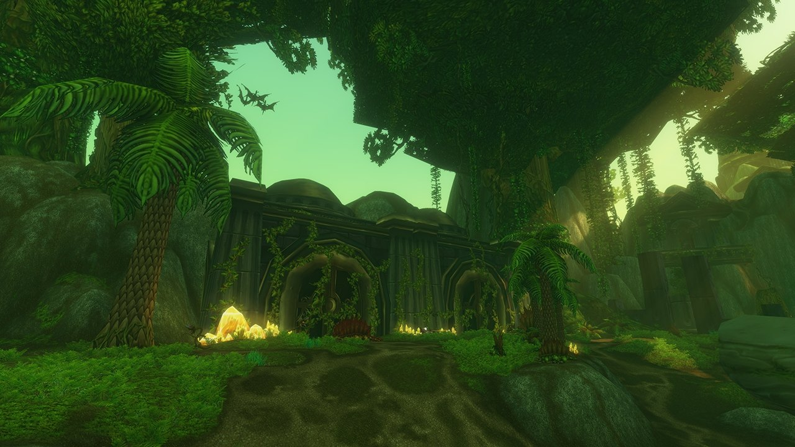

## Cómo llegar

Shaper's Terrace es una nueva mazmorra de World of Warcraft: Forever, para los niveles 58 a 60, en Un'Goro Crater. La entrada está en una colina sobre Marshal's Refuge, en el norte del cráter, en /way 48.1 6.1.

## La historia

Shaper's Terrace es una antigua instalación de los titanes. Ahora viven allí dinosaurios, junto a algunos ensamblajes titánicos, entre pozos de alquitrán y cristales.

## La distribución

La mayor parte de la mazmorra es una gran zona abierta. Un camino cruza un pozo de alquitrán hasta la estructura central, el Pillar of Assimilation. Por el lado este corre un túnel lleno de cristales. Un camino por el norte lleva a un edificio titánico y luego a una zona con cascadas. Allí, tras una puerta cerrada, se esconde un portal de banda, encontrado en la beta, mira [este artículo](/es/news/hidden-instance-portals-hint-at-future-content/).

## Los power crystals

Según Blizzard, los power crystals que recoges en Un'Goro Crater sirven en consolas dentro de la mazmorra: <a class="wf-wh wf-q1" href="https://www.wowhead.com/forever/item=11184">Blue Power Crystal</a>, <a class="wf-wh wf-q1" href="https://www.wowhead.com/forever/item=11185">Green Power Crystal</a>, <a class="wf-wh wf-q1" href="https://www.wowhead.com/forever/item=11186">Red Power Crystal</a> y <a class="wf-wh wf-q1" href="https://www.wowhead.com/forever/item=11188">Yellow Power Crystal</a>. Qué hacen las consolas aún no se sabe.

## Los jefes

Se conocen cuatro jefes por su nombre, gracias a los desafíos Legacy de la mazmorra. Probablemente haya más.

- **Bolt**
- **Cinder**
- **Snowtalon**
- **Nanaya**

## Lo que aún no se sabe

- **Los demás jefes** y cómo son los combates.
- **Qué hacen las consolas** con los cristales.
- **El botín** y **las misiones**.
