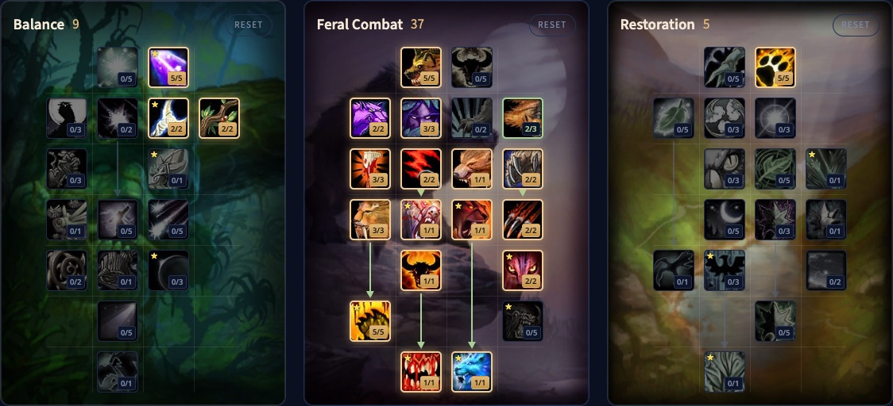

El Feral Druid de WoW Forever son dos specs en una: un felino que hace daño cuerpo a cuerpo con energía y Combo Points, y un oso que tanquea con ira. Puedes construir para uno de los dos o quedarte con ambos. El viejo powershifting ha desaparecido, pero Shifting Power convierte maná en energía, y puedes usar consumibles y hablar con la mayoría de los PNJ sin salir de tu forma. Esta guía cubre cuatro builds de nivel 60, los talentos clave, las dos rotaciones, los recursos, los stats y las razas.

| | |
|---|---|
| Rol | Daño cuerpo a cuerpo en Cat Form, tanque en Bear Form |
| Builds de nivel 60 | Híbrida 9/37/5, Felino 9/37/5, Oso 9/37/5, Solo 0/35/16 |
| Talentos clave | Feral Charge, Shifting Power, Primal Bite, Leader of the Pack, Nature's Reach |
| Fortalezas | Dos roles en uno, Leader of the Pack, el personaje más rápido dentro y fuera |
| Debilidades | Daño de híbrido, tres recursos que vigilar, difícil de dominar |
| Otras guías del Druid | [Guía de leveling del Druid](/es/guides/druid-leveling/), [Balance Druid](/es/guides/balance-druid/), [Restoration Druid](/es/guides/restoration-druid/) |

## Fortalezas y debilidades

**Dos roles.** El felino hace daño como un Rogue, el oso tanquea como un Warrior, y puedes cambiar en mitad del combate. Fuera de forma aún tienes Rebirth, Innervate, Remove Curse y algunas curas.

**Buffs de banda.** Mark of the Wild, Thorns y Faerie Fire como cualquier Druid, más Leader of the Pack: un 3 % más de probabilidad de crítico cuerpo a cuerpo y a distancia para todo el grupo o la banda a 45 metros. Demoralizing Roar reduce el daño del enemigo.

**Movilidad.** Feral Swiftness te hace un 30 % más rápido en Cat Form, también en interiores. <a class="wf-wh wf-spell" href="https://www.wowhead.com/forever/spell=1850">Dash</a>, Feral Charge y Pounce acortan distancias en combate, y Prowl te deja pasar junto al peligro.

**Daño de híbrido.** Blizzard mantiene a los híbridos un poco por debajo de las clases de daño puras de media. Aún puedes encabezar los medidores, solo que menos a menudo que un Rogue.

**Tres recursos.** El felino vigila la energía, los Combo Points y, para Shifting Power, el maná. El oso tiene ira. Suma los sangrados y los debuffs, y el Feral es una de las specs más difíciles de dominar.

## Cuatro builds de nivel 60

Las cuatro usan 51 puntos, el total de talentos del nivel 60. Todas ponen 9 puntos en Balance para Genesis 5/5, Nature's Majesty 2/2 y Nature's Reach 2/2, salvo la build en solitario.

### Híbrida, 9/37/5

Felino y oso en una sola build, para grupos de endgame que piden cualquiera de los dos roles. [Abre la build en la calculadora de talentos](/es/talents/druid/?t=050022-50230232123112125011-05).

| Talento | Puntos |
|---|---|
| **Genesis** | 5/5 |
| **Nature's Majesty** | 2/2 |
| **Nature's Reach** | 2/2 |
| **Ferocity** | 5/5 |
| **Feral Swiftness** | 2/2 |
| **Feral Instinct** | 3/3 |
| **Thick Hide** | 2/3 |
| **Shredding Attacks** | 3/3 |
| **Savage Fury** | 2/2 |
| **Feral Charge** | 1/1 |
| **Sharpened Claws** | 2/2 |
| **Predatory Strikes** | 3/3 |
| **Lacerate** | 1/1 |
| **Predatory Discipline** | 1/1 |
| **Blood Frenzy** | 2/2 |
| **Leader of the Pack** | 1/1 |
| **Natural Instinct** | 2/2 |
| **Rend and Tear** | 5/5 |
| **Primal Bite** | 1/1 |
| **Lacerate** | Talento nuevo de Feral Combat desde la corrección |
| **Shifting Power** | 1/1 |
| **Heart of the Wild** | 5/5 |

### Felino, 9/37/5

Para un Druid que nunca tanquea. [Abre la build en la calculadora de talentos](/es/talents/druid/?t=050022-53230032123112125001-05).

### Oso, 9/37/5

Para un Druid que solo tanquea, con más ira y supervivencia. [Abre la build en la calculadora de talentos](/es/talents/druid/?t=050022-5023030212310212541-05).

### Solo, 0/35/16

Para hacer misiones y farmear en solitario: cambios de forma más baratos y autocuración eficiente, a cambio de algo de rendimiento en grupo. [Abre la build en la calculadora de talentos](/es/talents/druid/?t=-05231032123112125001-15513000001).

## Qué hacen los talentos clave

| Talento | Qué hace en Forever |
|---|---|
| **Nature's Reach** | Un 4 % más de probabilidad de golpe, y un 20 % más de alcance para los hechizos ofensivos de Balance |
| **<a class="wf-wh wf-spell" href="https://www.wowhead.com/forever/spell=17003">Heart of the Wild</a>** | Un 10 % más de Intellect, un 20 % más de Stamina en Bear Form, un 10 % más de Strength en Cat Form |
| **Feral Charge** | Solo como oso: carga contra un enemigo, lo inmoviliza e interrumpe su hechizo 4 segundos, y salta detrás de él |
| **Shifting Power** | Convierte al instante el 55 % de tu maná base en 40 de energía |
| **Primal Bite** | Un mordisco por el 100 % del daño del arma más un bonus, con mucha amenaza |
| **Blood Frenzy** | 5 de ira extra con un crítico en Bear Form, un Combo Point extra con un crítico en Cat Form |
| **Leader of the Pack** | Un 3 % más de probabilidad de crítico cuerpo a cuerpo y a distancia para el grupo o la banda a 45 metros |
| **Natural Reaction** | Un 5 % más de esquiva y 5 de ira con cada esquiva |
| **Rend and Tear** | Un 10 % más de daño con las habilidades cuerpo a cuerpo contra objetivos que sangran |
| **Furor** | 10 de ira al pasar a Bear Form; Cat Form te devuelve la energía que tenías, más 10 de energía por segundo pasado fuera de Bear Form |

Para la build en solitario: un Rejuvenation rápido y Swiftmend te curan, y vuelves a tu forma.

## Rotación de felino

1. Mantén Thorns sobre ti cuando vas solo.
2. Mantén Faerie Fire en el objetivo.
3. Rip con 5 Combo Points.
4. Mantén Rake activo.
5. Shifting Power en cuanto esté listo si tienes menos de 50 de energía.
6. Shred para generar Combo Points, o <a class="wf-wh wf-spell" href="https://www.wowhead.com/forever/spell=1082">Claw</a> si no puedes ponerte detrás del objetivo.

Guarda energía suficiente para volver a poner un sangrado en cuanto termine, pero no lo renueves antes. Contra monstruos que mueren rápido, sáltate los sangrados y quédate con Shred o Claw. Ferocious Bite no vale su energía por ahora.

## Rotación de oso

1. Mantén Thorns sobre ti.
2. Mantén Faerie Fire en el objetivo; también sirve para atraer a distancia.
3. Mantén Demoralizing Roar activo.
4. Primal Bite en el objetivo principal en cuanto esté listo.
5. Lacerate hasta 5 acumulaciones, y mantenlas.
6. <a class="wf-wh wf-spell" href="https://www.wowhead.com/forever/spell=779">Swipe</a> contra varios objetivos, <a class="wf-wh wf-spell" href="https://www.wowhead.com/forever/spell=6807">Maul</a> contra uno.

Contra monstruos débiles: Primal Bite y Maul contra uno, o solo Swipe contra un grupo.

## Reutilizaciones y utilidad

- **Growl** provoca a un enemigo, **Challenging Roar** a todos los enemigos a tu alrededor, con 10 minutos de reutilización.
- **Cower** reduce tu amenaza como felino.
- **Barkskin** reduce el daño que recibes, en cualquier forma.
- **Frenzied Regeneration** convierte ira en salud en Bear Form. Solo si estás en peligro, porque esa ira es tu amenaza.
- **<a class="wf-wh wf-spell" href="https://www.wowhead.com/forever/spell=5229">Enrage</a>** da ira pero baja tu armadura. Bueno para la amenaza, arriesgado contra golpes físicos fuertes.
- **Innervate** y **Rebirth** te hacen salir de tu forma. Rebirth es la única resurrección en combate del juego, con una reutilización larga.

## Recursos y formas

**El maná sigue regenerándose en forma.** Está oculto por defecto. Activa el Personal Resource Display en Options, Combat, para ver si tienes maná para Shifting Power, un hechizo de utilidad o volver a cambiar de forma.

**La energía** llega a 100 y se recupera a pulsos como el maná. **Los Combo Points** llegan a 5 por objetivo y no pasan a otro objetivo.

**La ira** empieza en 0, o en 10 con Furor, y llega a 100. La consigues al recibir daño, con críticos gracias a Blood Frenzy, con esquivas gracias a Natural Reaction y con Enrage.

**Quédate en una forma.** El powershifting y el bear weaving ya no compensan. A cambio, ahora puedes usar consumibles y hablar con la mayoría de PNJ y objetos sin salir de tu forma.

**Los sangrados** ignoran la armadura y activan Rend and Tear. Mantenlos y renuévalos justo después de que terminen.

## Posicionamiento

Como felino, quédate detrás del objetivo: Shred lo exige, el enemigo no puede pararte y evitas los ataques frontales. Feral Charge te pone detrás del objetivo, pero solo desde Bear Form. Como oso, tú marcas el ritmo: lleva a los lanzadores tras una esquina para agruparlos y gira el grupo de monstruos lejos de tu grupo.

## Stats y equipo

**Felino:** Hit hasta el tope (Nature's Reach da un 4 %, contra jefes de banda necesitas un 9 %), luego Expertise hasta su tope, luego Crit, Agility (poder de ataque y Crit), Strength (el doble de poder de ataque que la Agility) y poder de ataque. La Haste es rara.

**Oso:** los stats del felino para la amenaza, más Defense hasta 440 contra jefes de banda para que no te hagan críticos, Dodge (no puedes bloquear ni parar), armadura y Stamina. Un Druid tanque aguanta los golpes fuertes con mucha salud, no con mitigación.

**Equipo.** Cuero con los stats de arriba. En Forever, los ataques Feral usan el daño del arma, así que busca un arma a dos manos que pegue fuerte, pero no una con stats inútiles. Un **ídolo** en la ranura de reliquia da un pequeño bonus; llevar dos para alternar está bien. El equipo de nivel 60 aún no se conoce.

## Razas y profesiones

| Facción | Raza | Por qué |
|---|---|---|
| Alliance | Night Elf | Bonus a los críticos, bueno con una build llena de críticos |
| Alliance | Skyborne | Haste y una reutilización de regeneración de maná |
| Horde | Tauren | Aturdimiento en área y un 5 % más de vida |
| Horde | Skyborne | Haste y una reutilización de velocidad, menos útil que la de maná de la Alliance |

Las diferencias son pequeñas, así que elige la raza que te guste. **Leatherworking** fabrica parte del mejor equipo de cuero, una parte solo para peleteros. **Engineering** da artilugios útiles. **Herbalism** encaja con un Druid, porque recolectas en Travel Form, y **Alchemy** convierte esas hierbas en tus propios consumibles. Más sobre grupos en nuestras [guías de mazmorras](/es/guides/dungeons/).
