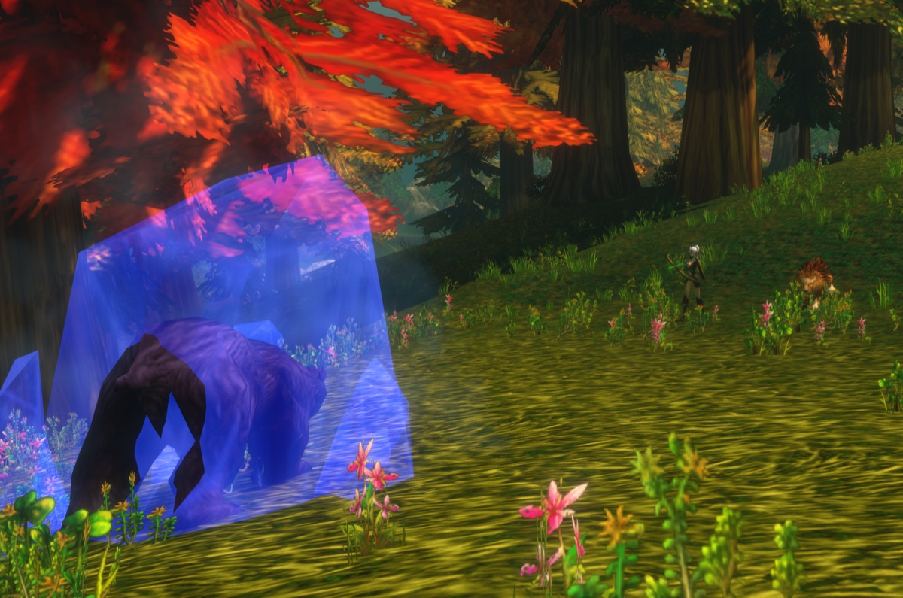
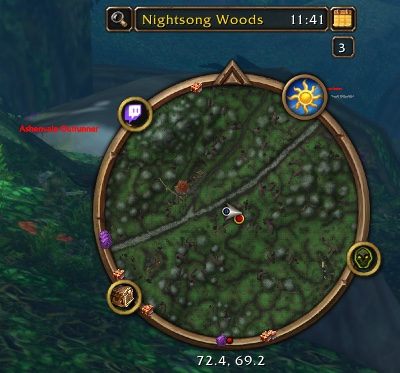

El Hunter es una de las clases más fuertes para subir de nivel. Haces daño a distancia, controlas a los monstruos con trampas y ralentizaciones, y tu mascota recibe los golpes. Los 10 primeros niveles son lentos, hasta que domas una mascota y recibes tu primer punto de talento. En WoW Forever, nuevas habilidades de mascota y nuevos talentos dan más profundidad a la clase. Esta guía cubre las builds, la rotación, los niveles clave, el equipo, las mascotas, las trampas y el rastreo.

| | |
|---|---|
| Spec más fácil para subir | Beast Mastery |
| Talentos clave | <a class="wf-wh wf-spell" href="https://www.wowhead.com/forever/spell=19552">Deadly Aspects</a>, Unleashed Fury, <a class="wf-wh wf-spell" href="https://www.wowhead.com/forever/spell=19598">Ferocity</a>, Summon Hawk, <a class="wf-wh wf-spell" href="https://www.wowhead.com/forever/spell=1223755">Focused Fire</a> |
| Fuerte en | Daño a distancia, una mascota que tanquea, control, viajes rápidos |
| Débil en | Un comienzo lento hasta el nivel 10, el maná y la munición |
| Orden de talentos por nivel | [Build de subida del Hunter](/es/leveling/hunter/) |
| Guías por spec | [Beast Mastery Hunter](/es/guides/beast-mastery-hunter/), [Marksmanship Hunter](/es/guides/marksmanship-hunter/), [Survival Hunter](/es/guides/survival-hunter/) |
| Builds hasta nivel 60 | Sí, la [build de subida](/es/leveling/hunter/) llega al 60 |

## Con qué spec subir

Los tres árboles sirven para subir. **Beast Mastery** es el más fluido: tu mascota hace más daño y aguanta más, y con <a class="wf-wh wf-spell" href="https://www.wowhead.com/forever/spell=2649">Growl</a> mantiene al monstruo sobre ella mientras disparas. **Marksmanship** hace más daño con tus propios disparos, así que robas la amenaza más a menudo y tienes que kitear. **Survival** mezcla cuerpo a cuerpo, trampas y disparos, y es la que más exige.
## Niveles 1 a 10

Empiezas sin talentos y sin mascota, con <a class="wf-wh wf-spell" href="https://www.wowhead.com/forever/spell=75">Auto Shot</a> y Raptor Strike. Los monstruos te alcanzan rápido, así que a menudo los rematas cuerpo a cuerpo.

1. Mantén <a class="wf-wh wf-spell" href="https://www.wowhead.com/forever/spell=13163">Aspect of the Monkey</a> en cuanto lo tengas, a nivel 4.
2. Atrae con Auto Shot.
3. Lanza <a class="wf-wh wf-spell" href="https://www.wowhead.com/forever/spell=1978">Serpent Sting</a>.
4. Lanza Arcane Shot cada vez que esté listo.
5. Lanza <a class="wf-wh wf-spell" href="https://www.wowhead.com/forever/spell=5116">Concussive Shot</a> para ralentizar al monstruo y mantener la distancia.
6. Retrocede entre disparos.
7. Usa Raptor Strike cuando el monstruo te alcance, y remátalo cuerpo a cuerpo.

Empieza cada pull desde lo más lejos posible: cada metro de más es un disparo más. Stats a estos niveles: Agility, luego poder de ataque, luego Intellect, luego Stamina y Spirit, luego armadura.

## Builds de talentos

La [build de nivel del Hunter](/es/leveling/hunter/) da el talento de cada nivel del 10 al 60. [Abre el resultado final en la calculadora de talentos](/es/talents/hunter/?t=5120221405101241-00503520005).

Para el nivel 60, cada guía de especialización tiene sus propias builds para bandas, subir de nivel y PvP: [Beast Mastery](/es/guides/beast-mastery-hunter/), [Survival](/es/guides/survival-hunter/) y [Marksmanship](/es/guides/marksmanship-hunter/).

## Niveles clave

| Nivel | Qué consigues | De dónde |
|---|---|---|
| 1 | Auto Shot, Raptor Strike, <a class="wf-wh wf-spell" href="https://www.wowhead.com/forever/spell=1494">Track Beasts</a> | Por defecto, instructor de clase |
| 4 | Aspect of the Monkey, Serpent Sting | Instructor de clase |
| 6 | Arcane Shot, <a class="wf-wh wf-spell" href="https://www.wowhead.com/forever/spell=1130">Hunter's Mark</a> | Instructor de clase |
| 8 | Concussive Shot | Instructor de clase |
| 10 | <a class="wf-wh wf-spell" href="https://www.wowhead.com/forever/spell=1515">Tame Beast</a>, <a class="wf-wh wf-spell" href="https://www.wowhead.com/forever/spell=5149">Beast Training</a> | Misión de clase |
| 10 | <a class="wf-wh wf-spell" href="https://www.wowhead.com/forever/spell=6991">Feed Pet</a>, <a class="wf-wh wf-spell" href="https://www.wowhead.com/forever/spell=982">Revive Pet</a>, <a class="wf-wh wf-spell" href="https://www.wowhead.com/forever/spell=883">Call Pet</a>, <a class="wf-wh wf-spell" href="https://www.wowhead.com/forever/spell=2641">Dismiss Pet</a>, Aspect of the Hawk, <a class="wf-wh wf-spell" href="https://www.wowhead.com/forever/spell=19883">Track Humanoids</a> | Instructor de clase |
| 10 | Primer punto de talento | Árbol de talentos |
| 12 | <a class="wf-wh wf-spell" href="https://www.wowhead.com/forever/spell=136">Mend Pet</a>, Wing Clip | Instructor de clase |
| 14 | <a class="wf-wh wf-spell" href="https://www.wowhead.com/forever/spell=1513">Scare Beast</a>, <a class="wf-wh wf-spell" href="https://www.wowhead.com/forever/spell=6197">Eagle Eye</a>, <a class="wf-wh wf-spell" href="https://www.wowhead.com/forever/spell=1002">Eyes of the Beast</a> | Instructor de clase |
| 16 | Mongoose Bite, Immolation Trap | Instructor de clase |
| 18 | <a class="wf-wh wf-spell" href="https://www.wowhead.com/forever/spell=2643">Multi-Shot</a> | Instructor de clase |
| 20 | Aimed Shot, <a class="wf-wh wf-spell" href="https://www.wowhead.com/forever/spell=5118">Aspect of the Cheetah</a>, <a class="wf-wh wf-spell" href="https://www.wowhead.com/forever/spell=1499">Freezing Trap</a> | Instructor de clase |
| 20 | Polearms | Instructor de armas |
| 22 | Scorpid Sting | Instructor de clase |
| 24 | <a class="wf-wh wf-spell" href="https://www.wowhead.com/forever/spell=19885">Track Hidden</a> | Instructor de clase |
| 25 | Summon Hawk, Trueshot Aura | Árbol de talentos |
| 26 | Rapid Fire, <a class="wf-wh wf-spell" href="https://www.wowhead.com/forever/spell=19880">Track Elementals</a> | Instructor de clase |
| 28 | Frost Trap | Instructor de clase |
| 30 | Feign Death, Aspect of the Beast | Instructor de clase |
| 30 | Intimidation, Strider Kick, Expose Prey, Scatter Shot | Árbol de talentos |
| 32 | <a class="wf-wh wf-spell" href="https://www.wowhead.com/forever/spell=1543">Flare</a>, <a class="wf-wh wf-spell" href="https://www.wowhead.com/forever/spell=19878">Track Demons</a> | Instructor de clase |
| 34 | <a class="wf-wh wf-spell" href="https://www.wowhead.com/forever/spell=13813">Explosive Trap</a> | Instructor de clase |
| 36 | <a class="wf-wh wf-spell" href="https://www.wowhead.com/forever/spell=3034">Viper Sting</a> | Instructor de clase |
| 40 | <a class="wf-wh wf-spell" href="https://www.wowhead.com/forever/spell=13159">Aspect of the Pack</a>, <a class="wf-wh wf-spell" href="https://www.wowhead.com/forever/spell=19882">Track Giants</a> | Instructor de clase |
| 40 | <a class="wf-wh wf-spell" href="https://www.wowhead.com/forever/spell=19574">Bestial Wrath</a>, Sniper Shot, Lacerating Strikes | Árbol de talentos |
| 40 | Equitación, Dual Specialization | Instructores |
| 46 | <a class="wf-wh wf-spell" href="https://www.wowhead.com/forever/spell=20043">Aspect of the Wild</a> | Instructor de clase |
| 50 | <a class="wf-wh wf-spell" href="https://www.wowhead.com/forever/spell=19879">Track Dragonkin</a> | Instructor de clase |
| 60 | <a class="wf-wh wf-spell" href="https://www.wowhead.com/forever/spell=19801">Tranquilizing Shot</a> | Instructor de clase |

Aimed Shot ya no es un talento: todo Hunter lo aprende a nivel 20. Los niveles de los talentos son los más tempranos sin Talented; con Talented los alcanzas hasta cinco niveles antes.

## La misión de clase

A nivel 10, todo Hunter hace Taming the Beast. La cadena enseña Tame Beast y Beast Training, para domar y entrenar tu primera mascota. Empieza en tu zona inicial: Teldrassil para los Night Elves, Dun Morogh para los Dwarves, [Zephras Isle](/es/guides/zephras-isle/) para el High Order Skyborne, Mulgore para los Tauren y Durotar para los Orcs y los Trolls.

## Dónde subir

El nivel mínimo recomendado de cada zona. Los niveles de las mazmorras están en la [guía de mazmorras](/es/guides/dungeons/).

| Nivel | Zonas |
|---|---|
| **1** | Elwynn Forest, Dun Morogh, Teldrassil, [Zephras Isle](/es/guides/zephras-isle/), Durotar, Mulgore, Tirisfal Glades |
| **10** | Westfall, Loch Modan, Darkshore, The Barrens, Silverpine Forest |
| **15** | Redridge Mountains, Stonetalon Mountains |
| **18** | Ashenvale |
| **20** | Wetlands, Hillsbrad Foothills, Duskwood |
| **25** | Thousand Needles |
| **30** | Alterac Mountains, Arathi Highlands, Desolace, Riverglades, Stranglethorn Vale |
| **35** | Badlands, Dustwallow Marsh, Feralas, Swamp of Sorrows |
| **40** | Shen'dralas, Tanaris, The Hinterlands |
| **43** | Searing Gorge |
| **45** | Azshara, Felwood, Blasted Lands |
| **48** | Un'Goro Crater |
| **50** | Burning Steppes, Western Plaguelands |
| **53** | Winterspring, Eastern Plaguelands |
| **55** | Silithus, Deadwind Pass |
| **60** | Mount Hyjal |

## Armas

Un Hunter puede usar más tipos de armas que cualquier otra clase. La mayoría las aprendes con un instructor de armas.

| Arma | Alianza | Horda |
|---|---|---|
| **Daggers** | Conocidas desde el inicio | Conocidas desde el inicio |
| **Axes de una y dos manos** | Buliwyf Stonehand (Ironforge) | Hanashi, Sayoc (Orgrimmar) |
| **Swords de una y dos manos** | Woo Ping (Stormwind) | Archibald (Undercity) |
| **Fist weapons** | Ilyenia Moonfire (Darnassus), Buliwyf Stonehand (Ironforge) | Sayoc (Orgrimmar) |
| **Staves** | Ilyenia Moonfire (Darnassus), Woo Ping (Stormwind) | Hanashi, Sayoc (Orgrimmar), Ansekhwa (Thunder Bluff) |
| **Polearms**, desde el nivel 20 | Woo Ping (Stormwind) | Archibald (Undercity) |
| **Bows** | Ilyenia Moonfire (Darnassus) | Hanashi, Sayoc (Orgrimmar) |
| **Crossbows** | Bixi Wobblebonk (Ironforge), Woo Ping (Stormwind) | Archibald (Undercity) |
| **Guns** | Buliwyf Stonehand (Ironforge) | Ansekhwa (Thunder Bluff) |
| **Thrown** | Bixi Wobblebonk (Ironforge), Ilyenia Moonfire (Darnassus) | Hanashi, Sayoc (Orgrimmar) |

Cada vez que aprendes un nuevo tipo de arma, primero tienes que subir su habilidad antes de acertar con fiabilidad.

## Equipo

**Las armas a distancia** son tu principal fuente de daño. Estas son buenas opciones del nivel 13 al 30:

| Nivel | Objeto | Origen |
|---|---|---|
| 13 a 16 | <a class="wf-wh wf-q3" href="https://www.wowhead.com/forever/item=272999">Barbaric Crossbow</a> | Ragefire Chasm |
| 13 a 16 | <a class="wf-wh wf-q3" href="https://www.wowhead.com/forever/item=279894">Calibrated Blunderbuss</a> | Misión en el Hall of Thanes, solo Alianza |
| 19 a 22 | <a class="wf-wh wf-q3" href="https://www.wowhead.com/forever/item=6469">Venomstrike</a> | Wailing Caverns |
| 22 a 29 | <a class="wf-wh wf-q3" href="https://www.wowhead.com/forever/item=3078">Naga Heartpiercer</a> | Blackfathom Deeps |
| 23 a 29 | <a class="wf-wh wf-q3" href="https://www.wowhead.com/forever/item=273843">Fallenroot Longbow</a> | Blackfathom Deeps |
| 29 a 30 | <a class="wf-wh wf-q3" href="https://www.wowhead.com/forever/item=274084">Quilboar Blaster</a> | Misión en Razorfen Kraul |

**Las armas cuerpo a cuerpo** importan sobre todo para Survival, que se apoya en el daño del arma. Para las otras specs, un arma cuerpo a cuerpo sirve sobre todo para llevar stats.

**Equipo fabricado y botín de mazmorra.** Leatherworking recibió pronto recetas nuevas y fuertes, como <a class="wf-wh wf-q3" href="https://www.wowhead.com/forever/item=252425">Dark Leather Boots</a>, <a class="wf-wh wf-q3" href="https://www.wowhead.com/forever/item=252504">Brawler's Leather Hood</a> y <a class="wf-wh wf-q3" href="https://www.wowhead.com/forever/item=252521">Stalker's Leather Belt</a>. Las mazmorras dan mejoras como <a class="wf-wh wf-q3" href="https://www.wowhead.com/forever/item=271212">Bloodied Chestwraps</a> y <a class="wf-wh wf-q3" href="https://www.wowhead.com/forever/item=9624">Triprunner Dungarees</a>.

## Profesiones

Sube tus profesiones a la vez que tu Hunter, para recolectar y fabricar al nivel adecuado. Los campamentos dan buffs a cada profesión, y en Forever tu mascota también los recibe.

- **Cooking** es imprescindible: la comida con buff da experiencia extra, y la necesitas para una hoguera.
- **Leatherworking** fabrica buen equipo de subida ligado y da un buff de experiencia descansada en tu campamento.
- **Skinning** va con Leatherworking, y Aspect of the Cheetah te lleva rápido de un monstruo a otro. Su buff de campamento da un 2% de probabilidad de crítico.
- **Herbalism** encaja con un Hunter siempre en marcha. Su buff de campamento da Intellect.
- **Alchemy** va con Herbalism, para las pociones. Su buff de campamento da regeneración de maná.
- **Engineering** fabrica artilugios, explosivos y miras para tu arma a distancia. El Reagent Bot del campamento vende comida, agua y materiales.
- **Mining** va con Engineering. Su buff de campamento da poder de ataque cuerpo a cuerpo, bueno para Survival y tu mascota.
- **Fishing** va con Cooking. Su buff de campamento sube todos los stats un 8%.
- **First Aid** da vendas y pociones. Su buff de campamento da Stamina a ti y a tu mascota.

## Consumibles

- **Comida y agua.** Mantente Well Fed por la experiencia extra; cualquier comida con buff es mejor que nada. Lleva agua de tu nivel, porque tendrás que beber.
- **Pociones.** Pociones de sanación para emergencias, ahora también de First Aid. First Aid también fabrica remedios contra Poisons, Diseases y Bleeds, que un Hunter no puede quitar de otra forma. Las pociones de maná también ayudan.
- **Los elixires** con los stats adecuados son caros de mantener, pero merecen la pena para una misión o un monstruo difícil.
- **Munición.** Mantén lleno tu carcaj o tu bolsa de munición. Sin flechas ni balas no puedes disparar.

## Mascotas

Tu mascota es el corazón de la clase. Vigila dónde está, qué habilidades usa y sus reutilizaciones: así puedes reaccionar a lo que hace un monstruo, o evitar el peligro del todo. En Forever tu mascota también recibe los buffs de Camping, siempre que esté invocada mientras te sientas junto a la hoguera. Desde el 10 de noviembre tu mascota tiene el 115% de su salud normal en lugar del 150%, que era un error, [más en nuestra noticia](/es/news/hunter-pets-lose-health-and-warlock-pets-gain-it/).

Las habilidades de mascota añaden utilidad, como <a class="wf-wh wf-spell" href="https://www.wowhead.com/forever/spell=24423">Demoralizing Screech</a> y <a class="wf-wh wf-spell" href="https://www.wowhead.com/forever/spell=7272">Dust Cloud</a>.

## Control y pulls

Los Hunters destacan en el control: Frost Trap, Freezing Trap, Wing Clip y Concussive Shot, reforzados con Entrapment, Clever Traps, Improved Concussive Shot y <a class="wf-wh wf-spell" href="https://www.wowhead.com/forever/spell=19228">Improved Wing Clip</a>. Scatter Shot e Intimidation añaden más. Tu mejor herramienta sigue siendo tu mascota, que retiene al monstruo mientras tú mantienes la distancia.

Scare Beast hace huir de miedo a una Beast hasta 10 segundos en el rango 1. Puede correr hacia otro grupo, así que úsalo con cuidado. En PvP funciona contra las mascotas de los Hunters y los Druids en forma animal.

Puedes atraer casi cualquier cosa desde lejos con un disparo. Los Hunters también encadenan bien: Serpent Sting y tus trampas de fuego siguen haciendo efecto mientras pasas al siguiente monstruo. Cuidado con los monstruos que siguen vivos, porque pueden correr hacia otro grupo.

## Movimiento

- **Aspect of the Cheetah** da un 30% de velocidad, pero quedas Dazed 4 segundos si recibes daño. Pathfinding añade hasta un 6%.
- **Aspect of the Pack** desde el nivel 40 hace lo mismo para tu grupo, con el mismo riesgo para todos. Bueno para viajar, no en combate.
- **<a class="wf-wh wf-spell" href="https://www.wowhead.com/forever/spell=5384">Feign Death</a>** te saca del combate. Úsalo para cruzar una zona peligrosa o para despojar algo mientras te atacan.
- **Tu mascota** puede alejar a los monstruos de ti, para cruzar una zona llena sin luchar contra todo.

## Maná

Los Hunters usan maná para todo, y hechizos como Aimed Shot cuestan mucho. Lleva agua y algunas pociones de maná. Cada árbol tiene un talento para el maná en combate: <a class="wf-wh wf-spell" href="https://www.wowhead.com/forever/spell=19590">Bestial Discipline</a>, Rapid Recuperation y Resourcefulness. Por eso el Spirit es valioso mientras subes. No gastes nunca todo tu maná: guarda lo suficiente para una trampa o Feign Death si un pull sale mal.

## Rastreo

El rastreo muestra en tu minimapa a los monstruos de un tipo. Ayuda a todo Hunter, sobre todo a Survival gracias a Improved Tracking. En PvE ves llegar las patrullas, en PvP ves a los jugadores enemigos. Track Hidden revela a los jugadores en sigilo.

| Color | Significado |
|---|---|
| **Verde con borde plateado** | Jugador aliado |
| **Verde con borde dorado** | PNJ aliado |
| **Rojo con borde plateado** | Jugador enemigo |
| **Rojo con borde dorado** | PNJ enemigo |
| **Dorado con borde dorado** | PNJ neutral, hostil en cuanto lo atacas |

## Aspects y reutilizaciones

Solo puede haber un Aspect activo a la vez.

| Aspect | Qué hace |
|---|---|
| **Aspect of the Hawk** | Más poder de ataque a distancia |
| **Aspect of the Beast** | Más poder de ataque cuerpo a cuerpo, y no se te puede rastrear |
| **Aspect of the Monkey** | Un 8% más de esquiva |
| **Aspect of the Cheetah** | Un 30% de velocidad, Dazed si te golpean |
| **Aspect of the Pack** | Un 30% de velocidad para tu grupo, Dazed si os golpean |
| **Aspect of the Wild** | Resistencia a la naturaleza para tu grupo |

- **Scorpid Sting** ha cambiado: reduce un 2% la probabilidad de golpe del objetivo durante 20 segundos. No se acumula con <a class="wf-wh wf-spell" href="https://www.wowhead.com/forever/spell=5570">Insect Swarm</a> de un Balance Druid, pero ayuda a tu tanque contra jefes cuando no hay Druid.
- **Tranquilizing Shot** a nivel 60 elimina un efecto de Frenzy de un monstruo. Importante en bandas.
- **Rapid Fire** aumenta tu velocidad de ataque a distancia y cuerpo a cuerpo un 40% durante 15 segundos, con 5 minutos de reutilización. Rapid Killing en Marksmanship le quita 2 minutos.
- **Grandes talentos:** Bestial Wrath para Beast Mastery, Sniper Shot para Marksmanship y Strider Kick para Survival.
- **Flare** revela a los enemigos ocultos e invisibles en un radio de 10 metros durante 30 segundos.
- **Eagle Eye** te deja mirar muy lejos, con alcance ilimitado, solo al aire libre.
- **Eyes of the Beast** te deja controlar directamente a tu mascota, por ejemplo para explorar o atraer desde lejos.

Más sobre comida, campamentos y experiencia descansada en la [guía de experiencia](/es/guides/experience/).
