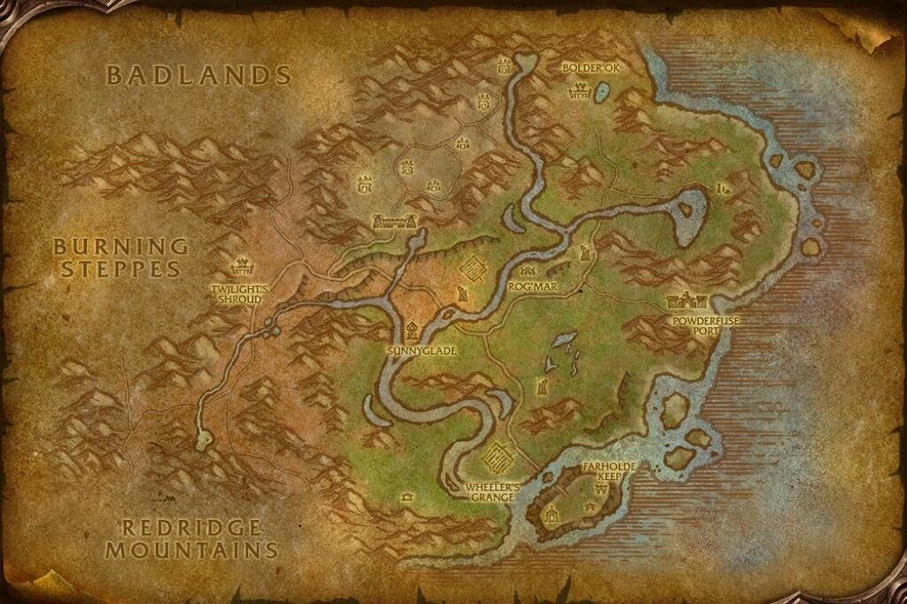
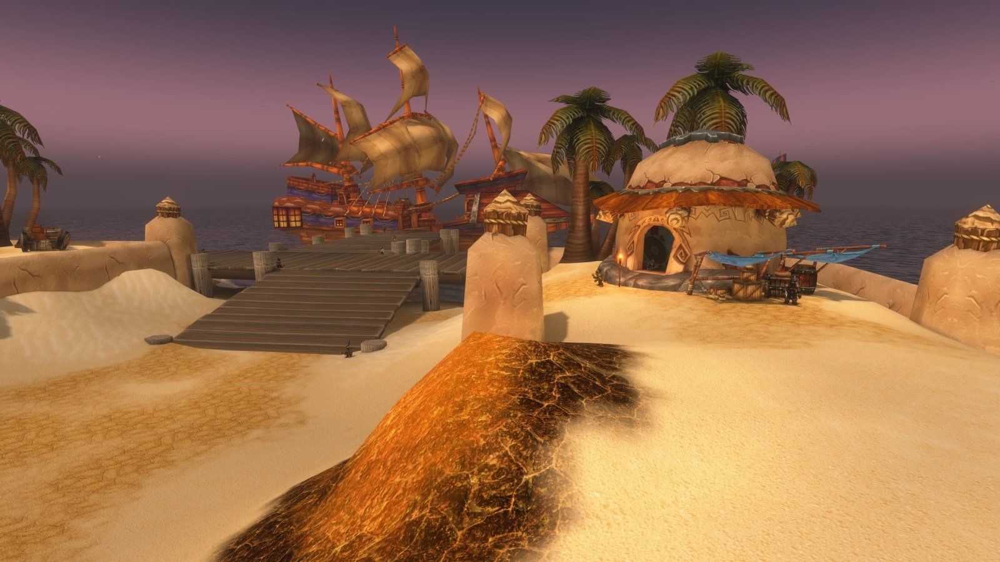
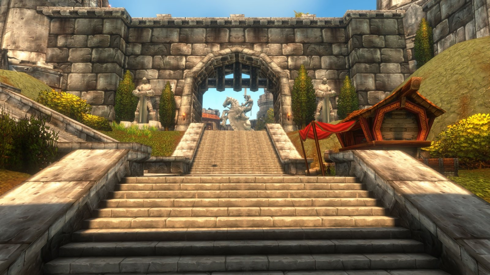
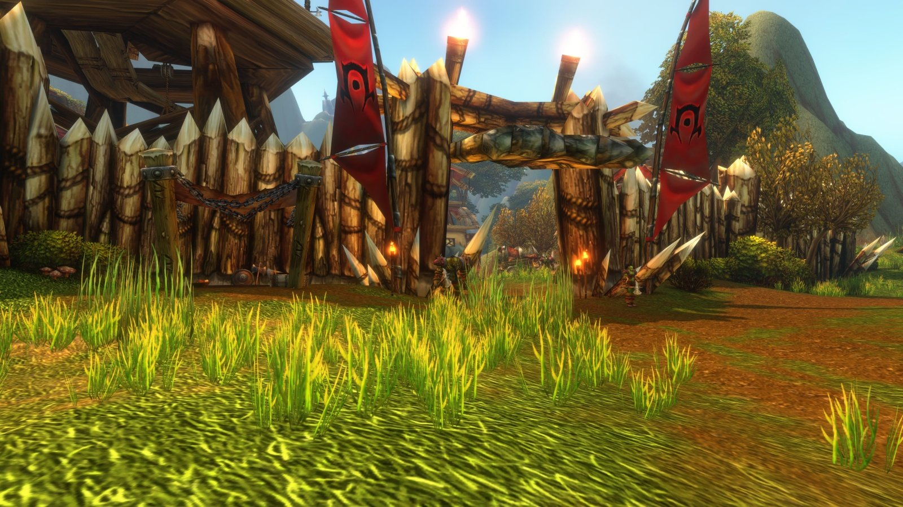
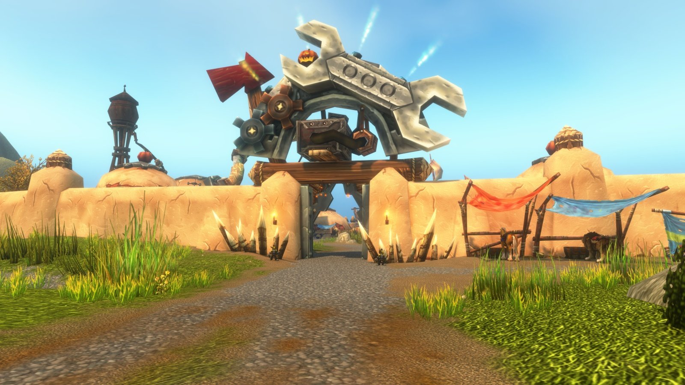
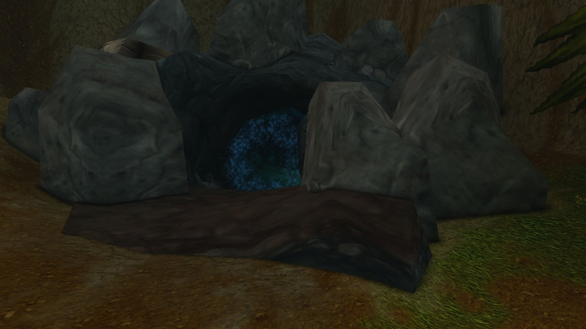

Riverglades es una zona nueva de WoW Forever, en la costa este de los Reinos del Este. Ríos, praderas y fortalezas en ruinas se extienden entre Redridge Mountains, las Burning Steppes y los Badlands. Muchos jugadores la llaman la mejor zona para subir de nivel de Forever. Esta guía explica cómo llegar, los pueblos, las misiones, el Bloodmaster's Ring y la mazmorra.

| | |
|---|---|
| Niveles | Unos 36 a 44, mejor desde 40 |
| Limita con | Redridge Mountains, Burning Steppes, Badlands |
| Alianza | Farholde Keep, Brotherhood of the Horse |
| Horda | Rog'mar, Bolder'ok Clan |
| Neutral | Powderfuse Port, un pueblo goblin |
| Mazmorra | [Krol'dok Stronghold](/es/guides/dungeons/kroldok-stronghold/), niveles 40 a 45 |

## Cómo llegar

Hay tres formas de entrar:

- **Desde Redridge Mountains**, el camino más rápido para la Alliance. Desde Lakeshire, sigue el camino hacia el norte hasta el borde del mapa, en dirección a la puerta de las Burning Steppes. En el cruce, un poste indica las Riverglades: toma el camino de la derecha y tras un breve paseo estás en las Bristle Hills, al oeste de la zona. Después el camino baja hacia el sur hasta Farholde Keep, la base de la Alliance.
- **Desde los Badlands**, por el camino del sur de la zona. Para la Horda es la entrada más fácil sin el punto de vuelo.
- **En barco** desde Steamwheedle Port en Tanaris, al este de Gadgetzan (/way 68.6 23.0). El barco atraca en Powderfuse Port (/way 80.6 54.6). La vuelta a Kalimdor funciona igual. Desde el puerto, la Horde sigue el camino hasta Rog'mar.

<figure class="wf-embed" data-wf-video="JYy08rjb3K4">
  <button type="button" class="wf-embed__play">
    
    
      How to get to the Riverglades in WoW Forever
      Reproduce el vídeo. Nutri en YouTube, 6 minutos.
    
  </button>
</figure>

## Pueblos y puntos de vuelo

- **Farholde Keep**, en el sur, es el pueblo de la Alianza y el hogar de la Brotherhood of the Horse, la caballería que dejó Stormwind. El maestro de vuelo <a class="wf-wh wf-plain" href="https://www.wowhead.com/forever/npc=257087">Gretchen Mayberry</a> está en /way 60.6 81.4.
- **Rog'mar**, en el centro de la zona, es el campamento de la Horda. El maestro de vuelo <a class="wf-wh wf-plain" href="https://www.wowhead.com/forever/npc=255993">Grakna</a> está en /way 59.6 45.2.
- **Powderfuse Port**, en la costa este, es un pueblo goblin neutral con el barco a Tanaris y la [Black Market Auction House](/es/guides/bmah/). No tiene maestro de vuelo.

Los destinos de cada punto de vuelo están en la [guía de rutas de vuelo](/es/guides/flight-paths/).

## Misiones

Las misiones de Riverglades son más lineales que en la mayoría de zonas de Classic. Terminas una ronda y la siguiente suele aparecer en el mismo pueblo. Los jugadores también notan poca competencia por los monstruos. Todas las misiones de la zona juntas valen unos 4 a 5 niveles.

La Alianza trabaja para la Brotherhood of the Horse, la Horda para el Bolder'ok Clan. Ambas luchan entre sí y contra el Twilight's Hammer. La historia de Farholde Keep está en el relato [Cost of Honor](/es/news/cost-of-honor-tells-the-past-of-the-riverglades/).

**Una misión oculta para la Horda.** <a class="wf-wh wf-plain" href="https://www.wowhead.com/forever/npc=257079">Cavalry Scout Alturin</a> cabalga por el camino principal que sale de Farholde Keep. Mátalo y suelta <a href="https://www.wowhead.com/forever/quest=93971">Farholde Scouting Report</a>, una misión sin misión previa que entregas en Rog'mar por 4.850 de experiencia. Atacarlo te activa el JcJ.

**Lleva estos objetos.** Algunas misiones piden objetos que puedes comprar o fabricar en casa. Te ahorras un viaje si los llevas:

| Objeto | Misión | Facción |
|---|---|---|
| 10 <a class="wf-wh wf-q1" href="https://www.wowhead.com/forever/item=769">Chunk of Boar Meat</a> | <a href="https://www.wowhead.com/forever/quest=95162">Paletusk Harvesting</a> | Horda |
| 10 <a class="wf-wh wf-q1" href="https://www.wowhead.com/forever/item=3241">Heavy Weightstone</a> | <a href="https://www.wowhead.com/forever/quest=96026">Step Two: More Rock</a> | Horda |
| 12 <a class="wf-wh wf-q1" href="https://www.wowhead.com/forever/item=3575">Iron Bar</a> y 4 <a class="wf-wh wf-q1" href="https://www.wowhead.com/forever/item=4304">Thick Leather</a> | <a href="https://www.wowhead.com/forever/quest=94974">Key Ingredients</a> | Horda |
| 12 <a class="wf-wh wf-q1" href="https://www.wowhead.com/forever/item=3575">Iron Bar</a> y 4 <a class="wf-wh wf-q1" href="https://www.wowhead.com/forever/item=4304">Thick Leather</a> | <a href="https://www.wowhead.com/forever/quest=94981">Key Ingredients</a> | Alianza |

Key Ingredients forma parte de la cadena para la llave de Krol'dok Stronghold, ver más abajo.

**Arreglos recientes.** Las correcciones del 13 de noviembre arreglaron tres cosas aquí: Jezap Jinglesprocket, anfitrión del Bloodmaster's Ring, vuelve a dar sus misiones, Gaseous Gold muestra la cantidad correcta, y las pilas de leña solo se pueden saquear durante su misión. Tres enemigos [pegan más flojo desde el 11 de noviembre](/es/news/judgement-now-counts-as-a-ranged-attack/).

## El Bloodmaster's Ring

El Bloodmaster's Ring es un foso de lucha al estilo del Ring of Blood, en /way 65.6 21.4 en territorio ogro. Luchas uno a uno contra luchadores Bolder'ok cada vez más fuertes. Cada combate da más o menos tanta experiencia como una misión de mazmorra. En un reino JcJ puede haber mucha gente de la otra facción.

1. <a href="https://www.wowhead.com/forever/quest=94668">Bloodmaster's Ring</a>: preséntate a Jezap en el ring.
2. <a href="https://www.wowhead.com/forever/quest=94669">Pay to Play</a>: paga la fianza de 1 de oro para entrar.
3. Combates: <a href="https://www.wowhead.com/forever/quest=94670">Bloodmaster's Ring</a>, <a href="https://www.wowhead.com/forever/quest=94739">Bloodmaster's Ring</a>, <a href="https://www.wowhead.com/forever/quest=94962">Bloodmaster's Ring</a> y <a href="https://www.wowhead.com/forever/quest=94964">Bloodmaster's Ring</a>, contra Mog'thar a nivel 43.
4. Desvío, aún sin confirmar: <a href="https://www.wowhead.com/forever/quest=94733">Our Ogre Friend</a>, <a href="https://www.wowhead.com/forever/quest=94734">A Boar's Delight</a> y <a href="https://www.wowhead.com/forever/quest=94737">A Treat for a Friend</a>.
5. Últimos combates: <a href="https://www.wowhead.com/forever/quest=94965">Bloodmaster's Ring</a> y <a href="https://www.wowhead.com/forever/quest=95063">Bloodmaster's Ring</a>.

Tras Snufflesnout eliges 3 <a class="wf-wh wf-q1" href="https://www.wowhead.com/forever/item=3928">Superior Healing Potion</a> o 2 <a class="wf-wh wf-q1" href="https://www.wowhead.com/forever/item=13443">Superior Mana Potion</a>. Toda la cadena termina con la elección entre tres anillos de nivel 45:

| Anillo | Stats |
|---|---|
| <a class="wf-wh wf-q3" href="https://www.wowhead.com/forever/item=275043">Bloodmaster's Ring</a> | 7 Aguante, 6 Intelecto, hasta 9 de daño y sanación con hechizos |
| <a class="wf-wh wf-q3" href="https://www.wowhead.com/forever/item=275044">Bloodsport Band</a> | 6 Aguante, 5 de salud cada 5 segundos, 22 de poder de ataque |
| <a class="wf-wh wf-q3" href="https://www.wowhead.com/forever/item=275045">Ogre Horn Ring</a> | 4 Fuerza, 3 Agilidad, 10 Aguante, 3 Defensa |

Más sobre el foso en [el post sobre el ring](/es/news/the-riverglades-get-their-own-ring-of-blood/).

## Krol'dok Stronghold

La mazmorra de la zona es una fortaleza ogra para los niveles 40 a 45, con seis jefes. La entrada está en las colinas al norte de Sunnyglade, al noreste de Twilight's Shroud, en /way 37.5 37.5. El ángel de la resurrección está justo fuera.

La mayoría de misiones de la mazmorra se abren tras la historia de la zona. En el lado de la Alianza es una cadena de unas diez misiones en Farholde Keep. La excepción cae dentro: <a class="wf-wh wf-plain" href="https://www.wowhead.com/forever/npc=259256">Tunk</a> suelta la Krol'dok Moulding, que empieza la cadena para una llave a un atajo en la mazmorra. Jefes, misiones y botín están en la [guía de Krol'dok Stronghold](/es/guides/dungeons/kroldok-stronghold/).

## Mascotas raras de Hunter

Los Hunters pueden domesticar tres bestias raras en los Riverglades, todas de nivel 41 o 42. Cada una es también el objetivo de una misión, así que otros jugadores también las matan. Solo puedes domesticar una bestia hasta tu propio nivel.

| Mascota | Familia | Nivel | Dónde |
|---|---|---|---|
| <a class="wf-wh wf-plain" href="https://www.wowhead.com/forever/npc=263315">Ombassa</a> | Cat, élite | 41 | /way 59.6 53.6, solo mediante una misión |
| <a class="wf-wh wf-plain" href="https://www.wowhead.com/forever/npc=260235">Trapclaw</a> | Crab | 42 | Bajo el agua en /way 82.4 53.5 |
| <a class="wf-wh wf-plain" href="https://www.wowhead.com/forever/npc=263380">Ghostmaw</a> | Crocolisk, élite | 42 | El río central, de Wheeler's Grange (/way 51.3 75.3) a Rog'mar (/way 63.5 36.5) |

- **Ombassa** solo aparece si usas el <a class="wf-wh wf-q1" href="https://www.wowhead.com/forever/item=271779">Tallstrider Call</a> durante <a href="https://www.wowhead.com/forever/quest=95986">King of the Wild Plains</a> (Alianza) o <a href="https://www.wowhead.com/forever/quest=96105">King of the Wild Plains</a> (Horda). Domestícala en la primera llamada: si la matas entonces, ya no puedes llamarla para ti. Después de domesticarla, usa la llamada otra vez, mata a la nueva Ombassa y recoge <a class="wf-wh wf-q1" href="https://www.wowhead.com/forever/item=281052">Ombassa's Hide</a> para la misión. Ataca cada 1,6 segundos y come carne y pescado.
- **Trapclaw** no necesita misión y sigue una ruta fija, pero reaparece despacio. Los jugadores con <a href="https://www.wowhead.com/forever/quest=95254">WANTED: Trapclaw</a> lo matan por <a class="wf-wh wf-q1" href="https://www.wowhead.com/forever/item=268586">Trapclaw's Pincer</a>, así que cuenta con esperar. Ataca cada 2,0 segundos.
- **Ghostmaw** tiene la ruta más larga de las tres. <a href="https://www.wowhead.com/forever/quest=95991">WANTED: Ghostmaw</a> (Alianza) y <a href="https://www.wowhead.com/forever/quest=95992">WANTED: Ghostmaw</a> (Horda) piden su <a class="wf-wh wf-q1" href="https://www.wowhead.com/forever/item=271828">Ghostmaw's Fang</a>, así que aquí también compites con otros jugadores. Ataca cada 2,0 segundos.

Más mascotas y cómo entrenarlas están en la [guía de subida de nivel del Hunter](/es/classes/hunter/leveling/).

## Recolección

Riverglades tiene hierbas y minerales para recolectores de nivel medio.

| Herbalism | Mining |
|---|---|
| <a class="wf-wh wf-q1" href="https://www.wowhead.com/forever/item=3821">Goldthorn</a> | <a class="wf-wh wf-q1" href="https://www.wowhead.com/forever/item=2772">Iron Ore</a> |
| <a class="wf-wh wf-q1" href="https://www.wowhead.com/forever/item=3358">Khadgar's Whisker</a> | <a class="wf-wh wf-q2" href="https://www.wowhead.com/forever/item=2775">Silver Ore</a> |
| <a class="wf-wh wf-q1" href="https://www.wowhead.com/forever/item=3356">Kingsblood</a> | <a class="wf-wh wf-q2" href="https://www.wowhead.com/forever/item=2776">Gold Ore</a> |
| <a class="wf-wh wf-q1" href="https://www.wowhead.com/forever/item=3357">Liferoot</a> | |
| <a class="wf-wh wf-q1" href="https://www.wowhead.com/forever/item=3820">Stranglekelp</a> | |
| <a class="wf-wh wf-q1" href="https://www.wowhead.com/forever/item=3355">Wild Steelbloom</a> | |

Las rutas y los niveles de habilidad están en las guías de [Herbalism](/es/tradeskills/forever/herbalism/) y [Mining](/es/tradeskills/forever/mining/).
