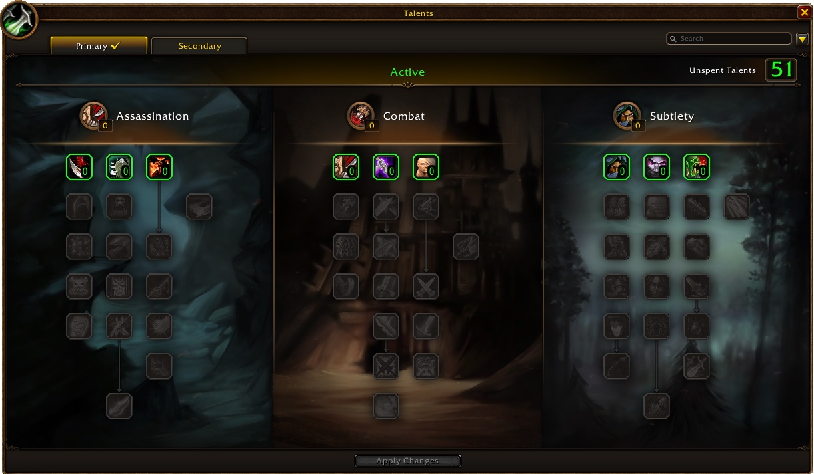

> **Actualización del 4 de noviembre:** las builds y talentos de abajo siguen los árboles nuevos de las notas de desarrollo del 2 de noviembre, más en [nuestra noticia](/es/news/rogues-get-shank-and-death-mark-in-a-big-rework/).

El Rogue nunca fue la clase más fácil de subir, pero WoW Forever ayuda. Los Poisons pueden ser críticos, el daño a un objetivo es mayor y cada spec tiene su propia identidad. En el nivel 30 eliges entre Assassination, Combat y dos estilos de Subtlety. Esta guía cubre las cuatro builds, la rotación, los niveles clave, las misiones de venenos, las armas y las profesiones.

| | |
|---|---|
| Spec más fácil para subir | Combat |
| Talentos clave | Remorseless Attacks, Deflection, Riposte, Venom, Improved Ambush |
| Puntos fuertes | Daño a un objetivo, control, Stealth |
| Puntos débiles | Poca vida, depende del equipo, poca utilidad |
| Talento por nivel | [Build de subida del Rogue](/es/leveling/rogue/) |
| Guías por spec | [Assassination Rogue](/es/guides/assassination-rogue/), [Combat Rogue](/es/guides/combat-rogue/), [Subtlety Rogue](/es/guides/subtlety-rogue/) |
| Builds hasta el nivel 60 | Todavía no, la [build de subida](/es/leveling/rogue/) llega al 35 |

## Con qué spec subir

**Combat** es el comienzo más indulgente. Deflection y Riposte te mantienen con vida, y vas de monstruo en monstruo sin pausas. Gracias a Hack and Slash, Combat también puede usar cualquier tipo de arma. **Subtlety con Ambush** abre desde Stealth con un golpe crítico enorme y mata rápido, pero es más débil en mazmorras. **Subtlety con sangrados** se basa en Garrote, Hemorrhage y Rupture. **Assassination** solo se vuelve fuerte cuando llega Mutilate en el nivel 40, así que no es una build para empezar.

Las builds de abajo se hicieron en la beta, que terminaba en el nivel 30. Cada build tiene una versión con cinco puntos extra por Talented del sistema Legacy. La calculadora de talentos muestra esas versiones como nivel 35, porque cuenta cada punto como un nivel. Las builds para el nivel 60 llegarán cuando podamos probarlas en el juego en vivo.

## Niveles 1 a 10

Aún no tienes talentos, solo <a class="wf-wh wf-spell" href="https://www.wowhead.com/forever/spell=1752">Sinister Strike</a> y <a class="wf-wh wf-spell" href="https://www.wowhead.com/forever/spell=2098">Eviscerate</a>. Stealth, Backstab y Evasion llegan rápido.

1. Genera Combo Points con Sinister Strike.
2. Gástalos con Eviscerate.
3. Con una daga: abre desde Stealth con Backstab para una muerte rápida.
4. Usa Evasion contra un monstruo peligroso.
5. Usa Gouge para interrumpir un hechizo o para escapar.

Abrir desde Stealth en cada monstruo te frena en estos niveles. Guárdalo para los monstruos fuertes y acércate sin más al resto.

Estadísticas en estos niveles: Agility, luego Attack Power, Strength, Stamina y armadura.

## Build de Assassination para el nivel 30

Se hace más fuerte a medida que se acerca Mutilate, en el nivel 40. Ruthlessness da más Combo Points, y Venom refuerza tus venenos tras cada Shank, pero te falta la supervivencia de Combat y el burst de Subtlety. [Abrir la build en la calculadora de talentos](/es/talents/rogue/?t=02530300201401).

| Talento | Puntos |
|---|---|
| **Remorseless Attacks** | 2/2 |
| **Malice** | 5/5 |
| **Ruthlessness** | 3/3 |
| **<a class="wf-wh wf-spell" href="https://www.wowhead.com/forever/spell=14165">Improved Slice and Dice</a>** | 3/3 |
| **Lethality** | 2/2 |
| **Cold Blood** | 1/1 |
| **Improved Poisons** | 4/5 |
| **Venom** | 1/1 |

Con Talented: Relentless Strikes 3/5 y Opportunity 2/5 en Subtlety. [Abrir la versión con Talented](/es/talents/rogue/?t=02530300201431--002).

1. Abre desde Stealth con Ambush.
2. Genera Combo Points con Sinister Strike, y usa Shank en cuanto esté listo.
3. Mantén Slice and Dice activo.
4. Remata con Eviscerate.
5. Usa Expose Armor antes de Eviscerate, y mantenlo en un jefe.
6. Interrumpe con Kick o Gouge, y huye con Vanish.
7. Contra un monstruo peligroso: Cheap Shot y luego Kidney Shot.
8. Ataca al siguiente monstruo antes de que se acabe Remorseless Attacks.

Estadísticas desde aquí para cada build: probabilidad de golpe crítico, luego Agility, Attack Power, Strength, Stamina y armadura.

## Build de Combat para el nivel 30

Defensiva y ofensiva a la vez: más daño con Eviscerate y tus ataques automáticos, y Deflection y Riposte contra las pausas. Flawless Execution, Aggression y Blade Flurry completan la build. [Abrir la build en la calculadora de talentos](/es/talents/rogue/?t=-3200331210011301).

| Talento | Puntos |
|---|---|
| **Coup de Grace** | 3/3 |
| **Efficient Strikes** | 2/2 |
| **Deflection** | 3/3 |
| **Precision** | 3/3 |
| **Improved Sprint** | 1/2 |
| **Endurance** | 2/2 |
| **Riposte** | 1/1 |
| **Flawless Execution** | 1/1 |
| **Weapon Expertise** | 1/2 |
| **Aggression** | 3/3 |
| **Blade Flurry** | 1/1 |

Con Talented: Hack and Slash 5/5. [Abrir la versión con Talented](/es/talents/rogue/?t=-32003312100113015).

¿Mueres demasiado porque tu equipo es flojo? Coge Lightning Reflexes en lugar de Coup de Grace, Improved Sprint y Flawless Execution. Así dependes más de los ataques automáticos y los Poisons que de los remates.

1. Abre desde Stealth con Cheap Shot, o acércate sin más y ataca. Con dagas, abre con Ambush.
2. Usa Blade Flurry al principio de cada combate, contra uno o más monstruos.
3. Genera Combo Points con Sinister Strike.
4. Mantén Slice and Dice activo.
5. Usa Eviscerate con 3 a 5 Combo Points.
6. Usa Expose Armor antes de Eviscerate, y mantenlo en un jefe.
7. Interrumpe con Kick o Gouge, y huye con Vanish.

## Build de Subtlety con Ambush para el nivel 30

Mata lo más rápido posible con Ambush críticos. Entras a menudo en Stealth y aprovechas cada Remorseless Attacks. La mayoría de los monstruos quedan casi muertos tras la apertura. En mazmorras la build es más débil, porque Ambush necesita Stealth. Ghostly Strike te da de vez en cuando un Ambush en combate. [Abrir la build en la calculadora de talentos](/es/talents/rogue/?t=02--333003031021).

| Talento | Puntos |
|---|---|
| **Remorseless Attacks** (Assassination) | 2/2 |
| **Setup** | 3/3 |
| **Master of Deception** | 3/3 |
| **Opportunity** | 3/5 |
| **Improved Ambush** | 3/3 |
| **Initiative** | 3/3 |
| **Premeditation** | 1/1 |
| **Elusiveness** | 2/2 |
| **Ghostly Strike** | 1/1 |

Con Talented: Malice 5/5 en Assassination. [Abrir la versión con Talented](/es/talents/rogue/?t=025--333003031021).

1. Abre desde Stealth con Ambush.
2. Genera Combo Points con Sinister Strike.
3. Remata a un monstruo debilitado con Eviscerate. Contra un monstruo con mucha vida, usa Slice and Dice.
4. Para matar rápido a un objetivo: Gouge, Vanish y otro Ambush.
5. Interrumpe con Kick.
6. En un jefe de mazmorra: Slice and Dice y Expose Armor antes de Eviscerate.
7. Ataca al siguiente monstruo antes de que se acabe Remorseless Attacks.

## Build de Subtlety con sangrados para el nivel 30

Se basa en Garrote, Hemorrhage y Rupture, y en Serrated Blades, que hace que Rupture golpee más fuerte. [Abrir la build en la calculadora de talentos](/es/talents/rogue/?t=--3320002313210001).

| Talento | Puntos |
|---|---|
| **Master of Deception** | 3/3 |
| **Opportunity** | 2/2 |
| **Setup** | 3/3 |
| **Elusiveness** | 2/2 |
| **Dirty Tricks** | 2/2 |
| **Initiative** | 3/3 |
| **Ghostly Strike** | 1/1 |
| **Premeditation** | 1/1 |
| **Serrated Blades** | 3/3 |
| **Hemorrhage** | 1/1 |

Con Talented: Dirty Deeds 2/2, Preparation 1/1 y Malice 2/5 en Assassination. [Abrir la versión con Talented](/es/talents/rogue/?t=002--3322002313210011).

1. Abre desde Stealth con Garrote.
2. Genera Combo Points con Hemorrhage.
3. Mantén Slice and Dice activo.
4. Usa Rupture con 3 a 5 Combo Points en un jefe o en un monstruo con mucha vida.
5. Remata a un monstruo debilitado con Eviscerate.
6. En un jefe: Vanish y un nuevo Garrote en cuanto se acabe el primero.
7. Interrumpe con Kick.
8. Usa Expose Armor en un jefe de mazmorra si tu grupo tiene varios DPS físicos.

Con puntos en Talented del sistema Legacy, llegas a cada talento hasta cinco niveles antes.

## Niveles clave

| Nivel | Qué consigues | De |
|---|---|---|
| 10 | Sap, Slice and Dice, Sprint, Dual Wield | Instructor de clase |
| 10 | Remorseless Attacks, Malice, Coup de Grace, Efficient Strikes, Setup, Opportunity, Master of Deception | Árbol de talentos |
| 14 | Expose Armor, Garrote | Instructor de clase |
| 15 | Ruthlessness, Improved Slice and Dice, Precision, Improved Ambush | Árbol de talentos |
| 16 | Feint, [Pick Lock](/es/guides/lockpicking/) | Instructor de clase |
| 18 | Ambush, Poised | Instructor de clase |
| 20 | Poisons | Misión de clase |
| 20 | Rupture | Instructor de clase |
| 20 | Riposte, Lethality, Premeditation | Árbol de talentos |
| 22 | Distract, Vanish | Instructor de clase |
| 24 | Shank | Instructor de clase |
| 25 | Cold Blood, Flawless Execution, Aggression, Ghostly Strike | Árbol de talentos |
| 26 | Cheap Shot | Instructor de clase |
| 30 | Kidney Shot, Disarm Trap | Instructor de clase |
| 30 | Venom, Relentless Strikes, Blade Flurry, Hemorrhage, Preparation | Árbol de talentos |
| 34 | Blind | Instructor de clase |
| 35 | Seal Fate, Flash of Steel, Boot Knife | Árbol de talentos |
| 40 | Safe Fall, equitación, Dual Specialization | Instructores |
| 40 | Mutilate, Adrenaline Rush, Death Mark | Árbol de talentos |

Las habilidades anteriores vienen del instructor de clase: Stealth en el 1, Backstab y Pick Pocket en el 4, Gouge en el 6, Evasion en el 8, Kick y Parry en el 12.

## Las misiones de venenos

En el nivel 20, una cadena de misiones de clase te enseña los Poisons.

| Paso | Alianza | Horda |
|---|---|---|
| 1 | <a href="https://www.wowhead.com/forever/quest=2360">Mathias and the Defias</a> | <a href="https://www.wowhead.com/forever/quest=2460">The Shattered Salute</a> |
| 2 | <a href="https://www.wowhead.com/forever/quest=2359">Klaven's Tower</a> | <a href="https://www.wowhead.com/forever/quest=2458">Deep Cover</a> |
| 3 | <a href="https://www.wowhead.com/forever/quest=2607">The Touch of Zanzil</a> | <a href="https://www.wowhead.com/forever/quest=2478">Mission: Possible But Not Probable</a> |
| 4 | <a href="https://www.wowhead.com/forever/quest=2608">The Touch of Zanzil</a> | <a href="https://www.wowhead.com/forever/quest=2479">Hinott's Assistance</a> |
| 5 | <a href="https://www.wowhead.com/forever/quest=2609">The Touch of Zanzil</a> | <a href="https://www.wowhead.com/forever/quest=2480">Hinott's Assistance</a> |

Se esperan más misiones de clase con objetos de recompensa por encima del nivel 30, que la beta no alcanzaba.

Cada paso de las dos cadenas, con el punto débil de cada enemigo duro, está en la [guía de los Poisons](/es/guides/poisons/).

## Dónde subir

El nivel mínimo recomendado de cada zona. Los niveles de las mazmorras están en la [guía de mazmorras](/es/guides/dungeons/).

| Nivel | Zonas |
|---|---|
| **1** | Elwynn Forest, Dun Morogh, Teldrassil, [Zephras Isle](/es/guides/zephras-isle/), Durotar, Mulgore, Tirisfal Glades |
| **10** | Westfall, Loch Modan, Darkshore, The Barrens, Silverpine Forest |
| **15** | Redridge Mountains, Stonetalon Mountains |
| **18** | Ashenvale |
| **20** | Wetlands, Hillsbrad Foothills, Duskwood |
| **25** | Thousand Needles |
| **30** | Alterac Mountains, Arathi Highlands, Desolace, Stranglethorn Vale |
| **35** | Badlands, Dustwallow Marsh, Feralas, Riverglades, Swamp of Sorrows |
| **40** | Shen'dralas, Tanaris, The Hinterlands |
| **43** | Searing Gorge |
| **45** | Azshara, Felwood, Blasted Lands |
| **48** | Un'Goro Crater |
| **50** | Burning Steppes, Western Plaguelands |
| **53** | Winterspring, Eastern Plaguelands |
| **55** | Silithus, Deadwind Pass |
| **60** | Mount Hyjal |

## Armas

El daño del arma es la base de casi todas las habilidades del Rogue y de tus ataques automáticos, así que un buen arma marca la mayor diferencia. Assassination y Subtlety prefieren dagas. Combat puede usar cualquier tipo de arma con Hack and Slash: un ataque extra con hachas y espadas, crítico con dagas y armas de puño, y penetración de armadura con mazas. Las hachas de una mano son nuevas para el Rogue en Forever.

| Arma | Alianza | Horda |
|---|---|---|
| **Dagas, hachas de una mano, armas arrojadizas** | Conocidas desde el principio | Conocidas desde el principio |
| **Espadas** | Woo Ping (Stormwind) | Archibald (Undercity) |
| **Mazas** | Buliwyf Stonehand (Ironforge) | Ansekhwa (Thunder Bluff) |
| **Armas de puño** | Ilyenia Moonfire (Darnassus), Buliwyf Stonehand (Ironforge) | Sayoc (Orgrimmar) |
| **Arcos** | Ilyenia Moonfire (Darnassus) | Hanashi (Orgrimmar) |
| **Ballestas** | Bixi Wobblebonk (Ironforge), Woo Ping (Stormwind) | Archibald (Undercity) |
| **Armas de fuego** | Buliwyf Stonehand (Ironforge) | Ansekhwa (Thunder Bluff) |

Armas que destacan camino del 30:

| Arma | Tipo | Nivel |
|---|---|---|
| <a class="wf-wh wf-q3" href="https://www.wowhead.com/forever/item=5192">Thief's Blade</a> | Espada | 17 |
| <a class="wf-wh wf-q3" href="https://www.wowhead.com/forever/item=1937">Buzz Saw</a> | Espada | 18 |
| <a class="wf-wh wf-q3" href="https://www.wowhead.com/forever/item=5191">Cruel Barb</a> | Espada | 19 |
| <a class="wf-wh wf-q3" href="https://www.wowhead.com/forever/item=1482">Shadowfang</a> | Espada, mano principal | 19 |
| <a class="wf-wh wf-q3" href="https://www.wowhead.com/forever/item=1935">Assassin's Blade</a> | Daga | 19 |
| <a class="wf-wh wf-q3" href="https://www.wowhead.com/forever/item=7682">Torturing Poker</a> | Daga | 29 |

## Equipo

El mejor equipo para subir viene de Leatherworking y de las mazmorras. Forever rehízo muchas recetas de cuero tempranas, así que fabricas buenas piezas desde el principio, como <a class="wf-wh wf-q3" href="https://www.wowhead.com/forever/item=252425">Dark Leather Boots</a> en el nivel 10 y <a class="wf-wh wf-q3" href="https://www.wowhead.com/forever/item=252428">Brawler's Leather Belt</a> en el nivel 12. En las mazmorras y sus misiones encuentras piezas como <a class="wf-wh wf-q3" href="https://www.wowhead.com/forever/item=2041">Tunic of Westfall</a> y <a class="wf-wh wf-q3" href="https://www.wowhead.com/forever/item=273820">Nightskulker Ring</a>.

Busca Agility, Attack Power, Strength y Stamina. Un segundo conjunto con Spirit te ayuda a recuperarte antes entre combates. En Forever puedes guardar conjuntos de objetos en la ventana del personaje y cambiar entre ellos.

## Profesiones

Algunas profesiones cambian mucho lo rápido que matas y lo bien que sobrevives. Súbelas junto a tu Rogue para no perder bonus. Los campamentos dan un bufo a cada profesión.

- **Skinning** da buen dinero, porque matas muchas bestias.
- **Leatherworking** es la pareja natural de Skinning y una de las mejores profesiones para un Rogue, con muchas recetas nuevas y rehechas y buen equipo más adelante.
- **Herbalism** da todo para Alchemy, pero las hierbas sueltas se venden por poco.
- **Alchemy** da pociones y elixires, y se vuelve más rentable más adelante.
- **Cooking** es imprescindible: la comida con bufo da experiencia extra, y la necesitas para una hoguera.
- **Fishing** combina bien con Cooking y pesca cajas y cofres.
- **First Aid** te salva en un apuro y ahora también fabrica pociones de sanación.

## Consumibles

- **Comida.** Los Rogues usan Energy, así que no necesitan agua, pero comen mucho. Mantente Well Fed por la experiencia extra, mejor con comida de Attack Power, Agility o Stamina. Lleva también comida de vendedor, para comer la comida con bufo solo cuando se acabe Well Fed.
- **Pociones.** Pociones de sanación de cofres, de monstruos o de First Aid. Los remedios de First Aid contra enfermedades y sangrados merecen la pena, porque un Rogue no puede quitarlos de otra forma.
- **Elixires.** Elixires de batalla como <a class="wf-wh wf-q1" href="https://www.wowhead.com/forever/item=8949">Elixir of Agility</a>, <a class="wf-wh wf-q1" href="https://www.wowhead.com/forever/item=246948">Distilled Firewater</a>, <a class="wf-wh wf-q1" href="https://www.wowhead.com/forever/item=250349">Elixir of Strength</a>, <a class="wf-wh wf-q1" href="https://www.wowhead.com/forever/item=250350">Elixir of Ferocity</a> y <a class="wf-wh wf-q1" href="https://www.wowhead.com/forever/item=250351">Elixir of the Grizzly</a>. Elixires guardianes como <a class="wf-wh wf-q1" href="https://www.wowhead.com/forever/item=5997">Elixir of Minor Defense</a> y <a class="wf-wh wf-q1" href="https://www.wowhead.com/forever/item=3826">Troll's Blood Elixir</a>.
- **Pociones de protección.** <a class="wf-wh wf-q1" href="https://www.wowhead.com/forever/item=6052">Nature Protection Potion</a> y <a class="wf-wh wf-q1" href="https://www.wowhead.com/forever/item=6051">Holy Protection Potion</a> te ayudan a vencer solo a un monstruo difícil o a un jefe. <a class="wf-wh wf-q1" href="https://www.wowhead.com/forever/item=250938">Minor Frenzy Potion</a> da más daño durante un combate.
- **<a class="wf-wh wf-q1" href="https://www.wowhead.com/forever/item=7676">Thistle Tea</a>.** Una bebida de Rogue que da mucha Energy de golpe, para el burst o para huir.

## Poisons y Sharpening Stones

Los Poisons son la seña del Rogue. Instant Poison y Deadly Poison hacen daño, Crippling Poison y Mind-numbing Poison ralentizan a un objetivo, y Wound Poison reduce la sanación. En Forever tienen más cargas, pueden ser críticos y se quedan en el arma junto a una Sharpening Stone como <a class="wf-wh wf-q1" href="https://www.wowhead.com/forever/item=2862">Rough Sharpening Stone</a> o <a class="wf-wh wf-q1" href="https://www.wowhead.com/forever/item=2863">Coarse Sharpening Stone</a>. Según la fuente, ambos también se acumulan con Windfury Totem.

Fabricas los Poisons con componentes como <a class="wf-wh wf-q1" href="https://www.wowhead.com/forever/item=5173">Deathweed</a>, <a class="wf-wh wf-q1" href="https://www.wowhead.com/forever/item=2930">Essence of Pain</a>, <a class="wf-wh wf-q1" href="https://www.wowhead.com/forever/item=8924">Dust of Deterioration</a> y <a class="wf-wh wf-q1" href="https://www.wowhead.com/forever/item=8923">Essence of Agony</a>. Vanish necesita <a class="wf-wh wf-q1" href="https://www.wowhead.com/forever/item=5140">Flash Powder</a> y Blind necesita <a class="wf-wh wf-q1" href="https://www.wowhead.com/forever/item=5530">Blinding Powder</a>.

## Energy y Combo Points

La Energy es tu recurso para casi todas las habilidades, Stealth incluido. Hay tres tipos de habilidades: utilidad y control, habilidades que generan Combo Points, y remates que los gastan. Los Combo Points se quedan en un objetivo. Si los generas en otro monstruo, los antiguos desaparecen. Así que gástalos antes de cambiar de objetivo. Kick y Blind no los tocan.

## Stealth y aperturas

Stealth te hace invisible a cambio de velocidad. Tu barra de acción cambia a las aperturas. Cheap Shot, Garrote y Ambush dan Combo Points, Pick Pocket, Distract y Sap no. En Forever, Sap ya no rompe Stealth, así que puedes sacar un monstruo más de un pull. Más detalles en el [class deep dive](/es/news/rogues-get-mutilate-and-axes-warlocks-get-banes/).

## Control y tiempos de reutilización

El control compensa la poca utilidad. Cheap Shot y Kidney Shot aturden, Blind desorienta, Sap y Gouge incapacitan. Usa un aturdimiento mientras sigues atacando. Blind, Sap y Gouge duran más pero se rompen con el daño, así que úsalos para sacar a un monstruo del combate.

Cada spec tiene sus propios tiempos de reutilización. Assassination tiene Cold Blood para un golpe crítico seguro. Combat tiene Blade Flurry para velocidad y un segundo objetivo, y Adrenaline Rush para Energy. Subtlety tiene Preparation, que termina el tiempo de reutilización de tus otras habilidades, y Premeditation para Combo Points antes del combate. Todo Rogue tiene Evasion, Sprint y Vanish para sobrevivir o escapar. Distract y Pick Lock son tu utilidad; con Pick Lock abres atajos en algunas mazmorras.

Más sobre comida, campamentos y experiencia de descanso en la [guía de experiencia](/es/guides/experience/).
