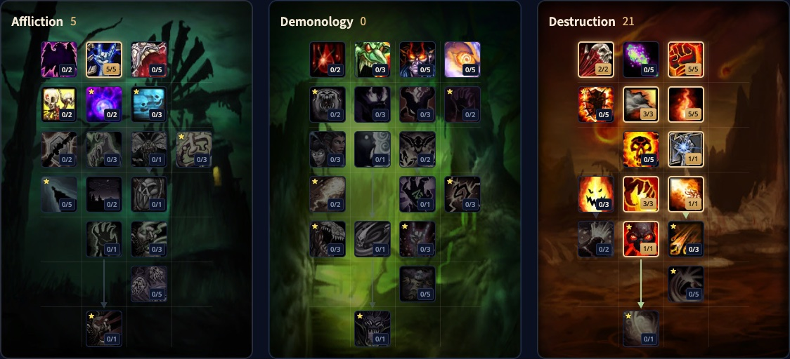

Le Destruction Warlock dans WoW Forever met le feu à tout. Vous répandez Immolate, le faites détoner avec Conflagrate et comblez les trous avec Shadow Bolt. Conflagrate arrive désormais au niveau 25 et Hellfire peut faire des critiques. Ce guide couvre build, rotation, Hellfire, mana et stats.

| | |
|---|---|
| Rôle | Burst à distance et dégâts de zone, au mieux en donjon |
| Build au niveau 30 | 21 points en Destruction et 5 en Affliction, avec les 5 points en plus de Talented |
| Talents clés | Bane, Aftermath, Shadowburn, Conflagrate, Agonizing Flames, Suppression |
| Force | Burst avec Conflagrate et Shadowburn, Hellfire contre les packs |
| Faiblesse | Le mana, la menace, l’immobilité |
| Leveling | [Guide de leveling du Warlock](/fr/guides/warlock-leveling/), [build de leveling du Warlock](/fr/leveling/warlock/) |
| Autres spés | [Affliction Warlock](/fr/guides/affliction-warlock/), [Demonology Warlock](/fr/guides/demonology-warlock/) |

## Ce qui change pour Destruction

- **Conflagrate au niveau 25.** Il est plus haut dans l’arbre, vous l’obtenez donc 15 niveaux plus tôt qu’en Classic.
- **Hellfire peut faire des critiques.** Il arrive au niveau 30 et fait de Destruction l’une des spés de zone les plus fortes de cette tranche.
- **Agonizing Flames fait plus.** 10 % de dégâts en plus pour tous vos sorts de Destruction à 3/3, et 10 % de chances de critique en plus pour Searing Pain.
- **Bane of Havoc est nouveau.** Il copie sur sa cible 15 % des dégâts que vous faites aux autres ennemis, chaque tick de Hellfire compris.
- **Aftermath fait plus.** 50 % de dégâts initiaux en plus pour Immolate à 5/5, et Conflagrate ralentit la cible de 50 % pendant 5 secondes.
- **Les Banes ne sont pas des Curses.** <a class="wf-wh wf-spell" href="https://www.wowhead.com/forever/spell=980">Bane of Agony</a> est désormais un Bane, vous pouvez donc ajouter <a class="wf-wh wf-spell" href="https://www.wowhead.com/forever/spell=440892">Curse of the Elements</a> ou <a class="wf-wh wf-spell" href="https://www.wowhead.com/forever/spell=6205">Curse of Weakness</a> sur la même cible.

## Forces et faiblesses

| Forces | Faiblesses |
|---|---|
| Conflagrate et Shadowburn abattent vite les cibles prioritaires | Shadow Bolt coûte 160 mana, Immolate 155 et un Hellfire complet 645 |
| Immolate sur un pack et Hellfire pour de gros dégâts de zone | Beaucoup de menace immédiate avec Immolate, Conflagrate et Hellfire |
| Soulstone, Healthstones et invocations pour le groupe | Vous restez immobile la plus grande partie de chaque combat |

## Le build niveau 30

Ce build utilise 26 points : les 21 points du niveau 30 plus 5 de <a class="wf-wh wf-spell" href="https://www.wowhead.com/forever/spell=1225474">Talented</a> dans le système Legacy. Prenez Bane, Aftermath, Shadowburn, Conflagrate et Agonizing Flames, puis 3 points dans Cataclysm et 2 dans <a class="wf-wh wf-spell" href="https://www.wowhead.com/forever/spell=17917">Destructive Reach</a>, pour 20 % de portée en plus, afin d’atteindre 20 points en Destruction. Cinq points dans <a class="wf-wh wf-spell" href="https://www.wowhead.com/forever/spell=18174">Suppression</a> donnent du toucher et moins de menace, et le dernier point va à Bane of Havoc pour les donjons. [Ouvrir le build dans le calculateur de talents](/fr/talents/warlock/?t=05--2050350103101).

| Talent | Points |
|---|---|
| **Suppression** | 5/5 |
| **Destructive Reach** | 2/2 |
| **Bane** | 5/5 |
| **Cataclysm** | 3/3 |
| **Aftermath** | 5/5 |
| **Shadowburn** | 1/1 |
| **Agonizing Flames** | 3/3 |
| **Conflagrate** | 1/1 |
| **Bane of Havoc** | 1/1 |

Surtout en solo ? Prenez 3 points dans Suppression, 2 dans Improved Life Tap et 1 dans Improved Corruption, et laissez Bane of Havoc. [Ouvrir la version solo](/fr/talents/warlock/?t=231--20503501031).

Après le niveau 30 viennent Fire and Brimstone, Shadow and Flame et Incinerate plus bas dans l’arbre.

## Ce que font les talents clés

| Talent | Ce qu’il fait dans Forever |
|---|---|
| **Bane** | Une demi-seconde de moins sur l’incantation de Shadow Bolt et Immolate à 5/5 |
| **Aftermath** | 50 % de dégâts initiaux en plus pour Immolate, et Conflagrate ralentit la cible |
| **Shadowburn** | Un finisher instantané qui coûte un Soul Shard et le rend si la cible meurt dans les 8 secondes. Le point seul le plus précieux du build |
| **Conflagrate** | Consomme votre Immolate pour des dégâts de Feu instantanés, avec 10 secondes de recharge |
| **Agonizing Flames** | 10 % de dégâts en plus pour tous les sorts de Destruction à 3/3 |
| **Suppression** | 1 % de toucher par point et moins de menace |
| **Cataclysm** | 10 % de coût en mana en moins pour les sorts de Destruction à 3/3 |
| **Bane of Havoc** | 15 % de vos dégâts sur les autres ennemis vont à sa cible. Rentable sur les packs de 4 ou plus avec Hellfire |

Ruin et Improved Shadow Bolt demandent plus de critique que vous n’en avez au niveau 30. Fire and Brimstone n’ajoute qu’environ 2 dégâts par seconde à ce niveau, moins que 3 points de Suppression.

## Rotation

**Un ennemi**
1. Envoyez votre démon.
2. Lancez <a class="wf-wh wf-spell" href="https://www.wowhead.com/forever/spell=172">Corruption</a> et <a class="wf-wh wf-spell" href="https://www.wowhead.com/forever/spell=348">Immolate</a>. Ajoutez <a class="wf-wh wf-spell" href="https://www.wowhead.com/forever/spell=980">Bane of Agony</a> seulement sur les ennemis qui vivent plus de 20 secondes, car il fait l’essentiel de ses dégâts à la fin.
3. Lancez <a class="wf-wh wf-spell" href="https://www.wowhead.com/forever/spell=686">Shadow Bolt</a> comme sort de remplissage tant que vous avez du mana.
4. Peu de mana ? Lancez <a class="wf-wh wf-spell" href="https://www.wowhead.com/forever/spell=1454">Life Tap</a> si vous avez de la vie en trop. Sans soigneur, ou à court des deux, lancez plutôt <a class="wf-wh wf-spell" href="https://www.wowhead.com/forever/spell=689">Drain Life</a>. Tirez à la baguette si même cela est trop cher.
5. Lancez <a class="wf-wh wf-spell" href="https://www.wowhead.com/forever/spell=17962">Conflagrate</a> juste avant la fin d’Immolate, puis relancez Immolate si l’ennemi vit assez longtemps.
6. Lancez <a class="wf-wh wf-spell" href="https://www.wowhead.com/forever/spell=17877">Shadowburn</a> pour le coup de grâce.

Shadow Bolt n’est pas très économe en mana. En solo, le temps de boire après un pull peut faire de Drain Life le meilleur sort de remplissage. Si un ennemi court vers vous de loin, ouvrez avec Immolate et lancez Bane of Agony une fois qu’il vous atteint, pour que vos sorts ne soient pas repoussés.

**Deux ennemis.** Mettez Immolate, Bane of Agony et Corruption sur le second ennemi et lancez <a class="wf-wh wf-spell" href="https://www.wowhead.com/forever/spell=5782">Fear</a> sur lui. Avec Bane of Havoc, utilisez-le à la place de Bane of Agony. Envoyez votre démon sur le premier, tuez-le avec Shadow Bolt, Conflagrate et Shadowburn, et fearez à nouveau le second quand il revient.

**Donjons.** Laissez au tank environ 5 secondes avant vos dégâts de zone. Sur les trash, posez Immolate sur 2 ennemis ou plus et laissez Bane of Agony, Corruption et les curses. Sur 3 ennemis groupés ou plus, foncez et canalisez <a class="wf-wh wf-spell" href="https://www.wowhead.com/forever/spell=1949">Hellfire</a>. Avec Bane of Havoc et 4 ennemis ou plus, posez-le d’abord sur l’ennemi que votre groupe tue en dernier. Sur les boss, lancez <a class="wf-wh wf-spell" href="https://www.wowhead.com/forever/spell=440892">Curse of the Elements</a> dans un groupe avec beaucoup de lanceurs de sorts ou <a class="wf-wh wf-spell" href="https://www.wowhead.com/forever/spell=704">Curse of Recklessness</a> pour un groupe surtout mêlée, puis vos DoTs et Shadow Bolt.

## Immolate, Conflagrate et Shadowburn

<a class="wf-wh wf-spell" href="https://www.wowhead.com/forever/spell=348">Immolate</a> est votre sort le plus important. Le rang 4 au niveau 30 coûte 155 mana et fait environ 60 dégâts de Feu immédiats, 50 % de plus avec Aftermath, et environ 95 de plus en 15 secondes.

<a class="wf-wh wf-spell" href="https://www.wowhead.com/forever/spell=17962">Conflagrate</a> consomme Immolate, ne le lancez donc pas dès qu’il est prêt. Laissez Immolate tourner et lancez Conflagrate avant le dernier tick, sauf si l’ennemi est de toute façon presque mort. Ce n’est qu’à partir du niveau 40, avec Shadow and Flame à 5/5, que Conflagrate laisse Immolate sur la cible.

<a class="wf-wh wf-spell" href="https://www.wowhead.com/forever/spell=17877">Shadowburn</a> fait environ 150 dégâts avec l’équipement du niveau 30 et coûte 130 mana et un Soul Shard, que vous récupérez si la cible meurt dans les 8 secondes. Lancez-le pour le coup de grâce, ou en vous déplaçant. À partir du niveau 28, mettez une Firestone de <a class="wf-wh wf-spell" href="https://www.wowhead.com/forever/spell=6366">Create Firestone</a> sur votre arme pour des dégâts de Feu et du critique en plus sur Immolate, Conflagrate et Hellfire.

## Hellfire et menace

<a class="wf-wh wf-spell" href="https://www.wowhead.com/forever/spell=1949">Hellfire</a> est une canalisation de 15 secondes qui fait environ 83 dégâts de Feu par seconde à chaque ennemi autour de vous, et autant à vous. Une canalisation complète coûte 645 mana et environ 1 250 points de votre propre vie. C’est votre sort le plus économe contre les packs, mais votre soigneur paie avec vous, alors prévenez-le avant le pull.

Destruction génère beaucoup de menace immédiate. Ne posez Immolate que sur les ennemis que le tank a déjà frappés, considérez Hellfire comme risqué, et gardez une Healthstone prête avant chaque pull.

## Démons

- **Succubus ou Incubus** (<a class="wf-wh wf-spell" href="https://www.wowhead.com/forever/spell=712">Summon Succubus</a>) : le plus de dégâts et votre choix par défaut en donjon. En solo, il ne garde pas la menace sans talents de Demonology. <a class="wf-wh wf-spell" href="https://www.wowhead.com/forever/spell=6358">Seduction</a> écarte un humanoïde du combat.
- **Voidwalker** (<a class="wf-wh wf-spell" href="https://www.wowhead.com/forever/spell=697">Summon Voidwalker</a>) : un excellent tank pendant le leveling. Torment garde bien mieux la menace qu’en Classic, et Sacrifice vous donne un bouclier en urgence.
- **Felhunter** (<a class="wf-wh wf-spell" href="https://www.wowhead.com/forever/spell=691">Summon Felhunter</a>) : presque les dégâts de la Succubus, et <a class="wf-wh wf-spell" href="https://www.wowhead.com/forever/spell=19505">Devour Magic</a> pour les donjons avec beaucoup d’affaiblissements. <a class="wf-wh wf-spell" href="https://www.wowhead.com/forever/spell=19244">Spell Lock</a> n’arrive qu’au niveau 36.
- **Imp** (<a class="wf-wh wf-spell" href="https://www.wowhead.com/forever/spell=688">Summon Imp</a>) : peu de dégâts, mais <a class="wf-wh wf-spell" href="https://www.wowhead.com/forever/spell=6307">Blood Pact</a> donne de l’Endurance au groupe.

La nouvelle commande Move vous laisse placer votre démon où vous voulez. Placez Attack et Follow sur des touches que vous pressez sans réfléchir.

## Vie et mana

<a class="wf-wh wf-spell" href="https://www.wowhead.com/forever/spell=1454">Life Tap</a> évolue désormais avec l’Esprit. Le rang 3 convertit 140 points de vie plus votre Esprit en mana, plus 10 % par point dans Improved Life Tap. Un Hellfire complet coûte plus de 3 Life Taps, et Cataclysm réduit de 10 % le coût de vos sorts de Destruction. Trois règles vous gardent en action :

- **Beaucoup plus de vie que de mana ?** Lancez Life Tap.
- **À court des deux ?** Tirez à la baguette, ou lancez Drain Life et retransformez la vie drainée en mana.
- **Après un pull**, tappez librement si votre soigneur vous soigne. Sinon, tappez jusqu’à la moitié de votre vie, puis mangez et buvez.

## Stats et équipement

**Puissance des sorts, dégâts de Feu et dégâts d’Ombre** d’abord, puis **Intelligence et Esprit**, puis **Endurance**. Les dégâts de Feu aident Immolate, Conflagrate et Hellfire, les dégâts d’Ombre aident Shadow Bolt et Shadowburn. L’Intelligence compte plus que pour les autres spés, car Destruction dépense le plus de mana. Avec Suppression à 5/5, vous ne ratez plus les ennemis de votre niveau. Le critique aide Destruction plus que les autres spés, mais il est rare sur l’équipement au niveau 30.

- **Tailoring** a de nouvelles pièces de Flamme liées à l’âme qui renforcent Immolate, Conflagrate et Hellfire, et des pièces d’Ombre comme <a class="wf-wh wf-q3" href="https://www.wowhead.com/forever/item=253967">Shadow Gown</a>. Seul le tailleur qui les fabrique peut les porter.
- **Armes.** Votre arme est un bâton de stats, sa puissance des sorts compte plus que ses dégâts. La quête Warlock de l’Orb of Soran’ruk vous laisse choisir entre <a class="wf-wh wf-q3" href="https://www.wowhead.com/forever/item=15109">Staff of Soran'ruk</a> et <a class="wf-wh wf-q3" href="https://www.wowhead.com/forever/item=6898">Orb of Soran'ruk</a>.
- **Baguettes.** <a class="wf-wh wf-q3" href="https://www.wowhead.com/forever/item=7001">Gravestone Scepter</a> de Blackfathom Deeps est la baguette la plus forte avant le niveau 30. Utilisez-la quand vous êtes à court de mana et de vie.

## Races et métiers

| Faction | Race | Pourquoi |
|---|---|---|
| Alliance | Human | Ruthless pour 1 % de chances de coup critique en plus, <a class="wf-wh wf-spell" href="https://www.wowhead.com/forever/spell=20598">The Human Spirit</a> pour 10 % d’Esprit en plus. Le meilleur choix |
| Alliance | Gnome | <a class="wf-wh wf-spell" href="https://www.wowhead.com/forever/spell=20591">Expansive Mind</a> pour plus de mana, <a class="wf-wh wf-spell" href="https://www.wowhead.com/forever/spell=1259817">Eureka!</a> pour des sorts plus forts et moins chers |
| Horde | Undead | <a class="wf-wh wf-spell" href="https://www.wowhead.com/forever/spell=1260201">Touch of the Grave</a> évolue avec l’Endurance, <a class="wf-wh wf-spell" href="https://www.wowhead.com/forever/spell=20577">Cannibalize</a> rend aussi du mana, <a class="wf-wh wf-spell" href="https://www.wowhead.com/forever/spell=7744">Will of the Forsaken</a> brise la peur. Le meilleur choix dans la plupart des cas |
| Horde | Orc | <a class="wf-wh wf-spell" href="https://www.wowhead.com/forever/spell=20572">Blood Fury</a> : 10 % de puissance des sorts en plus pendant 15 secondes, <a class="wf-wh wf-spell" href="https://www.wowhead.com/forever/spell=1299026">Shatter Curse</a> contre les curses, Command : 5 % de dégâts en plus pour le familier |
| Horde | Troll | <a class="wf-wh wf-spell" href="https://www.wowhead.com/forever/spell=1260270">Rapid Regeneration</a> soigne 50 % de votre vie en 6 secondes, <a class="wf-wh wf-spell" href="https://www.wowhead.com/forever/spell=20557">Beast Slaying</a> contre les bêtes, et Berserking accélère vos sorts |

Aucune n’est assez forte pour renoncer à une race que vous préférez.

**Métiers.** Tailoring fabrique de l’équipement de Flamme et d’Ombre à presque tous les niveaux, et son bonus de camp donne de l’Esprit. Enchanting va bien avec. First Aid donne des bandages et maintenant aussi des potions et des remèdes contre le poison, la maladie et les saignements, qu’un Warlock ne peut pas retirer autrement. Alchemy fabrique <a class="wf-wh wf-q1" href="https://www.wowhead.com/forever/item=250342">Lesser Arcane Elixir</a> et <a class="wf-wh wf-q1" href="https://www.wowhead.com/forever/item=250340">Lesser Mageblood Elixir</a>.
