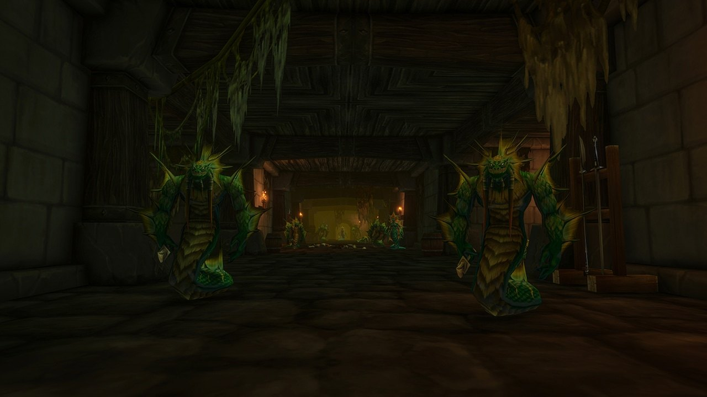

## Y aller

Alcaz Prison est un nouveau donjon de World of Warcraft: Forever, pour les niveaux 48 à 53, sur Alcaz Island au large de Dustwallow Marsh. Depuis le quai, prenez le chemin qui monte la colline sur la gauche jusqu'au grand bâtiment. Le portail est dans son sous-sol, vers /way 75 15.

## L'histoire

La prison d'Alcaz Island passait depuis longtemps pour détenir des prisonniers importants, dont King Varian Wrynn, mais personne ne pouvait y entrer. Dans Forever, ses portes s'ouvrent. À l'intérieur, la Defias Brotherhood et les nagas se battent entre eux, et de nouvelles pièces d'un mystère bien connu attendent, selon [Blizzard](/fr/news/blizzard-describes-all-nine-new-dungeons/).

## Les boss

### The Questioner

Le premier boss. Laissez-le en vie si vous voulez le déguisement secret : la quête <a href="https://www.wowhead.com/forever/quest=96335">The Man in the Iron Chains</a>, à la fin du donjon, vous renvoie vers lui.

### Blazeroar

Le seul boss connu à ce jour, cité dans le défi Legacy du donjon.

## Le déguisement secret

Une chaîne cachée commence ici et mène à l'<a class="wf-wh wf-q3" href="https://www.wowhead.com/forever/item=279471">Alcaz Operative Insignia</a>, un jouet qui vous déguise en agent Defias pendant 10 minutes. Nettoyez le donjon sans tuer The Questioner, prenez <a href="https://www.wowhead.com/forever/quest=96335">The Man in the Iron Chains</a> à la fin, puis suivez la piste jusqu'à Moonbrook, dans le Westfall, et ensuite Stormwind (Alliance) ou Booty Bay (Horde) pour une <a class="wf-wh wf-q2" href="https://www.wowhead.com/forever/item=279450">Fractured Insignia</a>. Six d'entre elles forment le jouet. Les étapes sont dans [l'article sur le jouet](/fr/news/alcaz-prison-hides-a-defias-disguise-toy/).

## Ce que l'on ne sait pas encore

- **Les autres boss** et le déroulement des combats.
- **La carte** de l'intérieur.
- **Le butin** et **les autres quêtes**.
