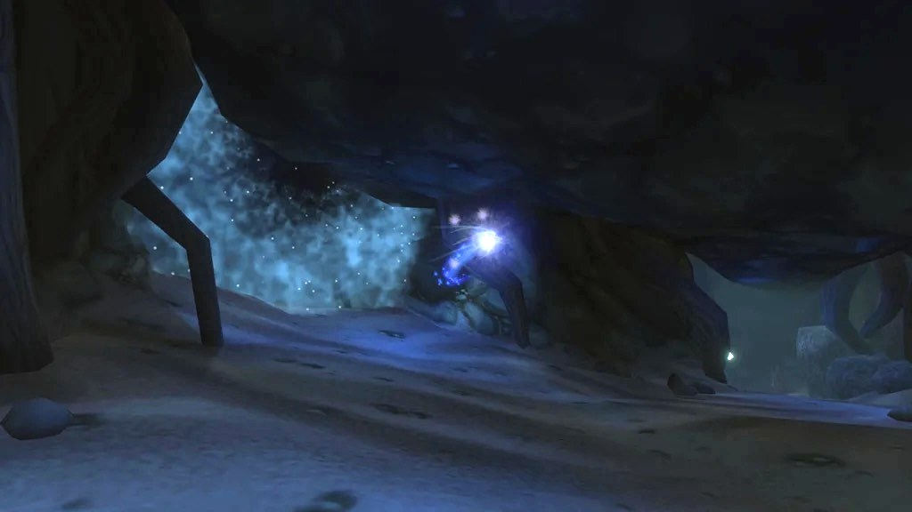

## L’accès

L’entrée se trouve dans les ruines englouties des Night Elves sur la Zoram Strand, au nord-ouest d’Ashenvale, en /way 14.5 14.6. Plongez dans le bassin au fond des ruines et suivez la grotte étroite et sinueuse derrière. Elle est pleine de nagas élites : entrez en groupe.

La Horde a Zoram'gar Outpost un peu au sud. L’Alliance rassemble ses quêtes à Darnassus, Darkshore et Ironforge.

## Le parcours

Trois niveaux avec de l’eau entre eux : emportez de quoi respirer sous l’eau si le groupe en a. Les numéros renvoient aux cartes ci-dessus.

1. **The Pool of Ask'Ar.** <a class="wf-wh wf-plain" href="https://www.wowhead.com/forever/npc=4887">Ghamoo-ra</a> (1), une tortue, attend dans l’eau de la première caverne. Argent Guard Thaelrid et le Lorgalis Manuscript sont dans une alcôve de la même salle.
2. **Les nagas.** <a class="wf-wh wf-plain" href="https://www.wowhead.com/forever/npc=4831">Lady Sarevess</a> (2) se tient avec deux gardes à l’ouest.
3. **Les murlocs.** <a class="wf-wh wf-plain" href="https://www.wowhead.com/forever/npc=6243">Gelihast</a> (3) garde une salle de murlocs à l’est. Nettoyez-la groupe par groupe. Après le combat, cliquez sur la pierre derrière lui pour la Blessing of Blackfathom.
4. **Moonshrine Sanctum.** <a class="wf-wh wf-plain" href="https://www.wowhead.com/forever/npc=12902">Lorgus Jett</a> (4) circule avec ses fidèles du Twilight's Hammer ; il n’a pas de place fixe. La Fathom Stone qui invoque <a class="wf-wh wf-plain" href="https://www.wowhead.com/forever/npc=12876">Baron Aquanis</a> se trouve sous l’eau.
5. **The Forgotten Pool.** <a class="wf-wh wf-plain" href="https://www.wowhead.com/forever/npc=4830">Old Serra'kis</a> (5) nage en eau profonde et il est facultatif.
6. **La chambre cérémonielle.** <a class="wf-wh wf-plain" href="https://www.wowhead.com/forever/npc=4832">Twilight Lord Kelris</a> (6) attend devant la dernière salle. Après lui, allumez les quatre braseros autour de la statue ; chacun fait venir une vague de monstres.
7. **L’antre d’Aku'mai.** <a class="wf-wh wf-plain" href="https://www.wowhead.com/forever/npc=4829">Aku'mai</a> (7) attend tout au fond.

## Le trash important

**Les nagas de la grotte d’entrée.** Élites et serrés. Attirez-les groupe par groupe, avant même d’atteindre le portail.

**Les lanceurs de sorts du Twilight's Hammer.** Aquamancers, Elementalists et Shadowmages frappent fort à distance. Interrompez-les ou rompez la ligne de vue pour qu’ils viennent à vous. Ils laissent aussi les Twilight Pendants de Twilight Falls.

**Les braseros.** Chaque brasero amène une vague. Les tortues frappent le plus fort ; un second tank, un familier ou un Rogue avec Evasion en prend une.

## Les boss

### Ghamoo-ra

Une tortue de niveau 25 avec beaucoup d’armure. Elle piétine un membre du groupe au hasard avec Trample, donc le soigneur garde tout le monde en vie. Elle peut être étourdie et apeurée.

### Lady Sarevess

Une naga de niveau 25 avec deux gardes. Contrôlez un garde et tuez l’autre d’abord. Son Forked Lightning est un cône frontal qui rebondit entre les joueurs : écartez-vous. Il peut être interrompu, mais elle lance alors Frost Nova sur ceux qui sont proches. Slow touche le tank.

### Gelihast

Un murloc de niveau 26. Attirez les adds de sa salle un par un, puis attirez-le seul. Son Net immobilise une cible au hasard et réduit sa menace.

### Lorgus Jett

Un élite de niveau 26, la cible d’Allegiance to the Old Gods. Il apparaît à l’un de plusieurs endroits du Moonshrine Sanctum. Son Lightning Shield blesse les combattants au corps à corps qui le frappent, et il lance Lightning Bolt.

### Old Serra'kis

Un requin facultatif de niveau 26, combattu sous l’eau. Il se soigne en attaquant. Surveillez votre souffle et remontez si besoin.

### Twilight Lord Kelris

Un démoniste orc de niveau 27 dans la chambre cérémonielle. Il lance Sleep et Mind Blast, et aucun des deux ne s’interrompt. Dissipez le sommeil : quand le tank dort, le suivant sur la liste de menace prend les coups.

### Aku'mai

Le boss final, une hydre de niveau 28. Restez hors de son Poison Cloud ; il peut être interrompu. Frenzied Rage lui donne 75 % de vitesse d’attaque en plus pendant 5 secondes quand sa vie est basse. Gardez les étourdissements et les temps de recharge du tank pour ce moment.

## Ce qu’on ne sait pas encore

- **Les taux de butin** des boss.
- **Les récompenses** de The Essence of Aku'Mai et d’Amongst the Ruins.
