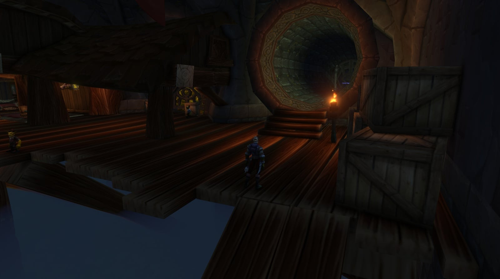
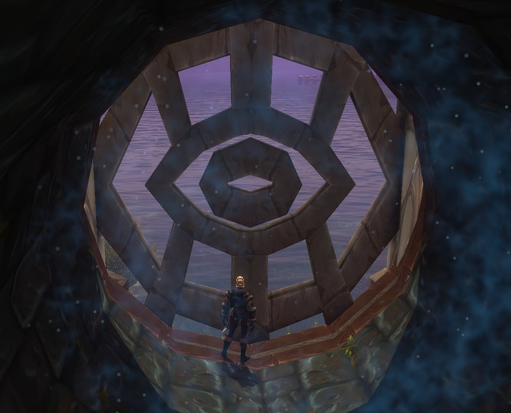

## Comment s’y rendre

**Alliance.** La première fois, le trajet depuis Hillsbrad Foothills jusqu’à la ville est long. Dans Dalaran, allez chez Cantrips & Crows dans les Dalaran Sewers, ouvrez la grille et suivez le tuyau jusqu’au portail. Plus d’infos sur la ville dans l’[article sur Dalaran dans la bêta](/fr/news/dalaran-opens-on-the-beta-for-the-alliance-only/).

**Horde.** La Horde n’est pas la bienvenue dans la ville et entre par un tunnel à l’extérieur, en /way 8.8 59.6, où l’<a class="wf-wh wf-plain" href="https://www.wowhead.com/forever/npc=269127">Image of Archmage Modera</a> donne accès. Au moins un joueur doit avoir la <a class="wf-wh wf-q2" href="https://www.wowhead.com/forever/item=277507">Dalaran Sewer Key</a> pour ouvrir la grille. Depuis The Sepulcher dans Silverpine Forest, c’est à quelques minutes à pied.

La ville attaque désormais les joueurs de la Horde à vue, et la suite de la Dalaran Sewer Key ne donne plus libre accès à la ville dans le monde ouvert. Le chemin du donjon reste le même ([plus](/fr/news/horde-players-are-attacked-on-sight-in-dalaran/)).

## La Dalaran Sewer Key

L’Alliance obtient la clé avec une seule quête : An Alarming Request, dès le niveau 30, d’Emissary Jacques à l’hôtel de ville de Southshore, vous envoie vers <a class="wf-wh wf-plain" href="https://www.wowhead.com/forever/npc=269127">Image of Archmage Modera</a> devant la ville, et son Heart of Disruption donne la clé. La Horde obtient la <a class="wf-wh wf-q2" href="https://www.wowhead.com/forever/item=277507">Dalaran Sewer Key</a> avec une chaîne de sept quêtes depuis Tarren Mill, dans les Hillsbrad Foothills. Les deux donneurs de quêtes se trouvent dans le village. Le créateur de contenu Farmerfarms montre toute la chaîne dans une vidéo.

<figure class="wf-embed" data-wf-video="fEruSWVwJjM">
  <button type="button" class="wf-embed__play">
    
    
      Dalaran Attunement Guide &amp; ALL Quests, WoW Forever
      Lancez la vidéo. Farmerfarms sur YouTube, 10 minutes.
    
  </button>
</figure>

Prenez d’abord trois quêtes.

| Quête | Donneur | Tâche |
|---|---|---|
| <a href="https://www.wowhead.com/forever/quest=544">Prison Break In</a> | <a class="wf-wh wf-plain" href="https://www.wowhead.com/forever/npc=2410">Magus Wordeen Voidglare</a> | Trouver les traîtres et récupérer leurs artefacts |
| <a href="https://www.wowhead.com/forever/quest=93680">Key to the City</a> | <a class="wf-wh wf-plain" href="https://www.wowhead.com/forever/npc=2410">Magus Wordeen Voidglare</a> | Obtenir la Grimy Key |
| <a href="https://www.wowhead.com/forever/quest=556">Stone Tokens</a> | <a class="wf-wh wf-plain" href="https://www.wowhead.com/forever/npc=2437">Keeper Bel'varil</a> | Rapporter 10 Worn Stone Tokens |

Rendez-les, puis prenez les deux suivantes.

| Quête | Donneur | Tâche |
|---|---|---|
| <a href="https://www.wowhead.com/forever/quest=545">Dalaran Patrols</a> | <a class="wf-wh wf-plain" href="https://www.wowhead.com/forever/npc=2410">Magus Wordeen Voidglare</a> | Tuer 6 Dalaran Summoners et 12 Elemental Slaves |
| <a href="https://www.wowhead.com/forever/quest=557">Bracers of Binding</a> | <a class="wf-wh wf-plain" href="https://www.wowhead.com/forever/npc=2437">Keeper Bel'varil</a> | Rapporter 4 Bracers of Earth Binding |

Rendez-les aussi, et la chaîne passe à la ville.

| Quête | Donneur | Tâche |
|---|---|---|
| <a href="https://www.wowhead.com/forever/quest=92434">Blood in the Streets</a> | <a class="wf-wh wf-plain" href="https://www.wowhead.com/forever/npc=2410">Magus Wordeen Voidglare</a> | La rendre à Image of Archmage Modera devant Dalaran |
| <a href="https://www.wowhead.com/forever/quest=96984">Heart of Disruption</a> | <a class="wf-wh wf-plain" href="https://www.wowhead.com/forever/npc=269127">Image of Archmage Modera</a> | Récupérer l’Arcane Mote dans la City of Dalaran |

Heart of Disruption donne la clé. Quatre des quêtes viennent de Classic : Prison Break In, Stone Tokens, Dalaran Patrols et Bracers of Binding. Key to the City, Blood in the Streets et Heart of Disruption sont nouvelles dans Forever. Plus de détails dans l’[article sur la clé](/fr/news/horde-earns-the-dalaran-sewer-key-in-tarren-mill/).

## Le trash important

**Les dégâts arcaniques.** Une fois sortis des égouts, une grande partie des dégâts est Arcane, attaques de mêlée comprises. Les tanks Warrior et Paladin bloquent beaucoup moins de coups. Prenez beaucoup d’eau si le groupe a peu d’interruptions, car plusieurs monstres brûlent le mana.

**L’immunité aux arcanes.** Presque tous les monstres ignorent les dégâts Arcane : Arcane Explosion et Arcane Shot font peu, et Counterspell n’interrompt pas.

**Les Mana Phantoms** lancent un vilain <a class="wf-wh wf-spell" href="https://www.wowhead.com/forever/spell=20817">Mana Burn</a> sur leur cible. Ils ne sont pas élites : interrompez-les ou étourdissez-les, et tuez-les d’abord.

**Fallen Mages et Fallen Warriors.** Les Mages lancent Frostbolt sur leur cible, alors attirez-les derrière un angle. Les Warriors utilisent Hamstring.

**Les Kirin Tor Necromancers** relèvent des squelettes jusqu’à leur mort, et Unholy Frenzy leur donne, à eux et à leurs squelettes, 75 % de vitesse d’attaque pendant 20 secondes.

**Seeking Remnants et Saturated Remnants.** Les Seeking Remnants voient à travers le camouflage. Les Saturated Remnants frappent en dégâts Arcane, impossibles à bloquer, et laissent en mourant un champ qui rend du mana à ceux qui s’y tiennent.

**Les Phantasms** posent Reflection Field sur eux-mêmes ou un allié, un bouclier qui renvoie chaque sort à son lanceur.

**Les Fragmented Sentries** frappent tous ceux qui sont devant elles avec Arcing Smash.

## Les boss

### Atrexis the Grave Knight

Le premier boss, au Ritual Circle au milieu de l’Underbelly, avec trois Kirin Tor Necromancers tout près ; tuez-en quelques-uns avant de l’attirer. Il désarme le tank, relève sans cesse des squelettes et se donne Unholy Frenzy, à lui et à ses alliés. Il frappe fort sur le tank : tuez les premiers squelettes, puis concentrez-vous sur le boss.

### Lyn the Ignored, une rare

Lyn the Ignored n'apparaît que si on l'invoque. Prenez le <a class="wf-wh wf-q1" href="https://www.wowhead.com/forever/item=276561">Black Tome</a> dans la salle de <a class="wf-wh wf-plain" href="https://www.wowhead.com/forever/npc=4275">Archmage Arugal</a> à Shadowfang Keep et utilisez-le à l'Ambermill Leyline Focus, le cristal bleu à côté de <a class="wf-wh wf-plain" href="https://www.wowhead.com/forever/npc=2120">Archmage Ataeric</a> à Ambermill (/way 63.4 64.3) : il devient le <a class="wf-wh wf-q2" href="https://www.wowhead.com/forever/item=275989">Tome of Dalaran</a>. Dans le donjon, traversez l'Underbelly et dépassez Atrexis the Grave Knight. Avant la rampe vers l'Arcane Anomaly, entrez tout droit dans la petite salle et utilisez le livre sur le cercle d'invocation. Chaque étape, avec captures d'écran, est dans l'[article sur le Tome of Dalaran](/fr/news/the-tome-of-dalaran-summons-lyn-the-ignored/).

Le livre n'est pas consommé. Après 3 minutes il fonctionne à nouveau, donc un groupe qui tombe peut invoquer Lyn the Ignored une nouvelle fois tout de suite. Elle apparaît après une courte scène avec un clin d'œil à <a class="wf-wh wf-plain" href="https://www.wowhead.com/forever/npc=11502">Ragnaros</a>, plus dans l'[article sur le nouvel essai](/fr/news/the-tome-of-dalaran-stays-for-another-try-at-lyn-the-ignored/).

Pendant le combat, le boss relève sans cesse des squelettes, comme Atrexis, et lance Shadow Bolt Volley sur tout le groupe. Curse of Thorns blesse le tank chaque fois que le tank inflige des dégâts : retirez la malédiction si vous le pouvez.

### Arcane Anomaly

On l’attire hors d’une bulle sur une terrasse après les égouts. Il frappe fort, et Arcane Bolt touche le tank pour environ 500 points de dégâts Arcane. <a class="wf-wh wf-spell" href="https://www.wowhead.com/forever/spell=1241501">Focal Blast</a> est un rayon arcanique qui balaie la salle après une incantation de 3 secondes : sortez de sa trajectoire dès le début de l’incantation.

### Fel Ancient

Sur Runeweaver Square, au centre de la ville, parmi des Suffused Treants. Une barrière de mana le protège ; Grindle Firespark la retire quand vous lui parlez. Entangle immobilise un joueur pendant 10 secondes et le blesse tant que cela dure. Fel Timbers court vers un joueur, frappe tous ceux à moins de 5 mètres et laisse une flaque verte de poison. Ensemble, c’est mortel : sortez tout de suite des flaques, et Blessing of Freedom retire les racines.

### Arcanic Enigma

Deux Mana Phantoms commencent le combat avec lui : tuez-les d’abord et arrêtez leur Mana Burn avec une interruption ou un étourdissement. <a class="wf-wh wf-spell" href="https://www.wowhead.com/forever/spell=1240869">Manamorph</a> transforme un joueur en animal pendant 8 secondes ; c’est de la magie, donc dissipez-la. Les Druids en Cat Form sont immunisés. Son Silence touche tous ceux autour de lui, alors le soigneur et les distances se tiennent loin. Des Arcane Manalings apparaissent sans cesse : fauchez-les, mais continuez à frapper le boss. C’est la cible de la quête de l’Alliance Power Overwhelming.

### Unstable Sentinel

Dans le quartier marchand de la ville. Tuez les Angry Tomes qui sortent des bâtiments avant de l’attirer. Arcing Smash frappe tous ceux qui sont devant lui, alors le tank le tourne loin du groupe. <a class="wf-wh wf-spell" href="https://www.wowhead.com/forever/spell=1241329">Malfunction</a> se charge pendant 2 secondes puis frappe tous ceux à moins de 25 mètres toutes les 2 secondes pendant 6 secondes. Les distances restent au-delà de 25 mètres et la mêlée s’éloigne pendant l’incantation ; un étourdissement avant l’incantation l’arrête.

### Shade of the Archmage

Le dernier boss, dans le Purple Parlor en haut de la Violet Citadel. Parlez au PNJ devant la Violet Citadel, au nord-ouest de la ville, pour être téléporté en haut ; le Shade apparaît quand vous entrez. Arcane Bolt frappe fort sur le tank. <a class="wf-wh wf-spell" href="https://www.wowhead.com/forever/spell=1241515">Bounding Mana</a> envoie une sphère de mana vers un joueur puis la fait revenir ; elle blesse et réduit au silence pendant 6 secondes tous ceux sur sa trajectoire : ne vous placez pas entre lui et ce joueur. Arcane Explosion suit et touche tous ceux à moins de 20 mètres. Quand son mana est vide, il lance Mass Polymorph sur tout le groupe pendant 8 secondes et le remplit avec Evocation, puis le combat recommence. Dispersez-vous, gardez les lanceurs de sorts à distance et cachez-vous derrière le mur pendant Mass Polymorph. Si quelqu’un quitte la salle, il revient à sa vie maximale.

### Mana Devourer

Nettoyez toute la salle avant le pull, car chaque monstre encore en vie rejoint le combat. Drain Vitality inflige des dégâts Arcane sur la durée au tank, et Debilitate inflige des dégâts Arcane à tous et retire 200 points de mana à chaque joueur. Tuez-le vite, avant que le groupe soit à court de mana.

## Ce qu’on ne sait pas encore

- **Sunreaver's Sanctuary** : sur la bêta, on ne peut pas encore y entrer.
- **Les taux de butin** des boss.
