## L’accès

**Alliance.** Entrez dans la High Seat d’Ironforge, où siège King Magni Bronzebeard. Un passage couvert de toiles d’araignée s’ouvre sur la gauche, en /way 43.5 52.0. Suivez-le jusqu’en bas, jusqu’au portail. Le chemin passe au-dessus de la lave, et une chute est mortelle.

**Horde.** Une longue marche en terre de l’Alliance : depuis l’Undercity par Silverpine Forest, les Hillsbrad Foothills, les Arathi Highlands, les Wetlands et le Loch Modan jusqu’à Dun Morogh, puis devant les gardes d’Ironforge. Retirez votre équipement avant les gardes, pour qu’il ne perde pas de durabilité si vous mourez.

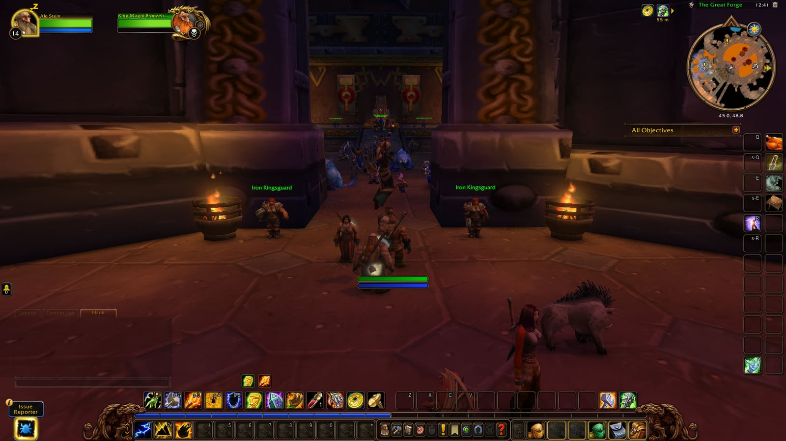

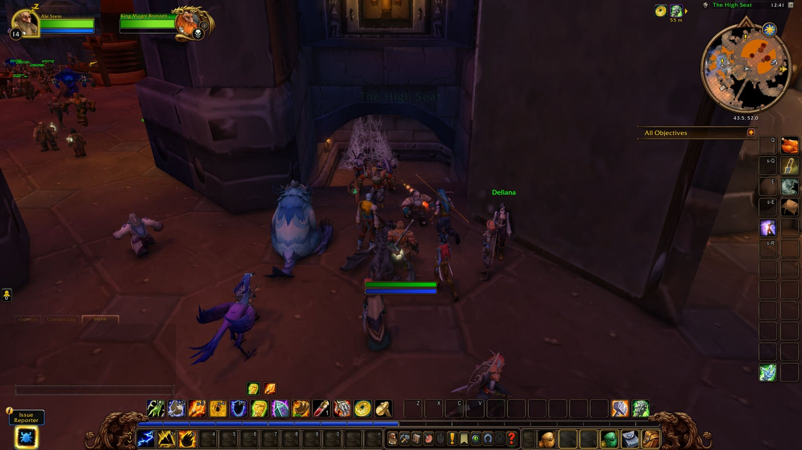

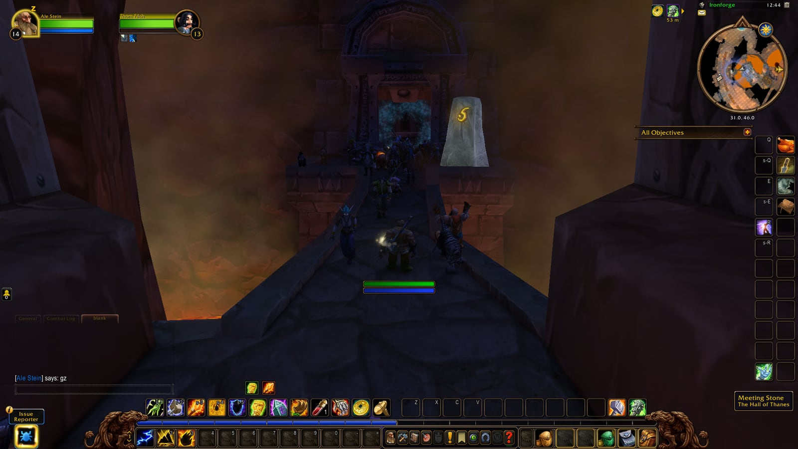

## Le parcours

Une ligne droite avec un détour par une grotte. Depuis le portail :

1. **La première salle.** Tormented Souls et Enraged Apparitions, des pulls faciles. Prenez le couloir de gauche, vers l’ouest.
2. **Anvilmar's Rest.** Dans la salle d’avant, le Ghostly Attendant donne An Ancient Grudge. Faldrim Anvilmar fait le tour du tombeau au centre.
3. **Le côté Dark Iron.** Sortez par le couloir sud-est. Des barils de Seaforium Blasting Powder se trouvent à côté de plusieurs groupes : tirez dessus à distance et le groupe saute avec.
4. **La grotte.** Magmatus se tient au milieu de Dark Iron Dwarves.
5. **Retour dans les salles.** En haut du tunnel attend un groupe de quatre avec deux barils à côté. Tirez sur les deux barils en même temps.
6. **Plunder** patrouille dans le couloir juste après.
7. **Le Reliquary of Kings.** Au nord, par un pont gardé par des Lesser Stone Golems, avec Durgen Dirgehammer. Le Treaty of Understanding se trouve derrière l’une des portes de la chambre forte.

En sortant, rendez [An Ancient Grudge](/fr/guides/dungeons/hall-of-thanes/quests/#quest-96395) au Ghostly Attendant.

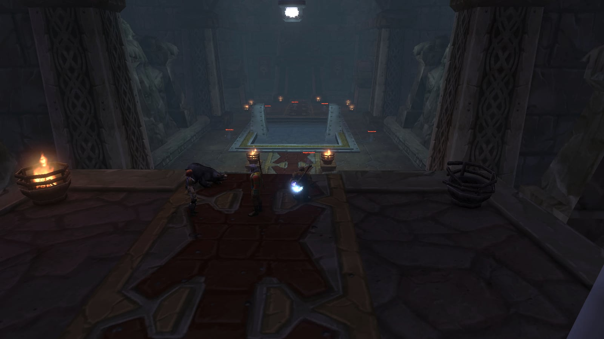

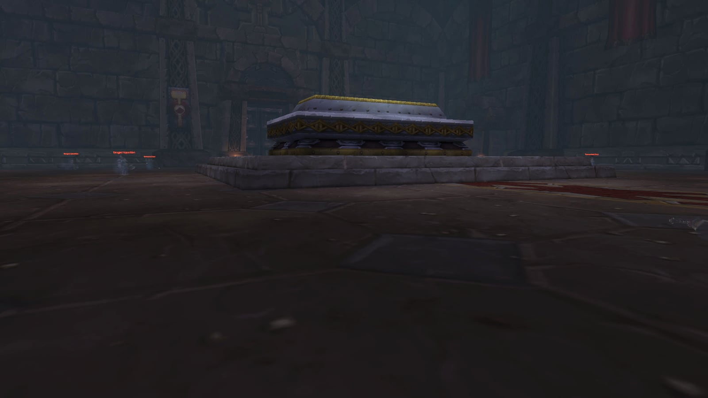

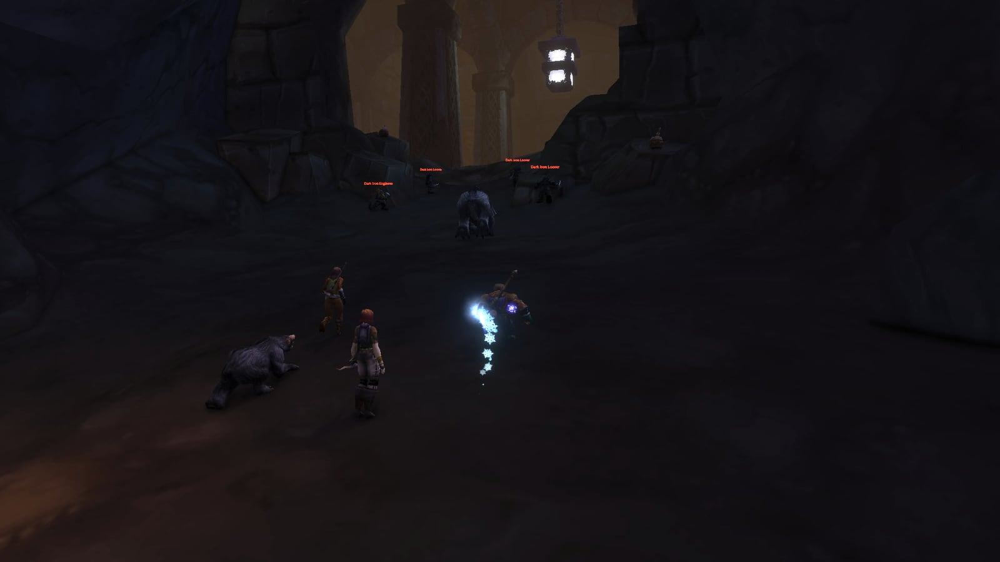

## Le trash important

Les fantômes des premières salles tombent vite. Après Faldrim Anvilmar, les Dark Iron Dwarves prennent le relais, et ces groupes méritent de l’attention.

**Dark Iron Engineer.** Lance des bombes sur sa cible encore et encore, et l’explosion touche tout le monde autour. L’endroit est choisi au début de l’incantation : écartez-vous et la bombe rate complètement.

**Dark Iron Looter.** Des dagues empoisonnées et beaucoup de dégâts. En général avec d’autres Dark Iron Dwarves ou quelques Bloodhound Runts non élites. Tuez les Looters en premier.

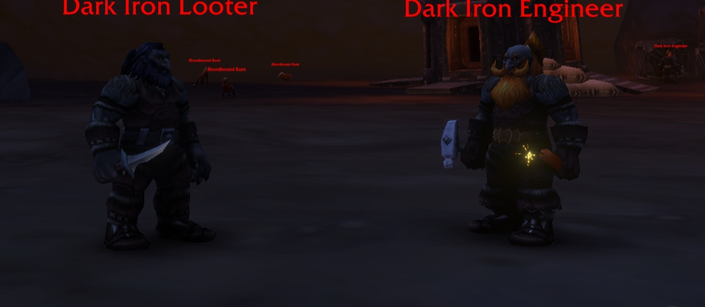

**Dark Iron Summoner.** Un lanceur de sorts avec une Fireball puissante, qui invoque aussi un Fiery Assistant, un élémentaire de feu. Les deux incantations s’interrompent et le Summoner peut être étourdi. Pullez derrière un pilier ou un mur, hors de sa vue, pour qu’il vienne à vous.

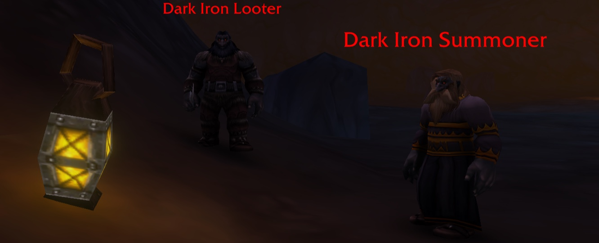

**Lesser Stone Golem.** Frappe fort et vite et court plus vite que vous, donc fuir ne marche pas. Seul, il reste gérable ; à côté d’un autre groupe, il fait mal. Le dernier groupe avant le boss final réunit un Golem, un Looter et un Summoner : [Polymorph](https://www.wowhead.com/forever/spell=118) sur le Summoner, puis tuez le Looter et le Golem.

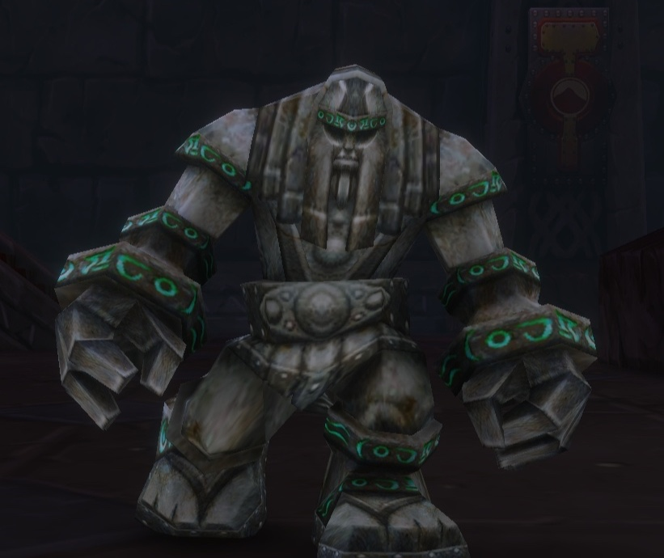

**Bloodhound Runts.** Leur morsure laisse Infected Wounds pendant 5 minutes : plus de dégâts physiques subis. Sans classe qui retire les maladies, un Simple Poultice de First Aid ou le racial [Stoneform](https://www.wowhead.com/forever/spell=20594) du Dwarf le soigne.

## Les quatre boss

### Faldrim Anvilmar

Un Dwarf mort-vivant qui patrouille autour de son tombeau dans Anvilmar's Rest, entre les fantômes. Le danger est de le puller avec un groupe. Dégagez d’abord un coin, puis attirez-le là. Il lance [Mind Blast](https://www.wowhead.com/forever/spell=26048) et pose [Anvilmar's Curse](https://www.wowhead.com/forever/spell=1292602) sur le tank pendant 10 minutes : vitesse d’attaque et d’incantation réduite de 20 %, mais immunité aux poisons et aux saignements. Un joueur qui retire les malédictions facilite le combat.

### Magmatus

Un élémentaire de feu avec un Dark Iron Summoner à ses côtés, et d’autre trash autour. Éliminez le Summoner qui patrouille avant le pull. Pendant le combat, le tank éloigne Magmatus du groupe pendant que les autres tuent le Summoner : sa Fire Nova est instantanée et touche tous ceux qui sont près de lui. [Combust](https://www.wowhead.com/forever/spell=1293228) enflamme un joueur au hasard pendant 12 secondes.

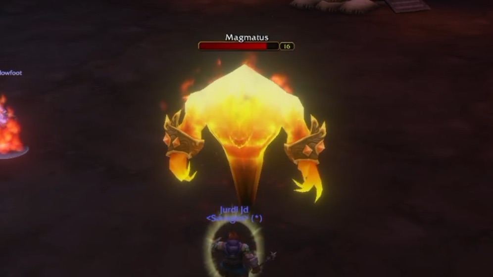

### Plunder

Un golem qui patrouille dans son couloir, avec une seule technique : [Knock Away](https://www.wowhead.com/forever/spell=10101), qui projette un joueur au loin. Nettoyez d’abord le trash, puis le tank l’attire dans un coin. Placez-vous pour qu’un coup ne vous envoie jamais dans un groupe.

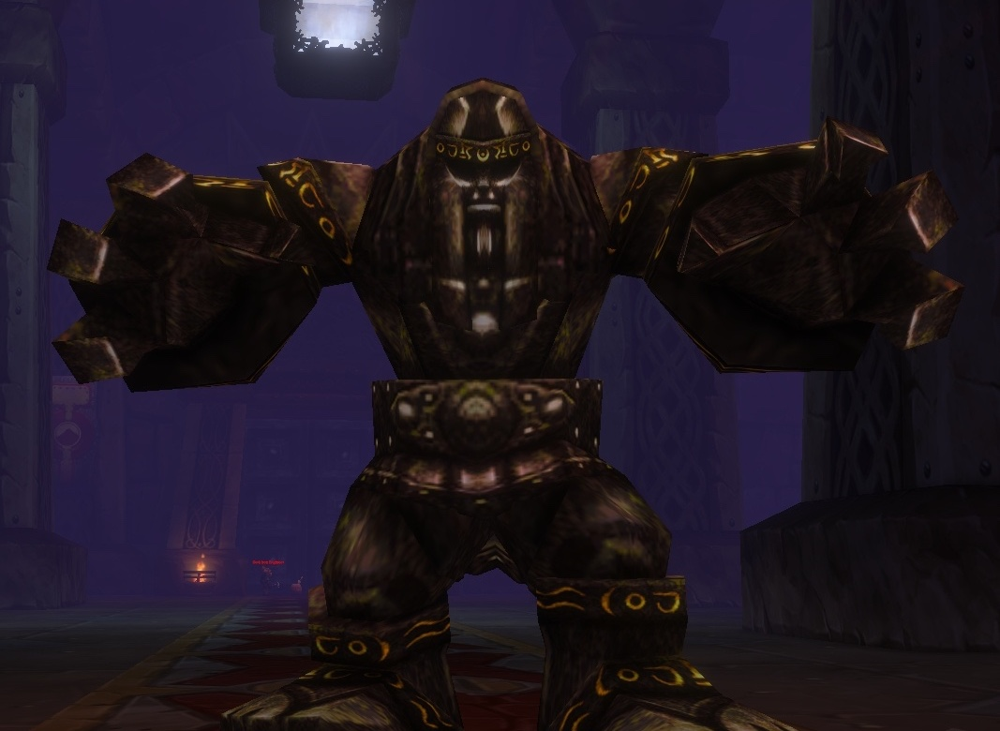

### Durgen Dirgehammer

Le boss final, à l’origine de l’incursion des Dark Iron. Il va et vient sur sa plateforme dans le Reliquary of Kings, avec deux Lesser Stone Golems à ses côtés et des Dark Iron Looters autour de la salle. Nettoyez tous les Looters avant le pull : son [Fear](https://www.wowhead.com/forever/spell=26070) fait fuir les joueurs pendant 8 secondes. Tuez ensuite Durgen le plus vite possible, puis les Golems ; ensemble, ils frappent très fort sur le tank. Il pose aussi [Rend](https://www.wowhead.com/forever/spell=12054) sur le tank, 44 dégâts physiques toutes les 3 secondes. Un Golem tué avant un wipe ne revient pas.

Un Shaman qui pose un [Tremor Totem](https://www.wowhead.com/forever/spell=8143) avant le pull rend le fear inoffensif. Après le combat, un levier dans la chambre forte du fond ouvre les portes fermées, et le chemin du retour est court.

## Ce qu’on ne sait pas encore

- Si la Horde aura un accès plus rapide. Une quête cachée avec une téléportation pour la Horde fait l’objet de rumeurs, mais personne ne l’a trouvée.
- Si les récompenses et les niveaux changeront avant la sortie le 4 novembre.

La soluce du donjon avec la vidéo de Jurdi se trouve dans l’article [The Hall of Thanes compte quatre boss et cinq quêtes](/fr/news/the-hall-of-thanes-has-four-bosses-and-five-quests/). Tous les donjons sont dans le [guide des donjons](/fr/guides/dungeons/).
