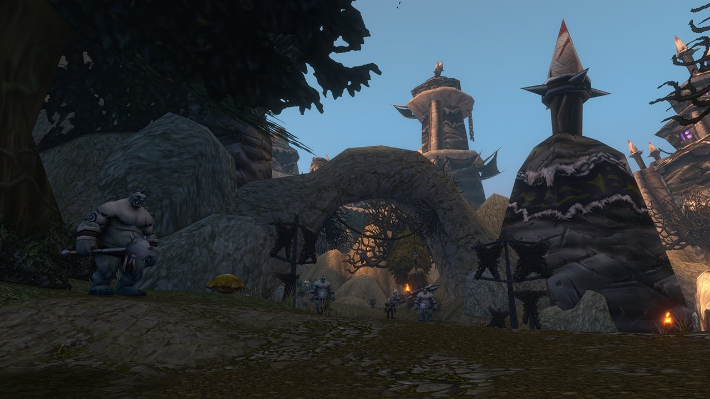

## Comment y aller

Krol'dok Stronghold est un nouveau donjon de World of Warcraft: Forever, pour les niveaux 40 à 45, dans la nouvelle zone des Riverglades. La forteresse des ogres se dresse sur une colline au-dessus de Sunnyglade, au nord de la zone. L'entrée est une grotte cachée juste à l'ouest des grandes portes, à /way 37.5 37.5.

Des éclaireurs ogres enlèvent des voyageurs et pillent des villages dans toutes les Riverglades, et leur piste mène ici. La nuit, d'étranges chants s'élèvent de la forteresse.

## Le plan

Un chemin sinueux monte entre des bâtiments grossiers, des ateliers et des camps, le long de passages gardés. Un grand pont de bois mène au sommet, où se trouvent les plus grands bâtiments. <a class="wf-wh wf-plain" href="https://www.wowhead.com/forever/npc=278310">Krol'dok Centurion</a> est l'un des ogres élites que vous croiserez.

## Les clés

Les données du jeu contiennent deux clés pour la forteresse, <a class="wf-wh wf-q1" href="https://www.wowhead.com/forever/item=267089">Krol'dok Compound Key</a> et <a class="wf-wh wf-q1" href="https://www.wowhead.com/forever/item=271721">Krol'dok Ogre Key</a>. <a class="wf-wh wf-q1" href="https://www.wowhead.com/forever/item=271721">Krol'dok Ogre Key</a> peut tomber sur Overlord Mugg. Une série de quêtes qui commence par la Krol'dok Moulding de Tunk donne une clé vers un raccourci, voir les [quêtes](/fr/guides/dungeons/kroldok-stronghold/quests/).

## Les boss

La carte en haut montre le chemin et les six boss dans l'ordre. Q marque un lieu de quête en route.

1. **Slavecrusher Grox**, dans le premier virage après l'entrée.
2. **Twilight Commander Zarmok**, au pied de la première montée.
3. **War Handler Ashka**, du côté est, près de la rivière.
4. **Nar'gurk**, parmi les camps du côté ouest.
5. **Bossman Toof**, sur le chemin du sommet.
6. **Overlord Mugg**, au sommet de la forteresse. Il est cité dans le défi Legacy du donjon et lâche <a class="wf-wh wf-q1" href="https://www.wowhead.com/forever/item=267086">Eye of Mugg</a>, un objet de quête.

## Ce qu'on ne sait pas encore

- **Le déroulement des combats** et ce que lâche chaque boss.
- **Le butin**, y compris les pièces du set Krol'dok Battlegear.
- **Les quêtes**, y compris celle des deux objets <a class="wf-wh wf-q1" href="https://www.wowhead.com/forever/item=267137">Krol'dok Moulding</a>.
