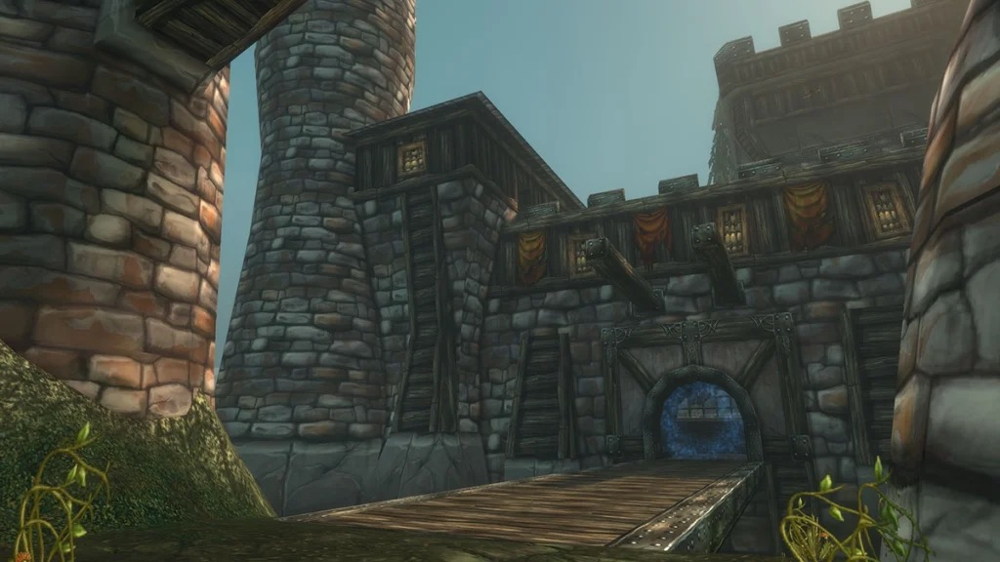

## L’accès

Le donjon se dresse dans les montagnes juste au nord de Pyrewood Village, dans Silverpine Forest, en /way 44.5 68.0. Pour la Horde, le Sepulcher et ses trois donneurs de quêtes sont à deux pas.

Pour l’Alliance, Silverpine Forest à ce niveau est un long voyage dangereux. Les personnages Skyborne y arrivent assez vite depuis Dalaran.

## Le parcours

Le donjon monte sur plusieurs étages, chacun avec sa carte ci-dessus. Les numéros renvoient aux boss.

1. **Les cellules.** <a class="wf-wh wf-plain" href="https://www.wowhead.com/forever/npc=3914">Rethilgore</a> (1) garde les prisonniers au début. Après le combat, libérez le prisonnier de votre faction, <a class="wf-wh wf-plain" href="https://www.wowhead.com/forever/npc=3849">Deathstalker Adamant</a> pour la Horde ou <a class="wf-wh wf-plain" href="https://www.wowhead.com/forever/npc=3850">Sorcerer Ashcrombe</a> pour l’Alliance. Il ouvre la porte de la cour.
2. **La cour.** Le corps de Deathstalker Vincent se trouve à droite de l’escalier. Trois chevaux élites occupent les écuries, et Jordan's Hammer pour la quête de Paladin est tout près.
3. **La cuisine et la salle à manger.** <a class="wf-wh wf-plain" href="https://www.wowhead.com/forever/npc=3886">Razorclaw the Butcher</a> (2) travaille dans la cuisine. Le fantôme de <a class="wf-wh wf-plain" href="https://www.wowhead.com/forever/npc=3887">Baron Silverlaine</a> (3) hante la salle à manger ; il est facultatif.
4. **La salle haute.** <a class="wf-wh wf-plain" href="https://www.wowhead.com/forever/npc=4278">Commander Springvale</a> (4) attend dans une salle de Wailing Guardsmen. Le rare Deathsworn Captain n’apparaît pas toujours.
5. **Le chemin de ronde.** <a class="wf-wh wf-plain" href="https://www.wowhead.com/forever/npc=4279">Odo the Blindwatcher</a> (5) et ses Vile Bats.
6. **L’observatoire.** <a class="wf-wh wf-plain" href="https://www.wowhead.com/forever/npc=4274">Fenrus the Devourer</a> (6), avec The Book of Ur sur une étagère de la même salle.
7. **La tour.** <a class="wf-wh wf-plain" href="https://www.wowhead.com/forever/npc=3927">Wolf Master Nandos</a> (7) garde la porte avec ses loups. <a class="wf-wh wf-plain" href="https://www.wowhead.com/forever/npc=4275">Archmage Arugal</a> (8) attend tout en haut.

## Le trash important

**Fel Steeds et Shadow Charger.** Trois chevaux élites dans les écuries qui frappent très fort ; en attirer un, c’est attirer les trois. Fel Stomp étourdit tout le monde autour. Mettez-en un en Polymorph et laissez un familier de Hunter ou de Warlock en tanker un autre.

**Wailing Guardsmen.** Screams of the Past fait fuir le groupe. Attirez-les par petits groupes, surtout avant Commander Springvale.

**Les meutes de worgens.** Les Bleak Worgs lancent Wavering Will, qui ralentit incantations et attaques. Tuez-les en premier à chaque pull.

## Les boss

### Rethilgore

Un worgen de niveau 20 avec deux Bleak Worgs et un Shadowfang Whitescalp. Le Soul Drain de Rethilgore fait mal. Tuez les adds d’abord.

### Razorclaw the Butcher

Un élite de niveau 22 dans la cuisine, avec des adds à marquer et à tuer en premier. Son Butcher Drain draine la vie du tank pendant tout le combat.

### Baron Silverlaine

Un fantôme de niveau 24. Nettoyez d’abord sa salle. Son Veil of Shadow réduit de 75 % les soins reçus par le tank ; interrompez-le ou retirez la malédiction.

### Commander Springvale

Un élite de niveau 24 dans une salle pleine d’adds. Il étourdit avec Hammer of Justice. À 30 % de vie, il lance Divine Shield puis Holy Light : interrompez le Holy Light, sinon le combat s’éternise.

### Odo the Blindwatcher

Un worgen de niveau 24 avec une nuée de Vile Bats. Howling Rage lui donne plus de puissance d’attaque à mesure que sa vie baisse. Tuez d’abord les chauves-souris et gardez les temps de recharge offensifs pour quand il passe sous la moitié.

### Fenrus the Devourer

Un loup de niveau 25 sans adds. Une simple course aux dégâts, mais il frappe fort sur le tank et son Toxic Saliva demande un soin contre le poison.

### Wolf Master Nandos

Un worgen de niveau 25 qui garde la porte d’Arugal. À 80 % de vie, il appelle sa meute : Bleak Worgs, Slavering Worgs et un Lupine Horror. Le tank doit les reprendre vite.

### Archmage Arugal

Le boss final, niveau 26. Tuez d’abord les trois worgens de sa salle. Arugal se téléporte dans la salle, prend le contrôle de joueurs et lance Void Bolt, qui ne s’interrompt pas, et Thundershock. Arugal's Curse ne peut pas être retirée ; contrôlez le joueur maudit au lieu de l’attaquer. La Shadow Resistance aide.

Après le combat, le <a class="wf-wh wf-q1" href="https://www.wowhead.com/forever/item=276561">Black Tome</a> est posé sur la table de sa salle, nouveau dans Forever. Il ouvre la voie vers Lyn the Ignored, un boss caché de [City of Dalaran](/fr/guides/dungeons/city-of-dalaran/) ; chaque étape est dans l’[article sur le Tome of Dalaran](/fr/news/the-tome-of-dalaran-summons-lyn-the-ignored/).

## Ce qu’on ne sait pas encore

- **Les taux de butin** des boss.
- **L’accès pour l’Alliance** : à quel point il est rapide pour les Skyborne depuis Dalaran.
