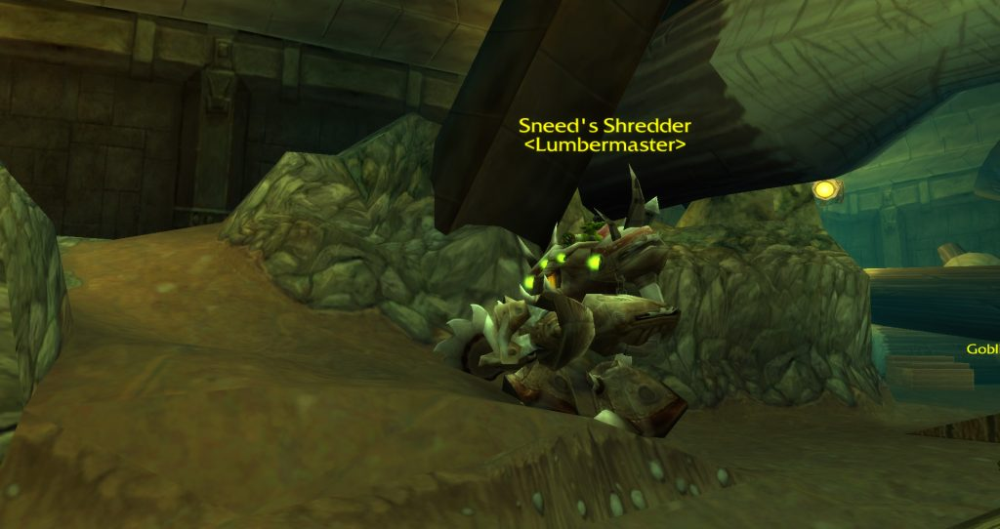
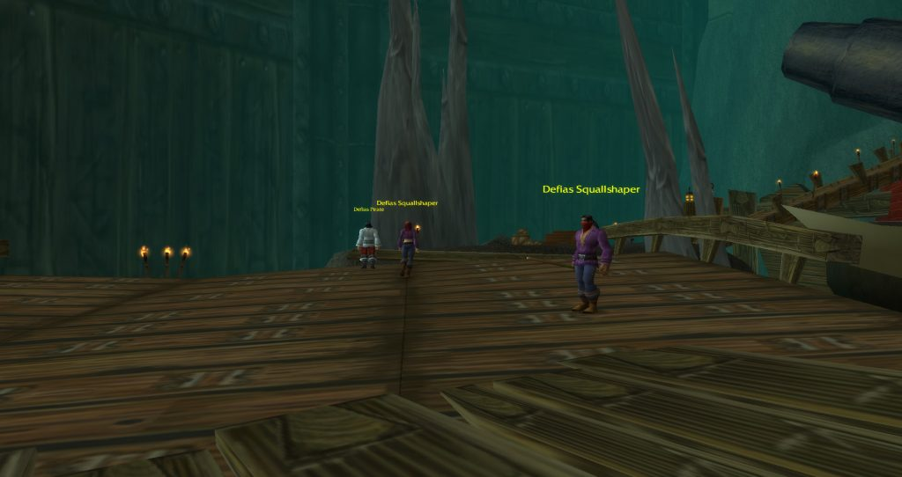
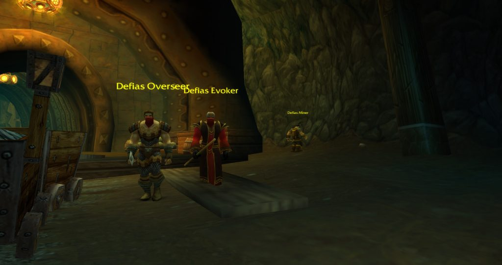
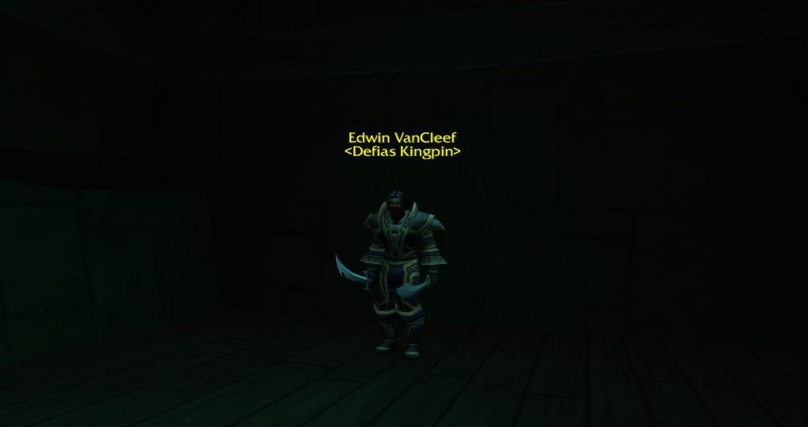

## L’accès

L’entrée est la Defias Hideout, le grand bâtiment dans le coin sud-ouest de Moonbrook, en /way 42 72. Descendez dans le dédale de grottes en dessous jusqu’au portail tout en bas. Des élites Defias arpentent la route de Moonbrook, alors retrouvez-vous à l’entrée.

En descendant, un passage latéral mène à la partie hantée de la mine. Elle est hors du donjon, mais chaque mort-vivant y est élite. Deux quêtes de Wilder Thistlenettle s’y font.

La Horde n’a pas de quêtes ici et une longue route à travers Westfall, mais le butin est le même pour les deux factions.

## Le parcours

Presque une ligne droite. Les numéros renvoient à la carte ci-dessus.

1. **Les tunnels.** Un chemin droit dans la mine jusqu’à <a class="wf-wh wf-plain" href="https://www.wowhead.com/forever/npc=644">Rhahk'Zor</a> (1), qui garde une porte.
2. **Le carrefour.** Après la porte, Miner Johnson peut se tenir à gauche. C’est un rare, il n’est pas toujours là.
3. **Le camp de bûcherons.** Nettoyez les Goblin Woodcarvers, puis attirez Sneed's Shredder (2).
4. **La fonderie.** <a class="wf-wh wf-plain" href="https://www.wowhead.com/forever/npc=1763">Gilnid</a> (3) travaille parmi des Goblin Craftsmen et Engineers. Nettoyez d’abord au moins un côté de la salle.
5. **La crique.** Le tunnel débouche sur une grande caverne. Traversez les quais jusqu’au navire, où <a class="wf-wh wf-plain" href="https://www.wowhead.com/forever/npc=646">Mr. Smite</a> (5) attend sur le pont inférieur.
6. **Le navire.** Après Mr. Smite, <a class="wf-wh wf-plain" href="https://www.wowhead.com/forever/npc=645">Cookie</a> (6) est à gauche. Montez jusqu’à <a class="wf-wh wf-plain" href="https://www.wowhead.com/forever/npc=647">Captain Greenskin</a> (4), puis jusqu’à <a class="wf-wh wf-plain" href="https://www.wowhead.com/forever/npc=639">Edwin VanCleef</a> (7) sur le pont supérieur.
7. **La sortie.** Un tunnel à l’arrière du navire mène dehors. Beaucoup de groupes tuent Cookie au retour, depuis le pont inférieur près de la passerelle.

## Le trash important

**Les patrouilles Defias.** Des Evokers, Henchmen et Overseers circulent en groupes dans la mine. Surveillez-les avant d’attirer un groupe, sinon une patrouille se joint au combat.

**La fonderie.** La salle de Gilnid est remplie de Goblin Craftsmen et Engineers. Attirez un groupe à la fois et maîtrisez les dégâts de zone.

**Le navire.** Pirates et Squallshapers se tiennent serrés sur les ponts. Captain Greenskin s’attire facilement par accident depuis le bas, alors approchez son pont avec prudence.

## Les boss

### Rhahk'Zor

Un ogre de niveau 19 avec deux Defias Watchmen qui attaquent à distance. Marquez les Watchmen et tuez-les d’abord. Rhahk'Zor Slam étourdit le tank, le soigneur le garde donc bien en vie pendant ce temps.

### Sneed

Sneed combat dans son Shredder. Quand celui-ci casse, il en sort avec une nouvelle table de menace, et le tank doit le reprendre. Sneed lance Disarm. Tout membre du groupe qui attire l’attention du tank subit Distracting Pain.

### Gilnid

Un gobelin de niveau 20 avec un Goblin Craftsman et un Goblin Engineer à ses côtés. Tuez les adds d’abord. Son Molten Metal réduit la menace du tank : le soigneur soigne à travers et les DPS ralentissent un instant.

### Mr. Smite

Un tauren de niveau 20 avec deux Defias Blackguards camouflés ; tuez-les d’abord. Le combat a trois phases, chacune ouverte par Smite Stomp, un étourdissement sur tout le groupe. Dans la deuxième, il se bat avec deux armes et frappe bien plus fort : le moment des temps de recharge du tank.

### Cookie

Facultatif, à gauche sur le navire après Mr. Smite. Cookie's Cooking le soigne et peut être interrompu. Il utilise aussi Acid Splash.

### Captain Greenskin

Un gobelin de niveau 20 avec un Defias Squallshaper, un Defias Pirate et un Defias Companion. Tuez d’abord les deux adds élites. Son Poisoned Harpoon demande un soin contre le poison, et Cleave touche ceux qui sont devant lui.

### Edwin VanCleef

Un élite de niveau 21 avec deux Blackguards camouflés. À la moitié de sa vie, il en appelle deux autres avec VanCleef's Allies. Tuez la première paire, contrôlez ou ignorez la seconde et concentrez-vous sur VanCleef. Assurez-vous que Captain Greenskin est mort avant de l’attirer. Il laisse An Unsent Letter, qui lance une quête.

## Ce qu’on ne sait pas encore

- **Les taux de butin** des boss.
- **La Band of the Better Half** : où elle tombe.
