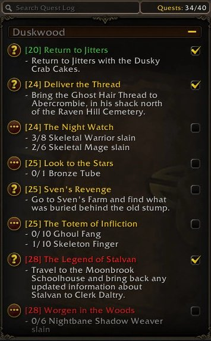
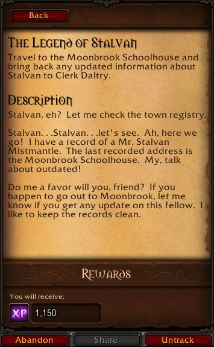
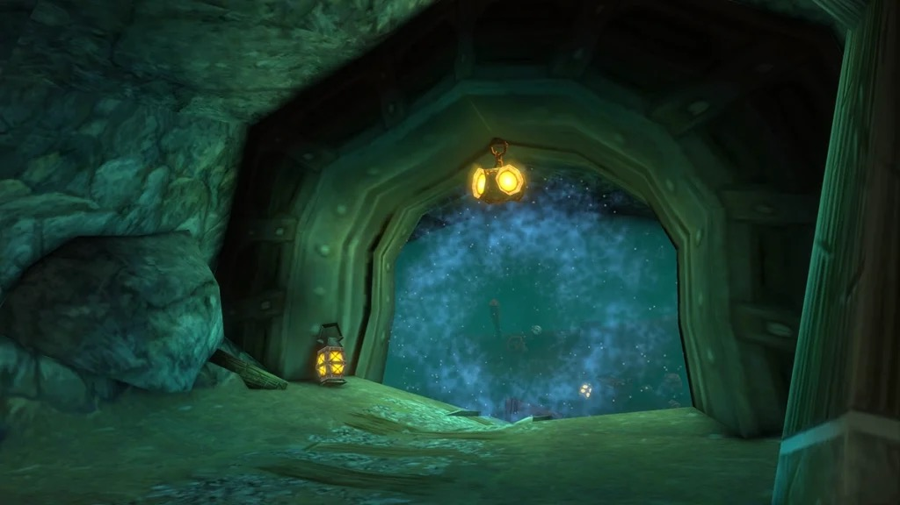
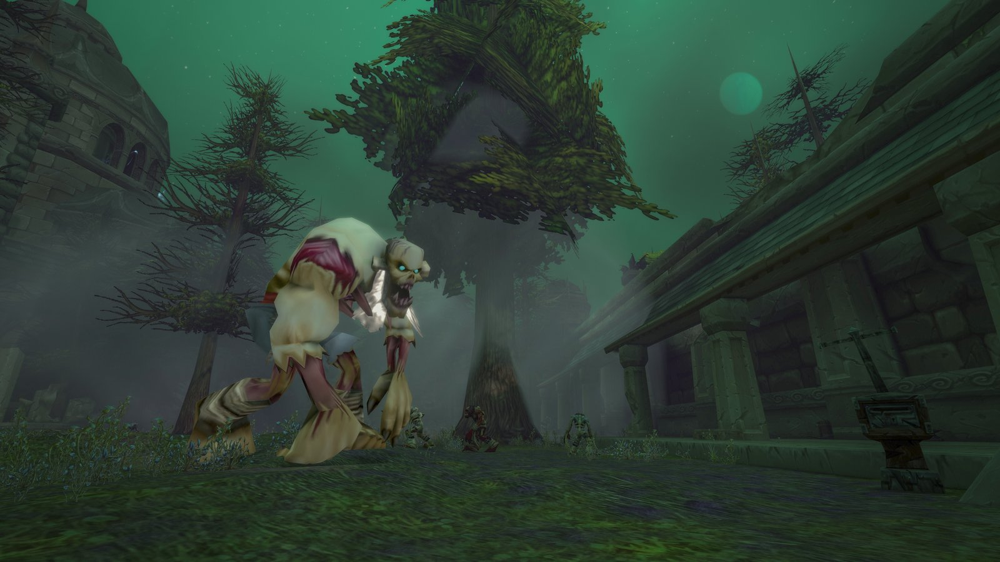
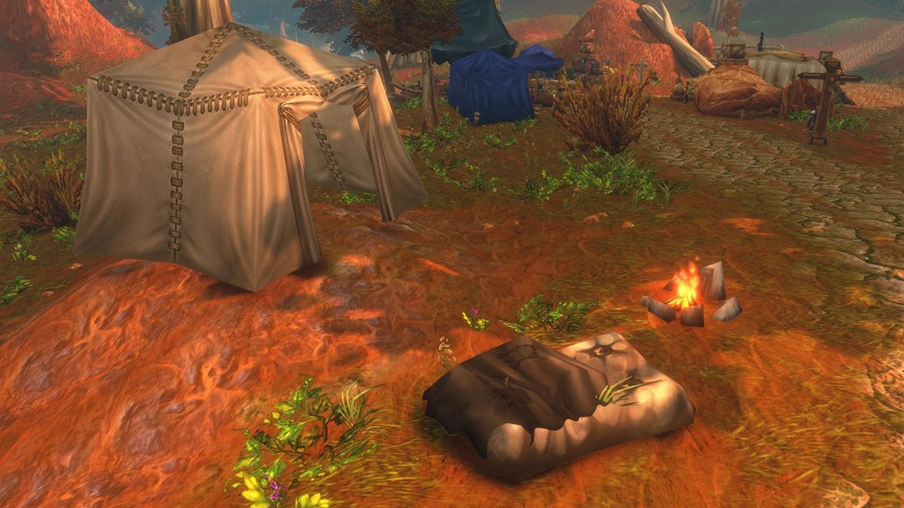

L'expérience dans WoW Forever fonctionne en grande partie comme dans Classic, avec le même montant par niveau et le même plafond au 60. Ce qui change, ce sont les sources : les donjons paient autrement, les monstres verts donnent moins, et les camps, la nourriture et le Cozy Sleeping Bag ajoutent des bonus. Ce guide couvre tout.

| | |
|---|---|
| Expérience jusqu'au niveau 60 | 4 084 700, comme dans Classic |
| Sources principales | Quêtes, kills, donjons, exploration |
| XP reposée | Expérience doublée sur les kills, jusqu'à 150 % d'un niveau |
| Bonus en plus | Camp Tent, Well Fed grâce à la nourriture, Cozy Sleeping Bag |
| Talents Legacy | Well Rested et Talented |
| Route de leveling | <a href="https://shop.restedxp.com/ref/nutri/" rel="noopener sponsored">RestedXP</a>, 10 % de réduction avec notre lien partenaire |
| Voir aussi | [Guide du camping](/fr/guides/camping/), [Cozy Sleeping Bag](/fr/guides/cozy-sleeping-bag/), [Cooking](/fr/tradeskills/forever/cooking/) |

## Comment fonctionne l'expérience

Vous gagnez de l'expérience avec les quêtes, les kills, l'exploration et les donjons. Avec assez d'expérience, vous passez au niveau suivant, jusqu'au plafond de 60. Là, l'expérience s'arrête.

La barre d'expérience en bas de l'écran montre où vous en êtes. Survolez-la pour voir votre expérience actuelle et ce qu'il vous manque. Chaque gain apparaît aussi dans le chat.

## Expérience par niveau

Chaque niveau demande plus d'expérience que le précédent. Au total, il faut 4 084 700 points pour atteindre le niveau 60. En septembre, un article affirmait que Forever en demandait beaucoup moins, mais Blizzard [l'a démenti](/fr/news/wowhead-retracts-experience-curve-story/) : les montants sont exactement ceux de Classic.

| Niveau | Vers le suivant | Total atteint |
|---|---|---|
| 1 | 400 | 0 |
| 2 | 900 | 400 |
| 3 | 1400 | 1300 |
| 4 | 2100 | 2700 |
| 5 | 2800 | 4800 |
| 6 | 3600 | 7600 |
| 7 | 4500 | 11 200 |
| 8 | 5400 | 15 700 |
| 9 | 6500 | 21 100 |
| 10 | 7600 | 27 600 |
| 11 | 8800 | 35 200 |
| 12 | 10 100 | 44 000 |
| 13 | 11 400 | 54 100 |
| 14 | 12 900 | 65 500 |
| 15 | 14 400 | 78 400 |
| 16 | 16 000 | 92 800 |
| 17 | 17 700 | 108 800 |
| 18 | 19 400 | 126 500 |
| 19 | 21 300 | 145 900 |
| 20 | 23 200 | 167 200 |
| 21 | 25 200 | 190 400 |
| 22 | 27 300 | 215 600 |
| 23 | 29 400 | 242 900 |
| 24 | 31 700 | 272 300 |
| 25 | 34 000 | 304 000 |
| 26 | 36 400 | 338 000 |
| 27 | 38 900 | 374 400 |
| 28 | 41 400 | 413 300 |
| 29 | 44 300 | 454 700 |
| 30 | 47 400 | 499 000 |
| 31 | 50 800 | 546 400 |
| 32 | 54 500 | 597 200 |
| 33 | 58 600 | 651 700 |
| 34 | 62 800 | 710 300 |
| 35 | 67 100 | 773 100 |
| 36 | 71 600 | 840 200 |
| 37 | 76 100 | 911 800 |
| 38 | 80 800 | 987 900 |
| 39 | 85 700 | 1 068 700 |
| 40 | 90 700 | 1 154 400 |
| 41 | 95 800 | 1 245 100 |
| 42 | 101 000 | 1 340 900 |
| 43 | 106 300 | 1 441 900 |
| 44 | 111 800 | 1 548 200 |
| 45 | 117 500 | 1 660 000 |
| 46 | 123 200 | 1 777 500 |
| 47 | 129 100 | 1 900 700 |
| 48 | 135 100 | 2 029 800 |
| 49 | 141 200 | 2 164 900 |
| 50 | 147 500 | 2 306 100 |
| 51 | 153 900 | 2 453 600 |
| 52 | 160 400 | 2 607 500 |
| 53 | 167 100 | 2 767 900 |
| 54 | 173 900 | 2 935 000 |
| 55 | 180 800 | 3 108 900 |
| 56 | 187 900 | 3 289 700 |
| 57 | 195 000 | 3 477 600 |
| 58 | 202 300 | 3 672 600 |
| 59 | 209 800 | 3 874 900 |
| 60 | - | 4 084 700 |

## Quêtes

Une quête donne de l'expérience selon son niveau, son type et la difficulté de ses objectifs. Le journal de quêtes affiche le montant avant que vous l'acceptiez. Les quêtes aux objectifs lents ou difficiles paient en général plus que d'autres du même niveau.

Le journal colore chaque quête selon son niveau par rapport au vôtre :

- **Gris :** 5 niveaux ou plus en dessous
- **Vert :** 3 à 4 niveaux en dessous
- **Jaune :** jusqu'à 2 niveaux au-dessus ou en dessous
- **Orange :** 3 à 4 niveaux au-dessus
- **Rouge :** 5 niveaux ou plus au-dessus

Pour les quêtes plus de 5 niveaux sous le vôtre, l'expérience baisse de 10 à 20 % par niveau supplémentaire.

**Les quêtes élites et de groupe** vous envoient contre des monstres plus forts ou dans des endroits dangereux. Il faut souvent de l'aide, et la récompense est plus élevée, expérience comprise.

**Les quêtes répétables** ont un marqueur bleu au lieu de jaune. La plupart ne donnent pas d'expérience, faites-les donc seulement pour les autres récompenses.

## Kills

Les monstres donnent de l'expérience selon leur niveau par rapport au vôtre et selon leur type. Les monstres proches de votre niveau offrent le meilleur équilibre entre vitesse et expérience. Les monstres bien plus bas donnent peu, les bien plus hauts prennent trop de temps.

Les barres de nom utilisent les mêmes couleurs que le journal de quêtes. Les monstres gris ne donnent aucune expérience. Les monstres avec un crâne sont bien au-dessus de votre niveau et mieux vaut les éviter.

**Les monstres verts donnent moins que dans Classic.** Les monstres sous votre niveau paient moins dans Forever, de quelques pour cent à environ un quart par kill. Selon Blizzard, c'est [voulu](/fr/news/green-mobs-give-less-experience-than-in-classic/), pour équilibrer les nouveaux buffs de la nourriture et des camps. Les monstres de votre niveau donnent exactement autant que dans Classic.

**Les élites** ont un dragon doré autour de leur portrait. Ils donnent plus d'expérience que les monstres normaux, mais prennent tellement plus de temps qu'ils valent rarement le farm.

### Tag et crédit du kill

Seul le premier joueur ou groupe qui touche un monstre, avec des dégâts ou un affaiblissement, reçoit l'expérience. Un monstre tagué par quelqu'un d'autre a une barre de nom grise. En groupe, chaque membre vivant et à proximité reçoit le crédit, il n'est donc pas nécessaire que chacun touche chaque monstre.

### Farm en zone

Rassembler un groupe de monstres et l'abattre avec des sorts de zone peut aller vite au bon endroit. Blizzard a rendu la méthode moins efficace dans Forever, surtout pour les Mages, réputés pour cela dans Classic. Elle marche encore un peu avec les bons sorts, le bon équipement ou de l'aide. Il faut un moyen de survivre au groupe ou de le tenir à distance avec des immobilisations, des ralentissements et des étourdissements, beaucoup de monstres et peu de joueurs en concurrence.

## Donjons

L'expérience des donjons a changé plusieurs fois pendant la bêta. En septembre, Blizzard a [déplacé l'expérience des kills vers les quêtes](/fr/news/wow-forever-dungeon-experience-changes/) : les monstres donnaient peu, les quêtes de donjon beaucoup. Le 1er octobre, l'expérience en plus des quêtes de donjon a été [réduite de 50 %](/fr/news/dungeon-quests-give-50-percent-less-bonus-experience/). Une semaine plus tard, les monstres de donjon ont reçu [20 % d'expérience en plus](/fr/news/dungeon-kills-give-20-percent-more-experience/), et un bug qui basait chaque kill sur le niveau le plus haut du groupe a été corrigé.

Le mieux est de prendre les quêtes de donjon à l'avance et de les terminer pendant le run. Rassembler de grands groupes et les tuer avec des sorts de zone, le dungeon cleave, fonctionne aussi, mais Blizzard ne veut pas que les donjons soient la route la plus rapide vers le 60.

Un joueur bien plus haut dans le groupe coûte beaucoup d'expérience. Un niveau 60 qui vide un donjon pour vous n'est plus un moyen efficace de monter. Groupez-vous avec des joueurs de votre tranche de niveau. Le [guide des donjons](/fr/guides/dungeons/) liste chaque donjon avec ses niveaux et ses quêtes.

## Exploration

Entrer dans une nouvelle zone pour la première fois donne un peu d'expérience et la révèle sur votre carte. Le montant est faible, un détour n'en vaut donc pas la peine, mais cela s'additionne pendant vos déplacements pour les quêtes.

## Groupes

En groupe, l'expérience par kill dépend de la taille du groupe et du niveau de ses membres. Un groupe plus grand signifie moins par joueur, et un membre bien plus haut la réduit fortement. En échange, vous tuez plus vite et finissez plus facilement les quêtes. Les récompenses de quête ne changent pas en groupe, mais les objectifs de quête ne comptent pas dans un groupe de raid.

## Expérience reposée

L'XP reposée double l'expérience des kills jusqu'à épuisement. Les quêtes et l'exploration n'ont pas ce bonus.

Vous l'accumulez dans une auberge, une capitale ou dans le Cozy Sleeping Bag. Votre portrait affiche alors un ZZZ. Déconnectez-vous là et elle continue de s'accumuler hors ligne. Avec de l'XP reposée, la partie remplie de votre barre d'expérience devient bleue au lieu de violette, et un repère montre jusqu'où va la réserve.

| | |
|---|---|
| Vitesse | 5 % de votre niveau actuel toutes les 8 heures en zone de repos |
| Plafond | 150 % de votre niveau actuel, 30 bulles |
| De vide à plein | Environ 10 jours déconnecté |
| Legacy : Well Rested | 4 % plus vite et un plafond 4 % plus haut par rang, jusqu'à 20 % |

**Well Rested** augmente la vitesse et le plafond du même pourcentage. Le remplissage prend donc toujours environ 10 jours, mais la réserve contient jusqu'à un cinquième de plus. **Talented**, le talent Legacy suivant, donne votre premier point de talent jusqu'à cinq niveaux plus tôt. Les deux sont dans le [calculateur Legacy](/fr/talents/legacy/).

## Camps, nourriture et sac de couchage

Forever ajoute trois bonus qui se cumulent entre eux et avec l'XP reposée.

**Camp Tent.** Dans un camp, un Leatherworker peut monter une Camp Tent. S'y reposer donne de l'expérience reposée comme dans une auberge, jusqu'à 5 % d'un niveau. Le buff dure une heure et reste à la mort. Le [guide du camping](/fr/guides/camping/) décrit chaque objet de camp.

**Well Fed.** La plupart des plats de Cooking donnent Well Fed, avec 5 % d'expérience en plus sur les kills en plus de leurs autres stats. Il dure en général environ 15 minutes et disparaît à la mort. Cooking est un métier secondaire, il s'ajoute donc à vos deux métiers principaux, et il faut l'avoir pour allumer un feu de camp.

**Cozy Sleeping Bag.** Déroulez-le n'importe où et allongez-vous pour obtenir jusqu'à 3 cumuls de Well-Rested, 1 % d'expérience en plus par cumul. Le buff reste à la mort, et s'allonger dans le sac compte comme une zone de repos, même déconnecté. Le [guide du sac de couchage](/fr/guides/cozy-sleeping-bag/) détaille la chaîne de quêtes sur les deux continents.

## Une route de leveling

Le plus gros gain d'expérience par heure vient d'une bonne route : des quêtes prises à l'avance, rendues en chemin et sans allers-retours inutiles. <a href="https://shop.restedxp.com/ref/nutri/" rel="noopener sponsored">RestedXP</a> propose des routes de leveling pas à pas pour chaque classe et chaque race, aussi pour WoW Forever. Avec <a href="https://shop.restedxp.com/ref/nutri/" rel="noopener sponsored">notre lien partenaire</a>, vous obtenez 10 % de réduction.
