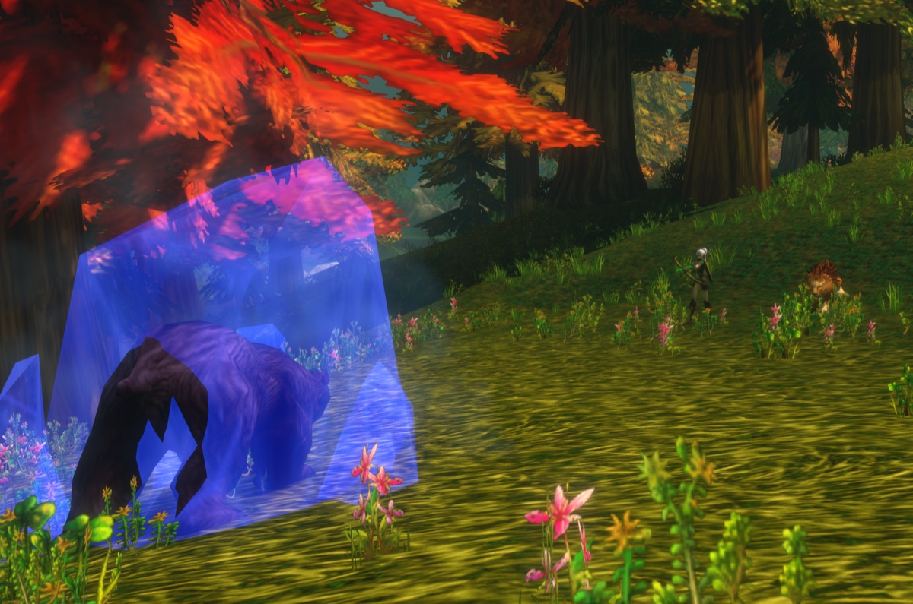
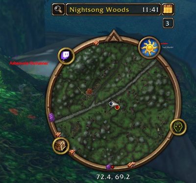

Le Hunter est l’une des classes les plus fortes pour monter de niveau. Vous faites des dégâts à distance, vous contrôlez les monstres avec des pièges et des ralentissements, et votre familier encaisse les coups. Les 10 premiers niveaux sont lents, jusqu’à ce que vous apprivoisiez un familier et receviez votre premier point de talent. Dans WoW Forever, de nouvelles techniques de familier et de nouveaux talents donnent plus de profondeur à la classe. Ce guide couvre les builds, la rotation, les niveaux clés, l’équipement, les familiers, les pièges et le pistage.

| | |
|---|---|
| Spé la plus simple pour monter | Beast Mastery |
| Talents clés | <a class="wf-wh wf-spell" href="https://www.wowhead.com/forever/spell=19552">Deadly Aspects</a>, Unleashed Fury, <a class="wf-wh wf-spell" href="https://www.wowhead.com/forever/spell=19598">Ferocity</a>, Summon Hawk, <a class="wf-wh wf-spell" href="https://www.wowhead.com/forever/spell=1223755">Focused Fire</a> |
| Force | Dégâts à distance, un familier qui tank, contrôle, déplacements rapides |
| Faiblesse | Un début lent jusqu’au niveau 10, le mana et les munitions |
| Ordre des talents par niveau | [Build de leveling du Hunter](/fr/leveling/hunter/) |
| Guides par spé | [Beast Mastery Hunter](/fr/guides/beast-mastery-hunter/), [Marksmanship Hunter](/fr/guides/marksmanship-hunter/), [Survival Hunter](/fr/guides/survival-hunter/) |
| Builds jusqu’au niveau 60 | Oui, le [build de leveling](/fr/leveling/hunter/) va jusqu’au 60 |

## Quelle spé pour monter

Les trois arbres permettent de monter. **Beast Mastery** est le plus fluide : votre familier fait plus de dégâts et survit mieux, et avec <a class="wf-wh wf-spell" href="https://www.wowhead.com/forever/spell=2649">Growl</a> il garde le monstre sur lui pendant que vous tirez. **Marksmanship** fait plus de dégâts avec vos propres tirs, vous prenez donc plus souvent la menace et devez kiter. **Survival** mêle mêlée, pièges et tirs, et demande le plus d’attention.
## Niveaux 1 à 10

Vous commencez sans talents et sans familier, avec <a class="wf-wh wf-spell" href="https://www.wowhead.com/forever/spell=75">Auto Shot</a> et Raptor Strike. Les monstres vous atteignent vite, vous les achevez donc souvent en mêlée.

1. Gardez <a class="wf-wh wf-spell" href="https://www.wowhead.com/forever/spell=13163">Aspect of the Monkey</a> dès que vous l’avez, au niveau 4.
2. Engagez avec Auto Shot.
3. Lancez <a class="wf-wh wf-spell" href="https://www.wowhead.com/forever/spell=1978">Serpent Sting</a>.
4. Lancez Arcane Shot dès qu’il est prêt.
5. Lancez <a class="wf-wh wf-spell" href="https://www.wowhead.com/forever/spell=5116">Concussive Shot</a> pour ralentir le monstre et garder vos distances.
6. Reculez entre vos tirs.
7. Utilisez Raptor Strike quand le monstre vous atteint, et achevez-le en mêlée.

Engagez chaque combat d’aussi loin que possible : chaque mètre en plus est un tir en plus. Stats à ces niveaux : Agility, puis puissance d’attaque, puis Intellect, puis Stamina et Spirit, puis armure.

## Les builds de talents

Le [build de leveling du Hunter](/fr/leveling/hunter/) donne le talent de chaque niveau de 10 à 60. [Ouvrir le résultat final dans le calculateur de talents](/fr/talents/hunter/?t=5120221405101241-00503520005).

Pour le niveau 60, chaque guide de spécialisation a ses propres builds pour les raids, le leveling et le PvP : [Beast Mastery](/fr/guides/beast-mastery-hunter/), [Survival](/fr/guides/survival-hunter/) et [Marksmanship](/fr/guides/marksmanship-hunter/).

## Niveaux clés

| Niveau | Ce que vous obtenez | Où |
|---|---|---|
| 1 | Auto Shot, Raptor Strike, <a class="wf-wh wf-spell" href="https://www.wowhead.com/forever/spell=1494">Track Beasts</a> | Par défaut, maître de classe |
| 4 | Aspect of the Monkey, Serpent Sting | Maître de classe |
| 6 | Arcane Shot, <a class="wf-wh wf-spell" href="https://www.wowhead.com/forever/spell=1130">Hunter's Mark</a> | Maître de classe |
| 8 | Concussive Shot | Maître de classe |
| 10 | <a class="wf-wh wf-spell" href="https://www.wowhead.com/forever/spell=1515">Tame Beast</a>, <a class="wf-wh wf-spell" href="https://www.wowhead.com/forever/spell=5149">Beast Training</a> | Quête de classe |
| 10 | <a class="wf-wh wf-spell" href="https://www.wowhead.com/forever/spell=6991">Feed Pet</a>, <a class="wf-wh wf-spell" href="https://www.wowhead.com/forever/spell=982">Revive Pet</a>, <a class="wf-wh wf-spell" href="https://www.wowhead.com/forever/spell=883">Call Pet</a>, <a class="wf-wh wf-spell" href="https://www.wowhead.com/forever/spell=2641">Dismiss Pet</a>, Aspect of the Hawk, <a class="wf-wh wf-spell" href="https://www.wowhead.com/forever/spell=19883">Track Humanoids</a> | Maître de classe |
| 10 | Premier point de talent | Arbre de talents |
| 12 | <a class="wf-wh wf-spell" href="https://www.wowhead.com/forever/spell=136">Mend Pet</a>, Wing Clip | Maître de classe |
| 14 | <a class="wf-wh wf-spell" href="https://www.wowhead.com/forever/spell=1513">Scare Beast</a>, <a class="wf-wh wf-spell" href="https://www.wowhead.com/forever/spell=6197">Eagle Eye</a>, <a class="wf-wh wf-spell" href="https://www.wowhead.com/forever/spell=1002">Eyes of the Beast</a> | Maître de classe |
| 16 | Mongoose Bite, Immolation Trap | Maître de classe |
| 18 | <a class="wf-wh wf-spell" href="https://www.wowhead.com/forever/spell=2643">Multi-Shot</a> | Maître de classe |
| 20 | Aimed Shot, <a class="wf-wh wf-spell" href="https://www.wowhead.com/forever/spell=5118">Aspect of the Cheetah</a>, <a class="wf-wh wf-spell" href="https://www.wowhead.com/forever/spell=1499">Freezing Trap</a> | Maître de classe |
| 20 | Polearms | Maître d’armes |
| 22 | Scorpid Sting | Maître de classe |
| 24 | <a class="wf-wh wf-spell" href="https://www.wowhead.com/forever/spell=19885">Track Hidden</a> | Maître de classe |
| 25 | Summon Hawk, Trueshot Aura | Arbre de talents |
| 26 | Rapid Fire, <a class="wf-wh wf-spell" href="https://www.wowhead.com/forever/spell=19880">Track Elementals</a> | Maître de classe |
| 28 | Frost Trap | Maître de classe |
| 30 | Feign Death, Aspect of the Beast | Maître de classe |
| 30 | Intimidation, Strider Kick, Expose Prey, Scatter Shot | Arbre de talents |
| 32 | <a class="wf-wh wf-spell" href="https://www.wowhead.com/forever/spell=1543">Flare</a>, <a class="wf-wh wf-spell" href="https://www.wowhead.com/forever/spell=19878">Track Demons</a> | Maître de classe |
| 34 | <a class="wf-wh wf-spell" href="https://www.wowhead.com/forever/spell=13813">Explosive Trap</a> | Maître de classe |
| 36 | <a class="wf-wh wf-spell" href="https://www.wowhead.com/forever/spell=3034">Viper Sting</a> | Maître de classe |
| 40 | <a class="wf-wh wf-spell" href="https://www.wowhead.com/forever/spell=13159">Aspect of the Pack</a>, <a class="wf-wh wf-spell" href="https://www.wowhead.com/forever/spell=19882">Track Giants</a> | Maître de classe |
| 40 | <a class="wf-wh wf-spell" href="https://www.wowhead.com/forever/spell=19574">Bestial Wrath</a>, Sniper Shot, Lacerating Strikes | Arbre de talents |
| 40 | Monte, Dual Specialization | Maîtres |
| 46 | <a class="wf-wh wf-spell" href="https://www.wowhead.com/forever/spell=20043">Aspect of the Wild</a> | Maître de classe |
| 50 | <a class="wf-wh wf-spell" href="https://www.wowhead.com/forever/spell=19879">Track Dragonkin</a> | Maître de classe |
| 60 | <a class="wf-wh wf-spell" href="https://www.wowhead.com/forever/spell=19801">Tranquilizing Shot</a> | Maître de classe |

Aimed Shot n’est plus un talent : tout Hunter l’apprend au niveau 20. Les niveaux des talents sont les plus précoces sans Talented ; avec Talented, vous les atteignez jusqu’à cinq niveaux plus tôt.

## La quête de classe

Au niveau 10, chaque Hunter fait Taming the Beast. La suite apprend Tame Beast et Beast Training, pour apprivoiser et dresser votre premier familier. Elle commence dans votre zone de départ : Teldrassil pour les Night Elves, Dun Morogh pour les Dwarves, [Zephras Isle](/fr/guides/zephras-isle/) pour le High Order Skyborne, Mulgore pour les Tauren et Durotar pour les Orcs et les Trolls.

## Où monter

Le niveau minimum conseillé pour chaque zone. Les niveaux des donjons sont dans le [guide des donjons](/fr/guides/dungeons/).

| Niveau | Zones |
|---|---|
| **1** | Elwynn Forest, Dun Morogh, Teldrassil, [Zephras Isle](/fr/guides/zephras-isle/), Durotar, Mulgore, Tirisfal Glades |
| **10** | Westfall, Loch Modan, Darkshore, The Barrens, Silverpine Forest |
| **15** | Redridge Mountains, Stonetalon Mountains |
| **18** | Ashenvale |
| **20** | Wetlands, Hillsbrad Foothills, Duskwood |
| **25** | Thousand Needles |
| **30** | Alterac Mountains, Arathi Highlands, Desolace, Riverglades, Stranglethorn Vale |
| **35** | Badlands, Dustwallow Marsh, Feralas, Swamp of Sorrows |
| **40** | Shen'dralas, Tanaris, The Hinterlands |
| **43** | Searing Gorge |
| **45** | Azshara, Felwood, Blasted Lands |
| **48** | Un'Goro Crater |
| **50** | Burning Steppes, Western Plaguelands |
| **53** | Winterspring, Eastern Plaguelands |
| **55** | Silithus, Deadwind Pass |
| **60** | Mount Hyjal |

## Armes

Un Hunter peut utiliser plus de types d’armes que toute autre classe. Vous apprenez la plupart chez un maître d’armes.

| Arme | Alliance | Horde |
|---|---|---|
| **Daggers** | Connues dès le départ | Connues dès le départ |
| **Axes à une et deux mains** | Buliwyf Stonehand (Ironforge) | Hanashi, Sayoc (Orgrimmar) |
| **Swords à une et deux mains** | Woo Ping (Stormwind) | Archibald (Undercity) |
| **Fist weapons** | Ilyenia Moonfire (Darnassus), Buliwyf Stonehand (Ironforge) | Sayoc (Orgrimmar) |
| **Staves** | Ilyenia Moonfire (Darnassus), Woo Ping (Stormwind) | Hanashi, Sayoc (Orgrimmar), Ansekhwa (Thunder Bluff) |
| **Polearms**, dès le niveau 20 | Woo Ping (Stormwind) | Archibald (Undercity) |
| **Bows** | Ilyenia Moonfire (Darnassus) | Hanashi, Sayoc (Orgrimmar) |
| **Crossbows** | Bixi Wobblebonk (Ironforge), Woo Ping (Stormwind) | Archibald (Undercity) |
| **Guns** | Buliwyf Stonehand (Ironforge) | Ansekhwa (Thunder Bluff) |
| **Thrown** | Bixi Wobblebonk (Ironforge), Ilyenia Moonfire (Darnassus) | Hanashi, Sayoc (Orgrimmar) |

Chaque fois que vous apprenez un nouveau type d’arme, vous devez d’abord monter sa compétence avant de toucher de façon fiable.

## Équipement

**Les armes à distance** sont votre principale source de dégâts. Voici de bons choix du niveau 13 au 30 :

| Niveau | Objet | Source |
|---|---|---|
| 13 à 16 | <a class="wf-wh wf-q3" href="https://www.wowhead.com/forever/item=272999">Barbaric Crossbow</a> | Ragefire Chasm |
| 13 à 16 | <a class="wf-wh wf-q3" href="https://www.wowhead.com/forever/item=279894">Calibrated Blunderbuss</a> | Quête dans le Hall of Thanes, Alliance uniquement |
| 19 à 22 | <a class="wf-wh wf-q3" href="https://www.wowhead.com/forever/item=6469">Venomstrike</a> | Wailing Caverns |
| 22 à 29 | <a class="wf-wh wf-q3" href="https://www.wowhead.com/forever/item=3078">Naga Heartpiercer</a> | Blackfathom Deeps |
| 23 à 29 | <a class="wf-wh wf-q3" href="https://www.wowhead.com/forever/item=273843">Fallenroot Longbow</a> | Blackfathom Deeps |
| 29 à 30 | <a class="wf-wh wf-q3" href="https://www.wowhead.com/forever/item=274084">Quilboar Blaster</a> | Quête dans Razorfen Kraul |

**Les armes de mêlée** comptent surtout pour Survival, qui s’appuie sur les dégâts de l’arme. Pour les autres spés, une arme de mêlée sert surtout à porter des stats.

**Équipement fabriqué et butin de donjon.** Leatherworking a reçu tôt de nouvelles recettes fortes, comme <a class="wf-wh wf-q3" href="https://www.wowhead.com/forever/item=252425">Dark Leather Boots</a>, <a class="wf-wh wf-q3" href="https://www.wowhead.com/forever/item=252504">Brawler's Leather Hood</a> et <a class="wf-wh wf-q3" href="https://www.wowhead.com/forever/item=252521">Stalker's Leather Belt</a>. Les donjons donnent des améliorations comme <a class="wf-wh wf-q3" href="https://www.wowhead.com/forever/item=271212">Bloodied Chestwraps</a> et <a class="wf-wh wf-q3" href="https://www.wowhead.com/forever/item=9624">Triprunner Dungarees</a>.

## Métiers

Montez vos métiers en même temps que votre Hunter, pour récolter et fabriquer au bon niveau. Les camps donnent des buffs à chaque métier, et dans Forever votre familier en profite aussi.

- **Cooking** est indispensable : la nourriture à buff donne de l’expérience en plus, et il vous le faut pour un feu de camp.
- **Leatherworking** fabrique du bon équipement de leveling lié et donne un buff d’expérience reposée au camp.
- **Skinning** va avec Leatherworking, et Aspect of the Cheetah vous mène vite d’un monstre à l’autre. Son buff de camp donne 2 % de chances de coup critique.
- **Herbalism** convient à un Hunter toujours en route. Son buff de camp donne de l’Intellect.
- **Alchemy** va avec Herbalism, pour les potions. Son buff de camp donne de la régénération de mana.
- **Engineering** fabrique gadgets, explosifs et lunettes de visée pour votre arme à distance. Le Reagent Bot du camp vend nourriture, eau et matériaux.
- **Mining** va avec Engineering. Son buff de camp donne de la puissance d’attaque en mêlée, utile pour Survival et votre familier.
- **Fishing** va avec Cooking. Son buff de camp augmente toutes les stats de 8 %.
- **First Aid** donne des bandages et des potions. Son buff de camp donne de la Stamina à vous et à votre familier.

## Consommables

- **Nourriture et eau.** Restez Well Fed pour l’expérience en plus ; n’importe quelle nourriture à buff vaut mieux que rien. Emportez de l’eau de votre niveau, car vous devrez boire.
- **Potions.** Des potions de soins pour les urgences, aussi avec First Aid maintenant. First Aid fabrique aussi des remèdes contre les Poisons, Diseases et Bleeds, qu’un Hunter ne peut pas retirer autrement. Les potions de mana aident aussi.
- **Les élixirs** avec les bonnes stats coûtent cher à entretenir, mais valent la peine pour une quête ou un monstre difficile.
- **Munitions.** Gardez votre carquois ou votre giberne pleins. Sans flèches ni balles, vous ne pouvez pas tirer.

## Familiers

Votre familier est le cœur de la classe. Surveillez sa position, ses techniques et ses temps de recharge : vous pouvez ainsi réagir à ce que fait un monstre, ou éviter le danger. Dans Forever, votre familier profite aussi des buffs de Camping, s’il est invoqué pendant que vous êtes assis au feu de camp. Depuis le 10 novembre, votre familier a 115 % de ses points de vie normaux au lieu de 150 %, qui venaient d'un bug, [plus de détails dans notre article](/fr/news/hunter-pets-lose-health-and-warlock-pets-gain-it/).

Les techniques de familier apportent de l’utilité, comme <a class="wf-wh wf-spell" href="https://www.wowhead.com/forever/spell=24423">Demoralizing Screech</a> et <a class="wf-wh wf-spell" href="https://www.wowhead.com/forever/spell=7272">Dust Cloud</a>.

## Contrôle et engagements

Les Hunters excellent au contrôle : Frost Trap, Freezing Trap, Wing Clip et Concussive Shot, renforcés par Entrapment, Clever Traps, Improved Concussive Shot et <a class="wf-wh wf-spell" href="https://www.wowhead.com/forever/spell=19228">Improved Wing Clip</a>. Scatter Shot et Intimidation en ajoutent encore. Votre meilleur outil reste votre familier, qui retient le monstre pendant que vous gardez vos distances.

Scare Beast fait fuir une Beast de peur jusqu’à 10 secondes au rang 1. Elle peut courir vers un autre groupe, utilisez-le donc avec prudence. En PvP, il marche contre les familiers des Hunters et les Druids en forme animale.

Vous pouvez engager presque tout à distance avec un tir. Les Hunters enchaînent aussi bien les monstres : Serpent Sting et vos pièges de feu continuent de faire effet pendant que vous passez au suivant. Attention aux monstres encore en vie, qui peuvent courir vers un autre groupe.

## Déplacements

- **Aspect of the Cheetah** donne 30 % de vitesse, mais vous êtes Dazed 4 secondes quand vous prenez des dégâts. Pathfinding ajoute jusqu’à 6 %.
- **Aspect of the Pack** dès le niveau 40 fait de même pour votre groupe, avec le même risque pour tous. Bien pour voyager, pas en combat.
- **<a class="wf-wh wf-spell" href="https://www.wowhead.com/forever/spell=5384">Feign Death</a>** vous fait sortir du combat. Utilisez-le pour traverser une zone dangereuse ou ramasser quelque chose pendant que des monstres vous attaquent.
- **Votre familier** peut attirer les monstres loin de vous, pour traverser une zone peuplée sans tout combattre.

## Mana

Les Hunters utilisent du mana pour tout, et des sorts comme Aimed Shot coûtent cher. Emportez de l’eau et quelques potions de mana. Chaque arbre a un talent pour le mana en combat : <a class="wf-wh wf-spell" href="https://www.wowhead.com/forever/spell=19590">Bestial Discipline</a>, Rapid Recuperation et Resourcefulness. Le Spirit est donc précieux en montant. Ne videz jamais tout votre mana : gardez-en assez pour un piège ou Feign Death si un engagement tourne mal.

## Pistage

Le pistage montre les monstres d’un type sur votre minicarte. Il aide chaque Hunter, surtout en Survival grâce à Improved Tracking. En PvE, vous voyez arriver les patrouilles, en PvP les joueurs ennemis. Track Hidden révèle les joueurs camouflés.

| Couleur | Signification |
|---|---|
| **Vert avec bord argenté** | Joueur ami |
| **Vert avec bord doré** | PNJ ami |
| **Rouge avec bord argenté** | Joueur ennemi |
| **Rouge avec bord doré** | PNJ ennemi |
| **Doré avec bord doré** | PNJ neutre, hostile dès que vous l’attaquez |

## Aspects et temps de recharge

Un seul Aspect peut être actif à la fois.

| Aspect | Ce qu’il fait |
|---|---|
| **Aspect of the Hawk** | Plus de puissance d’attaque à distance |
| **Aspect of the Beast** | Plus de puissance d’attaque en mêlée, et vous ne pouvez pas être pisté |
| **Aspect of the Monkey** | 8 % d’esquive en plus |
| **Aspect of the Cheetah** | 30 % de vitesse, Dazed si vous êtes touché |
| **Aspect of the Pack** | 30 % de vitesse pour votre groupe, Dazed en cas de coup |
| **Aspect of the Wild** | Résistance à la Nature pour votre groupe |

- **Scorpid Sting** a changé : il réduit de 2 % les chances de toucher de la cible pendant 20 secondes. Il ne se cumule pas avec <a class="wf-wh wf-spell" href="https://www.wowhead.com/forever/spell=5570">Insect Swarm</a> d’un Balance Druid, mais aide votre tank contre les boss quand il n’y a pas de Druid.
- **Tranquilizing Shot** au niveau 60 retire un effet de Frenzy d’un monstre. Important en raid.
- **Rapid Fire** augmente votre vitesse d’attaque à distance et en mêlée de 40 % pendant 15 secondes, avec 5 minutes de recharge. Rapid Killing en Marksmanship retire 2 minutes.
- **Grands talents :** Bestial Wrath pour Beast Mastery, Sniper Shot pour Marksmanship et Strider Kick pour Survival.
- **Flare** révèle les ennemis cachés et invisibles dans un rayon de 10 mètres pendant 30 secondes.
- **Eagle Eye** vous laisse voir très loin, avec une portée illimitée, en extérieur seulement.
- **Eyes of the Beast** vous laisse contrôler directement votre familier, par exemple pour éclairer ou engager de loin.

Plus d’infos sur la nourriture, les camps et l’expérience reposée dans le [guide de l’expérience](/fr/guides/experience/).
