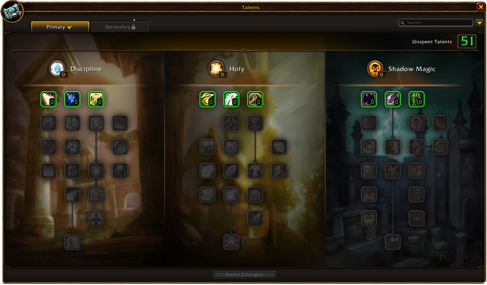

Le Priest monte tranquillement dans WoW Forever : soignez-vous, protégez-vous et laissez les dégâts sur la durée et une baguette faire le travail. Au niveau 30, vous choisissez entre Discipline, Holy et Shadow. Ce guide couvre les trois builds, la rotation, les niveaux clés, les sorts raciaux, les baguettes et les métiers.

| | |
|---|---|
| Spé la plus simple pour monter | Discipline avec une baguette |
| Talents clés | Wand Specialization, Twin Disciplines, Spirit Tap, Penance, Mind Flay |
| Points forts | Soins, boucliers, dégâts réguliers avec peu de pauses |
| Points faibles | Kills lents au début, mana, peu de contrôle |
| Talent par niveau | [Build de leveling du Priest](/fr/leveling/priest/) |
| Builds jusqu'au niveau 60 | Après la sortie le 4 novembre |

## Quelle spé pour monter

Les 20 à 30 premiers niveaux diffèrent à peine. Vous commencez avec <a class="wf-wh wf-spell" href="https://www.wowhead.com/forever/spell=585">Smite</a>, obtenez une baguette dès que possible, puis gardez votre vie avec des soins et des boucliers pendant que la baguette tue. Vers le niveau 30, la route se sépare.

**Discipline** garde ce style tranquille et ajoute Penance au niveau 30, pour des dégâts ou un soin rapide. **Shadow** tue plus vite avec Mind Flay et Mind Blast, mais ne brille qu'à partir du niveau 28 environ, sauf avec une bonne puissance des sorts. **Holy** s'adresse à ceux qui passent une grande partie du leveling à soigner des donjons. Monter seul en Holy est lent.

Les builds ci-dessous sont faits pour la bêta, qui s'arrête au niveau 30. Les builds niveau 60 suivront après la sortie.

## Niveaux 1 à 10

Vous n'avez pas encore de talents. Smite et Lesser Heal sont vos sorts jusqu'à ce que vous ayez une baguette.

1. Attaquez avec Shoot de votre baguette.
2. Lancez Lesser Heal quand votre vie baisse.

Utilisez <a class="wf-wh wf-spell" href="https://www.wowhead.com/forever/spell=17">Power Word: Shield</a> quand vous devez lancer sans interruption, et gardez <a class="wf-wh wf-spell" href="https://www.wowhead.com/forever/spell=589">Shadow Word: Pain</a> quand votre mana le permet.

Stats pour tous les builds à ces niveaux : d'abord Intellect et puissance des sorts, puis Stamina et Spirit, puis armure.

## Build Discipline niveau 30

Le même style à la baguette, avec le moins de pauses possible. [Ouvrir le build dans le calculateur de talents](/fr/talents/priest/?t=024013011305001).

| Talent | Points |
|---|---|
| **Wand Specialization** | 2/2 |
| **Twin Disciplines** | 4/5 |
| **Holy Precision** | 1/3 |
| **Improved Power Word: Shield** | 3/3 |
| **Mental Agility** | 1/3 |
| **Inner Focus** | 1/1 |
| **Meditation** | 3/3 |
| **Mental Strength** | 5/5 |
| **Penance** | 1/1 |

1. Gardez Power Word: Shield quand votre mana le permet, pour que les dégâts ne ralentissent pas vos sorts.
2. Ouvrez avec Smite.
3. Lancez Shadow Word: Pain quand votre mana le permet.
4. Dès le niveau 30 : lancez Penance dès qu'il est prêt, pour des dégâts ou pour vous soigner.
5. Finissez à la baguette, ou laissez Shadow Word: Pain le faire.

## Build Holy niveau 30

Pour ceux qui veulent soigner beaucoup de donjons sans passer Discipline. [Ouvrir le build dans le calculateur de talents](/fr/talents/priest/?t=-2050510303011).

| Talent | Points |
|---|---|
| **<a class="wf-wh wf-spell" href="https://www.wowhead.com/forever/spell=14913">Twilight Focus</a>** | 2/3 |
| **Holy Specialization** | 5/5 |
| **Divine Fury** | 5/5 |
| **Holy Nova** | 1/1 |
| **Inspiration** | 3/3 |
| **Improved Healing** | 3/3 |
| **Binding Heal** | 1/1 |
| **Litany of Light** | 1/2 |

En solo, la rotation est celle de Discipline sans Penance : Power Word: Shield, Smite, Shadow Word: Pain et la baguette.

## Build Shadow niveau 30

Pour ceux qui préfèrent les dégâts, ne veulent pas soigner et ne veulent pas attendre Shadowform au niveau 40. [Ouvrir le build dans le calculateur de talents](/fr/talents/priest/?t=--3050204012013).

| Talent | Points |
|---|---|
| **Shadow Focus** | 3/5 |
| **Spirit Tap** | 5/5 |
| **Improved Shadow Word: Pain** | 2/2 |
| **Improved Mind Blast** | 4/5 |
| **Mind Flay** | 1/1 |
| **Improved Mind Flay** | 2/2 |
| **Vampiric Embrace** | 1/1 |
| **Shadow Weaving** | 3/3 |

1. Dès le niveau 20 : lancez Mind Flay sur la cible jusqu'à ce qu'elle vous atteigne.
2. Gardez Shadow Word: Pain.
3. Lancez Mind Blast dès qu'il est prêt.
4. Dès le niveau 20 : lancez Devouring Plague dès qu'il est prêt et que votre mana le permet ; il vous soigne aussi.
5. Finissez à la baguette, ou laissez vos dégâts sur la durée le faire.

En Shadow, la puissance d'ombre compte avec l'Intellect et la puissance des sorts. Avec des points dans Talented du système Legacy, vous atteignez chaque talent jusqu'à cinq niveaux plus tôt.

## Niveaux clés

| Niveau | Ce que vous obtenez | Auprès de |
|---|---|---|
| 5 | Lesser Magic Wand, métiers apprenti | Enchanting, maîtres de métier |
| 10 | Premier sort racial | Quête de classe |
| 13 | Greater Magic Wand | Enchanting |
| 20 | Deuxième sort racial, Fear Ward, Devouring Plague, Flash Heal, Holy Fire | Quête de classe, maître de classe |
| 20 | Mind Flay, Inner Focus, Holy Nova | Arbre de talents |
| 25 | Vampiric Embrace, Binding Heal | Arbre de talents |
| 30 | Divine Spirit, Prayer of Healing, Mind Control | Maître de classe |
| 30 | Penance, Silence | Arbre de talents |
| 32 | Shadow Word: Death, Abolish Disease | Maître de classe |
| 40 | Greater Heal, monte, Dual Specialization | Maîtres |
| 40 | Shadowform, Power Infusion, Prayer of Mending | Arbre de talents |

Les sorts plus précoces viennent du maître de classe : <a class="wf-wh wf-spell" href="https://www.wowhead.com/forever/spell=1243">Power Word: Fortitude</a> au niveau 1, Shadow Word: Pain au 4, Power Word: Shield au 6, <a class="wf-wh wf-spell" href="https://www.wowhead.com/forever/spell=139">Renew</a> et Fade au 8, Mind Blast et Resurrection au 10, Inner Fire au 12, Psychic Scream et Cure Disease au 14, Heal au 16 et Dispel Magic au 18.

## Sorts raciaux

Chaque Priest reçoit deux sorts raciaux, aux niveaux 10 et 20, via une quête de classe. Dans Forever, ils ont été retravaillés, et les Gnome Priests sont nouveaux. Fear Ward et Devouring Plague ne sont plus raciaux : tous les Priests les apprennent au niveau 20.

| Race | Sorts raciaux |
|---|---|
| **Human** | Divine Grace, Feedback |
| **Dwarf** | Desperate Prayer, Chastise |
| **Night Elf** | Starshards, Elune's Grace |
| **Gnome** | Confounding Flash, Contingency Plan |
| **Undead** | Touch of Weakness, Dark Sacrifice |
| **Troll** | Hex of Weakness, Shadowguard |

Les changements sont détaillés dans le [class deep dive](/fr/news/warriors-keep-rage-through-armor-and-every-priest-gets-fear-ward/).

## Armes et baguettes

Les Priests utilisent dagues, masses à une main, bâtons et baguettes. Les masses et les baguettes viennent avec la classe ; les dagues et les bâtons demandent un maître d'armes.

| Arme | Alliance | Horde |
|---|---|---|
| **Dagues** | Ilyenia Moonfire (Darnassus), Bixi Wobblebonk (Ironforge), Woo Ping (Stormwind) | Sayoc (Orgrimmar), Archibald (Undercity) |
| **Bâtons** | Ilyenia Moonfire (Darnassus), Woo Ping (Stormwind) | Hanashi et Sayoc (Orgrimmar), Ansekhwa (Thunder Bluff) |

Votre arme est en général votre plus grande source de puissance des sorts ou d'ombre, changez-la donc souvent. Au début, la baguette fait l'essentiel des dégâts.

| Baguette | Niveau | Où |
|---|---|---|
| **Lesser Magic Wand** | 5 | Enchanting |
| **Greater Magic Wand** | 13 | Enchanting |
| <a class="wf-wh wf-q3" href="https://www.wowhead.com/forever/item=8071">Sizzle Stick</a> | 15 ou plus | Quête de Wailing Caverns |
| <a class="wf-wh wf-q3" href="https://www.wowhead.com/forever/item=7001">Gravestone Scepter</a> | 18 ou plus | Quête de Blackfathom Deeps |
| <a class="wf-wh wf-q2" href="https://www.wowhead.com/forever/item=5214">Wand of Eventide</a> | 27 | Butin du monde, lié quand équipé |

## Métiers

Monter un métier avec votre Priest donne de l'équipement, des consommables et de l'or, et évite de rattraper plus tard. Dans Forever, c'est encore plus vrai : les coefficients de puissance des sorts ont changé, ce qui rend l'équipement fabriqué plus intéressant, et les camps donnent des buffs à chaque métier.

- **Cooking** aide toutes les classes : la nourriture donne de l'expérience en plus, et il le faut pour un feu de camp.
- **Tailoring** propose un bon équipement de leveling lié que vous ne trouverez pas ailleurs.
- **Enchanting** donne des enchantements, des baguettes sans passer par l'Hôtel des ventes et des huiles de puissance des sorts. Désenchantez votre surplus de Tailoring pour les composants.
- **Fishing** se monte en parallèle et pêche des caisses et des perles pour Tailoring et Enchanting.
- **Alchemy** donne des potions et un buff de régénération de mana.

## Consommables

- **Nourriture et boisson.** La nourriture cuisinée donne de l'expérience en plus, restez donc Well Fed. Emportez de l'eau de votre niveau, car même avec une baguette il faudra boire.
- **Potions.** Des potions de soins pour les urgences, désormais aussi fabriquées avec First Aid, et des potions de mana.
- **Élixirs.** Chers à entretenir, mais utiles contre un monstre ou une quête difficile.
- **Huiles.** Enchanting fabrique des huiles de puissance des sorts ou de mana.

Plus d'infos sur la nourriture, les camps et l'XP reposée dans le [guide de l'expérience](/fr/guides/experience/).

## Dégâts et soins sur la durée

Les sorts sur la durée sont au cœur du Priest. Renew soigne toutes les quelques secondes, Shadow Word: Pain inflige des dégâts toutes les quelques secondes, et Devouring Plague fait de même avec un temps de recharge plus long et vous soigne des dégâts infligés.

Sur la bêta, ces sorts ne sont pas figés au lancement. Leur valeur se met à jour pendant leur durée au lieu de garder celle du moment où vous les lancez. Un buff de puissance des sorts pendant le sort compte tout de suite. Blizzard ne l'a pas annoncé.

## Mana

Le mana compte pour tous les Priests, même si vous tirez surtout à la baguette. Emportez beaucoup d'eau et quelques potions de mana. Spirit aide beaucoup, car il donne de la régénération de mana entre les pulls, et Spirit Tap et Meditation le renforcent encore.

## Soins

Même en Shadow, vous vous soignez et soignez les autres.

- **Heal** est votre soin de base, avec Lesser Heal avant et Greater Heal dès le niveau 40.
- **Penance** soigne par salves en Discipline, ou inflige des dégâts à un ennemi.
- **Power Word: Shield** n'est pas un soin mais un bouclier qui agit comme une seconde barre de vie.

Holy ajoute Prayer of Mending, qui saute sur la cible suivante chaque fois que quelqu'un subit des dégâts, et Binding Heal, qui vous soigne vous et votre cible en même temps.

## Contrôle et utilité

Le contrôle n'est pas le point fort du Priest. Shackle Undead retire un mort-vivant du combat, tant que personne ne lui inflige de dégâts. Psychic Scream fait fuir les ennemis proches, ce qui peut sauver un pull mais aussi attirer plus de monstres.

Power Word: Fortitude augmente la Stamina et va sur chaque membre du groupe, vous compris. Divine Spirit fait de même pour Spirit. Power Infusion, le dernier talent Discipline, donne à un allié beaucoup de puissance des sorts pendant un court moment. Vampiric Embrace soigne votre groupe, pas votre raid, d'une partie de vos dégâts d'ombre.

