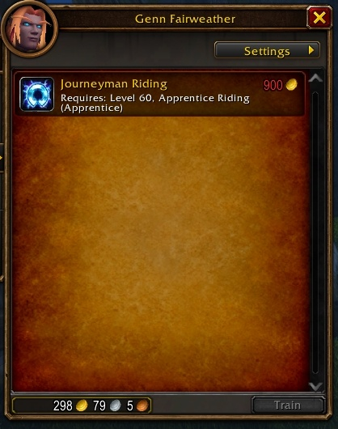

Dans WoW Forever, vous montez à partir du niveau 40. Chaque race a son maître d’équitation et son marchand de montures près de sa capitale, et votre première monture est gratuite. Ce guide montre ce que coûte l’équitation, comment marche la monture gratuite et où se trouve chaque maître.

| | |
|---|---|
| Niveau 40 | <a class="wf-wh wf-spell" href="https://www.wowhead.com/forever/spell=33388">Apprentice Riding</a>, 60 % de vitesse |
| Niveau 60 | <a class="wf-wh wf-spell" href="https://www.wowhead.com/forever/spell=33391">Journeyman Riding</a>, 100 % de vitesse |
| Apprentissage | 100 et 1 000 pièces d’or, 10 % de moins à Honored |
| Première monture | Gratuite, chez le marchand de votre race |
| Vol | Jamais, selon les développeurs |

## Comment marche l’équitation

L’équitation a deux rangs. <a class="wf-wh wf-spell" href="https://www.wowhead.com/forever/spell=33388">Apprentice Riding</a> au niveau 40 permet de monter les montures normales à 60 % de vitesse. <a class="wf-wh wf-spell" href="https://www.wowhead.com/forever/spell=33391">Journeyman Riding</a> au niveau 60 permet de monter les montures rapides à 100 %. Il faut Apprentice avant de pouvoir apprendre Journeyman.

Quand vous apprenez Apprentice Riding, vous apprenez aussi la compétence de monte de votre race, comme <a class="wf-wh wf-spell" href="https://www.wowhead.com/forever/spell=6743">Horse Riding</a> pour les Humans ou <a class="wf-wh wf-spell" href="https://www.wowhead.com/forever/spell=6746">Wolf Riding</a> pour les Orcs. C’est elle que demandent les infobulles des montures. Pour monter la monture d’une autre race, il faut Exalted auprès de cette race et payer 100 pièces d’or pour sa compétence, par exemple <a class="wf-wh wf-spell" href="https://www.wowhead.com/forever/spell=6745">Tiger Riding</a> pour un Human qui veut un sabre de Darnassus.

L’objet de monture vous apprend la monture : elle devient un sort et compte pour chaque personnage du compte, selon les infobulles. Vos montures se trouvent dans la fenêtre des collections (Maj+P). Depuis [le hotfix du 10 novembre](/fr/news/racial-vendor-mounts-become-bind-on-pickup/), les montures raciales des marchands sont Bind-on-Pickup, vous ne pouvez donc plus en acheter une pour un ami d’une autre race.

## Ce que ça coûte

| Compétence | Niveau | Apprentissage | À Honored | Monture |
|---|---|---|---|---|
| <a class="wf-wh wf-spell" href="https://www.wowhead.com/forever/spell=33388">Apprentice Riding</a> | 40 | 100 pièces d’or | 90 pièces d’or | 20 pièces d’or, la première gratuite |
| <a class="wf-wh wf-spell" href="https://www.wowhead.com/forever/spell=33391">Journeyman Riding</a> | 60 | 1 000 pièces d’or | 900 pièces d’or | 200 pièces d’or |

La remise vaut à Honored auprès de la faction de votre race : Stormwind pour les Humans, Orgrimmar pour les Orcs, et ainsi de suite. Les Skyborne [ont reçu la même remise le 19 novembre](/fr/news/skyborne-now-get-10-percent-off-riding-at-honored/).

## Votre première monture gratuite

Au niveau 40, le maître d’équitation de votre race donne Learning to Ride. Apprenez Apprentice Riding et rendez la quête au marchand de montures à côté du maître. Il donne alors une quête pour examiner les montures exposées : cliquez sur celle que vous voulez, revenez, et elle est à vous.

| Race | Quête | Au choix |
|---|---|---|
| Human | <a href="https://www.wowhead.com/forever/quest=97045">Your First Horse</a> | Brown Horse, Chestnut Mare, Pinto Horse |
| Human, chez <a class="wf-wh wf-plain" href="https://www.wowhead.com/forever/npc=1460">Unger Statforth</a> | <a href="https://www.wowhead.com/forever/quest=97171">Your First Horse</a> | les mêmes, plus le Black Stallion |
| Dwarf | <a href="https://www.wowhead.com/forever/quest=97017">Your First Riding Ram</a> | Gray Ram, Brown Ram, White Ram |
| Night Elf | <a href="https://www.wowhead.com/forever/quest=95511">Your First Feline Friend</a> | Striped Frostsaber, Striped Nightsaber, Spotted Frostsaber, Striped Dawnsaber |
| Gnome | <a href="https://www.wowhead.com/forever/quest=97046">Your First Mechanostrider</a> | Red, Blue, Green ou Unpainted Mechanostrider |
| Skyborne | <a href="https://www.wowhead.com/forever/quest=96996">Your First Riding Galestrider</a> | Umber, Stormy ou Empyrean Galestrider |
| Orc | <a href="https://www.wowhead.com/forever/quest=96994">Your First Riding Wolf</a> | Brown, Dire, Timber ou Black Wolf |
| Undead | <a href="https://www.wowhead.com/forever/quest=96997">A Steed in Death as They Were in Life</a> | Red, Brown, Blue ou Black Skeletal Horse |
| Tauren | <a href="https://www.wowhead.com/forever/quest=96982">Your First Riding Kodo</a> | Gray, Brown ou White Kodo |
| Tauren, chez <a class="wf-wh wf-plain" href="https://www.wowhead.com/forever/npc=269152">Tylana Clawhoof</a> | <a href="https://www.wowhead.com/forever/quest=97446">Your First Riding Kodo</a> | les mêmes, plus le Lavender Kodo |
| Troll | <a href="https://www.wowhead.com/forever/quest=96989">Your First Riding Raptor</a> | Emerald, Turquoise ou Violet Raptor |

Les Humans peuvent prendre le Black Stallion gratuitement chez <a class="wf-wh wf-plain" href="https://www.wowhead.com/forever/npc=1460">Unger Statforth</a> à Menethil Harbor, et les Tauren le Lavender Kodo chez <a class="wf-wh wf-plain" href="https://www.wowhead.com/forever/npc=269152">Tylana Clawhoof</a> dans les Stonetalon Mountains. Prenez alors la quête gratuite là-bas plutôt que chez le marchand à côté du maître.

## Maîtres d’équitation et marchands de montures

| Race | Compétence | Maître | Marchand | Où |
|---|---|---|---|---|
| Human | <a class="wf-wh wf-spell" href="https://www.wowhead.com/forever/spell=6743">Horse Riding</a> | <a class="wf-wh wf-plain" href="https://www.wowhead.com/forever/npc=4732">Randal Hunter</a>, /way 84.2 65.0 | <a class="wf-wh wf-plain" href="https://www.wowhead.com/forever/npc=384">Katie Hunter</a>, /way 84.0 65.4 | Eastvale Logging Camp, Elwynn Forest |
| Human | | | <a class="wf-wh wf-plain" href="https://www.wowhead.com/forever/npc=1460">Unger Statforth</a>, /way 8.6 54.6 | Menethil Harbor, Wetlands |
| Dwarf | <a class="wf-wh wf-spell" href="https://www.wowhead.com/forever/spell=6744">Ram Riding</a> | <a class="wf-wh wf-plain" href="https://www.wowhead.com/forever/npc=4772">Ultham Ironhorn</a>, /way 63.8 50.2 | <a class="wf-wh wf-plain" href="https://www.wowhead.com/forever/npc=1261">Veron Amberstill</a>, /way 63.6 50.6 | Amberstill Ranch, Dun Morogh |
| Night Elf | <a class="wf-wh wf-spell" href="https://www.wowhead.com/forever/spell=6745">Tiger Riding</a> | <a class="wf-wh wf-plain" href="https://www.wowhead.com/forever/npc=4753">Jartsam</a>, /way 38.6 16.0 | <a class="wf-wh wf-plain" href="https://www.wowhead.com/forever/npc=4730">Lelanai</a>, /way 38.6 15.6 | Darnassus |
| Gnome | <a class="wf-wh wf-spell" href="https://www.wowhead.com/forever/spell=10908">Mechanostrider Piloting</a> | <a class="wf-wh wf-plain" href="https://www.wowhead.com/forever/npc=7954">Binjy Featherwhistle</a>, /way 49.2 48.0 | <a class="wf-wh wf-plain" href="https://www.wowhead.com/forever/npc=7955">Milli Featherwhistle</a>, /way 49.2 48.0 | Steelgrill's Depot, Dun Morogh |
| Skyborne | <a class="wf-wh wf-spell" href="https://www.wowhead.com/forever/spell=1285853">Galestrider Riding</a> | <a class="wf-wh wf-plain" href="https://www.wowhead.com/forever/npc=265756">Genn Fairweather</a>, /way 53.8 81.2 | le même PNJ | À l’ouest de Valanaar, Zephras Isle |
| Orc | <a class="wf-wh wf-spell" href="https://www.wowhead.com/forever/spell=6746">Wolf Riding</a> | <a class="wf-wh wf-plain" href="https://www.wowhead.com/forever/npc=4752">Kildar</a>, /way 69.2 13.2 | <a class="wf-wh wf-plain" href="https://www.wowhead.com/forever/npc=3362">Ogunaro Wolfrunner</a>, /way 69.4 12.4 | Valley of Honor, Orgrimmar |
| Undead | <a class="wf-wh wf-spell" href="https://www.wowhead.com/forever/spell=10906">Undead Horsemanship</a> | <a class="wf-wh wf-plain" href="https://www.wowhead.com/forever/npc=4773">Velma Warnam</a>, /way 60.0 52.6 | <a class="wf-wh wf-plain" href="https://www.wowhead.com/forever/npc=4731">Zachariah Post</a>, /way 59.8 52.6 | Brill, Tirisfal Glades |
| Tauren | <a class="wf-wh wf-spell" href="https://www.wowhead.com/forever/spell=18996">Kodo Riding</a> | <a class="wf-wh wf-plain" href="https://www.wowhead.com/forever/npc=3690">Kar Stormsinger</a>, /way 46.8 61.8 | <a class="wf-wh wf-plain" href="https://www.wowhead.com/forever/npc=3685">Harb Clawhoof</a>, /way 46.6 62.0 | Bloodhoof Village, Mulgore |
| Tauren | | | <a class="wf-wh wf-plain" href="https://www.wowhead.com/forever/npc=269152">Tylana Clawhoof</a>, /way 46.0 59.8 | Stonetalon Mountains |
| Troll | <a class="wf-wh wf-spell" href="https://www.wowhead.com/forever/spell=10863">Raptor Riding</a> | <a class="wf-wh wf-plain" href="https://www.wowhead.com/forever/npc=7953">Xar'Ti</a>, /way 55.2 75.6 | <a class="wf-wh wf-plain" href="https://www.wowhead.com/forever/npc=7952">Zjolnir</a>, /way 55.2 75.6 | Sen'jin Village, Durotar |

Les Skyborne des deux factions apprennent à monter et achètent leurs Galestriders chez le même PNJ. Chaque monture de chaque marchand, avec le prix et une page par monture, se trouve dans le [guide des montures](/fr/guides/mounts/).

## Paladins et Warlocks

Les Paladins et les Warlocks reçoivent leurs montures par des quêtes de classe aux niveaux 40 et 60, et ces quêtes apprennent aussi la compétence de monte. Depuis [le hotfix du 25 novembre](/fr/news/epic-riding-fixed-for-paladins-and-warlocks/), les quêtes du niveau 60 apprennent aussi Journeyman Riding, ils peuvent donc monter toutes les montures rapides. Les montures de classe sont le [Warhorse](/fr/guides/mounts/warhorse/), le [Charger](/fr/guides/mounts/charger/), le [Felsteed](/fr/guides/mounts/felsteed/) et le [Dreadsteed](/fr/guides/mounts/dreadsteed/).
