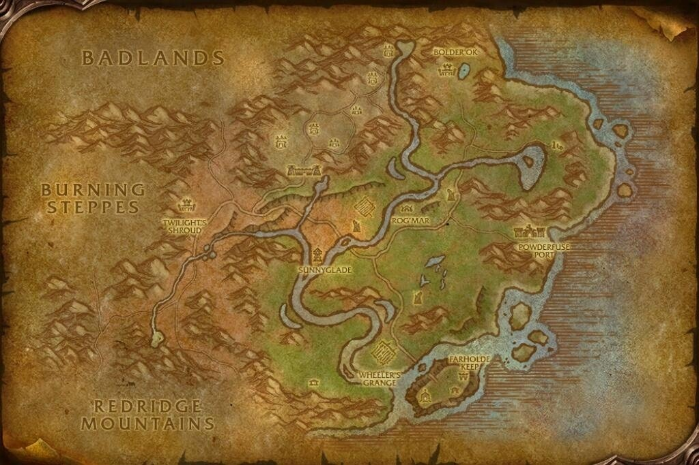
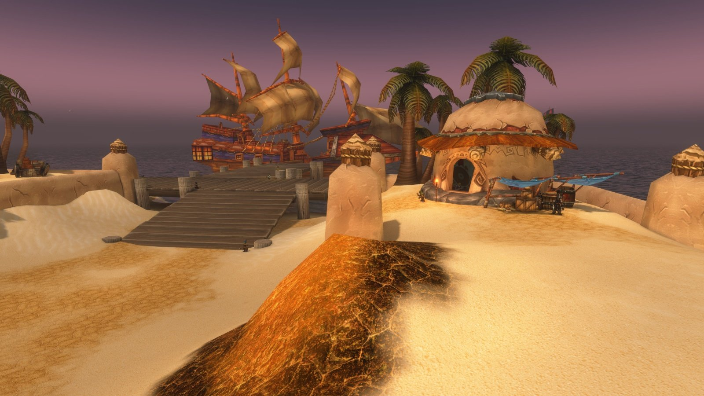
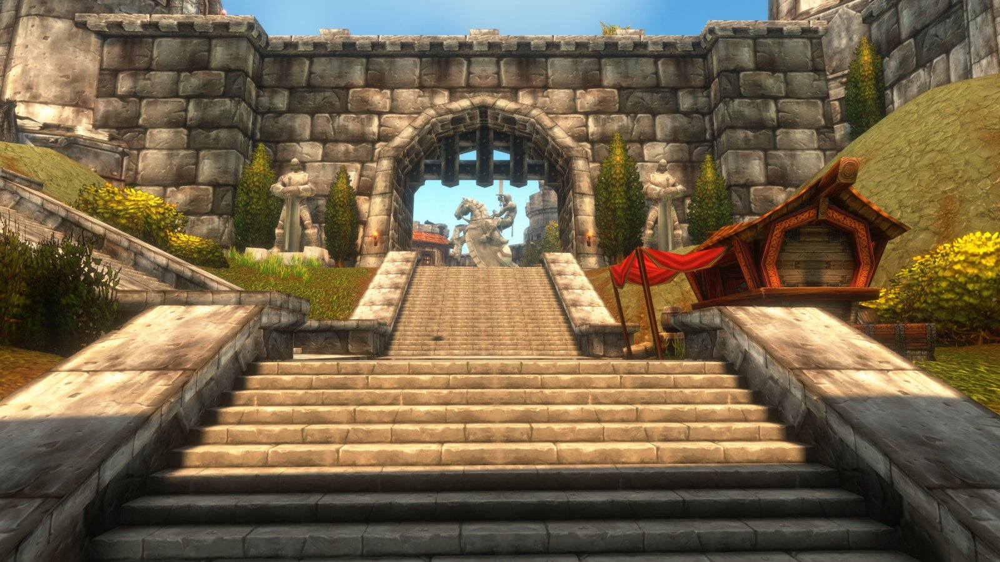
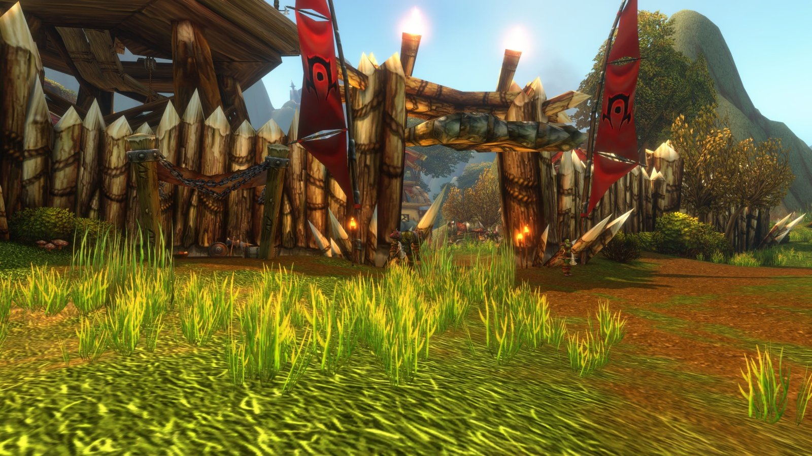
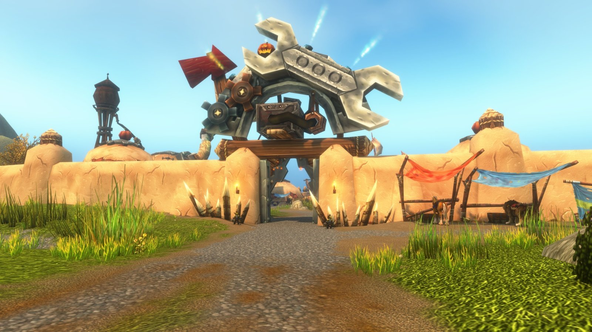
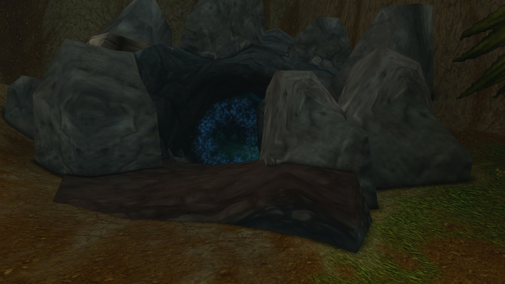

Les Riverglades sont une nouvelle zone de WoW Forever, sur la côte est des Royaumes de l'Est. Rivières, prairies et forteresses en ruine s'étendent entre Redridge Mountains, les Burning Steppes et les Badlands. Beaucoup de joueurs en font la meilleure zone de leveling de Forever. Ce guide montre comment y aller, les villes, les quêtes, le Bloodmaster's Ring et le donjon.

| | |
|---|---|
| Niveaux | Environ 36 à 44, idéal dès 40 |
| Zones voisines | Redridge Mountains, Burning Steppes, Badlands |
| Alliance | Farholde Keep, Brotherhood of the Horse |
| Horde | Rog'mar, Bolder'ok Clan |
| Neutre | Powderfuse Port, une ville gobeline |
| Donjon | [Krol'dok Stronghold](/fr/guides/dungeons/kroldok-stronghold/), niveaux 40 à 45 |

## Y aller

Il y a trois façons d'entrer :

- **Depuis Redridge Mountains**, par la route au nord de la zone. Un embranchement qui menait nulle part dans Classic mène maintenant aux Riverglades. Les joueurs trouvent le début du chemin à l'est de la grotte au nord de la Tower of Ilgalar, vers /way 76.0 35.5 : montez la pente jusqu'à un petit sentier sous la route et suivez-le vers le nord-est.
- **Depuis les Badlands**, par la route au sud de la zone. Pour la Horde, c'est l'entrée la plus simple sans le point de vol.
- **En bateau** depuis Steamwheedle Port à Tanaris, à l'est de Gadgetzan (/way 68.6 23.0). Le bateau accoste à Powderfuse Port (/way 80.6 54.6). Le retour vers Kalimdor se fait de la même façon.

<figure class="wf-embed" data-wf-video="JYy08rjb3K4">
  <button type="button" class="wf-embed__play">
    
    
      How to get to the Riverglades in WoW Forever
      Lancez la vidéo. Nutri sur YouTube, 6 minutes.
    
  </button>
</figure>

## Villes et points de vol

- **Farholde Keep**, au sud, est la ville de l'Alliance et le foyer de la Brotherhood of the Horse, la cavalerie qui a quitté Stormwind. Le maître de vol <a class="wf-wh wf-plain" href="https://www.wowhead.com/forever/npc=257087">Gretchen Mayberry</a> se trouve à /way 60.6 81.4.
- **Rog'mar**, au centre de la zone, est le camp de la Horde. Le maître de vol <a class="wf-wh wf-plain" href="https://www.wowhead.com/forever/npc=255993">Grakna</a> se trouve à /way 59.6 45.2.
- **Powderfuse Port**, sur la côte est, est une ville gobeline neutre avec le bateau pour Tanaris et le [Black Market Auction House](/fr/guides/bmah/). Elle n'a pas de maître de vol.

Les destinations de chaque point de vol sont dans le [guide des trajets aériens](/fr/guides/flight-paths/).

## Quêtes

Les quêtes des Riverglades sont plus linéaires que dans la plupart des zones de Classic. Terminez une série et la suivante apparaît le plus souvent dans la même ville. Les joueurs remarquent aussi peu de concurrence pour les monstres. Toutes les quêtes de la zone valent ensemble environ 4 à 5 niveaux.

L'Alliance travaille pour la Brotherhood of the Horse, la Horde pour le Bolder'ok Clan. Les deux se battent entre elles et contre le Twilight's Hammer. L'histoire de Farholde Keep est dans la nouvelle [Cost of Honor](/fr/news/cost-of-honor-tells-the-past-of-the-riverglades/).

**Une quête cachée pour la Horde.** <a class="wf-wh wf-plain" href="https://www.wowhead.com/forever/npc=257079">Cavalry Scout Alturin</a> chevauche sur la route principale qui sort de Farholde Keep. Tuez-le et il laisse <a href="https://www.wowhead.com/forever/quest=93971">Farholde Scouting Report</a>, une quête sans quête d'introduction que vous rendez à Rog'mar pour 4 850 points d'expérience. L'attaquer vous active pour le PvP.

**Emportez ces objets.** Quelques quêtes demandent des objets que vous pouvez acheter ou fabriquer ailleurs. Vous gagnez un aller-retour en les apportant :

| Objet | Quête | Faction |
|---|---|---|
| 10 <a class="wf-wh wf-q1" href="https://www.wowhead.com/forever/item=769">Chunk of Boar Meat</a> | <a href="https://www.wowhead.com/forever/quest=95162">Paletusk Harvesting</a> | Horde |
| 10 <a class="wf-wh wf-q1" href="https://www.wowhead.com/forever/item=3241">Heavy Weightstone</a> | <a href="https://www.wowhead.com/forever/quest=96026">Step Two: More Rock</a> | Horde |
| 12 <a class="wf-wh wf-q1" href="https://www.wowhead.com/forever/item=3575">Iron Bar</a> et 4 <a class="wf-wh wf-q1" href="https://www.wowhead.com/forever/item=4304">Thick Leather</a> | <a href="https://www.wowhead.com/forever/quest=94974">Key Ingredients</a> | Horde |
| 12 <a class="wf-wh wf-q1" href="https://www.wowhead.com/forever/item=3575">Iron Bar</a> et 4 <a class="wf-wh wf-q1" href="https://www.wowhead.com/forever/item=4304">Thick Leather</a> | <a href="https://www.wowhead.com/forever/quest=94981">Key Ingredients</a> | Alliance |

Key Ingredients fait partie de la série pour la clé de Krol'dok Stronghold, voir plus bas.

**Corrections récentes.** Les correctifs du 13 novembre ont réglé trois choses ici : Jezap Jinglesprocket, l'hôte du Bloodmaster's Ring, propose de nouveau ses quêtes, Gaseous Gold affiche la bonne quantité, et les tas de bois ne se fouillent que pendant leur quête. Trois ennemis [frappent moins fort depuis le 11 novembre](/fr/news/judgement-now-counts-as-a-ranged-attack/).

## Le Bloodmaster's Ring

Le Bloodmaster's Ring est une arène dans le style du Ring of Blood, à /way 65.6 21.4 en territoire ogre. Vous affrontez un par un des bagarreurs Bolder'ok de plus en plus forts. Chaque combat rapporte à peu près autant d'expérience qu'une quête de donjon. Sur un royaume PvP, l'arène peut attirer l'autre faction.

1. <a href="https://www.wowhead.com/forever/quest=94668">Bloodmaster's Ring</a> : présentez-vous à Jezap à l'arène.
2. <a href="https://www.wowhead.com/forever/quest=94669">Pay to Play</a> : payez la caution de 1 pièce d'or pour participer.
3. Combats : <a href="https://www.wowhead.com/forever/quest=94670">Bloodmaster's Ring</a>, <a href="https://www.wowhead.com/forever/quest=94739">Bloodmaster's Ring</a>, <a href="https://www.wowhead.com/forever/quest=94962">Bloodmaster's Ring</a> et <a href="https://www.wowhead.com/forever/quest=94964">Bloodmaster's Ring</a>, contre Mog'thar au niveau 43.
4. Détour, pas encore confirmé : <a href="https://www.wowhead.com/forever/quest=94733">Our Ogre Friend</a>, <a href="https://www.wowhead.com/forever/quest=94734">A Boar's Delight</a> et <a href="https://www.wowhead.com/forever/quest=94737">A Treat for a Friend</a>.
5. Derniers combats : <a href="https://www.wowhead.com/forever/quest=94965">Bloodmaster's Ring</a> et <a href="https://www.wowhead.com/forever/quest=95063">Bloodmaster's Ring</a>.

Après Snufflesnout, vous choisissez 3 <a class="wf-wh wf-q1" href="https://www.wowhead.com/forever/item=3928">Superior Healing Potion</a> ou 2 <a class="wf-wh wf-q1" href="https://www.wowhead.com/forever/item=13443">Superior Mana Potion</a>. Toute la série se termine par le choix d'un anneau parmi trois, de niveau 45 :

| Anneau | Stats |
|---|---|
| <a class="wf-wh wf-q3" href="https://www.wowhead.com/forever/item=275043">Bloodmaster's Ring</a> | 7 Endurance, 6 Intelligence, jusqu'à 9 aux dégâts et soins des sorts |
| <a class="wf-wh wf-q3" href="https://www.wowhead.com/forever/item=275044">Bloodsport Band</a> | 6 Endurance, 5 points de vie toutes les 5 secondes, 22 puissance d'attaque |
| <a class="wf-wh wf-q3" href="https://www.wowhead.com/forever/item=275045">Ogre Horn Ring</a> | 4 Force, 3 Agilité, 10 Endurance, 3 Défense |

Plus sur l'arène dans [le post sur le ring](/fr/news/the-riverglades-get-their-own-ring-of-blood/).

## Krol'dok Stronghold

Le donjon de la zone est une forteresse ogre pour les niveaux 40 à 45, avec six boss. L'entrée est sur les collines au nord de Sunnyglade, au nord-est de Twilight's Shroud, à /way 37.5 37.5. Le gardien des âmes est juste devant.

La plupart des quêtes du donjon ne s'ouvrent qu'après l'histoire de la zone. Côté Alliance, c'est une série d'une dizaine de quêtes à Farholde Keep. L'exception tombe à l'intérieur : <a class="wf-wh wf-plain" href="https://www.wowhead.com/forever/npc=259256">Tunk</a> laisse la Krol'dok Moulding, qui lance la série pour une clé vers un raccourci dans le donjon. Boss, quêtes et butin sont dans le [guide de Krol'dok Stronghold](/fr/guides/dungeons/kroldok-stronghold/).

## Récolte

Les Riverglades ont des herbes et des minerais pour les récolteurs de niveau intermédiaire.

| Herbalism | Mining |
|---|---|
| <a class="wf-wh wf-q1" href="https://www.wowhead.com/forever/item=3821">Goldthorn</a> | <a class="wf-wh wf-q1" href="https://www.wowhead.com/forever/item=2772">Iron Ore</a> |
| <a class="wf-wh wf-q1" href="https://www.wowhead.com/forever/item=3358">Khadgar's Whisker</a> | <a class="wf-wh wf-q2" href="https://www.wowhead.com/forever/item=2775">Silver Ore</a> |
| <a class="wf-wh wf-q1" href="https://www.wowhead.com/forever/item=3356">Kingsblood</a> | <a class="wf-wh wf-q2" href="https://www.wowhead.com/forever/item=2776">Gold Ore</a> |
| <a class="wf-wh wf-q1" href="https://www.wowhead.com/forever/item=3357">Liferoot</a> | |
| <a class="wf-wh wf-q1" href="https://www.wowhead.com/forever/item=3820">Stranglekelp</a> | |
| <a class="wf-wh wf-q1" href="https://www.wowhead.com/forever/item=3355">Wild Steelbloom</a> | |

Les parcours et les niveaux de compétence sont dans les guides [Herbalism](/fr/tradeskills/forever/herbalism/) et [Mining](/fr/tradeskills/forever/mining/).
