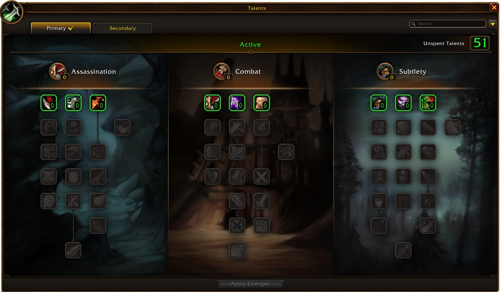

Le Rogue n'a jamais été la classe la plus simple à monter, mais WoW Forever aide. Les Poisons peuvent faire des critiques, les dégâts sur une cible sont plus élevés et chaque spé a sa propre identité. Au niveau 30, vous choisissez entre Assassination, Combat et deux styles de Subtlety. Ce guide couvre les quatre builds, la rotation, les niveaux clés, les quêtes de poisons, les armes et les métiers.

| | |
|---|---|
| Spé la plus simple pour monter | Combat |
| Talents clés | Remorseless Attacks, Deflection, Riposte, Mutilate, Improved Ambush |
| Points forts | Dégâts sur une cible, contrôle, Stealth |
| Points faibles | Peu de vie, dépend de l'équipement, peu d'utilitaire |
| Talent par niveau | [Build de leveling du Rogue](/fr/leveling/rogue/) |
| Builds jusqu'au niveau 60 | Après la sortie le 4 novembre |

## Quelle spé pour monter

**Combat** est le départ le plus tolérant. Deflection et Riposte vous gardent en vie, et vous passez de monstre en monstre sans pause. Grâce à Hack and Slash, Combat peut aussi utiliser tous les types d'armes. **Subtlety avec Ambush** ouvre depuis Stealth avec un énorme coup critique et tue vite, mais elle est plus faible en donjon. **Subtlety avec saignements** repose sur Garrote, Hemorrhage et Rupture. **Assassination** ne devient forte qu'avec Mutilate au niveau 30, ce n'est donc pas un build de départ.

Les builds ci-dessous sont faits pour la bêta, qui s'arrête au niveau 30. Chaque build a une version avec cinq points en plus pour Talented du système Legacy. Le calculateur de talents affiche ces versions au niveau 35, car il compte chaque point comme un niveau. Les builds pour le niveau 60 suivront après la sortie.

## Niveaux 1 à 10

Vous n'avez pas encore de talents, seulement <a class="wf-wh wf-spell" href="https://www.wowhead.com/forever/spell=1752">Sinister Strike</a> et <a class="wf-wh wf-spell" href="https://www.wowhead.com/forever/spell=2098">Eviscerate</a>. Stealth, Backstab et Evasion arrivent vite.

1. Générez des Combo Points avec Sinister Strike.
2. Dépensez-les avec Eviscerate.
3. Avec une dague : ouvrez depuis Stealth avec Backstab pour un kill rapide.
4. Utilisez Evasion contre un monstre dangereux.
5. Utilisez Gouge pour interrompre un sort ou pour vous échapper.

Ouvrir depuis Stealth sur chaque monstre vous ralentit à ces niveaux. Gardez-le pour les monstres forts et marchez simplement vers les autres.

Caractéristiques à ces niveaux : Agility, puis Attack Power, Strength, Stamina et armure.

## Build Assassination niveau 30

Gagne en puissance à mesure que Mutilate approche. Ruthlessness et Relentless Strikes donnent plus de Combo Points et d'Energy, mais il vous manque la survie de Combat et le burst de Subtlety. [Ouvrir le build dans le calculateur de talents](/fr/talents/rogue/?t=02530310101401).

| Talent | Points |
|---|---|
| **Remorseless Attacks** | 2/2 |
| **Malice** | 5/5 |
| **Ruthlessness** | 3/3 |
| **<a class="wf-wh wf-spell" href="https://www.wowhead.com/forever/spell=14165">Improved Slice and Dice</a>** | 3/3 |
| **Relentless Strikes** | 1/1 |
| **Lethality** | 1/5 |
| **Cold Blood** | 1/1 |
| **Improved Poisons** | 4/5 |
| **Mutilate** | 1/1 |

Avec Talented : Lethality 4/5 et Opportunity 2/2 en Subtlety. [Ouvrir la version avec Talented](/fr/talents/rogue/?t=02530310401401--002).

1. Ouvrez depuis Stealth avec Ambush.
2. Générez des Combo Points avec Mutilate.
3. Gardez Slice and Dice actif.
4. Achevez avec Eviscerate.
5. Utilisez Expose Armor avant Eviscerate, et maintenez-le sur un boss.
6. Interrompez avec Kick ou Gouge, et fuyez avec Vanish.
7. Contre un monstre dangereux : Cheap Shot, puis Kidney Shot.
8. Attaquez le monstre suivant avant la fin de Remorseless Attacks.

Caractéristiques à partir d'ici pour chaque build : chance de coup critique, puis Agility, Attack Power, Strength, Stamina et armure.

## Build Combat niveau 30

Défensif et offensif à la fois : plus de dégâts sur Eviscerate et vos attaques automatiques, et Deflection et Riposte contre les pauses. Blade Flurry et Flawless Execution arrivent plus tard. [Ouvrir le build dans le calculateur de talents](/fr/talents/rogue/?t=-3200332110141).

| Talent | Points |
|---|---|
| **Improved Eviscerate** | 3/3 |
| **Improved Sinister Strike** | 2/2 |
| **Deflection** | 3/3 |
| **Precision** | 3/3 |
| **Endurance** | 2/2 |
| **Riposte** | 1/1 |
| **Improved Sprint** | 1/2 |
| **Flawless Execution** | 1/1 |
| **Dual Wield Specialization** | 4/5 |
| **Blade Flurry** | 1/1 |

Avec Talented : Hack and Slash 5/5. [Ouvrir la version avec Talented](/fr/talents/rogue/?t=-32003321101415).

Vous mourez trop souvent parce que votre équipement est faible ? Prenez Lightning Reflexes à la place d'Improved Eviscerate, Improved Sprint et Flawless Execution. Vous comptez alors davantage sur les attaques automatiques et les Poisons que sur les coups de grâce.

1. Ouvrez depuis Stealth avec Cheap Shot, ou approchez simplement et attaquez. Avec des dagues, ouvrez avec Ambush.
2. Utilisez Blade Flurry au début de chaque combat, contre un monstre ou plusieurs.
3. Générez des Combo Points avec Sinister Strike.
4. Gardez Slice and Dice actif.
5. Utilisez Eviscerate à 3 à 5 Combo Points.
6. Utilisez Expose Armor avant Eviscerate, et maintenez-le sur un boss.
7. Interrompez avec Kick ou Gouge, et fuyez avec Vanish.

## Build Subtlety Ambush niveau 30

Tue le plus vite possible avec des Ambush critiques. Vous passez souvent en Stealth et profitez de chaque Remorseless Attacks. La plupart des monstres sont presque morts après l'ouverture. En donjon, le build est plus faible, car Ambush demande Stealth tant que vous n'avez pas Cutthroat, à un niveau plus élevé. [Ouvrir le build dans le calculateur de talents](/fr/talents/rogue/?t=02-02-032320331).

| Talent | Points |
|---|---|
| **Remorseless Attacks** | 2/2 |
| **Improved Sinister Strike** | 2/2 |
| **Master of Deception** | 3/3 |
| **Opportunity** | 2/2 |
| **Setup** | 3/3 |
| **Elusiveness** | 2/2 |
| **Improved Ambush** | 3/3 |
| **Initiative** | 3/3 |
| **Ghostly Strike** | 1/1 |

Avec Talented : Malice 5/5 en Assassination. [Ouvrir la version avec Talented](/fr/talents/rogue/?t=025-02-032320331).

1. Ouvrez depuis Stealth avec Ambush.
2. Générez des Combo Points avec Sinister Strike.
3. Achevez un monstre affaibli avec Eviscerate. Contre un monstre avec beaucoup de vie, utilisez plutôt Slice and Dice.
4. Pour tuer une cible vite : Gouge, Vanish et un autre Ambush.
5. Interrompez avec Kick.
6. Sur un boss de donjon : Slice and Dice et Expose Armor avant Eviscerate.
7. Attaquez le monstre suivant avant la fin de Remorseless Attacks.

## Build Subtlety saignements niveau 30

Repose sur Garrote, Hemorrhage et Rupture, et sur Serrated Blades, qui rend Rupture plus fort. [Ouvrir le build dans le calculateur de talents](/fr/talents/rogue/?t=--0323220310013001).

| Talent | Points |
|---|---|
| **Master of Deception** | 3/3 |
| **Opportunity** | 2/2 |
| **Setup** | 3/3 |
| **Elusiveness** | 2/2 |
| **Dirty Tricks** | 2/2 |
| **Initiative** | 3/3 |
| **Ghostly Strike** | 1/1 |
| **Premeditation** | 1/1 |
| **Serrated Blades** | 3/3 |
| **Hemorrhage** | 1/1 |

Avec Talented : Dirty Deeds 2/2, Preparation 1/1 et Malice 2/5 en Assassination. [Ouvrir la version avec Talented](/fr/talents/rogue/?t=002--0323220310013211).

1. Ouvrez depuis Stealth avec Garrote.
2. Générez des Combo Points avec Hemorrhage.
3. Gardez Slice and Dice actif.
4. Utilisez Rupture à 3 à 5 Combo Points sur un boss ou un monstre avec beaucoup de vie.
5. Achevez un monstre affaibli avec Eviscerate.
6. Sur un boss : Vanish et un nouveau Garrote dès que le premier expire.
7. Interrompez avec Kick.
8. Utilisez Expose Armor sur un boss de donjon si votre groupe compte plusieurs DPS physiques.

Avec des points dans Talented du système Legacy, vous atteignez chaque talent jusqu'à cinq niveaux plus tôt.

## Niveaux clés

| Niveau | Ce que vous obtenez | Auprès de |
|---|---|---|
| 10 | Sap, Slice and Dice, Sprint, Dual Wield | Maître de classe |
| 10 | Remorseless Attacks, Malice, Improved Sinister Strike, Improved Eviscerate, Opportunity, Master of Deception | Arbre de talents |
| 14 | Expose Armor, Garrote | Maître de classe |
| 15 | Ruthlessness, Improved Slice and Dice, Precision, Setup, Improved Ambush | Arbre de talents |
| 16 | Feint, Pick Lock | Maître de classe |
| 18 | Ambush | Maître de classe |
| 20 | Poisons | Quête de classe |
| 20 | Rupture | Maître de classe |
| 20 | Riposte, Ghostly Strike, Lethality, Relentless Strikes | Arbre de talents |
| 22 | Distract, Vanish | Maître de classe |
| 25 | Cold Blood, Flawless Execution, Premeditation | Arbre de talents |
| 26 | Cheap Shot | Maître de classe |
| 30 | Kidney Shot, Disarm Trap | Maître de classe |
| 30 | Mutilate, Blade Flurry, Hemorrhage, Preparation | Arbre de talents |
| 34 | Blind | Maître de classe |
| 35 | Seal Fate, Aggression, Cutthroat, Quietus | Arbre de talents |
| 40 | Safe Fall, monte, Dual Specialization | Maîtres |
| 40 | Venom, Adrenaline Rush, Thousand Cuts | Arbre de talents |

Les techniques plus anciennes viennent du maître de classe : Stealth au 1, Backstab et Pick Pocket au 4, Gouge au 6, Evasion au 8, Kick et Parry au 12.

## Les quêtes de poisons

Au niveau 20, une suite de quêtes de classe vous apprend les Poisons.

| Étape | Alliance | Horde |
|---|---|---|
| 1 | <a href="https://www.wowhead.com/forever/quest=2360">Mathias and the Defias</a> | <a href="https://www.wowhead.com/forever/quest=2460">The Shattered Salute</a> |
| 2 | <a href="https://www.wowhead.com/forever/quest=2359">Klaven's Tower</a> | <a href="https://www.wowhead.com/forever/quest=2458">Deep Cover</a> |
| 3 | <a href="https://www.wowhead.com/forever/quest=2607">The Touch of Zanzil</a> | <a href="https://www.wowhead.com/forever/quest=2478">Mission: Possible But Not Probable</a> |
| 4 | <a href="https://www.wowhead.com/forever/quest=2608">The Touch of Zanzil</a> | <a href="https://www.wowhead.com/forever/quest=2479">Hinott's Assistance</a> |
| 5 | <a href="https://www.wowhead.com/forever/quest=2609">The Touch of Zanzil</a> | <a href="https://www.wowhead.com/forever/quest=2480">Hinott's Assistance</a> |

D'autres quêtes de classe avec des objets en récompense arriveront à la sortie.

## Armes

Les dégâts de l'arme sont la base de presque toutes les techniques du Rogue et de vos attaques automatiques, donc une bonne arme fait la plus grande différence. Assassination et Subtlety préfèrent les dagues. Combat peut utiliser tous les types d'armes avec Hack and Slash : une attaque en plus pour les haches et les épées, du crit pour les dagues et les armes de pugilat, et de la pénétration d'armure pour les masses. Les haches à une main sont nouvelles pour le Rogue dans Forever.

| Arme | Alliance | Horde |
|---|---|---|
| **Dagues, haches à une main, armes de jet** | Connues dès le départ | Connues dès le départ |
| **Épées** | Woo Ping (Stormwind) | Archibald (Undercity) |
| **Masses** | Buliwyf Stonehand (Ironforge) | Ansekhwa (Thunder Bluff) |
| **Armes de pugilat** | Ilyenia Moonfire (Darnassus), Buliwyf Stonehand (Ironforge) | Sayoc (Orgrimmar) |
| **Arcs** | Ilyenia Moonfire (Darnassus) | Hanashi (Orgrimmar) |
| **Arbalètes** | Bixi Wobblebonk (Ironforge), Woo Ping (Stormwind) | Archibald (Undercity) |
| **Armes à feu** | Buliwyf Stonehand (Ironforge) | Ansekhwa (Thunder Bluff) |

Armes qui sortent du lot sur la route du 30 :

| Arme | Type | Niveau |
|---|---|---|
| <a class="wf-wh wf-q3" href="https://www.wowhead.com/forever/item=5192">Thief's Blade</a> | Épée | 17 |
| <a class="wf-wh wf-q3" href="https://www.wowhead.com/forever/item=1937">Buzz Saw</a> | Épée | 18 |
| <a class="wf-wh wf-q3" href="https://www.wowhead.com/forever/item=5191">Cruel Barb</a> | Épée | 19 |
| <a class="wf-wh wf-q3" href="https://www.wowhead.com/forever/item=1482">Shadowfang</a> | Épée, main droite | 19 |
| <a class="wf-wh wf-q3" href="https://www.wowhead.com/forever/item=1935">Assassin's Blade</a> | Dague | 19 |
| <a class="wf-wh wf-q3" href="https://www.wowhead.com/forever/item=7682">Torturing Poker</a> | Dague | 29 |

## Équipement

Le meilleur équipement de leveling vient de Leatherworking et des donjons. Forever a retravaillé beaucoup de recettes en cuir du début, vous fabriquez donc de bonnes pièces dès le départ, comme <a class="wf-wh wf-q3" href="https://www.wowhead.com/forever/item=252425">Dark Leather Boots</a> au niveau 10 et <a class="wf-wh wf-q3" href="https://www.wowhead.com/forever/item=252428">Brawler's Leather Belt</a> au niveau 12. Dans les donjons et leurs quêtes, vous trouvez des pièces comme <a class="wf-wh wf-q3" href="https://www.wowhead.com/forever/item=2041">Tunic of Westfall</a> et <a class="wf-wh wf-q3" href="https://www.wowhead.com/forever/item=273820">Nightskulker Ring</a>.

Cherchez Agility, Attack Power, Strength et Stamina. Un second ensemble avec Spirit vous aide à récupérer plus vite entre les combats. Dans Forever, vous pouvez enregistrer des ensembles d'objets dans la fenêtre du personnage et passer de l'un à l'autre.

## Métiers

Quelques métiers changent beaucoup la vitesse à laquelle vous tuez et votre survie. Montez-les avec votre Rogue pour ne rater aucun bonus. Les camps donnent un buff à chaque métier.

- **Skinning** rapporte bien, car vous tuez beaucoup de bêtes.
- **Leatherworking** est la paire naturelle de Skinning et l'un des meilleurs métiers pour un Rogue, avec beaucoup de recettes nouvelles et retravaillées et un bon équipement plus tard.
- **Herbalism** fournit tout pour Alchemy, mais les herbes seules se vendent peu.
- **Alchemy** donne des potions et des élixirs, et devient plus rentable plus tard.
- **Cooking** est indispensable : la nourriture à buff donne de l'expérience en plus, et il en faut pour un feu de camp.
- **Fishing** va bien avec Cooking et pêche des caisses et des coffres.
- **First Aid** vous sauve d'un mauvais pas et fabrique maintenant aussi des potions de soins.

## Consommables

- **Nourriture.** Les Rogues utilisent l'Energy, ils n'ont donc pas besoin d'eau, mais ils mangent beaucoup. Restez Well Fed pour l'expérience en plus, de préférence avec de la nourriture pour Attack Power, Agility ou Stamina. Prenez aussi de la nourriture de marchand, pour ne manger la nourriture à buff que quand Well Fed expire.
- **Potions.** Des potions de soins trouvées dans des coffres, sur des monstres ou fabriquées avec First Aid. Les remèdes de First Aid contre les maladies et les saignements valent le coup, car un Rogue ne peut pas les retirer autrement.
- **Élixirs.** Des élixirs de bataille comme <a class="wf-wh wf-q1" href="https://www.wowhead.com/forever/item=8949">Elixir of Agility</a>, <a class="wf-wh wf-q1" href="https://www.wowhead.com/forever/item=246948">Distilled Firewater</a>, <a class="wf-wh wf-q1" href="https://www.wowhead.com/forever/item=250349">Elixir of Strength</a>, <a class="wf-wh wf-q1" href="https://www.wowhead.com/forever/item=250350">Elixir of Ferocity</a> et <a class="wf-wh wf-q1" href="https://www.wowhead.com/forever/item=250351">Elixir of the Grizzly</a>. Des élixirs du gardien comme <a class="wf-wh wf-q1" href="https://www.wowhead.com/forever/item=5997">Elixir of Minor Defense</a> et <a class="wf-wh wf-q1" href="https://www.wowhead.com/forever/item=3826">Troll's Blood Elixir</a>.
- **Potions de protection.** <a class="wf-wh wf-q1" href="https://www.wowhead.com/forever/item=6052">Nature Protection Potion</a> et <a class="wf-wh wf-q1" href="https://www.wowhead.com/forever/item=6051">Holy Protection Potion</a> vous aident à vaincre seul un monstre difficile ou un boss. <a class="wf-wh wf-q1" href="https://www.wowhead.com/forever/item=250938">Minor Frenzy Potion</a> donne plus de dégâts pendant un combat.
- **<a class="wf-wh wf-q1" href="https://www.wowhead.com/forever/item=7676">Thistle Tea</a>.** Une boisson de Rogue qui rend beaucoup d'Energy d'un coup, pour le burst ou pour fuir.

## Poisons et Sharpening Stones

Les Poisons sont la marque du Rogue. Instant Poison et Deadly Poison infligent des dégâts, Crippling Poison et Mind-numbing Poison ralentissent une cible, et Wound Poison réduit les soins. Dans Forever, ils ont plus de charges, peuvent faire des critiques et restent sur l'arme à côté d'une Sharpening Stone comme <a class="wf-wh wf-q1" href="https://www.wowhead.com/forever/item=2862">Rough Sharpening Stone</a> ou <a class="wf-wh wf-q1" href="https://www.wowhead.com/forever/item=2863">Coarse Sharpening Stone</a>. Selon la source, les deux se cumulent aussi avec Windfury Totem.

Vous fabriquez les Poisons avec des composants comme <a class="wf-wh wf-q1" href="https://www.wowhead.com/forever/item=5173">Deathweed</a>, <a class="wf-wh wf-q1" href="https://www.wowhead.com/forever/item=2930">Essence of Pain</a>, <a class="wf-wh wf-q1" href="https://www.wowhead.com/forever/item=8924">Dust of Deterioration</a> et <a class="wf-wh wf-q1" href="https://www.wowhead.com/forever/item=8923">Essence of Agony</a>. Vanish demande <a class="wf-wh wf-q1" href="https://www.wowhead.com/forever/item=5140">Flash Powder</a> et Blind demande <a class="wf-wh wf-q1" href="https://www.wowhead.com/forever/item=5530">Blinding Powder</a>.

## Energy et Combo Points

L'Energy est votre ressource pour presque toutes les techniques, Stealth compris. Il y a trois sortes de techniques : utilitaire et contrôle, techniques qui génèrent des Combo Points, et coups de grâce qui les dépensent. Les Combo Points restent sur une cible. Si vous en générez sur un autre monstre, les anciens disparaissent. Dépensez-les donc avant de changer de cible. Kick et Blind n'y touchent pas.

## Stealth et ouvertures

Stealth vous rend invisible, au prix de la vitesse. Votre barre d'action passe aux ouvertures. Cheap Shot, Garrote et Ambush donnent des Combo Points, Pick Pocket, Distract et Sap non. Dans Forever, Sap ne rompt plus Stealth, vous pouvez donc retirer un monstre de plus d'un pull. Plus de détails dans le [class deep dive](/fr/news/rogues-get-mutilate-and-axes-warlocks-get-banes/).

## Contrôle et temps de recharge

Le contrôle compense le peu d'utilitaire. Cheap Shot et Kidney Shot étourdissent, Blind désoriente, Sap et Gouge neutralisent. Utilisez un étourdissement pendant que vous continuez à attaquer. Blind, Sap et Gouge durent plus longtemps mais se rompent aux dégâts, utilisez-les donc pour sortir un monstre du combat.

Chaque spé a ses propres temps de recharge. Assassination a Cold Blood pour un coup critique assuré. Combat a Blade Flurry pour la vitesse et une seconde cible, et Adrenaline Rush pour l'Energy. Subtlety a Preparation, qui termine le temps de recharge de vos autres techniques, et Premeditation pour des Combo Points avant le combat. Tout Rogue a Evasion, Sprint et Vanish pour survivre ou s'échapper. Distract et Pick Lock sont votre utilitaire ; avec Pick Lock, vous ouvrez des raccourcis dans certains donjons.

Plus d'infos sur la nourriture, les camps et l'expérience reposée dans le [guide de l'expérience](/fr/guides/experience/).
